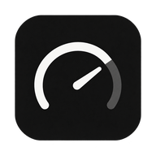
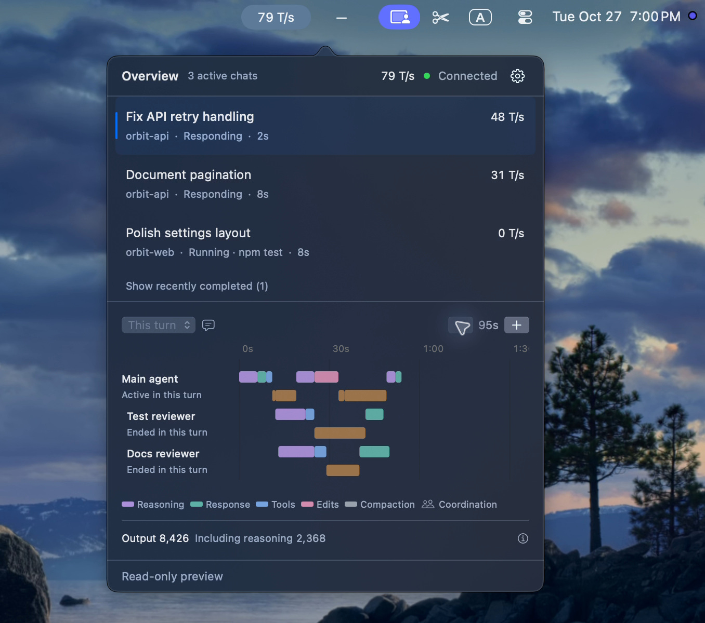
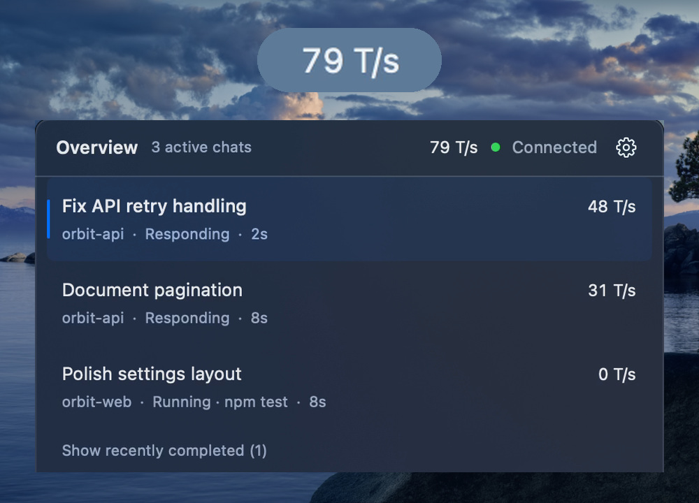
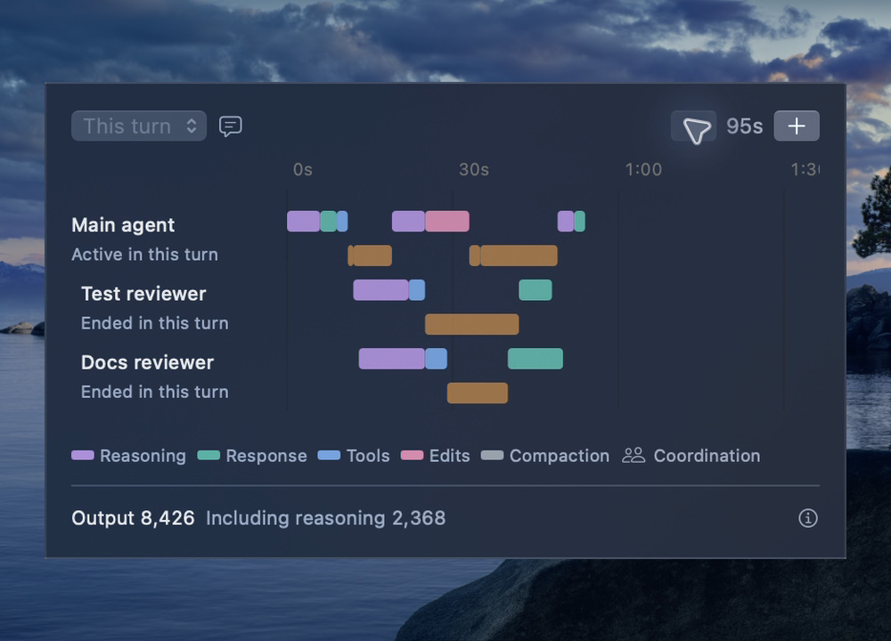
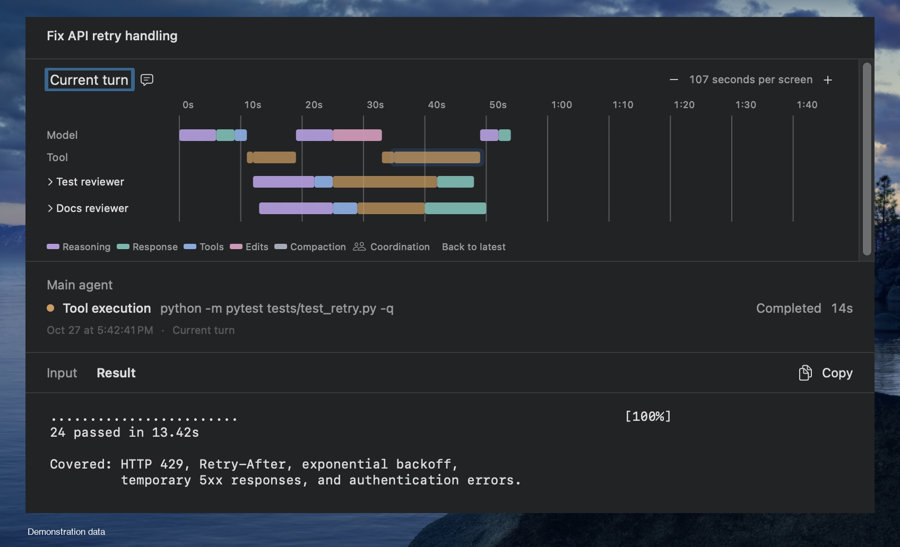

<p align="right"><strong>English</strong> · <a href="README.zh-CN.md">简体中文</a></p>

<div align="center">
  
  <h1>Codex Activity Monitor</h1>
  <p>A macOS menu bar monitor for Codex Desktop with token output rates, session statistics, and agent execution trajectories, similar to DeepSeek Harness’s statistics and trajectory views.</p>
  <p>
    <a href="https://github.com/LiuHanzhang/codex-activity-monitor/releases#release-v0.1.0-alpha.3"></a>
    
    <a href="LICENSE"></a>
  </p>
</div>

> [!IMPORTANT]
> The app is still in early testing, and Developer ID signing and Apple notarization are not in place yet. If macOS blocks the app on first launch, you’ll need to allow it manually in **System Settings → Privacy & Security → Open Anyway**. See [Installation](#installation) for the steps.

<a id="see-it-in-action"></a>
<p align="center">
  <a href="docs/assets/showcase/desktop-overview.jpg"></a>
</p>
<p align="center"><sub>Chat overview and main-agent/subagent timeline.</sub></p>
<p align="center"><a href="#installation">Installation</a> · <a href="#first-launch">First launch</a> · <a href="#build-from-source">Build from source</a> · <a href="docs/user-guide.md">User guide</a></p>

## Features

<table>
  <tr>
    <td width="435" align="center"><a href="docs/assets/showcase/speed-overview.jpg"></a></td>
    <td width="435" align="center"><a href="docs/assets/showcase/timeline.jpg"></a></td>
  </tr>
  <tr>
    <td width="435" valign="top"><b>Real-time token speed</b><br>See the aggregate rate in the menu bar and each chat's speed, current activity, and elapsed time in the overview.</td>
    <td width="435" valign="top"><b>Agent activity timeline</b><br>Compare model activity and tool calls across the main agent and explicitly linked subagents. Zoom, scroll back, and return to the latest activity.</td>
  </tr>
</table>

### Activity details

Click a timeline block to open the activity viewer. Read the available user input, visible model output, tool arguments, results, or file changes, with explicit labels for partial, truncated, and unavailable content.

<p align="center"><a href="docs/assets/showcase/activity-detail.jpg"></a></p>

## Installation

Go to [GitHub Releases](https://github.com/LiuHanzhang/codex-activity-monitor/releases) and download the Apple Silicon ZIP named `Codex-Activity-Monitor-<version>-macos-arm64.zip` from the latest release's **Assets**. This is an early prerelease with ad-hoc signing and no Apple notarization; follow the opening instructions below. You can also [build from source](#build-from-source).

### Runtime requirements

| Requirement | Current scope |
| --- | --- |
| Mac | Apple Silicon Mac, macOS 14+. Runtime validation on macOS 14 remains pending. |
| Codex | Local Codex Desktop; see the installation and data locations below. |

The standalone app includes its runtime and required resources.

### Where Codex is installed

The current version uses the Codex components included in `ChatGPT.app`. Make sure `ChatGPT.app` is in your Mac's Applications folder, at `/Applications/ChatGPT.app`. Monitor automatically finds the components it needs inside that app.

If you use another installation method, rename the app, or install it elsewhere, Monitor currently has no option in its interface to select another location. See [the user guide](docs/user-guide.md#codex-is-installed-somewhere-else) for details.

### Local data locations

Codex chat history is stored in `~/.codex/` by default (`~` means your user home directory). Monitor reads that history without modifying it to display activity details and reconcile the timeline. If you use a custom Codex data directory, see [the user guide](docs/user-guide.md#local-data).

Monitor's own settings, integration configuration backups, and timeline data are stored in `~/Library/Application Support/CodexActivityMonitor/`.

### Install the app

Once you have a ZIP package:

1. Extract the ZIP to get `Codex Activity Monitor.app`.
2. Move the app to your Applications folder (`/Applications`).
3. Double-click the app. If macOS blocks it, follow the steps below to allow it to open.

### Allow the app to open

The current Alpha build **has no Developer ID signature and has not been notarized by Apple**. When you first open a downloaded copy, macOS may report that it cannot verify the developer or check the app for malicious software.

After confirming that the app came from this project, try opening it. If macOS blocks it:

1. Open **System Settings → Privacy & Security**.
2. Scroll down and click **Open Anyway** next to the message about Codex Activity Monitor being blocked.
3. Authenticate if prompted, then click **Open** in the confirmation dialog.

See [Apple's instructions](https://support.apple.com/en-us/102445) for details.

### Upgrade an existing installation

1. Finish active Codex tasks, then fully quit both Codex Desktop and Monitor.
2. Extract the new release and replace the app in `/Applications`.
3. Open Monitor and let integration configuration finish, then open Codex Desktop.

The Monitor UI, collector, and Desktop-owned bridge are separate processes. Quitting Monitor leaves the existing Codex connection's bridge running; replacing the app does not reload that process. The new Monitor can be running while an older, protocol-compatible bridge continues to provide data. Changes to the bridge implementation or app location require a full Codex restart to complete the switch. Reopening the same Monitor build does not require restarting Codex. See [updates and moving the app](docs/user-guide.md#updates-or-moving-the-app-have-not-taken-effect).

## First launch

1. Let active Codex tasks finish.
2. Open Codex Activity Monitor. It automatically configures the local integration and starts its collector on first launch.
3. Fully quit and reopen Codex Desktop so new processes inherit the integration configuration.
4. Start a local Codex task, then click the monitor's menu bar item. Select a chat to see its current turn, timeline, and usage.

Keep Monitor running while observing. The gear button opens a separate Settings window (also **Command-,**). Without a saved language choice, the app uses Simplified Chinese when the primary system language is Chinese, including Traditional Chinese variants, and English for every other language. In **General**, switch between **English / 简体中文**; a manual choice is saved and takes precedence. You can also change **Launch at login**. Initial configuration enables launch at login; macOS may ask you to allow the login item. Original conversation and tool content keep their own language.

**Runtime Status** shows detected component problems and recovery; **Logs** provides local diagnostic records with search, filters, details, and copy. Closing Settings keeps observation running. These checks cannot rule out every software error.

**About** shows the full version, build number, project links, and licenses. Sparkle checks the static update feed daily by default. A newer version appears in the overview and About; choose **View Update** to open its update window and continue to the release page for a manual download. Disable automatic checks or check manually in About. Update checks do not upload chats, logs, or usage records.

## Privacy and compatibility

- Processing is local; Monitor does not upload conversations. This does not change Codex Desktop's own network behavior.
- Local state can contain chat titles, project paths, command previews, and metrics. Transient text is used for local tokenization and selected live details.
- Observation covers connected local chats. Remote sessions and chats outside the configured backend are outside this quick start.
- Integration relies on version-specific Codex protocol and TRACE behavior. Upstream updates can affect observation.

## Configure, disconnect, or uninstall

**Restore configuration before deleting the app.** Deleting only the `.app` leaves integration configuration and local data behind.

| Action | Steps |
| --- | --- |
| Enable or repair integration | Turn on **Settings → General → Codex**. Follow its configuration, connection, or restart message. For changed configuration, use **Reconfigure Integration** when offered. |
| Pause observation | Quit Monitor. Integration stays configured; reopen Monitor to resume. |
| Disconnect, keeping the app | Turn off **Settings → General → Codex**. Original configuration is restored; preferences and diagnostic logs remain. Reopening Monitor keeps integration disabled. |
| Uninstall | In **Settings → General → Maintenance**, choose **Remove local data and quit to uninstall** and confirm. Finish tasks, fully quit Codex, and wait for cleanup and Monitor to exit. Then delete the `.app`. |

Restoration preserves configuration values you changed after integration and does not forcibly end tasks. Leave Monitor open until cleanup finishes; reopen it to continue if interrupted. Codex-owned conversations, source checkouts, and development virtual environments are outside the uninstall cleanup scope. See [the full uninstall guide](docs/user-guide.md#uninstall).

## Build from source

These steps are for developers and run from the repository root. Use Python 3.11+ and Xcode 26+ with its Swift toolchain; the build machine's macOS must support the selected Xcode. Installing dependencies and downloading tokenizer assets for the first time require network access.

### Run from source

```sh
python3 -m venv .local/venv
.local/venv/bin/python -m pip install -e .
bin/build-gui
bin/run-gui
```

The output is `.local/gui/Codex Activity Monitor.app`. Keep the checkout and `.local/venv` in place: this build depends on both. See [CONTRIBUTING.md](CONTRIBUTING.md) for development tests and the read-only Preview build.

### Build a standalone app

This build currently supports Apple Silicon Macs only. Prepare the isolated packaging environment before your first build:

```sh
bin/prepare-standalone
bin/build-standalone
```

The output is `.local/standalone/Codex Activity Monitor.app` and a ZIP package in the same directory. The app includes Python, dependencies, and tokenizer assets; running it does not require the checkout, Python, or Xcode. For daily use, move the app to `/Applications`, then follow the [first-launch steps](#first-launch) above to connect it.

The current build is ad-hoc signed and not notarized. See the [packaging guide](packaging/README.md) for the build environment, isolation checks, and compatibility validation boundaries.

## How it works

A wrapper launches the original Codex `app-server`, forwards its stdio protocol, and observes lifecycle events plus selected streaming TRACE deltas. A local collector associates chats, turns, and activities, counts received tokens, and publishes state to the native Swift app.

Codex retains ownership of conversation history. Monitor reads it for persisted content and reconciliation; its own SQLite sidecar stores phase metadata. See [Architecture](docs/architecture.md) for the data flow, measurement boundaries, and integration changes.

## Troubleshooting and contributing

**No chats or no data?** With Monitor configured and running, finish active tasks, fully quit and reopen Codex Desktop, then start a new local task. Check the connection indicator. See [Troubleshooting](docs/user-guide.md#troubleshooting) for other cases.

For bug reports, include your macOS version, Codex version, Monitor build, and reproducible steps. Remove private conversation content, credentials, and configuration backups before sharing logs or screenshots. See [CONTRIBUTING.md](CONTRIBUTING.md) to build, test, and contribute.

## License

Copyright (c) 2026 Hanzhang Liu. Licensed under the [MIT License](LICENSE). Third-party dependencies and externally sourced materials retain their own licenses and copyright notices.
