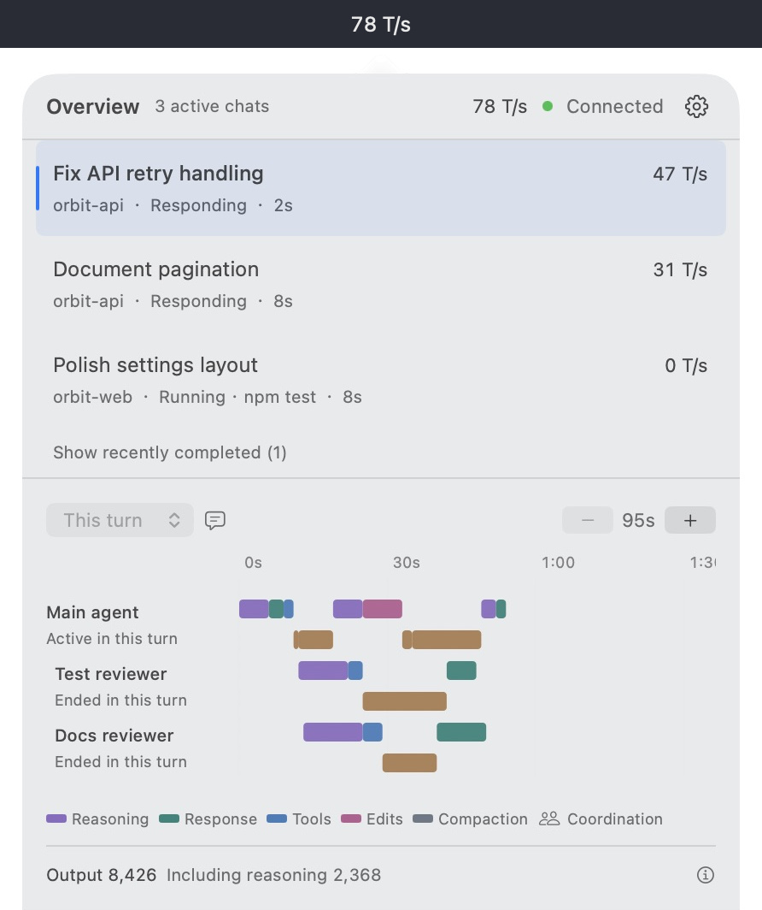
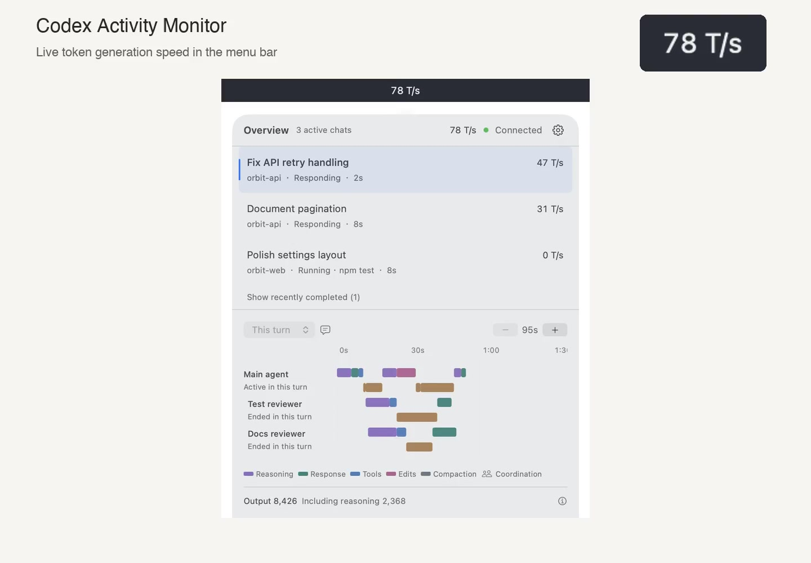
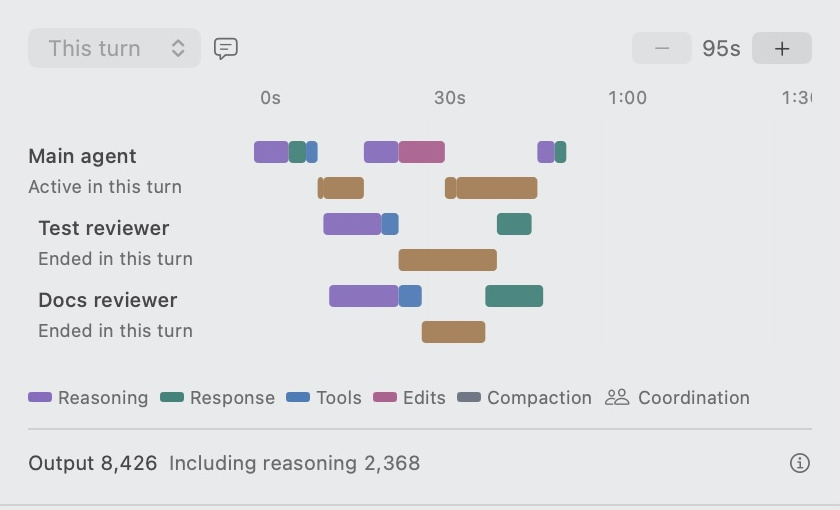
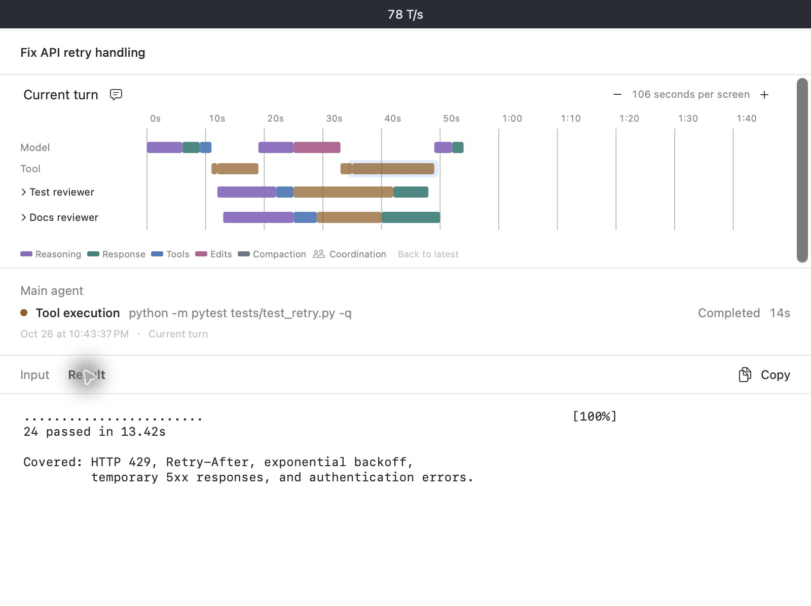
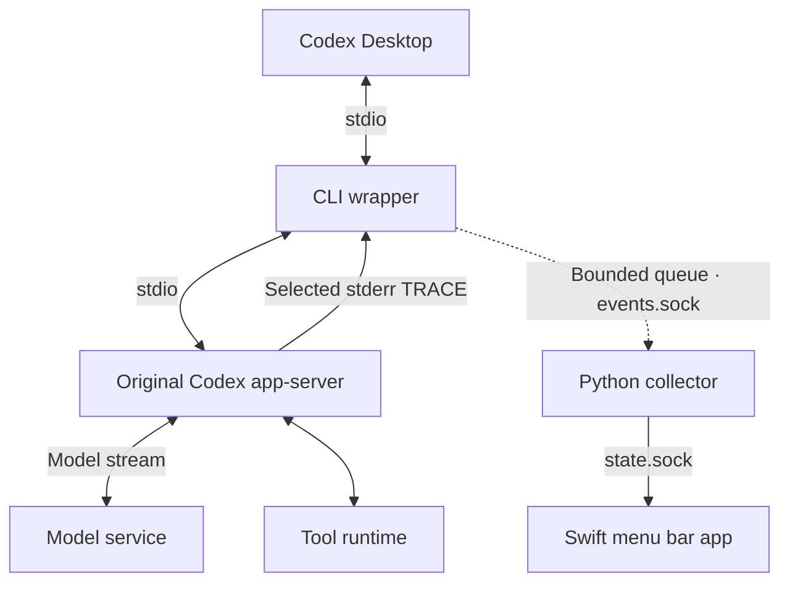
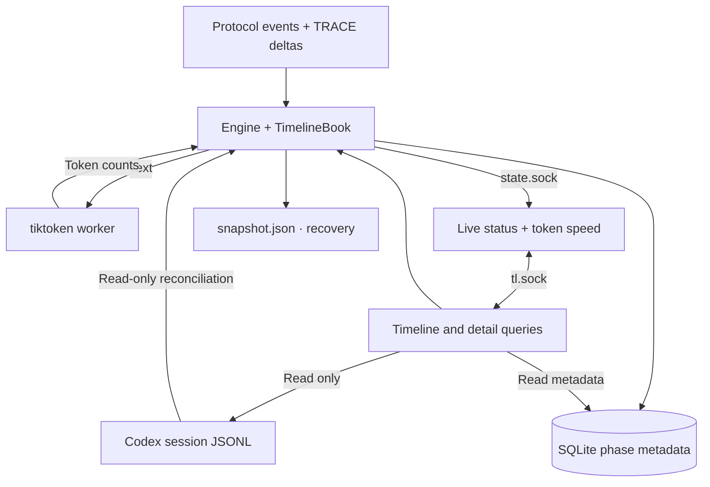

# Codex Activity Monitor

[简体中文](README.zh-CN.md) · [User guide](docs/user-guide.md) · [Architecture](docs/architecture.md) · [Contributing](CONTRIBUTING.md)

**See Codex’s live token generation speed in your macOS menu bar.** Track chats, tool calls, and subagents in one place, and explore each turn on an activity timeline.



**Development version · macOS 14+ target · MIT.** No Developer ID-signed, notarized public release is available yet. The standalone development build targets Apple Silicon. The macOS 14 deployment target is checked at build time; runtime validation on macOS 14 remains pending.

## Features

- **Live token generation speed:** see tokens per second directly in the menu bar and for each active chat.
- **Chat overview:** follow current activity, elapsed time, and recently completed tasks.
- **Activity timeline:** separate model and tool lanes, with explicitly linked subagents on a shared time axis.
- **Explore a turn:** zoom between 30 / 60 / 120-second reference scales, scroll back, and return to the latest activity.
- **Inspect the details:** open user input, visible model output, tool arguments, results, and file changes in a separate activity viewer.
- **Understand usage:** see Codex-reported Output and Reasoning token counts for the selected turn. Output already includes Reasoning.
- **Use your language:** English and Simplified Chinese, with an optional launch-at-login setting.

Token generation speed (T/s) is calculated from text and tool input received in the latest one-second window; hidden reasoning is excluded. `—` means unavailable; a known zero appears as `0`.

## See it in action

[](docs/assets/demo.mp4)

[Watch or download the demo (MP4)](docs/assets/demo.mp4) · [Animated walkthrough (GIF)](docs/assets/demo.gif)

Watch token generation speed update in the menu bar, then select a chat, explore its timeline, and inspect a tool’s input and result.

<details>
<summary>More screenshots: subagent timeline and activity details</summary>

**Main agent and two reviewers, on the same clock**



**Read a tool's arguments and result**



</details>

## Install or build

The app targets **macOS 14 or later** and requires a local Codex Desktop installation. The default integration expects its original CLI at:

```text
/Applications/ChatGPT.app/Contents/Resources/codex-cli/CodexCLI.app/Contents/MacOS/codex
```

The GUI currently has no CLI-path picker. A non-default Codex installation needs a custom setup and is outside the quick start below.

### Build a standalone app

Use an **Apple Silicon Mac**, **Xcode 26+ with its Swift toolchain**, and **Python 3.11+** to bootstrap the build. The build machine must run a macOS version supported by the selected Xcode. From a checkout of this repository:

```sh
bin/prepare-standalone
bin/build-standalone
```

The resulting app includes Python, its dependencies, and tokenizer assets. It can run without the checkout, a separate Python installation, or Xcode. The build also produces `.local/standalone/Codex-Activity-Monitor-0.1.0-arm64-dev.zip`.

For daily use, move the app to `/Applications` before opening it so later builds do not replace the copy you use. You can also run it directly from the build directory:

```sh
open '.local/standalone/Codex Activity Monitor.app'
```

For the same macOS user, both locations default to the same settings and data under `~/Library/Application Support/CodexActivityMonitor/`, shared with the daily source-built GUI. Moving the app requires no data migration. To move an already configured app, finish tasks and quit Codex and Monitor first; then open Monitor from its new location before reopening Codex.

The current build is ad-hoc signed and is **not notarized**; Gatekeeper may require manual approval when it is transferred to another Mac. See the [packaging guide](packaging/README.md) for build details and validation boundaries.

### Run from source

For local development, use Python 3.11+ and Xcode 26+ with its Swift toolchain on a macOS version supported by that Xcode:

```sh
python3 -m venv .local/venv
.local/venv/bin/python -m pip install -e .
bin/build-gui
bin/run-gui
```

This app depends on the checkout and `.local/venv`; keep them in place. Dependency installation and the first tokenizer-asset download require network access.

## First launch

1. Let active Codex tasks finish.
2. Open Codex Activity Monitor. On first launch it automatically configures the local integration and starts its collector.
3. Fully quit and reopen Codex Desktop so its new processes inherit the configuration.
4. Start a task in Codex, then click the monitor's menu bar item. Its connection indicator and chat list show the observed activity.

Keep the monitor open while observing. Launch at login is enabled on initial configuration; you can change it in **Settings → Launch at login**. macOS may ask you to allow the login item.

## Usage

- **Open the overview:** click the menu bar item. Select a chat to see its current turn, timeline, and usage.
- **Read the request:** click the speech-bubble button beside the turn selector.
- **Explore time:** use `−` / `+` to change the reference scale. Scroll horizontally to inspect earlier activity; **Back to latest** resumes following.
- **Inspect an activity:** click a timeline block to open the activity viewer. Select its tabs to read arguments, output, or other available source content.
- **Switch language:** open the gear menu, then **Language → English / 简体中文**. Conversation and tool content keep their original language.

Some reasoning activities have no visible summary. Empty reasoning content is normal; the app does not expose hidden reasoning. Partial observations and unavailable or truncated content are labeled explicitly.

For menu bar states, data locations, and troubleshooting, see the [user guide](docs/user-guide.md).

## Configure, disconnect, or uninstall

These actions have different effects:

| Action | Steps | Result |
| --- | --- | --- |
| Enable or repair integration | **Settings → Configure**; reopen Codex after active work finishes | Enables observation and retains the original configuration backup |
| Pause observation | **Settings → Quit Codex Activity Monitor** | Stops observation; keeps integration configured. Reopen the monitor to resume |
| Disconnect, keeping the app | **Settings → Restore configuration… → Restore configuration**, leaving the cleanup option unchecked | Restores the previous configuration and keeps app settings. Future launches stay disconnected until you choose **Configure** |
| Uninstall | **Settings → Restore configuration…**, check **Remove local data and quit to uninstall**, then restore | Restores configuration, waits for Codex to exit, removes owned local data and the login item, then quits. Delete the `.app` afterward |

Restoration preserves configuration values you changed after integration. Existing Codex processes keep their inherited environment until they exit; the monitor waits for safe cleanup rather than forcibly ending tasks. Leave it open until cleanup completes. If interrupted, reopen it to continue.

**Restore before deleting the app.** Dragging the app to Trash alone leaves configuration and local data behind. Uninstalling a source build does not delete your checkout or development virtual environment. Codex-owned conversations are outside the monitor's cleanup scope.

## How it works

The wrapper launches the original Codex `app-server` and forwards its stdio protocol. It observes both protocol lifecycle events and selected stderr TRACE logs, which expose streaming text and tool-input deltas.



The collector associates events with chats, turns, and activities. A local tokenizer counts the text to calculate token generation speed. Live state reaches the GUI through `state.sock`; timeline and activity details use separate read-only queries through `tl.sock`.



Codex keeps ownership of its conversation history. Monitor reads that history for persisted content and reconciliation; its own SQLite sidecar stores phase metadata, and `snapshot.json` provides a recovery checkpoint. See [Architecture](docs/architecture.md) for the component boundaries and configuration changes.

## Privacy and compatibility

- Processing is local. Codex Activity Monitor does not upload conversations. This does not change Codex Desktop's own network behavior.
- Local state can contain chat titles, project paths, command previews, and numeric metrics. Transient text is used for tokenization and selected live details.
- Observation covers connected local chats. Remote sessions and chats outside the configured local backend are not supported by this quick start.
- The integration depends on version-specific Codex protocol and trace behavior. Upstream updates can affect observation.

## Troubleshooting and contributing

**No chats or no data?** Finish active tasks, fully quit Codex Desktop, reopen it while the monitor is running, and start a new task. Check the connection indicator. More cases are covered in [Troubleshooting](docs/user-guide.md#troubleshooting).

For bugs, include your macOS version, Codex version, monitor build, and reproducible steps. Remove private conversation content, credentials, and configuration backups before sharing logs or screenshots.

See [CONTRIBUTING.md](CONTRIBUTING.md) to build, test, and contribute changes.

## License

Copyright (c) 2026 Hanzhang Liu. Licensed under the [MIT License](LICENSE). Third-party dependencies and externally sourced materials retain their own licenses and copyright notices.
