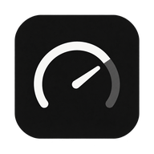
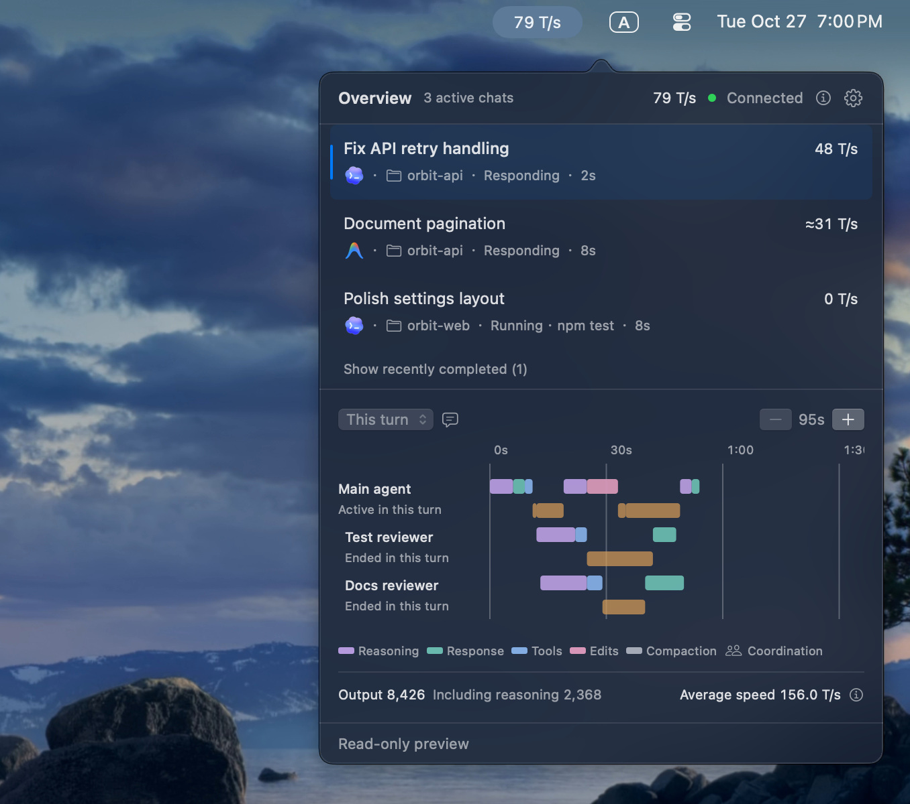
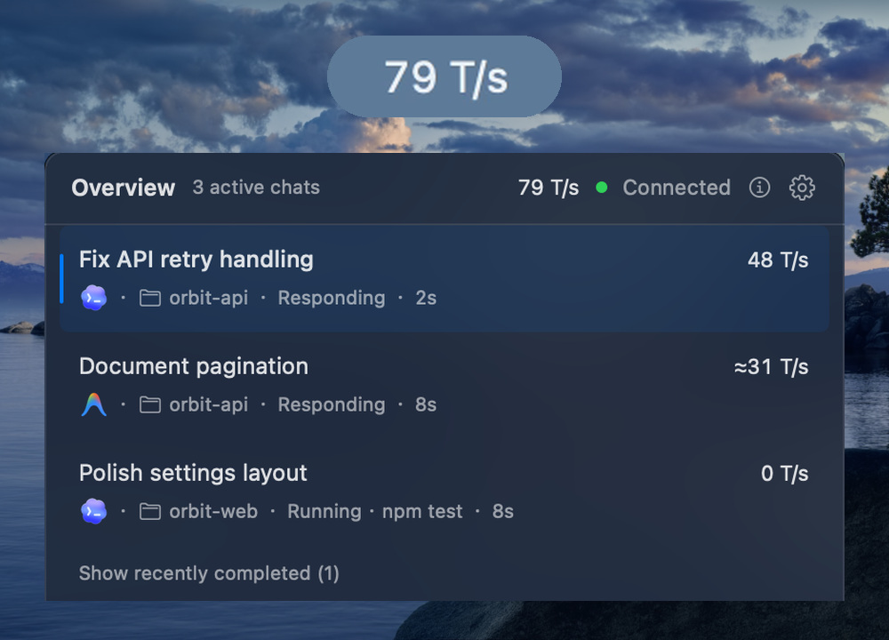
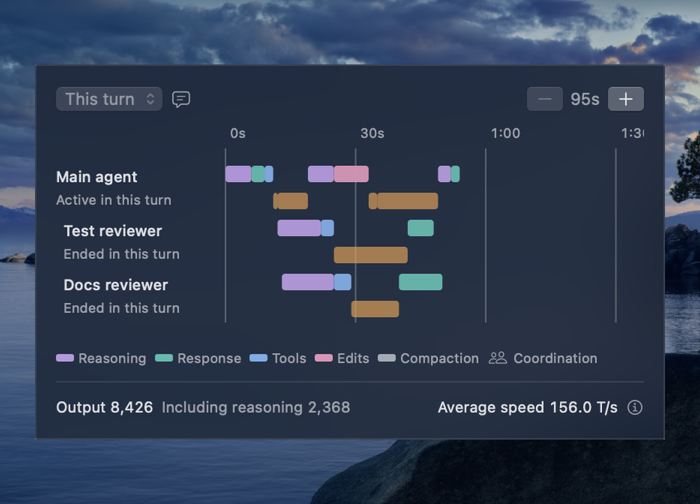
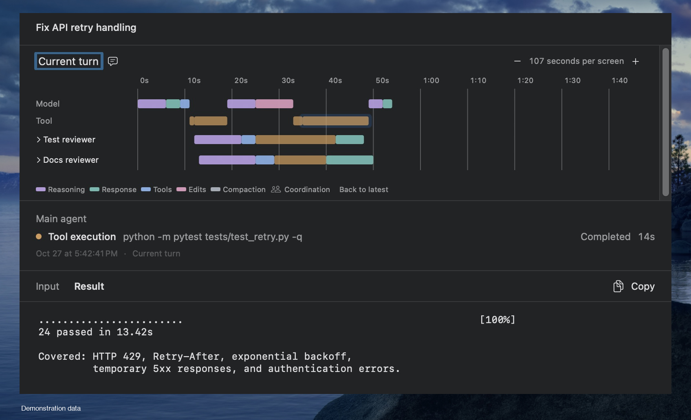

<p align="right"><strong>English</strong> · <a href="README.zh-CN.md">简体中文</a></p>

<div align="center">
  
  <h1>Codex Activity Monitor</h1>
  <p>A native macOS menu bar monitor for <strong>Codex Desktop</strong> and <strong>Antigravity</strong>.<br>Track real-time token output speed (<code>T/s</code>), turn statistics, and main/subagent execution trajectories on a shared timeline—similar to DeepSeek Harness’s statistics and trajectory views.</p>
  <p>
    <a href="https://github.com/LiuHanzhang/codex-activity-monitor/releases/tag/v0.2.0"></a>
    
    <a href="LICENSE"></a>
  </p>
</div>

<a id="see-it-in-action"></a>
<p align="center">
  <a href="docs/assets/showcase/desktop-overview.jpg"></a>
</p>
<p align="center"><sub>Chat overview and shared main-agent / subagent execution timeline.</sub></p>
<p align="center"><a href="#features">Features</a> · <a href="#quick-start">Quick start</a> · <a href="#configure-and-uninstall">Manage &amp; uninstall</a> · <a href="#build-from-source">Build from source</a> · <a href="docs/user-guide.md">User guide</a></p>

## Features

<table>
  <tr>
    <td width="435" align="center"><a href="docs/assets/showcase/speed-overview.jpg"></a></td>
    <td width="435" align="center"><a href="docs/assets/showcase/timeline.jpg"></a></td>
  </tr>
  <tr>
    <td width="435" valign="top"><b>Real-time token speed &amp; turn stats</b><br>See aggregate output rate (<code>T/s</code>) and status animations right in the menu bar. Open the panel to inspect per-chat speed, elapsed time, Output / Reasoning token counts, and average turn speed.</td>
    <td width="435" valign="top"><b>Main &amp; subagent timeline</b><br>Visualize model phases (reasoning, responses, tool-argument generation) and tool executions on separate lanes across the main agent and spawned subagents. Zoom and scrub through history.</td>
  </tr>
</table>

### Activity details

Click any block on the timeline to open the **Activity viewer** and inspect user prompts, visible model outputs, tool arguments, command results, or file diffs—with clear indicators for partial, truncated, or unavailable content.

<p align="center"><a href="docs/assets/showcase/activity-detail.jpg"></a></p>

- **Multi-agent support:** Observe **Codex Desktop** and **Antigravity Desktop** side by side or independently, with agent logos and project folder icons.
- **100% local & read-only:** All token counting and trajectory assembly happen locally on your Mac. Monitor never uploads your conversations and never modifies agent history files.

## Quick start

### Requirements

- **Mac:** Apple Silicon Mac running **macOS 14+**.
- **Supported agents:** Local **Codex Desktop** (`/Applications/ChatGPT.app`), **Antigravity Desktop** (verified on 2.32.1), or both.

### 1. Install the app

1. Download `Codex-Activity-Monitor-<version>-macos-arm64.dmg` from the latest [GitHub Release](https://github.com/LiuHanzhang/codex-activity-monitor/releases).
2. Double-click the DMG, drag **Codex Activity Monitor** into **Applications**, eject the disk image, and launch the app from Applications.

> [!NOTE]
> The app currently uses ad-hoc signing without Apple notarization. If macOS blocks the first launch, open **System Settings → Privacy & Security**, scroll down, and click **Open Anyway** next to the message for Codex Activity Monitor ([Apple guide](https://support.apple.com/en-us/102445)).

### 2. Connect your agents

You can enable **Codex**, **Antigravity**, or both under **Settings (⌘,) → General → Agent Integration**:

- **Antigravity Desktop (zero-config, no restart):** With Antigravity Desktop running under the same macOS user, turn on **Antigravity** in **Settings → General → Agent Integration**. Active and recent chats appear immediately.
- **Codex Desktop:** On first launch, Monitor automatically configures the local Codex wrapper (requiring `/Applications/ChatGPT.app`). Let any active Codex task finish, then **fully quit and reopen Codex Desktop** once so new sessions inherit the integration.

Start a local task in Codex or Antigravity, then click the menu bar item to view live token speed, the execution timeline, and turn usage.

### Upgrading

When upgrading to a new version, quit Monitor (and Codex Desktop if Codex integration is enabled), drag the new app from the DMG to **Applications** to replace the old version, then reopen Monitor before launching Codex Desktop. The app also checks the static Sparkle feed daily and displays a green upward arrow when a newer release is available.

<a id="configure-and-uninstall"></a>
## Configure, disconnect, or uninstall

> [!IMPORTANT]
> **Restore configuration before deleting the app.** Dragging `.app` directly to Trash while Codex integration is enabled leaves the launch environment configuration and local data behind.

| Action | Steps |
| --- | --- |
| **Enable / disable Antigravity** | Toggle **Settings → General → Agent Integration → Antigravity**. Connects over local loopback without modifying Antigravity settings. |
| **Enable / repair Codex** | Turn on **Settings → General → Agent Integration → Codex** and follow the connection or restart prompt. |
| **Pause observation** | Quit Monitor. Reopen Monitor anytime to resume. |
| **Disconnect Codex (keep app)** | Turn off **Settings → General → Agent Integration → Codex** to restore your original launch environment. |
| **Uninstall completely** | Go to **Settings → General → Maintenance**, click **Remove local data and quit to uninstall**, and confirm. If Codex is integrated, finish tasks and quit Codex Desktop; wait for Monitor to finish cleanup and exit, then move the `.app` to Trash. |

Uninstalling cleans up Monitor's own settings, logs, login item, and derived metadata without touching your Codex or Antigravity conversation histories. See the [user guide](docs/user-guide.md#uninstall) for details.

## How it works & privacy

- **Codex integration:** A lightweight wrapper launches the original Codex `app-server` inside `/Applications/ChatGPT.app`, forwards its stdio protocol unmodified, and observes lifecycle events plus streaming TRACE deltas. History is read from `~/.codex/` without modification.
- **Antigravity integration:** Monitor subscribes to the running Antigravity Language Server over local loopback (`StreamAgentStateUpdates`) and reads local transcripts under `~/.gemini/antigravity/brain/` without modifying Antigravity files or launch configuration.
- **Local storage & privacy:** Monitor stores its preferences, configuration backups, and derived timeline metadata in `~/Library/Application Support/CodexActivityMonitor/`. Conversations, tool outputs, and logs stay on your Mac and are never uploaded.
- **Compatibility:** Observation relies on internal Codex protocol/TRACE behavior and Antigravity local RPC/transcript formats; upstream desktop updates may affect observation.

For full details on interface controls, diagnostics, custom data directories, and architecture, see the [User guide](docs/user-guide.md), [Architecture](docs/architecture.md), and [Antigravity notes](dev-history/30_antigravity/README.md).

## Build from source

Requires an Apple Silicon Mac, Python 3.11+, and Xcode 26+ with its Swift toolchain.

### Run a development build

```sh
python3 -m venv .local/venv
.local/venv/bin/python -m pip install -e .
bin/build-gui
bin/run-gui
```

This outputs `.local/gui/Codex Activity Monitor.app` (which depends on the repository checkout and `.local/venv`). See [CONTRIBUTING.md](CONTRIBUTING.md) for test suites and the read-only Preview build.

### Build a standalone release DMG

```sh
bin/prepare-standalone
bin/build-standalone
```

This bundles a standalone Python runtime, dependencies, and tokenizer assets into `.local/standalone/Codex Activity Monitor.app` and packages `.local/standalone/Codex-Activity-Monitor-<version>-macos-arm64.dmg`. See the [packaging guide](packaging/README.md) for details.

## Troubleshooting and contributing

- **No chats or no data?** Ensure Monitor is running and the corresponding agent toggle is enabled in **Settings → General → Agent Integration**. For Codex, quit and reopen Codex Desktop after enabling integration; for Antigravity, ensure Antigravity Desktop is running under the same macOS user. Check **Settings → Runtime Status** or see [Troubleshooting](docs/user-guide.md#troubleshooting).
- **Bug reports & contributions:** Include your macOS version, Codex or Antigravity version, Monitor build number, and reproduction steps (remove private chat content before sharing logs or screenshots). See [CONTRIBUTING.md](CONTRIBUTING.md).

## License

Copyright (c) 2026 Hanzhang Liu. Licensed under the [MIT License](LICENSE). Third-party dependencies and externally sourced materials retain their own licenses and copyright notices.
