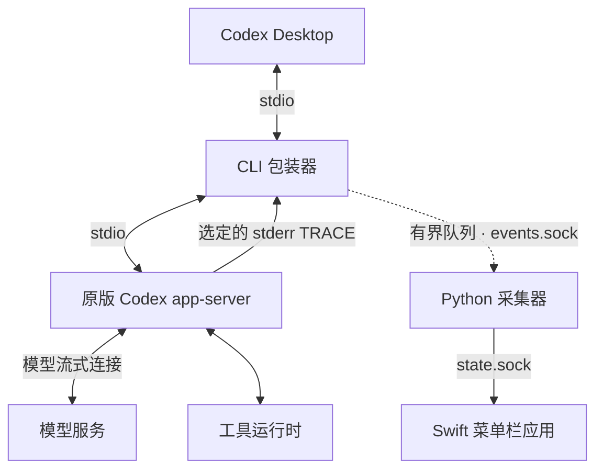
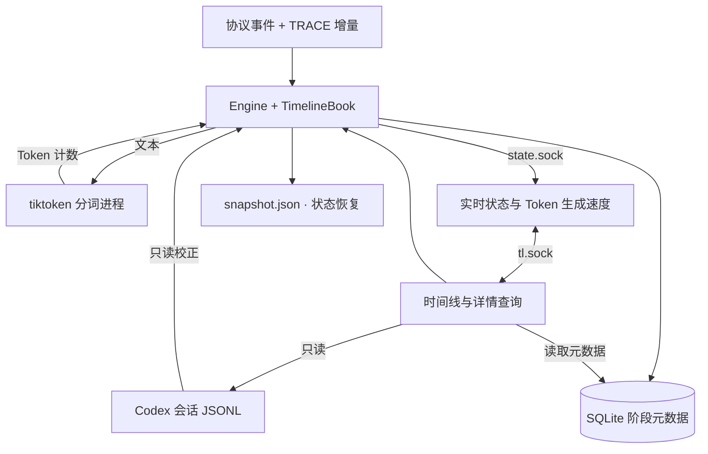

# Codex Activity Monitor

[English](README.md) · [使用指南](docs/user-guide.md) · [架构说明](docs/architecture.md) · [参与开发](CONTRIBUTING.md)

**在 macOS 菜单栏实时查看 Codex 的 Token 生成速度。** 集中查看多个聊天、工具调用和子智能体的运行状态，沿时间线回看每一步。


**开发版本 · 目标 macOS 14+ · MIT。** 当前尚无经过 Developer ID 签名和公证的公开发行包。独立开发版面向 Apple Silicon。构建会检查 macOS 14 部署目标；macOS 14 实际运行验证仍待完成。

## 主要功能

- **实时 Token 生成速度**：在 macOS 菜单栏直接显示每秒生成的 Token 数，同时查看各聊天的速度。
- **多聊天概览**：集中查看当前活动、耗时和最近完成的任务。
- **活动时间线**：模型和工具分别占用轨道，显式关联的子智能体使用共同时间轴。
- **回看执行过程**：支持 30／60／120 秒参考比例，横向回看与返回最新活动。
- **查看活动详情**：在独立窗口读取用户输入、可见模型输出、工具参数、结果和文件改动。
- **理解用量**：显示所选轮次的 Codex 官方 Output／Reasoning token 计数；Output 已包含 Reasoning。
- **语言和启动设置**：支持英文、简体中文，以及登录时启动。

Token 生成速度（T/s）按最近一秒内本地收到的正文和工具参数计算，不包含隐藏推理。`—` 表示暂不可用；已知为零时显示 `0`。

## 效果演示

[](docs/assets/demo.mp4)

[观看或下载演示视频（MP4）](docs/assets/demo.mp4) · [动画演示（GIF）](docs/assets/demo.gif)

查看菜单栏中实时变化的 Token 生成速度，再选择聊天、回看时间线，打开工具参数与执行结果。

<details>
<summary>更多截图：子智能体时间线与活动详情</summary>

**主智能体与两名审查者，共用时间轴**


**读取工具参数和结果**


</details>

## 安装或构建

App 目标系统为 **macOS 14 或更新版本**，并要求本机已安装 Codex Desktop。默认接入使用以下原版 CLI 路径：

```text
/Applications/ChatGPT.app/Contents/Resources/codex-cli/CodexCLI.app/Contents/MacOS/codex
```

GUI 当前没有 CLI 路径选择器。Codex 安装在其他位置时需要定制接入，不适用下面的快速开始步骤。

### 构建独立 App

构建需要 **Apple Silicon Mac**、**Xcode 26+ 及其 Swift 工具链**，以及用于引导构建的 **Python 3.11+**。构建机器的 macOS 版本须满足所选 Xcode 的要求。在仓库根目录运行：

```sh
bin/prepare-standalone
bin/build-standalone
```

生成的 App 已包含 Python、依赖和分词资源，运行时无需源码目录、额外安装 Python 或 Xcode。构建还会生成 `.local/standalone/Codex-Activity-Monitor-0.1.0-arm64-dev.zip`。

日常使用建议先将 App 移入 `/Applications` 再打开，避免后续构建替换正在使用的 App。也可以直接从构建目录运行：

```sh
open '.local/standalone/Codex Activity Monitor.app'
```

在同一 macOS 用户下，两种位置都默认使用 `~/Library/Application Support/CodexActivityMonitor/` 中的设置和数据，也与源码构建的日常 GUI 共用；移动 App 无需迁移数据。已接入后如需移动，先结束任务并退出 Codex 和 Monitor，移动后从新位置打开 Monitor，再打开 Codex。

当前产物使用 ad-hoc 签名，**尚未公证**；传到另一台 Mac 后，Gatekeeper 可能要求手动允许打开。构建细节及验证边界见[打包指南](packaging/README.md)。

### 从源码运行

本机开发需要 Python 3.11+、Xcode 26+ 及其 Swift 工具链，macOS 版本须满足所选 Xcode 的要求：

```sh
python3 -m venv .local/venv
.local/venv/bin/python -m pip install -e .
bin/build-gui
bin/run-gui
```

这种构建依赖当前源码和 `.local/venv`，请保留其位置。安装依赖与首次下载分词资源需要联网。

## 首次使用

1. 等待正在执行的 Codex 任务结束。
2. 打开 Codex Activity Monitor。首次启动会自动配置本机接入并启动采集器。
3. 完全退出并重新打开 Codex Desktop，让新进程继承接入配置。
4. 在 Codex 中开始一个任务，点击菜单栏入口，通过连接指示灯和聊天列表确认活动已经出现。

观察期间请保持 Monitor 运行。首次配置默认开启登录启动，可在 **设置 → 登录时启动** 中关闭；macOS 可能要求允许该登录项。

## 日常使用

- **打开概览**：点击菜单栏入口，选择聊天，查看当前轮次、时间线和用量。
- **读取任务输入**：点击轮次选择器旁的对话气泡按钮。
- **回看时间线**：用 `−`／`+` 调整参考比例，横向滚动查看较早活动；点击**回到最新**恢复跟随。
- **查看详情**：点击时间块打开活动查看器，再通过标签页读取参数、输出等可用原文。
- **切换语言**：打开齿轮菜单，选择 **语言 → English／简体中文**。对话与工具原文保持原语言。

有些思考活动没有可见摘要，内容留白属于正常情况；应用不会展示隐藏推理。部分观测、截断和不可用内容会明确标记。

菜单栏状态、数据位置与更多操作见[使用指南](docs/user-guide.md)。

## 配置、取消接入与卸载

以下操作的效果不同：

| 操作 | 步骤 | 结果 |
| --- | --- | --- |
| 启用或修复接入 | **设置 → 配置**；任务结束后重开 Codex | 开启观察，并沿用接入前的原配置备份 |
| 暂停观察 | **设置 → 退出** | 停止观察，保留接入配置；重新打开 Monitor 可恢复 |
| 取消接入，保留 App | **设置 → 恢复配置… → 恢复配置**，不勾选清理选项 | 恢复原配置并保留 App 设置；之后打开仍保持未接入，需要时主动点击“配置” |
| 完整卸载 | **设置 → 恢复配置…**，勾选**清理本机数据并退出，用于卸载**，再恢复 | 恢复配置，等待 Codex 退出，清理所属本机数据和登录项后退出；随后删除 `.app` |

恢复时会保留你在接入后另行修改的配置值。已运行的 Codex 进程会保留继承的环境，直到退出；Monitor 会等待安全清理，不会强制结束任务。请保持 Monitor 运行直到清理完成；若中途退出，重新打开可继续处理。

**先恢复，再删除 App。** 只把 App 拖进废纸篓会留下配置和本机数据。从源码运行时，卸载不会删除仓库和开发虚拟环境；Codex 自己的对话记录也不属于 Monitor 的清理范围。

## 工作原理

包装器启动原版 Codex `app-server` 并转发 stdio 协议，同时观察协议生命周期事件和选定的 stderr TRACE 日志，从中取得正文与工具参数的流式增量。



采集器按聊天、轮次和活动身份关联事件，使用本地分词器统计 Token 并计算生成速度。实时状态通过 `state.sock` 推送给界面；时间线和活动详情通过独立的 `tl.sock` 只读查询。



对话历史仍由 Codex 管理。Monitor 只读历史内容并校正活动，自己的 SQLite 仅保存阶段元数据，`snapshot.json` 用于状态恢复。组件职责和接入配置变更见[架构说明](docs/architecture.md)。

## 隐私与兼容性

- 数据在本机处理，Codex Activity Monitor 不上传对话；这不改变 Codex Desktop 自身的联网行为。
- 本机状态可能包含聊天标题、项目路径、命令预览和数值指标。实时文本用于本地分词及所选活动详情。
- 观察范围是已接入的本机聊天。本快速开始不支持远程会话或配置后端之外的聊天。
- 接入依赖特定版本的 Codex 协议和 trace 行为，上游更新可能影响观察。

## 常见问题与参与开发

**没有聊天或没有数据？** 等任务结束，完全退出 Codex Desktop，在 Monitor 运行时重新打开 Codex 并开始一个新任务，再检查连接状态。更多情况见[故障排查](docs/user-guide.md#troubleshooting)。

报告问题时，请提供 macOS 版本、Codex 版本、Monitor 构建和复现步骤。分享日志或截图前，请移除私密对话、登录信息和配置备份。

开发、测试与贡献方式见 [CONTRIBUTING.md](CONTRIBUTING.md)。

## 许可证

Copyright (c) 2026 Hanzhang Liu。采用 [MIT 许可证](LICENSE)。第三方依赖和外部来源材料保留各自的许可证与版权声明。
