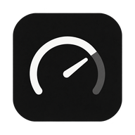
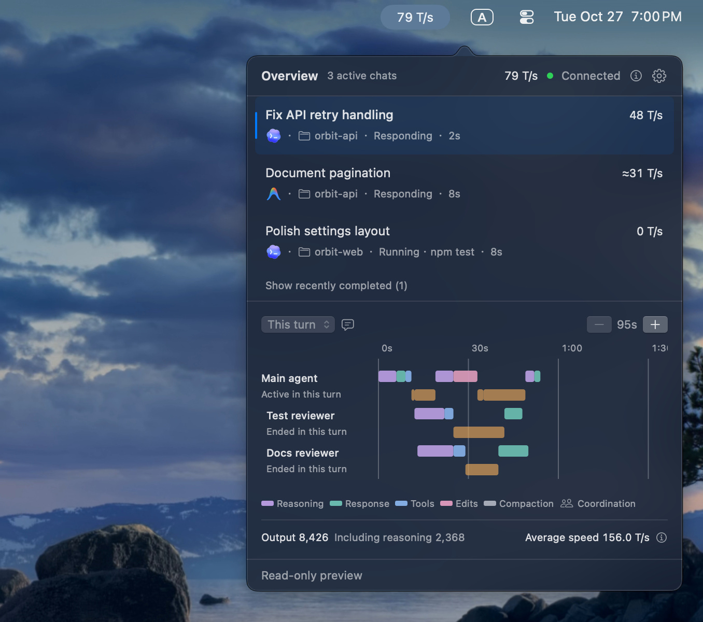
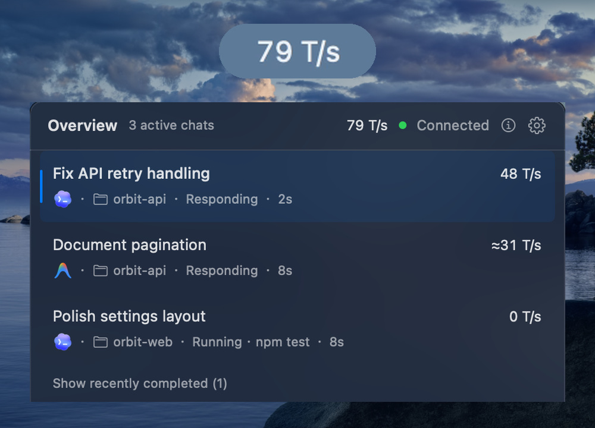
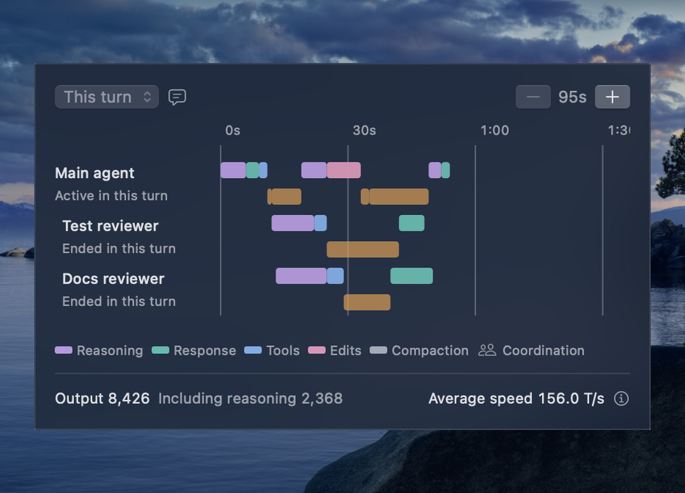
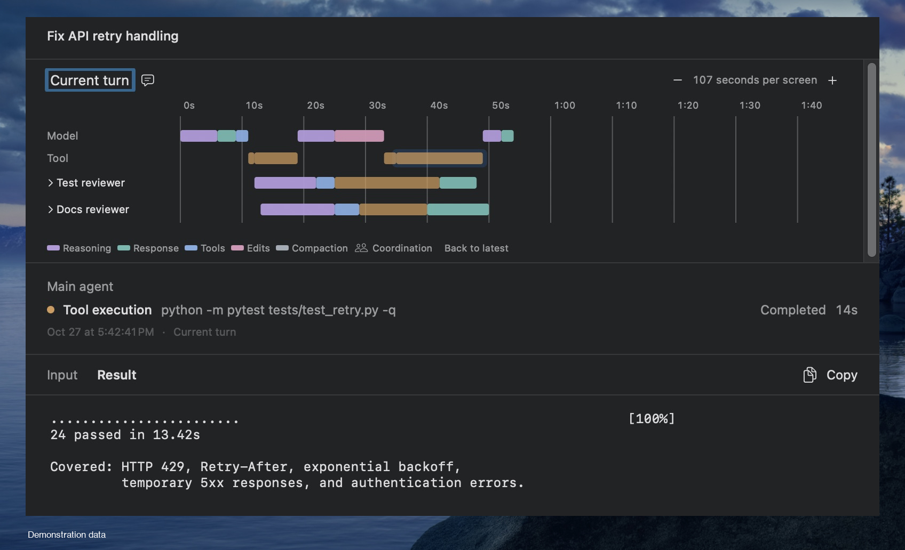

<p align="right"><a href="README.md">English</a> · <strong>简体中文</strong></p>

<div align="center">
  
  <h1>Codex Activity Monitor</h1>
  <p>面向  <strong>Codex Desktop</strong> 与  <strong>Antigravity</strong> 的原生 macOS 菜单栏监控工具。<br>在菜单栏与主面板实时查看 Token 输出速率（<code>T/s</code>）、会话统计及主／子智能体执行轨迹，提供类似 DeepSeek Harness 的统计与轨迹视图。</p>
  <p>
    <a href="https://github.com/LiuHanzhang/codex-activity-monitor/releases/tag/v0.2.0"></a>
    
    <a href="LICENSE"></a>
  </p>
</div>

<a id="效果演示"></a>
<p align="center">
  <a href="docs/assets/showcase/desktop-overview.jpg"></a>
</p>
<p align="center"><sub>聊天概览与主／子智能体执行时间线。</sub></p>
<p align="center"><a href="#主要功能">主要功能</a> · <a href="#快速开始">快速开始</a> · <a href="#配置与卸载">配置与卸载</a> · <a href="#从源码构建">从源码构建</a> · <a href="docs/user-guide.md">使用指南</a></p>

## 主要功能

<table>
  <tr>
    <td width="435" align="center"><a href="docs/assets/showcase/speed-overview.jpg"></a></td>
    <td width="435" align="center"><a href="docs/assets/showcase/timeline.jpg"></a></td>
  </tr>
  <tr>
    <td width="435" valign="top"><b>实时 Token 速度与回合统计</b><br>菜单栏实时展示总输出速率（<code>T/s</code>）与思考／工具状态动画；展开面板可查看各会话的实时速度、耗时、Output／Reasoning Token 用量及单轮平均生成速度。</td>
    <td width="435" valign="top"><b>主／子智能体双轨时间线</b><br>在同一时间轴上对齐主智能体与派生子智能体（Subagents），分轨道展示模型阶段（思考、回复、工具参数生成）与工具调用，支持缩放与历史回看。</td>
  </tr>
</table>

### 活动详情

点击时间线上的任意色块即可打开独立的**活动查看器**，查看该步骤的用户输入、可见模型输出、工具参数、命令执行结果或文件改动（Diff），并对部分观测、截断或不可用内容给出明确标记。

<p align="center"><a href="docs/assets/showcase/activity-detail.jpg"></a></p>

- **多 Agent 同屏支持**：支持同时或单独监控 **Codex Desktop** 与 **Antigravity Desktop**，自动展示对应的 Agent 品牌图标与项目文件夹图标。
- **100% 本地处理与只读安全**：所有分词计数与轨迹拼装均在本机完成，只读访问历史记录，绝不上传任何对话或代码。

## 快速开始

### 运行要求

- **设备**：Apple Silicon Mac，**macOS 14+**。
- **支持的客户端**：本机已安装 **Codex Desktop**（`/Applications/ChatGPT.app`）、**Antigravity Desktop**（已在 2.32.1 验证），或同时使用两者。

### 1. 安装应用

1. 前往 [GitHub Releases](https://github.com/LiuHanzhang/codex-activity-monitor/releases) 下载最新版本的 `Codex-Activity-Monitor-<版本号>-macos-arm64.dmg`。
2. 双击打开 DMG，将 **Codex Activity Monitor** 拖入 **Applications（应用程序）** 文件夹，推出磁盘映像后从“应用程序”启动。

> [!NOTE]
> 应用当前使用 ad-hoc 签名，尚未完成 Apple 公证。首次打开若提示无法验证开发者，请打开 **系统设置 → 隐私与安全性**，向下滚动并在阻止提示旁点击 **仍要打开**（详见 [Apple 官方指引](https://support.apple.com/zh-cn/102445)）。

### 2. 接入 Agent

可在 **设置（⌘,）→ 通用 → Agent 接入** 中单独或同时开启 **Codex** 与 **Antigravity**：

-  **Antigravity Desktop（零配置、免重启）**：保持 Antigravity Desktop 在同一 macOS 用户下运行，在 **设置 → 通用 → Agent 接入** 中开启 **Antigravity** 即可立即订阅实时状态与历史记录。
-  **Codex Desktop**：首次启动 Monitor 会自动配置本机 Codex 接入（默认查找 `/Applications/ChatGPT.app`）。请等待正在执行的任务结束，**完全退出并重新打开一次 Codex Desktop**，让新会话继承接入配置。

开始一个本机 Codex 或 Antigravity 任务，点击菜单栏图标即可查看实时速度、执行时间线与 Token 用量。

### 升级版本

升级时请先退出 Monitor（若已开启 Codex 接入，请在任务结束后一并退出 Codex Desktop），打开新版 DMG 拖入 **Applications** 替换旧版，随后先启动 Monitor，再打开 Codex Desktop。应用默认每天通过 Sparkle 静态更新源检查新版本，有更新时会在主面板顶部显示绿色向上箭头。

<a id="配置与卸载"></a>
## 配置与卸载

> [!IMPORTANT]
> **卸载前请先通过设置恢复配置。** 若已启用 Codex 接入，直接把 `.app` 拖进废纸篓会留下启动环境配置和本机数据。

| 操作 | 步骤 |
| --- | --- |
| **启用／停用 Antigravity** | 切换 **设置 → 通用 → Agent 接入 → Antigravity** 开关。通过本机回环订阅状态，不修改 Antigravity 配置。 |
| **启用／修复 Codex 接入** | 打开 **设置 → 通用 → Agent 接入 → Codex** 开关，按界面提示确认连接或重启状态。 |
| **暂停观察** | 直接退出 Monitor；重新打开即可恢复观察。 |
| **取消 Codex 接入（保留 App）** | 关闭 **设置 → 通用 → Agent 接入 → Codex** 开关，自动恢复原启动环境。 |
| **完整卸载** | 在 **设置 → 通用 → 维护** 中点击 **清理本机数据并退出，用于卸载** 并确认。若已接入 Codex，请结束任务并退出 Codex Desktop，等待清理完成且 Monitor 自动退出后，再将 `.app` 移入废纸篓。 |

卸载只会清理 Monitor 自身的设置、日志、登录启动项和派生元数据，不会删除 Codex 或 Antigravity 的对话历史。详细步骤见[卸载指南](docs/user-guide.md#uninstall)。

## 工作原理与隐私边界

- **Codex 接入机制**：轻量级包装器启动 `/Applications/ChatGPT.app` 内的原版 Codex `app-server` 并原样转发 stdio 协议，同时旁路观察生命周期事件与流式 TRACE 增量，并只读访问 `~/.codex/` 下的会话历史。
- **Antigravity 接入机制**：采集器通过本机回环连接订阅正在运行的 Antigravity Language Server（`StreamAgentStateUpdates`），并只读访问 `~/.gemini/antigravity/brain/` 下的本地会话记录，无需改动客户端配置。
- **本机存储与隐私**：Monitor 的偏好设置、配置备份与时间线派生元数据保存在 `~/Library/Application Support/CodexActivityMonitor/`。所有对话、命令输出与诊断日志均留在本地，绝不上传。
- **兼容性说明**：观察能力依赖特定版本的 Codex 协议／TRACE 行为与 Antigravity 本地内部接口，上游客户端更新可能影响观察结果。

关于界面指标含义、自定义数据目录、运行状态诊断及架构设计的完整说明，请参阅[使用指南](docs/user-guide.md)、[架构说明](docs/architecture.md)与 [Antigravity 实现记录](dev-history/30_antigravity/README.md)。

## 从源码构建

需要 Apple Silicon Mac、Python 3.11+ 以及 Xcode 26+（含 Swift 工具链）。

### 源码运行（开发模式）

```sh
python3 -m venv .local/venv
.local/venv/bin/python -m pip install -e .
bin/build-gui
bin/run-gui
```

产物为 `.local/gui/Codex Activity Monitor.app`（运行依赖当前源码目录和 `.local/venv`）。开发测试与只读 Preview 构建见 [CONTRIBUTING.md](CONTRIBUTING.md)。

### 构建独立发行包（DMG）

```sh
bin/prepare-standalone
bin/build-standalone
```

产物为包含独立 Python 运行时、依赖与分词资源的 `.local/standalone/Codex Activity Monitor.app` 及同目录下的 `Codex-Activity-Monitor-<版本号>-macos-arm64.dmg`。详见[打包指南](packaging/README.md)。

## 常见问题与参与开发

- **没有聊天或没有数据？** 请确认 Monitor 正在运行，且在 **设置 → 通用 → Agent 接入** 中开启了对应的 Agent 开关。对于 Codex，首次开启后需完全退出并重开 Codex Desktop；对于 Antigravity，请确认 Antigravity Desktop 在同一 macOS 用户下运行。可前往 **设置 → 运行状态** 查看健康检查，或参阅[故障排查](docs/user-guide.md#troubleshooting)。
- **反馈问题与贡献代码**：提交 Issue 时请附上 macOS 版本、Codex 或 Antigravity 版本、Monitor 构建号及复现步骤（分享日志或截图前请移除私密对话内容）。详见 [CONTRIBUTING.md](CONTRIBUTING.md)。

## 许可证

Copyright (c) 2026 Hanzhang Liu。采用 [MIT 许可证](LICENSE)。第三方依赖和外部来源材料保留各自的许可证与版权声明。
