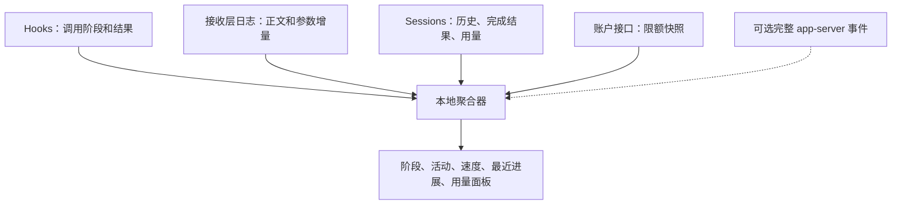

# 需求、组合方案与验证计划

整理日期：2026-10-10。本文描述拟实现的监控产品；实验结果与未完成工作分开列出。

## 1. 用户需求

使用 Codex Desktop 时，长时间没有可见变化容易被理解为界面卡死。用户希望看到后端在做什么、最近是否有进展、速度如何，以缓解等待焦虑。

需要回答：

1. 当前回合是否仍在运行？在哪个可确认的阶段？
2. 正文或工具参数是否持续产生增量？已经收到多少、最近速度多少？
3. 哪些工具准备调用、正在执行或已经完成？是否等待审批 / 用户输入？
4. 哪些文件通过补丁被修改？有无可确认的变更结果？
5. 距离最后一次可解释的活动过去多久？
6. 完成后的 token 用量和账户限额是多少？

不需要获取隐藏 reasoning 内容。不为监控改变 prompt、模型工具模式或 agent 工作方式。

## 2. 指标与状态表达

### 速度

先提供可验证的 `字符/s`、`UTF-8 字节/s` 和累计字符 / 字节数。正文、工具参数、reasoning 摘要、命令输出必须分别统计。

字符计数应统一约定，例如使用 Unicode 码点数；不要让一条采集路径使用 JavaScript 的 UTF-16 长度，另一条使用 UTF-8 字节数，却都标为“字符”。

最近窗口的接收速度：

```text
速度 = 窗口内新增内容数量 / 窗口时长
```

建议展示最近 1–2 秒的平滑速度，并保留首次增量、最后增量和整段接收均速。快照事件需要求有效差异，不能直接累加每份快照。

若添加 token/s，应标为“估算”，注明 tokenizer 与适用模型。不能把 delta 条数、固定字符比例或日志总字节数当作精确 token 数；分块边界也可能切开一个 token，简单逐块 tokenization 求和会引入误差。

完成后使用服务端 usage 更新实际报告用量。最终 reasoning token 数可以展示，但不能倒推出 reasoning 期间每秒的速度。

### 状态

| 可展示状态 | 最低证据要求 |
| --- | --- |
| 等待模型响应 | 用户已提交 / turn 已开始，尚无更明确活动 |
| 推理阶段 | 明确 reasoning 项目事件；若只有摘要，注明摘要信号 |
| 正文生成中 | 收到正文 delta |
| 工具参数生成中 | 收到工具输入 delta |
| 工具准备调用 | PreToolUse 或等价调用记录 |
| 等待审批 / 输入 | 明确对应请求 |
| 工具执行中 | 完整 item 生命周期或明确进程执行证据 |
| 工具已产出结果 | PostToolUse / item completed 等 |
| 回合完成、中断、失败 | 明确终止事件 |
| 观测中断 / 状态未知 | 采集链路丢失、关键事件缺失或无法关联 |

一个回合可以同时有多个工具运行；正文、后台命令、子代理也可能重叠。应维护每个活动的状态，界面显示主阶段和活动列表，不能用一个不断覆盖的全局枚举代表全部工作。

“最近 8 秒没有收到新事件”是观察事实；“模型卡死了”是需要额外证据的结论。连接保活、CPU 使用和进程存在只能作辅助健康信号，不能当作模型生成进度。

reasoning 项目的开始 / 结束可以支持阶段标记，但不能证明两者之间持续有计算进展。等待时长是经过时间，不是完成百分比；当前接口也没有可靠的剩余时间估算。

### 文件修改

优先显示 `fileChange` 和 diff 的确认结果。模型正在生成补丁时显示“生成编辑指令”，不要显示“文件已写入”。

Bash / Python 等可以直接写文件，未必产生 fileChange。若产品要求覆盖所有实际磁盘修改，再增加目标工作区的文件系统观察；文件监听本身不能证明修改由哪个工具或哪个聊天产生。

## 3. 推荐组合



### 优先方案：保留 Desktop 默认启动方式

1. Desktop 继续启动和管理原版、自带 CLI。
2. 通过官方 hooks 报告工具调用阶段与结果。
3. 使用接收层日志观察正文和工具参数生成；核对 Desktop 对 stderr 的转存与过滤。
4. 增量读取实际 CODEX_HOME 的 sessions，补充完成记录、历史和精确用量。
5. 通过账户查询接口更新额度，或先使用带时间的会话限额快照。

这条方案有望不依赖 `CODEX_CLI_PATH` 或手动预启动 app-server。**它尚未完成端到端验证**，特别是 Code Mode 内部工具 hooks、默认 Desktop 的日志落盘与多聊天关联。

hooks 不覆盖 hosted 工具等路径。如果缺口影响目标状态，应补充完整 app-server 事件，而不是假设 hooks 已覆盖全部工具。

### 补充方案：透明 stdio 转发

Desktop 的 CLI 启动入口指向薄包装器，由包装器启动同一原版 CLI，原样转发 stdin / stdout / stderr，同时复制所需数据给采集器。

stdout 提供完整 app-server 事件，stderr 提供上游接收层诊断。Desktop 仍发起启动；包装器需正确传递信号、关闭管道、退出码和子进程生命周期。

这条方案通常需要使用当前源码支持的启动入口覆盖，因此仍有接入配置和版本兼容工作。它无需预先运行一个独立后端，但也不是“完全不改变启动入口”。

**目前是设计，未完成验证。** 采集失败或日志背压必须能够降级，不能阻塞正常通信。

### 已验证的实验方案：独立监听后端

先启动 app-server 的 localhost WebSocket，再让隔离 Desktop 与观察客户端连接它。当前实验已验证相关事件和上游增量。

它便于控制日志与复现实验，但要额外管理后端生命周期，并依赖 Desktop 的连接覆盖入口。作为实验基线保留，不直接视为主 App 的最终接入方案。

### 接入决策

| 验证结果 | 采用方式 |
| --- | --- |
| hooks 覆盖目标工具，原生日志能可靠读取和关联增量 | 默认 Desktop 启动 + hooks + 日志 + sessions |
| 缺少重要工具的开始 / 审批 / 终止事件 | 增加完整 app-server 事件入口 |
| 默认 stdio 无独立订阅地址 | 验证透明转发器 |
| 接收层日志不能覆盖实际传输或版本变动较大 | 再评估兼容 HTTPS / SSE 和 WSS 的代理 |

网络代理目前不是首选。只有日志无法满足时才承担额外传输与认证复杂度。

## 4. 聚合与数据契约

每条归一化事件至少记录：

- 数据来源、来源版本、事件种类。
- 源事件时间、监控接收时间与单调时钟时间。
- 后端 / host、thread、turn、item / tool call 身份。
- 若可用：response_id、序号、Code Mode cell 或内部调用身份。
- 增量长度、状态、结果码，以及证据完整性。

不同层的 ID 不能默认相等。本次实验的外层 exec call ID 与内层 commandExecution ID 就不同。使用明确映射或标为未关联，不能凭相近时间强行归并到当前聊天。

对同一个来源检查序号、去重、断流；对多个来源区分“同一事实的镜像”与“不同阶段”。Sessions 完成记录可以补历史，但不能把它到达时刻当作实际执行开始。

工具可以并行。异步 hooks 可以乱序。掉线、取消、缺少 PostToolUse 时不能永远显示执行中，需要标记观测缺口，并等待权威状态补齐。

普通运行只保留必要指标和活动摘要；原始正文、参数与工具输出仅在明确的诊断模式下保存，并限制容量。认证令牌不属于采集数据。

## 5. 已验证与未完成

| 项目 | 状态 |
| --- | --- |
| 隔离后端上游长工具输入 delta | 已实测：2,367 条，合并结果校验通过 |
| 命令执行与输出事件 | 已实测；长 Python 命令退出码 0 |
| reasoning 摘要、最终 reasoning 用量 | 已实测；没有连续 reasoning token 计数 |
| 直接 apply_patch 的增量预览 | 特定隔离配置下已实测；模式已恢复 |
| 当前 sessions 的用量、完成项目结构 | 已只读检查 |
| 隔离后端 hooks feature | 已只读查询为 stable / enabled |
| 监控 hooks 实际回调、Code Mode 内部覆盖 | 未完成 |
| 默认 Desktop → 日志落盘 → 采集器 | 源码支持相关环节；端到端未完成 |
| 透明 stdio 转发器 | 未实现 / 未验证 |
| tokenizer 估算与误差校验 | 未完成 |
| 常驻采集器、聚合器、状态面板 | 未完成 |
| 性能、容量、重连与升级适配 | 未完成 |

曾经为实验修改隔离模型目录与补丁 feature；上游验证前已经恢复原有 harness / 工具模式。主 App、主配置与主后端未修改。本次文档编写也不安装 hooks、不启用 trace、不重启后端。

## 6. 分阶段实施与验收

### 阶段一：验证最小真实采集路径

在隔离 Desktop 配置仅报告事件的监控 hooks，并保持原有 tool_mode。分别验证：

- exec 内部 Bash、apply_patch、MCP 和普通本地工具。
- 长工具参数生成与真正执行之间的分界。
- 长命令、write_stdin 轮询、并行调用、失败和取消。
- 权限等待、hosted 工具与子代理的覆盖缺口。

同时验证 Desktop 自己启动 CLI 时，上游日志是否完整落盘，增量能否正确归属到两条并行聊天。将观察结果与当前实验 app-server 事件对照，不以脚本被启动作为采集成功。

### 阶段二：实现采集与聚合

为通过验证的数据源建立版本适配器，输出统一事件。实现窗口速度、活动生命周期、历史补齐和用量去重。

验收重点：只累计真正的内容 delta；同一响应不重复计费；不把另一聊天、预热请求或其他后端事件归到当前聊天。

若完整事件有重要缺口，先实现并验证转发器，再进入面板集成。

### 阶段三：提供等待反馈

界面至少显示当前可确认阶段、正在进行的活动、累计生成数量、窗口速度、最后一次进展距今时间，以及采集健康状态。

Reasoning 静默期显示有依据的等待状态；未取得精确 token/s 时使用字符/s 或明确标注估算。用户等待审批时突出所需操作。

完成后显示用量与限额的来源和更新时间。监控与 Codex UI 不是同一进程时，明确当前选中的 host / thread。

### 阶段四：运行与兼容性验收

比较启用前后响应延迟、工具调度开销、CPU / 内存、日志量与磁盘写入。验证轮转、重连、Desktop / CLI 退出、采集器崩溃、恢复会话和升级后的字段变化。

容量和性能目标尚未定标，需先测量真实基线，不能沿用实验的高频 trace 长期运行。完整监控链路通过这些验收后，才能称为需求已实现。

## 7. 证据入口

- [上游实验与限制](/Users/bytedance/personal/codex-activity-monitor/analysis/upstream-stream/FINDINGS.txt)
- [机器可读验证结果](/Users/bytedance/personal/codex-activity-monitor/analysis/upstream-stream/verification.json)
- [仅含增量大小与时间的记录](/Users/bytedance/personal/codex-activity-monitor/analysis/upstream-stream/tool-input-deltas.jsonl)
- [文件编辑 / Code Mode 实验](/Users/bytedance/personal/codex-activity-monitor/analysis/file-edit-progress/FINDINGS.txt)
- [隔离后端接收日志实验脚本](/Users/bytedance/personal/codex-activity-monitor/experiments/desktop-isolation/configure_transport_logging.py)
- [数据来源与官方 / 开源参考](/Users/bytedance/personal/codex-activity-monitor/dev-history/01_initial_experiment/data-sources.md)
