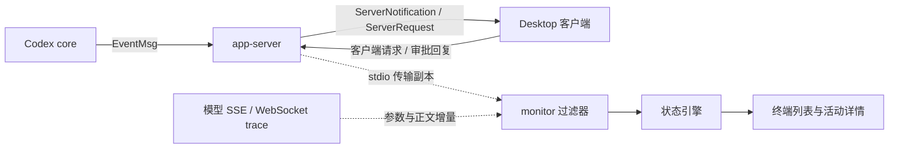

# App-server 事件与 monitor 消费 / 展示盘点

盘点日期：2026-10-12。源码基线：`/Users/bytedance/playground/codex`，提交 `806d9732c974bc8a51b8317c1bd8985544fe627c`。monitor 基线为当前工作区文件，包含已有工具名及命令预览改动。本轮盘点没有修改运行代码、暂存区或重启运行进程。

机器可读清单、源码哈希和已有实测捕获的事件统计见 [app-server-event-inventory.json](app-server-event-inventory.json)。本报告按声明的协议盘点，不表示每一种事件都已在本机运行中触发。源码与实际安装二进制是否完全对应仍需区分；实验、内部接口和配置相关消息不保证每个客户端都收到。

## 先把三层分开

用户所说“app-server 收到事件”有两个不同方向：core 产生事件，app-server 接收并向 Desktop 发送协议消息；Desktop 也向 app-server 发送请求和审批回复。monitor 观察的是这些传输消息，还额外观察模型传输日志。

这些集合不能混为一个列表：

| 集合 | 数量 | 用途与定义 |
| --- | --- | --- |
| core `EventMsg` | 84 | app-server 接收的内部事件；不是 84 个直接暴露的 v2 通知。定义于 [protocol.rs](/Users/bytedance/playground/codex/codex-rs/protocol/src/protocol.rs:1464)。 |
| `ServerNotification` | 87 | app-server 向客户端发送的通知；有开始、结束、增量、错误及配置变化等。定义于 [common.rs](/Users/bytedance/playground/codex/codex-rs/app-server-protocol/src/protocol/common.rs:1948)。 |
| `ServerRequest` | 11 | app-server 向客户端发起并等待回复的请求，包括 9 个当前请求和 2 个旧版审批请求。定义于 [common.rs](/Users/bytedance/playground/codex/codex-rs/app-server-protocol/src/protocol/common.rs:1793)。 |
| `ThreadItem` | 19 | `item/started` / `item/completed` 所承载的活动类型；事件名称相同不代表活动相同。定义于 [item.rs](/Users/bytedance/playground/codex/codex-rs/app-server-protocol/src/protocol/v2/item.rs:235)。 |

core 到 v2 的主要转换在 [bespoke_event_handling.rs](/Users/bytedance/playground/codex/codex-rs/app-server/src/bespoke_event_handling.rs:155) 与 [event_mapping.rs](/Users/bytedance/playground/codex/codex-rs/app-server-protocol/src/protocol/event_mapping.rs:30)。聊天、账号、文件搜索和进程 API 的一些通知由其他请求处理器或状态订阅产生，不能只扫描 `EventMsg` 来列全客户端消息。

## 当前支持范围

| 分类 | 服务端通知 | 服务端请求 | 含义 |
| --- | ---: | ---: | --- |
| 已展示 | 10 | 3 | 有处理路径，并影响列表或详情；不代表完整显示所有 payload。 |
| 部分消费 | 2 | 1 | 有处理意图或部分处理，但当前 payload / 分支有缺口。 |
| 仅透传 | 39 | 1 | 通过过滤器，没有专门状态或展示处理；部分字段已丢失。 |
| 丢弃 | 36 | 6 | 未进入状态引擎；不影响原 app-server 与 Desktop 之间的正常转发。 |
| 合计 | 87 | 11 | 全部方法已逐项分类。 |

“消费”在这里指产生明确语义状态或指标，不包括只登记 thread/turn 身份。未处理的消息可能经过身份登记代码，但不能算功能支持。过滤、消费和展示是三个不同环节。

monitor 的核对入口分别是 [events.py：过滤](/Users/bytedance/personal/codex_progress_monitor/src/codex_progress_monitor/events.py:43)、[engine.py：协议消费](/Users/bytedance/personal/codex_progress_monitor/src/codex_progress_monitor/engine.py:216)、[engine.py：上游消费](/Users/bytedance/personal/codex_progress_monitor/src/codex_progress_monitor/engine.py:416)、[display.py：展示](/Users/bytedance/personal/codex_progress_monitor/src/codex_progress_monitor/display.py:27)。

## 与日常进度最相关的结果（当前实现）

下表记录当前代码行为，不代表建议把这些信息全部展示给用户。面向用户的消费取舍、简化文案与实现顺序见 [事件消费与展示决策](event-display-decisions.md)，其中审批和用户操作只在内部维护状态，不重复 Desktop 提示。

| 能力 | app-server 相关消息 | monitor 当前展示 |
| --- | --- | --- |
| 回合开始 / 结束 | `turn/started`、`turn/completed` | 等待响应、完成、失败、已中断；错误原因不显示。 |
| 正文生成 | `item/agentMessage/delta`、消息 item 生命周期 | 生成正文、接收 token/s、token / 字符计数；不展示正文。 |
| 可见 reasoning 摘要 | `item/reasoning/summaryTextDelta`、reasoning item 生命周期 | Reasoning、摘要字数 / 段数；不表示全部 reasoning 的生成速度。 |
| 工具参数生成 | 普通 v2 通知没有当前 monitor 使用的逐参数 delta；从模型 trace 旁路取得 | 生成工具参数、工具名称、参数接收 token/s、拟执行命令摘要。 |
| 命令执行 | `commandExecution` 的 item 开始 / 结束、输出 delta | 命令摘要、执行 / 未确认、输出字符数、退出码；开始事件可能早于实际进程启动。 |
| MCP / 动态工具 | 对应 item 生命周期、MCP progress、动态客户端调用请求 | 基本工具名和开始 / 结束；MCP 内部进度与错误详情不显示。 |
| 人工 / 客户端审批 | 各类 `requestApproval`、客户端回复、`serverRequest/resolved` | 等待审批；请求清理与权限回复处理不完整。 |
| 用户回答 | `item/tool/requestUserInput`、MCP elicitation | 前者显示等待回答；MCP elicitation 未消费。 |
| Guardian 自动审核 | `item/autoApprovalReview/started` / `completed` | 没有消费和展示。 |
| 协作代理 | `collabAgentToolCall`、`subAgentActivity` | 未正确识别这些 item；不能显示完整代理调用关系。 |
| 计划、压缩、hook、后台 sleep | 各自通知或 item 类型 | 没有专门展示。 |
| 错误、重试、认证恢复、安全缓冲、MCP 启动 | 相应 error / model / MCP 通知 | 大多丢弃或未处理；这些等待可能只显示为等待响应。 |
| token 使用量与限额 | `thread/tokenUsage/updated`、`account/rateLimits/updated` | 未展示；当前接收 token 计数与这些服务端用量是不同指标。 |

## 已定位的实现缺口

这些是当前代码事实，不是未来设计：

1. **自动审核未消费。** `events.py` 只保留通用身份字段，删除 `reviewId`、`targetItemId`、`review.status`、`action`；引擎没有自动审核分支。透传两个方法名不能算支持自动审核。
2. **协作工具类型不匹配。** 源码协议类型是 `collabAgentToolCall`，monitor 的 `TOOL_TYPES` 写成 `collabToolCall`。正确类型进入引擎后不会创建活动；`receiverThreadIds` 也未保留，过滤器目前允许的是单数 `receiverThreadId`。
3. **聊天设置字段层级不匹配。** 实际事件包含 `threadSettings.model`；过滤器丢弃 `threadSettings`，引擎读的是平层 `params.model`。已有捕获也验证了嵌套结构，不能把此事件列为正常更新模型。
4. **请求清理不完整。** `serverRequest/resolved` 的正常 payload 包含 `threadId`。引擎只在没有 `threadId` 时清理审批表，且没有独立关闭等待活动的完整逻辑；依赖已观察到的客户端回复。回复缺失时，已解决的请求仍可能显示等待审批。
5. **实时诊断信息缺失。** `error`、警告、认证恢复、MCP 启动等被丢弃；MCP progress、安全缓冲等虽透传方法，内容和状态不消费。最终失败可显示，但当前失败原因或重试阶段不能显示。
6. **外层 `exec` 使用另一条事件流。** 参数完成后进入 `tool_ready`，内部工具的运行时 ID 另建活动，没有可靠父子关联。新 reasoning / 正文 item 会把旧 `exec` 标为完成，这是当前推断规则，不能证明后台 cell 或内部进程已终止。

四个合成事件诊断经过真实过滤器和状态引擎，复现了前三类字段 / 类型问题及请求清理问题：模型更新后仍为旧值；协作 item 活动数为 0；resolved 后仍为 approval；自动审核只剩身份 / 时间字段且未创建活动。诊断没有调用模型或执行命令。它们验证的是当前处理行为，不是对应场景的完整真实运行验收。

## 87 种服务端通知完整表

以下“实验”标记来自当前源码上的 `#[experimental(...)]`；没有此标记也不代表 payload 稳定或本机一定启用，例如自动审核 payload 在类型注释中标为不稳定。

| 通知 | 含义 | 过滤 | 当前支持 | 消费 / 展示及限制 | 定义 |
| --- | --- | --- | --- | --- | --- |
| `error` | 任务错误、重试中的流错误 | 丢弃 | 丢弃 | 过滤器直接丢弃；最终失败仅从 turn/completed 显示，错误原因和重试不显示。 | [源码](/Users/bytedance/playground/codex/codex-rs/app-server-protocol/src/protocol/common.rs:1950) |
| `thread/started` | 聊天创建或接入 | 透传 | 已展示 | 保存聊天 ID、名称、cwd、模型、ephemeral 等，显示聊天信息；不恢复完整历史活动。 | [源码](/Users/bytedance/playground/codex/codex-rs/app-server-protocol/src/protocol/common.rs:1951) |
| `thread/status/changed` | 聊天综合状态更新 | 透传 | 仅透传 | status 透传但无处理分支；当前状态主要由 turn 生命周期推导。 | [源码](/Users/bytedance/playground/codex/codex-rs/app-server-protocol/src/protocol/common.rs:1952) |
| `thread/readState/changed`（实验） | 聊天已读状态 | 透传 | 仅透传 | 无状态处理。 | [源码](/Users/bytedance/playground/codex/codex-rs/app-server-protocol/src/protocol/common.rs:1954) |
| `thread/archived` | 聊天归档 | 透传 | 仅透传 | 无状态处理；不会据此移除聊天。 | [源码](/Users/bytedance/playground/codex/codex-rs/app-server-protocol/src/protocol/common.rs:1955) |
| `thread/deleted` | 聊天删除 | 透传 | 仅透传 | 无状态处理；不会据此移除聊天。 | [源码](/Users/bytedance/playground/codex/codex-rs/app-server-protocol/src/protocol/common.rs:1956) |
| `thread/unarchived` | 聊天恢复归档 | 透传 | 仅透传 | 无状态处理。 | [源码](/Users/bytedance/playground/codex/codex-rs/app-server-protocol/src/protocol/common.rs:1957) |
| `thread/closed` | 聊天关闭 | 透传 | 仅透传 | 无状态处理；与 monitor 自己的桥接断开不是同一事件。 | [源码](/Users/bytedance/playground/codex/codex-rs/app-server-protocol/src/protocol/common.rs:1958) |
| `thread/reverted` | 聊天回退 | 透传 | 仅透传 | 无状态处理。 | [源码](/Users/bytedance/playground/codex/codex-rs/app-server-protocol/src/protocol/common.rs:1959) |
| `skills/changed` | 技能列表变化 | 丢弃 | 丢弃 | 不采集。 | [源码](/Users/bytedance/playground/codex/codex-rs/app-server-protocol/src/protocol/common.rs:1960) |
| `thread/name/updated` | 聊天名称变化 | 透传 | 已展示 | 保存并展示聊天名称。 | [源码](/Users/bytedance/playground/codex/codex-rs/app-server-protocol/src/protocol/common.rs:1961) |
| `thread/attachment/updated` | 聊天附件变化 | 透传 | 仅透传 | 无状态处理。 | [源码](/Users/bytedance/playground/codex/codex-rs/app-server-protocol/src/protocol/common.rs:1962) |
| `thread/goal/updated` | 长期目标变化 | 透传 | 仅透传 | 无状态处理。 | [源码](/Users/bytedance/playground/codex/codex-rs/app-server-protocol/src/protocol/common.rs:1963) |
| `thread/prediction/updated`（实验） | 预测元数据变化 | 透传 | 仅透传 | 无状态处理。 | [源码](/Users/bytedance/playground/codex/codex-rs/app-server-protocol/src/protocol/common.rs:1965) |
| `thread/goal/cleared` | 长期目标清除 | 透传 | 仅透传 | 无状态处理。 | [源码](/Users/bytedance/playground/codex/codex-rs/app-server-protocol/src/protocol/common.rs:1966) |
| `thread/queue/changed`（实验） | 排队消息变化 | 透传 | 仅透传 | 无状态处理。 | [源码](/Users/bytedance/playground/codex/codex-rs/app-server-protocol/src/protocol/common.rs:1968) |
| `project/changed`（实验） | 项目变化 | 丢弃 | 丢弃 | 不采集。 | [源码](/Users/bytedance/playground/codex/codex-rs/app-server-protocol/src/protocol/common.rs:1970) |
| `thread/project/updated`（实验） | 聊天所属项目变化 | 透传 | 仅透传 | 无状态处理；列表项目名目前来自 cwd 的目录名。 | [源码](/Users/bytedance/playground/codex/codex-rs/app-server-protocol/src/protocol/common.rs:1972) |
| `thread/environment/connected`（实验） | 执行环境已连接 | 透传 | 仅透传 | 无状态处理；不会更新采集连接状态。 | [源码](/Users/bytedance/playground/codex/codex-rs/app-server-protocol/src/protocol/common.rs:1974) |
| `thread/environment/disconnected`（实验） | 执行环境已断开 | 透传 | 仅透传 | 无状态处理；不会更新采集连接状态。 | [源码](/Users/bytedance/playground/codex/codex-rs/app-server-protocol/src/protocol/common.rs:1976) |
| `thread/settings/updated`（实验） | 聊天运行配置变化 | 透传 | 部分消费 | 有模型更新分支，但实际 payload 为 threadSettings.model；过滤器丢弃 threadSettings，分支读取平层 model，当前事件不能正确更新模型。 | [源码](/Users/bytedance/playground/codex/codex-rs/app-server-protocol/src/protocol/common.rs:1978) |
| `thread/tokenUsage/updated` | 服务端实际 token 使用量 | 丢弃 | 丢弃 | 明确丢弃；界面 token/s 来自接收文本重新分词，不是此事件的使用量。 | [源码](/Users/bytedance/playground/codex/codex-rs/app-server-protocol/src/protocol/common.rs:1979) |
| `turn/started` | 回合开始 | 透传 | 已展示 | 进入等待响应状态，登记回合关联并清理上回合活动。 | [源码](/Users/bytedance/playground/codex/codex-rs/app-server-protocol/src/protocol/common.rs:1980) |
| `hook/started` | hook 开始 | 丢弃 | 丢弃 | 不采集、不展示。 | [源码](/Users/bytedance/playground/codex/codex-rs/app-server-protocol/src/protocol/common.rs:1981) |
| `turn/completed` | 回合结束 | 透传 | 已展示 | 显示完成、失败或中断；有进程证据的后台命令可继续活动。错误正文被过滤。 | [源码](/Users/bytedance/playground/codex/codex-rs/app-server-protocol/src/protocol/common.rs:1982) |
| `hook/completed` | hook 结束 | 丢弃 | 丢弃 | 不采集、不展示。 | [源码](/Users/bytedance/playground/codex/codex-rs/app-server-protocol/src/protocol/common.rs:1983) |
| `turn/diff/updated` | 回合累计文件 diff | 丢弃 | 丢弃 | 明确丢弃，不展示文件 diff。 | [源码](/Users/bytedance/playground/codex/codex-rs/app-server-protocol/src/protocol/common.rs:1984) |
| `turn/plan/updated` | 计划步骤更新 | 丢弃 | 丢弃 | 明确丢弃，不展示计划进度。 | [源码](/Users/bytedance/playground/codex/codex-rs/app-server-protocol/src/protocol/common.rs:1985) |
| `item/started` | 活动开始 | 透传 | 已展示 | 按 item.type 分流；19 种类型中识别 9 种，详见活动类型表。命令开始不一定已启动进程。 | [源码](/Users/bytedance/playground/codex/codex-rs/app-server-protocol/src/protocol/common.rs:1986) |
| `item/autoApprovalReview/started` | Guardian 自动审核开始 | 透传 | 仅透传 | 丢弃 reviewId、targetItemId、review、action 等关键字段；引擎无处理分支，不能显示自动审核中。 | [源码](/Users/bytedance/playground/codex/codex-rs/app-server-protocol/src/protocol/common.rs:1987) |
| `item/autoApprovalReview/completed` | Guardian 自动审核结束 | 透传 | 仅透传 | 关键审核字段被过滤；引擎无处理分支，不能显示通过、拒绝、超时或取消。 | [源码](/Users/bytedance/playground/codex/codex-rs/app-server-protocol/src/protocol/common.rs:1988) |
| `autoApprovalReview/strictReviewRequired`（实验） | 需要严格自动审核 | 丢弃 | 丢弃 | 方法前缀不在白名单，直接丢弃。 | [源码](/Users/bytedance/playground/codex/codex-rs/app-server-protocol/src/protocol/common.rs:1990) |
| `item/completed` | 活动结束 | 透传 | 已展示 | 识别的 item.type 关闭活动并保存 status、exitCode；其他类型忽略。durationMs 经过滤但未用于活动耗时。 | [源码](/Users/bytedance/playground/codex/codex-rs/app-server-protocol/src/protocol/common.rs:1991) |
| `rawResponseItem/completed` | 完整原始模型输出 item（内部接口） | 丢弃 | 丢弃 | 不采集；不能与已采集的上游 response.output_item.done 混为一谈。 | [源码](/Users/bytedance/playground/codex/codex-rs/app-server-protocol/src/protocol/common.rs:1993) |
| `rawResponse/completed` | 原始模型 response 与 usage（内部接口） | 丢弃 | 丢弃 | 不采集。 | [源码](/Users/bytedance/playground/codex/codex-rs/app-server-protocol/src/protocol/common.rs:1995) |
| `item/agentMessage/delta` | 正文增量 | 透传 | 已展示 | 正文接收字符、token、速度与生成阶段；上游镜像存在时避免重复计数，不展示正文内容。 | [源码](/Users/bytedance/playground/codex/codex-rs/app-server-protocol/src/protocol/common.rs:1996) |
| `item/plan/delta` | 计划文本增量 | 透传 | 仅透传 | delta 被过滤，引擎无处理分支。 | [源码](/Users/bytedance/playground/codex/codex-rs/app-server-protocol/src/protocol/common.rs:1998) |
| `command/exec/outputDelta` | 客户端 command/exec API 的输出 | 丢弃 | 丢弃 | 不采集；与模型工具的 item/commandExecution/outputDelta 是不同接口。 | [源码](/Users/bytedance/playground/codex/codex-rs/app-server-protocol/src/protocol/common.rs:2000) |
| `process/outputDelta`（实验） | 客户端 process/spawn API 的输出 | 丢弃 | 丢弃 | 不采集。 | [源码](/Users/bytedance/playground/codex/codex-rs/app-server-protocol/src/protocol/common.rs:2003) |
| `process/exited`（实验） | 客户端 process/spawn API 的退出 | 丢弃 | 丢弃 | 不采集。 | [源码](/Users/bytedance/playground/codex/codex-rs/app-server-protocol/src/protocol/common.rs:2006) |
| `item/commandExecution/outputDelta` | 模型命令工具输出增量 | 透传 | 已展示 | 只保留输出字符数，更新最近进展，并将活跃命令设为执行工具；详情显示输出字符总数。 | [源码](/Users/bytedance/playground/codex/codex-rs/app-server-protocol/src/protocol/common.rs:2007) |
| `item/commandExecution/terminalInteraction` | 命令终端 stdin 交互 | 透传 | 仅透传 | 交互字段被过滤，无状态处理。 | [源码](/Users/bytedance/playground/codex/codex-rs/app-server-protocol/src/protocol/common.rs:2008) |
| `item/fileChange/outputDelta` | 旧版补丁输出增量 | 透传 | 仅透传 | 内容被过滤，无状态处理。 | [源码](/Users/bytedance/playground/codex/codex-rs/app-server-protocol/src/protocol/common.rs:2010) |
| `item/fileChange/patchUpdated` | 补丁变化更新 | 透传 | 仅透传 | 补丁字段被过滤，无状态处理。 | [源码](/Users/bytedance/playground/codex/codex-rs/app-server-protocol/src/protocol/common.rs:2011) |
| `serverRequest/resolved` | 客户端请求已回答或清理 | 透传 | 部分消费 | 桥接缓存会删除等待请求；引擎仅在没有 threadId 时清理审批表。正常 schema 带 threadId 时没有处理分支，不能单独结束等待状态。 | [源码](/Users/bytedance/playground/codex/codex-rs/app-server-protocol/src/protocol/common.rs:2012) |
| `item/mcpToolCall/progress` | MCP 工具内部进度 | 透传 | 仅透传 | progress/message 等字段被过滤，无状态处理；MCP 开始结束仍可通过 item 生命周期展示。 | [源码](/Users/bytedance/playground/codex/codex-rs/app-server-protocol/src/protocol/common.rs:2013) |
| `mcpServer/oauthLogin/completed` | MCP OAuth 登录结束 | 丢弃 | 丢弃 | 不采集。 | [源码](/Users/bytedance/playground/codex/codex-rs/app-server-protocol/src/protocol/common.rs:2014) |
| `mcpServer/startupStatus/updated` | MCP 服务启动状态 | 丢弃 | 丢弃 | 不采集；等待 MCP 启动无法单独解释。 | [源码](/Users/bytedance/playground/codex/codex-rs/app-server-protocol/src/protocol/common.rs:2015) |
| `mcpServer/event/stream/notification`（实验） | MCP 事件流通知 | 丢弃 | 丢弃 | 不采集。 | [源码](/Users/bytedance/playground/codex/codex-rs/app-server-protocol/src/protocol/common.rs:2017) |
| `account/updated` | 账号更新 | 丢弃 | 丢弃 | 不采集。 | [源码](/Users/bytedance/playground/codex/codex-rs/app-server-protocol/src/protocol/common.rs:2018) |
| `account/gatewayOAuth/changed` | 网关 OAuth 变化 | 丢弃 | 丢弃 | 不采集。 | [源码](/Users/bytedance/playground/codex/codex-rs/app-server-protocol/src/protocol/common.rs:2019) |
| `account/rateLimits/updated` | 账号限额变化 | 丢弃 | 丢弃 | 不采集。 | [源码](/Users/bytedance/playground/codex/codex-rs/app-server-protocol/src/protocol/common.rs:2020) |
| `app/list/updated` | 应用列表变化 | 丢弃 | 丢弃 | 不采集。 | [源码](/Users/bytedance/playground/codex/codex-rs/app-server-protocol/src/protocol/common.rs:2021) |
| `remoteControl/status/changed` | 远程控制状态 | 丢弃 | 丢弃 | 不采集；monitor 仅观察本机受监控 stdio 后端。 | [源码](/Users/bytedance/playground/codex/codex-rs/app-server-protocol/src/protocol/common.rs:2022) |
| `externalAgentConfig/import/progress` | 外部配置导入进度 | 丢弃 | 丢弃 | 不采集。 | [源码](/Users/bytedance/playground/codex/codex-rs/app-server-protocol/src/protocol/common.rs:2023) |
| `externalAgentConfig/import/completed` | 外部配置导入结束 | 丢弃 | 丢弃 | 不采集。 | [源码](/Users/bytedance/playground/codex/codex-rs/app-server-protocol/src/protocol/common.rs:2024) |
| `fs/changed` | 客户端文件订阅变化 | 丢弃 | 丢弃 | 不采集。 | [源码](/Users/bytedance/playground/codex/codex-rs/app-server-protocol/src/protocol/common.rs:2025) |
| `item/reasoning/summaryTextDelta` | 可见 reasoning 摘要增量 | 透传 | 已展示 | 统计摘要字数、段数与 token；界面显示摘要字/段，不显示摘要 token/s 或摘要正文。 | [源码](/Users/bytedance/playground/codex/codex-rs/app-server-protocol/src/protocol/common.rs:2026) |
| `item/reasoning/summaryPartAdded` | reasoning 摘要分段开始 | 透传 | 仅透传 | summaryIndex 透传但无处理分支；段数来自摘要 delta 或上游对应事件。 | [源码](/Users/bytedance/playground/codex/codex-rs/app-server-protocol/src/protocol/common.rs:2027) |
| `item/reasoning/textDelta` | reasoning 原始文本增量 | 透传 | 仅透传 | delta 被过滤，无状态处理；不能据此显示完整 reasoning 速度。 | [源码](/Users/bytedance/playground/codex/codex-rs/app-server-protocol/src/protocol/common.rs:2028) |
| `thread/compacted` | 旧版上下文压缩通知 | 透传 | 仅透传 | 透传但不处理；新版 contextCompaction 活动类型也未识别。 | [源码](/Users/bytedance/playground/codex/codex-rs/app-server-protocol/src/protocol/common.rs:2030) |
| `model/rerouted` | 模型被重新路由 | 透传 | 已展示 | 更新 toModel，详情显示当前模型；不展示切换原因。 | [源码](/Users/bytedance/playground/codex/codex-rs/app-server-protocol/src/protocol/common.rs:2031) |
| `model/verification` | 需要账号验证 | 透传 | 仅透传 | 验证信息被过滤，无状态处理。 | [源码](/Users/bytedance/playground/codex/codex-rs/app-server-protocol/src/protocol/common.rs:2032) |
| `modelProvider/authRecoveryStarted` | 模型供应商认证恢复开始 | 丢弃 | 丢弃 | 不采集，不能显示认证恢复中。 | [源码](/Users/bytedance/playground/codex/codex-rs/app-server-protocol/src/protocol/common.rs:2033) |
| `modelProvider/authRecoveryCompleted` | 模型供应商认证恢复结束 | 丢弃 | 丢弃 | 不采集。 | [源码](/Users/bytedance/playground/codex/codex-rs/app-server-protocol/src/protocol/common.rs:2034) |
| `turn/moderationMetadata`（实验） | 审核元数据 | 透传 | 仅透传 | 关键字段被过滤，无状态处理。 | [源码](/Users/bytedance/playground/codex/codex-rs/app-server-protocol/src/protocol/common.rs:2036) |
| `model/safetyBuffering/updated` | 输出等待安全审核 | 透传 | 仅透传 | 关键字段被过滤，无状态处理。 | [源码](/Users/bytedance/playground/codex/codex-rs/app-server-protocol/src/protocol/common.rs:2037) |
| `warning` | 一般警告 | 丢弃 | 丢弃 | 不采集、不展示。 | [源码](/Users/bytedance/playground/codex/codex-rs/app-server-protocol/src/protocol/common.rs:2038) |
| `guardianWarning` | 自动审核警告 | 丢弃 | 丢弃 | 不采集、不展示。 | [源码](/Users/bytedance/playground/codex/codex-rs/app-server-protocol/src/protocol/common.rs:2039) |
| `deprecationNotice` | 弃用通知 | 丢弃 | 丢弃 | 不采集。 | [源码](/Users/bytedance/playground/codex/codex-rs/app-server-protocol/src/protocol/common.rs:2040) |
| `configWarning` | 配置警告 | 丢弃 | 丢弃 | 不采集。 | [源码](/Users/bytedance/playground/codex/codex-rs/app-server-protocol/src/protocol/common.rs:2041) |
| `fuzzyFileSearch/sessionUpdated` | 客户端文件搜索结果更新 | 丢弃 | 丢弃 | 不采集。 | [源码](/Users/bytedance/playground/codex/codex-rs/app-server-protocol/src/protocol/common.rs:2042) |
| `fuzzyFileSearch/sessionCompleted` | 客户端文件搜索结束 | 丢弃 | 丢弃 | 不采集。 | [源码](/Users/bytedance/playground/codex/codex-rs/app-server-protocol/src/protocol/common.rs:2043) |
| `thread/realtime/started`（实验） | 实时音视频会话：started | 透传 | 仅透传 | 不处理；音频、SDP、转录等字段被过滤。 | [源码](/Users/bytedance/playground/codex/codex-rs/app-server-protocol/src/protocol/common.rs:2045) |
| `thread/realtime/itemAdded`（实验） | 实时音视频会话：itemAdded | 透传 | 仅透传 | 不处理；音频、SDP、转录等字段被过滤。 | [源码](/Users/bytedance/playground/codex/codex-rs/app-server-protocol/src/protocol/common.rs:2047) |
| `thread/realtime/item/started`（实验） | 实时音视频会话：started | 透传 | 仅透传 | 不处理；音频、SDP、转录等字段被过滤。 | [源码](/Users/bytedance/playground/codex/codex-rs/app-server-protocol/src/protocol/common.rs:2049) |
| `thread/realtime/item/transcript/delta`（实验） | 实时音视频会话：delta | 透传 | 仅透传 | 不处理；音频、SDP、转录等字段被过滤。 | [源码](/Users/bytedance/playground/codex/codex-rs/app-server-protocol/src/protocol/common.rs:2051) |
| `thread/realtime/item/completed`（实验） | 实时音视频会话：completed | 透传 | 仅透传 | 不处理；音频、SDP、转录等字段被过滤。 | [源码](/Users/bytedance/playground/codex/codex-rs/app-server-protocol/src/protocol/common.rs:2053) |
| `thread/realtime/transcript/delta`（实验） | 实时音视频会话：delta | 透传 | 仅透传 | 不处理；音频、SDP、转录等字段被过滤。 | [源码](/Users/bytedance/playground/codex/codex-rs/app-server-protocol/src/protocol/common.rs:2055) |
| `thread/realtime/transcript/done`（实验） | 实时音视频会话：done | 透传 | 仅透传 | 不处理；音频、SDP、转录等字段被过滤。 | [源码](/Users/bytedance/playground/codex/codex-rs/app-server-protocol/src/protocol/common.rs:2057) |
| `thread/realtime/outputAudio/delta`（实验） | 实时音视频会话：delta | 透传 | 仅透传 | 不处理；音频、SDP、转录等字段被过滤。 | [源码](/Users/bytedance/playground/codex/codex-rs/app-server-protocol/src/protocol/common.rs:2059) |
| `thread/realtime/sdp`（实验） | 实时音视频会话：sdp | 透传 | 仅透传 | 不处理；音频、SDP、转录等字段被过滤。 | [源码](/Users/bytedance/playground/codex/codex-rs/app-server-protocol/src/protocol/common.rs:2061) |
| `thread/realtime/error`（实验） | 实时音视频会话：error | 透传 | 仅透传 | 不处理；音频、SDP、转录等字段被过滤。 | [源码](/Users/bytedance/playground/codex/codex-rs/app-server-protocol/src/protocol/common.rs:2063) |
| `thread/realtime/closed`（实验） | 实时音视频会话：closed | 透传 | 仅透传 | 不处理；音频、SDP、转录等字段被过滤。 | [源码](/Users/bytedance/playground/codex/codex-rs/app-server-protocol/src/protocol/common.rs:2065) |
| `windows/worldWritableWarning` | Windows 可写目录警告 | 丢弃 | 丢弃 | 不采集。 | [源码](/Users/bytedance/playground/codex/codex-rs/app-server-protocol/src/protocol/common.rs:2068) |
| `windowsSandbox/setupCompleted` | Windows 沙箱安装结束 | 丢弃 | 丢弃 | 不采集。 | [源码](/Users/bytedance/playground/codex/codex-rs/app-server-protocol/src/protocol/common.rs:2069) |
| `account/login/completed` | 账号登录结束 | 丢弃 | 丢弃 | 不采集。 | [源码](/Users/bytedance/playground/codex/codex-rs/app-server-protocol/src/protocol/common.rs:2074) |

## 11 种服务端请求完整表

这些请求方向是 app-server → 客户端，客户端随后用同一 JSON-RPC ID 返回结果。它们不是“模型生成了一个工具调用参数”的事件。

| 请求 | 含义 | 过滤 | 当前支持 | 消费 / 展示及限制 | 定义 |
| --- | --- | --- | --- | --- | --- |
| `item/commandExecution/requestApproval` | 命令审批请求 | 透传 | 已展示 | 等待审批；不显示请求中的原因、审批选项和额外权限，命令名称依赖已有 item。 | [源码](/Users/bytedance/playground/codex/codex-rs/app-server-protocol/src/protocol/common.rs:1797) |
| `item/fileChange/requestApproval` | 文件变更审批请求 | 透传 | 已展示 | 等待审批；不展示变更内容或审批原因。 | [源码](/Users/bytedance/playground/codex/codex-rs/app-server-protocol/src/protocol/common.rs:1804) |
| `item/tool/requestUserInput` | 工具请求用户回答 | 透传 | 已展示 | 等待回答；不展示问题/选项。回复后结束等待，不保存答案。 | [源码](/Users/bytedance/playground/codex/codex-rs/app-server-protocol/src/protocol/common.rs:1810) |
| `mcpServer/elicitation/request` | MCP 请求用户补充信息或外部确认 | 丢弃 | 丢弃 | 过滤器直接丢弃；不会显示等待回答。 | [源码](/Users/bytedance/playground/codex/codex-rs/app-server-protocol/src/protocol/common.rs:1816) |
| `item/permissions/requestApproval` | 请求新增权限 | 透传 | 部分消费 | 显示等待审批，但回复是 permissions/scope，过滤器只保留 decision；不能解释实际授予了什么。 | [源码](/Users/bytedance/playground/codex/codex-rs/app-server-protocol/src/protocol/common.rs:1822) |
| `item/tool/call` | 动态工具委托客户端执行 | 透传 | 仅透传 | 请求透传但没有处理分支；dynamicToolCall 的 item 开始结束另有基本展示。 | [源码](/Users/bytedance/playground/codex/codex-rs/app-server-protocol/src/protocol/common.rs:1828) |
| `account/chatgptAuthTokens/refresh` | 请求客户端刷新认证 token | 丢弃 | 丢弃 | 不采集。 | [源码](/Users/bytedance/playground/codex/codex-rs/app-server-protocol/src/protocol/common.rs:1833) |
| `attestation/generate` | 请求客户端产生认证证明 | 丢弃 | 丢弃 | 不采集。 | [源码](/Users/bytedance/playground/codex/codex-rs/app-server-protocol/src/protocol/common.rs:1839) |
| `currentTime/read`（实验） | 请求客户端提供当前时间 | 丢弃 | 丢弃 | 不采集。 | [源码](/Users/bytedance/playground/codex/codex-rs/app-server-protocol/src/protocol/common.rs:1846) |
| `applyPatchApproval` | 旧版文件修改审批 | 丢弃 | 丢弃 | 不采集。 | [源码](/Users/bytedance/playground/codex/codex-rs/app-server-protocol/src/protocol/common.rs:1854) |
| `execCommandApproval` | 旧版命令审批 | 丢弃 | 丢弃 | 不采集。 | [源码](/Users/bytedance/playground/codex/codex-rs/app-server-protocol/src/protocol/common.rs:1860) |

客户端审批结果经过滤器时仅保留 `result.decision`。引擎识别拒绝 / 取消、普通批准后转为 `tool_ready`，以及用户回答后结束等待；不完整支持结构化权限授权结果或未观察到回复时仅凭 resolved 清理。

## 19 种活动类型完整表

目前识别其中 9 种；另有 `collabToolCall` 这个过滤器 / 引擎认可的名称，但它不属于当前源码定义的 19 种类型。

| item.type | 当前支持 | 消费 / 展示及限制 | 定义 |
| --- | --- | --- | --- |
| `userMessage` | 未识别 | 故意忽略，不统计或展示用户输入正文。 | [源码](/Users/bytedance/playground/codex/codex-rs/app-server-protocol/src/protocol/v2/item.rs:239) |
| `hookPrompt` | 未识别 | 未识别，不展示 hook 注入信息。 | [源码](/Users/bytedance/playground/codex/codex-rs/app-server-protocol/src/protocol/v2/item.rs:246) |
| `agentMessage` | 已展示 | 生成正文；正文增量与最终文本用于接收指标，不展示正文。 | [源码](/Users/bytedance/playground/codex/codex-rs/app-server-protocol/src/protocol/v2/item.rs:252) |
| `functionCallOutput` | 未识别 | 未识别；不能假设此类型为所有工具（包括 exec）统一提供返回事件。源码中的生产点包括 hook_runtime。 | [源码](/Users/bytedance/playground/codex/codex-rs/app-server-protocol/src/protocol/v2/item.rs:266) |
| `plan` | 未识别 | 未识别，计划正文与增量不展示。 | [源码](/Users/bytedance/playground/codex/codex-rs/app-server-protocol/src/protocol/v2/item.rs:276) |
| `reasoning` | 已展示 | Reasoning；显示可见摘要字数和段数；完整 reasoning 内容不展示。 | [源码](/Users/bytedance/playground/codex/codex-rs/app-server-protocol/src/protocol/v2/item.rs:282) |
| `commandExecution` | 已展示 | 有 unifiedExecStartup/Interaction 与 processId 时视为执行；否则执行未确认，直到收到输出。显示命令摘要、输出字符数、结束状态、退出码。 | [源码](/Users/bytedance/playground/codex/codex-rs/app-server-protocol/src/protocol/v2/item.rs:291) |
| `fileChange` | 已展示 | 通用“执行工具 · fileChange”；只显示生命周期，不展示文件清单或 diff。 | [源码](/Users/bytedance/playground/codex/codex-rs/app-server-protocol/src/protocol/v2/item.rs:330) |
| `mcpToolCall` | 已展示 | 显示 server/tool、生命周期；不显示 MCP progress 或结果/错误详情。 | [源码](/Users/bytedance/playground/codex/codex-rs/app-server-protocol/src/protocol/v2/item.rs:337) |
| `dynamicToolCall` | 已展示 | 显示工具名称、生命周期；客户端委托请求没有专门展示。 | [源码](/Users/bytedance/playground/codex/codex-rs/app-server-protocol/src/protocol/v2/item.rs:360) |
| `collabAgentToolCall` | 未识别 | 未识别：TOOL_TYPES 写成 collabToolCall，与实际协议类型不匹配；接收方字段也误用单数 receiverThreadId。 | [源码](/Users/bytedance/playground/codex/codex-rs/app-server-protocol/src/protocol/v2/item.rs:374) |
| `subAgentActivity` | 未识别 | 未识别，不展示子代理路径及其活动。 | [源码](/Users/bytedance/playground/codex/codex-rs/app-server-protocol/src/protocol/v2/item.rs:397) |
| `webSearch` | 已展示 | 通用工具生命周期；不展示查询、结果或动作详情。 | [源码](/Users/bytedance/playground/codex/codex-rs/app-server-protocol/src/protocol/v2/item.rs:407) |
| `imageView` | 已展示 | 通用工具生命周期；path 被过滤，不展示图片或路径。 | [源码](/Users/bytedance/playground/codex/codex-rs/app-server-protocol/src/protocol/v2/item.rs:410) |
| `sleep` | 未识别 | 未识别，不能单独显示后台等待/休眠。 | [源码](/Users/bytedance/playground/codex/codex-rs/app-server-protocol/src/protocol/v2/item.rs:414) |
| `imageGeneration` | 已展示 | 通用工具生命周期；不展示生成图片或任务进度。 | [源码](/Users/bytedance/playground/codex/codex-rs/app-server-protocol/src/protocol/v2/item.rs:415) |
| `enteredReviewMode` | 未识别 | 未识别，不显示进入代码 review 模式（与审批不同）。 | [源码](/Users/bytedance/playground/codex/codex-rs/app-server-protocol/src/protocol/v2/item.rs:418) |
| `exitedReviewMode` | 未识别 | 未识别，不显示退出代码 review 模式。 | [源码](/Users/bytedance/playground/codex/codex-rs/app-server-protocol/src/protocol/v2/item.rs:424) |
| `contextCompaction` | 未识别 | 未识别，上下文压缩不能解释为独立活动。 | [源码](/Users/bytedance/playground/codex/codex-rs/app-server-protocol/src/protocol/v2/item.rs:430) |

通用开始 / 结束事件中的 `status`、命令、工具身份等可以保存和展示；`durationMs` 虽保留，但显示耗时主要按本地开始 / 结束观察时间计算。`arguments` 在部分完成项中可以穿过 IPC，默认快照不保存完整参数；结果正文、错误详情、图片、文件清单等没有对应展示。命令内容被限制为首行摘要，不会执行用于生成预览的 JavaScript。

## 参数生成为什么还要另一条数据源

[bridge.py](/Users/bytedance/personal/codex_progress_monitor/src/codex_progress_monitor/bridge.py:20) 同时观察 stdio 与 stderr 的模型传输 trace。当前只消费以下 10 种上游事件：

| 上游事件 | 当前处理与展示 |
| --- | --- |
| `response.output_item.added` | 依据 `message`、`reasoning`、`custom_tool_call`、`function_call`、`web_search_call`、`image_generation_call` 创建活动；工具名从 item 元数据取得。 |
| `response.output_item.done` | 最终文本 / 参数用于计数校正和工具名称、命令预览补齐；工具参数完成后为执行未确认，不等于真实执行完成。 |
| `response.output_text.delta` | 正文接收计数与 token/s。 |
| `response.custom_tool_call_input.delta` | 自定义工具参数接收计数与 token/s；支持 Code Mode 工具名、拟执行命令前缀。 |
| `response.function_call_arguments.delta` | 函数工具参数接收计数与 token/s、拟执行命令前缀。 |
| `response.reasoning_summary_text.delta` | 可见摘要字数 / 段数与接收计数；不展示摘要正文或摘要 token/s。 |
| `response.reasoning_summary_part.added` | 补充摘要段信息；此事件有消费，协议侧同类通知当前没有消费。 |
| `response.completed` | 只用 response.model 更新后端模型，不显示 usage；不能代替 turn/completed。 |
| `response.failed` | 同上，没有根据此事件展示独立失败或重试阶段。 |
| `response.incomplete` | 同上，没有展示独立的不完整响应阶段。 |

其他上游事件被过滤。增量可有镜像，状态引擎会去重并优先使用已经关联的上游流，避免协议正文与上游正文重复计数。参数 / 正文缓冲有容量及重连质量限制；缺口后最终项可用于计数校正，但不补造实时速度。完整 reasoning token 流量、服务端用量和可见摘要接收速度不能互相替代。

## 客户端请求和 monitor 自身事件

Desktop → app-server 的客户端 API 数量远多于当前 monitor 观察范围；本报告的 11 个 `ServerRequest` 不包含客户端 API。当前过滤器只保留这些客户端方法的最小身份 / 配置字段：

`initialize`、`initialized`、`thread/start`、`thread/resume`、`thread/read`、`thread/name/set`、`turn/start`、`turn/interrupt`、`config/read`、`model/list`。

这些请求主要用于关联应答和获取元数据，不是每个方法都直接改变 UI。`config/read` 应答提供后端模型；含 thread 的应答提供聊天元数据与最近回合身份；`thread/read` 中的完整历史 item 不恢复为活动。`turn/interrupt` 请求本身不证明任务已中断，最终依赖回合结束状态。未知客户端请求被观察过滤器忽略，但原始传输继续正常转发。

无 method 的普通 JSON-RPC 结果会按最小字段过滤；API 错误应答的 error 内容没有保留或展示。这里的错误应答与上表中服务端 `error` 通知是两种消息，目前都无法提供界面的错误详情。

monitor 自身另有 `bridge/started`、`bridge/heartbeat`、`bridge/gap`、`bridge/reconnected`、`bridge/disconnected`、`bridge/stopped`，用于显示采集连接与观测缺口；它们不是 app-server 协议消息。采集器还处理重启后的历史快照和 stale 状态。这些质量标记不能替代任务错误或执行环境断连。

桥接重连缓存最多保留 512 条线程 / 回合 / item / 名称 / 模型 / 待审批元数据；正文和参数 delta 不缓存，完成项的完整正文 / 参数从缓存剥离。自动审核、错误、MCP progress 等当前没有重放状态。

源码中还有独立的工具 trace / analytics，例如 [parallel.rs](/Users/bytedance/playground/codex/codex-rs/core/src/tools/parallel.rs:445) 的 `codex.tool_call` 完成耗时日志，以及 Code Mode cell / child 的记录；它们不是本报告 87 种通知中的一项。当前 `TRACE_FILTER` 与 `decode_log` 没有消费这些结构化工具日志，不能将它们列为已支持。后续评估外层执行关联时应检查这些接口，而不是只按工具名或时间猜测。

## 真实记录覆盖与盘点校验

本轮对三份已有捕获统计了所有方法和活动类型，哈希与逐项统计在 JSON 附件中：

- tools 捕获：有 2 条命令的开始 / 结束、输出 delta；覆盖退出码 0 与非零的路径。
- live 捕获：有正文、reasoning 与上游参数流；没有命令 item 生命周期，不能据此推断所有 CLI 路径都没有执行事件。
- approval 捕获：有命令待审批开始、requestApproval、客户端 decline、resolved、最终 declined。开始项无进程 ID。

三份捕获都实际出现了 `thread/status/changed`、`thread/settings/updated`、MCP 启动与账号 / token 用量相关消息，其中多项当前没有正确消费。三份均没有自动审核通知，因此本文区分“源码存在”“实现消费”“实际捕获”，不把三者互相替代。

校验范围：自动提取 87 / 11 / 19 / 84 个定义；用真实过滤器逐项检查所有服务端方法的透传或丢弃；静态检查引擎与 renderer 的消费 / 展示分支；四个合成诊断验证已定位缺口；对已有捕获统计实际事件覆盖。没有重新运行完整产品测试，也没有将本次盘点写成新的 Desktop 端到端验收。

## 附录：app-server 接收的 84 种 core EventMsg

这是内部事件定义完整清单，不是新增 84 个 monitor 可直接展示的协议方法。典型映射：`TurnStarted` → `turn/started`，`TurnComplete` / `TurnAborted` → `turn/completed`，`GuardianAssessment` → 自动审核通知，`ExecApprovalRequest` → 客户端审批请求，`ItemStarted` / `ItemCompleted` → item 通知。旧版命令 / MCP / 补丁 begin/end 在 v2 处理中主要由 canonical item 生命周期取代，不能在当前 monitor 中再计一遍。

| Core EventMsg | 定义 |
| --- | --- |
| `Error` | [源码](/Users/bytedance/playground/codex/codex-rs/protocol/src/protocol.rs:1466) |
| `Warning` | [源码](/Users/bytedance/playground/codex/codex-rs/protocol/src/protocol.rs:1470) |
| `AuthRecoveryStarted` | [源码](/Users/bytedance/playground/codex/codex-rs/protocol/src/protocol.rs:1473) |
| `AuthRecoveryCompleted` | [源码](/Users/bytedance/playground/codex/codex-rs/protocol/src/protocol.rs:1476) |
| `GuardianWarning` | [源码](/Users/bytedance/playground/codex/codex-rs/protocol/src/protocol.rs:1479) |
| `RealtimeConversationStarted` | [源码](/Users/bytedance/playground/codex/codex-rs/protocol/src/protocol.rs:1482) |
| `RealtimeConversationRealtime` | [源码](/Users/bytedance/playground/codex/codex-rs/protocol/src/protocol.rs:1485) |
| `RealtimeConversationClosed` | [源码](/Users/bytedance/playground/codex/codex-rs/protocol/src/protocol.rs:1488) |
| `RealtimeConversationSdp` | [源码](/Users/bytedance/playground/codex/codex-rs/protocol/src/protocol.rs:1491) |
| `ModelReroute` | [源码](/Users/bytedance/playground/codex/codex-rs/protocol/src/protocol.rs:1494) |
| `ModelVerification` | [源码](/Users/bytedance/playground/codex/codex-rs/protocol/src/protocol.rs:1497) |
| `TurnModerationMetadata` | [源码](/Users/bytedance/playground/codex/codex-rs/protocol/src/protocol.rs:1500) |
| `SafetyBuffering` | [源码](/Users/bytedance/playground/codex/codex-rs/protocol/src/protocol.rs:1503) |
| `ContextCompacted` | [源码](/Users/bytedance/playground/codex/codex-rs/protocol/src/protocol.rs:1506) |
| `ThreadRolledBack` | [源码](/Users/bytedance/playground/codex/codex-rs/protocol/src/protocol.rs:1510) |
| `TurnStarted` | [源码](/Users/bytedance/playground/codex/codex-rs/protocol/src/protocol.rs:1515) |
| `ThreadSettingsApplied` | [源码](/Users/bytedance/playground/codex/codex-rs/protocol/src/protocol.rs:1519) |
| `TurnComplete` | [源码](/Users/bytedance/playground/codex/codex-rs/protocol/src/protocol.rs:1524) |
| `TokenCount` | [源码](/Users/bytedance/playground/codex/codex-rs/protocol/src/protocol.rs:1528) |
| `AgentMessage` | [源码](/Users/bytedance/playground/codex/codex-rs/protocol/src/protocol.rs:1531) |
| `UserMessage` | [源码](/Users/bytedance/playground/codex/codex-rs/protocol/src/protocol.rs:1534) |
| `AgentReasoning` | [源码](/Users/bytedance/playground/codex/codex-rs/protocol/src/protocol.rs:1537) |
| `AgentReasoningRawContent` | [源码](/Users/bytedance/playground/codex/codex-rs/protocol/src/protocol.rs:1540) |
| `AgentReasoningSectionBreak` | [源码](/Users/bytedance/playground/codex/codex-rs/protocol/src/protocol.rs:1543) |
| `SessionConfigured` | [源码](/Users/bytedance/playground/codex/codex-rs/protocol/src/protocol.rs:1546) |
| `EnvironmentConnected` | [源码](/Users/bytedance/playground/codex/codex-rs/protocol/src/protocol.rs:1549) |
| `EnvironmentDisconnected` | [源码](/Users/bytedance/playground/codex/codex-rs/protocol/src/protocol.rs:1552) |
| `ThreadGoalUpdated` | [源码](/Users/bytedance/playground/codex/codex-rs/protocol/src/protocol.rs:1555) |
| `ThreadQueueChanged` | [源码](/Users/bytedance/playground/codex/codex-rs/protocol/src/protocol.rs:1558) |
| `McpStartupUpdate` | [源码](/Users/bytedance/playground/codex/codex-rs/protocol/src/protocol.rs:1561) |
| `McpStartupComplete` | [源码](/Users/bytedance/playground/codex/codex-rs/protocol/src/protocol.rs:1564) |
| `McpToolCallBegin` | [源码](/Users/bytedance/playground/codex/codex-rs/protocol/src/protocol.rs:1566) |
| `McpToolCallEnd` | [源码](/Users/bytedance/playground/codex/codex-rs/protocol/src/protocol.rs:1568) |
| `WebSearchBegin` | [源码](/Users/bytedance/playground/codex/codex-rs/protocol/src/protocol.rs:1570) |
| `WebSearchEnd` | [源码](/Users/bytedance/playground/codex/codex-rs/protocol/src/protocol.rs:1572) |
| `ImageGenerationBegin` | [源码](/Users/bytedance/playground/codex/codex-rs/protocol/src/protocol.rs:1574) |
| `ImageGenerationEnd` | [源码](/Users/bytedance/playground/codex/codex-rs/protocol/src/protocol.rs:1576) |
| `ExecCommandBegin` | [源码](/Users/bytedance/playground/codex/codex-rs/protocol/src/protocol.rs:1579) |
| `ExecCommandOutputDelta` | [源码](/Users/bytedance/playground/codex/codex-rs/protocol/src/protocol.rs:1582) |
| `TerminalInteraction` | [源码](/Users/bytedance/playground/codex/codex-rs/protocol/src/protocol.rs:1585) |
| `ExecCommandEnd` | [源码](/Users/bytedance/playground/codex/codex-rs/protocol/src/protocol.rs:1587) |
| `ViewImageToolCall` | [源码](/Users/bytedance/playground/codex/codex-rs/protocol/src/protocol.rs:1590) |
| `ExecApprovalRequest` | [源码](/Users/bytedance/playground/codex/codex-rs/protocol/src/protocol.rs:1592) |
| `RequestPermissions` | [源码](/Users/bytedance/playground/codex/codex-rs/protocol/src/protocol.rs:1594) |
| `RequestUserInput` | [源码](/Users/bytedance/playground/codex/codex-rs/protocol/src/protocol.rs:1596) |
| `DynamicToolCallRequest` | [源码](/Users/bytedance/playground/codex/codex-rs/protocol/src/protocol.rs:1598) |
| `DynamicToolCallResponse` | [源码](/Users/bytedance/playground/codex/codex-rs/protocol/src/protocol.rs:1600) |
| `ElicitationRequest` | [源码](/Users/bytedance/playground/codex/codex-rs/protocol/src/protocol.rs:1602) |
| `ElicitationAbandoned` | [源码](/Users/bytedance/playground/codex/codex-rs/protocol/src/protocol.rs:1605) |
| `ApplyPatchApprovalRequest` | [源码](/Users/bytedance/playground/codex/codex-rs/protocol/src/protocol.rs:1607) |
| `GuardianAssessment` | [源码](/Users/bytedance/playground/codex/codex-rs/protocol/src/protocol.rs:1610) |
| `DeprecationNotice` | [源码](/Users/bytedance/playground/codex/codex-rs/protocol/src/protocol.rs:1614) |
| `StreamError` | [源码](/Users/bytedance/playground/codex/codex-rs/protocol/src/protocol.rs:1618) |
| `PatchApplyBegin` | [源码](/Users/bytedance/playground/codex/codex-rs/protocol/src/protocol.rs:1622) |
| `PatchApplyUpdated` | [源码](/Users/bytedance/playground/codex/codex-rs/protocol/src/protocol.rs:1625) |
| `PatchApplyEnd` | [源码](/Users/bytedance/playground/codex/codex-rs/protocol/src/protocol.rs:1628) |
| `TurnDiff` | [源码](/Users/bytedance/playground/codex/codex-rs/protocol/src/protocol.rs:1630) |
| `RealtimeConversationListVoicesResponse` | [源码](/Users/bytedance/playground/codex/codex-rs/protocol/src/protocol.rs:1633) |
| `PlanUpdate` | [源码](/Users/bytedance/playground/codex/codex-rs/protocol/src/protocol.rs:1635) |
| `TurnAborted` | [源码](/Users/bytedance/playground/codex/codex-rs/protocol/src/protocol.rs:1637) |
| `ShutdownComplete` | [源码](/Users/bytedance/playground/codex/codex-rs/protocol/src/protocol.rs:1640) |
| `EnteredReviewMode` | [源码](/Users/bytedance/playground/codex/codex-rs/protocol/src/protocol.rs:1643) |
| `ExitedReviewMode` | [源码](/Users/bytedance/playground/codex/codex-rs/protocol/src/protocol.rs:1646) |
| `RawResponseItem` | [源码](/Users/bytedance/playground/codex/codex-rs/protocol/src/protocol.rs:1648) |
| `RawResponseCompleted` | [源码](/Users/bytedance/playground/codex/codex-rs/protocol/src/protocol.rs:1649) |
| `ItemStarted` | [源码](/Users/bytedance/playground/codex/codex-rs/protocol/src/protocol.rs:1651) |
| `ItemCompleted` | [源码](/Users/bytedance/playground/codex/codex-rs/protocol/src/protocol.rs:1652) |
| `HookStarted` | [源码](/Users/bytedance/playground/codex/codex-rs/protocol/src/protocol.rs:1653) |
| `HookCompleted` | [源码](/Users/bytedance/playground/codex/codex-rs/protocol/src/protocol.rs:1654) |
| `AgentMessageContentDelta` | [源码](/Users/bytedance/playground/codex/codex-rs/protocol/src/protocol.rs:1656) |
| `PlanDelta` | [源码](/Users/bytedance/playground/codex/codex-rs/protocol/src/protocol.rs:1657) |
| `ReasoningContentDelta` | [源码](/Users/bytedance/playground/codex/codex-rs/protocol/src/protocol.rs:1658) |
| `ReasoningRawContentDelta` | [源码](/Users/bytedance/playground/codex/codex-rs/protocol/src/protocol.rs:1659) |
| `CollabAgentSpawnBegin` | [源码](/Users/bytedance/playground/codex/codex-rs/protocol/src/protocol.rs:1662) |
| `CollabAgentSpawnEnd` | [源码](/Users/bytedance/playground/codex/codex-rs/protocol/src/protocol.rs:1664) |
| `CollabAgentInteractionBegin` | [源码](/Users/bytedance/playground/codex/codex-rs/protocol/src/protocol.rs:1666) |
| `CollabAgentInteractionEnd` | [源码](/Users/bytedance/playground/codex/codex-rs/protocol/src/protocol.rs:1668) |
| `CollabWaitingBegin` | [源码](/Users/bytedance/playground/codex/codex-rs/protocol/src/protocol.rs:1670) |
| `CollabWaitingEnd` | [源码](/Users/bytedance/playground/codex/codex-rs/protocol/src/protocol.rs:1672) |
| `CollabCloseBegin` | [源码](/Users/bytedance/playground/codex/codex-rs/protocol/src/protocol.rs:1674) |
| `CollabCloseEnd` | [源码](/Users/bytedance/playground/codex/codex-rs/protocol/src/protocol.rs:1676) |
| `CollabResumeBegin` | [源码](/Users/bytedance/playground/codex/codex-rs/protocol/src/protocol.rs:1678) |
| `CollabResumeEnd` | [源码](/Users/bytedance/playground/codex/codex-rs/protocol/src/protocol.rs:1680) |
| `SubAgentActivity` | [源码](/Users/bytedance/playground/codex/codex-rs/protocol/src/protocol.rs:1683) |

具体生命周期改进方案见 [工具生命周期与审批状态改进](tool-lifecycle-and-approvals.md)；展示名称与命令预览的已有实现见 [工具活动名称与命令显示](tool-activity-display.md)。
