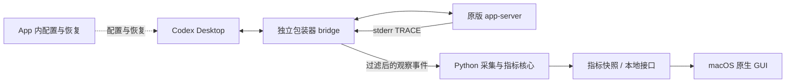

# GUI App：方案对比与选择

日期：2026-10-16 更新。状态：本轮本机 GUI、配置管理、迁移及有限验收已完成；回退已通过隔离进程验证，正式恢复后再接入已走通。独立发行包与后续验证边界见 [实施结果](implementation-results.md)。

后续 UI / UX 重设计已实现并更新本机 App，见[第 08 章](../08_gui_ui_ux_redesign/README.md)：紧凑面板、固定宽度菜单栏、整数 `T/s`、单会话思考 / 执行动效与弹出交互。本文保留首版方案与运行记录，当前界面及验证边界以[第 08 章实施结果](../08_gui_ui_ux_redesign/implementation-results.md)为准。

本文整理 2026-10-13 至 2026-10-16 的 GUI 讨论，以用户最后确认的选择为准。最新约定为：首次启动配置、App 内提供“配置 / 恢复配置”，恢复后由用户手动删除 App；直接误删通过启动脚本回退原版 CLI，并可重新下载 App 恢复配置。不增加常驻卸载 Helper，也不承诺拖入废纸篓后自动完整恢复与清理。此前的退出即恢复、自卸载及原生日志替代方案不作为首版方向。

当前目标是本机可运行。恢复相关的三项交互已确认，执行顺序见 [实施计划](implementation-plan.md)；方案、需求和计划文档不代表 GUI 或回退机制已经通过运行验收。

## 1. 阅读顺序

| 文档 | 内容 |
| --- | --- |
| 本文 | 产品目标、当前决策、界面方向和待定事项 |
| [产品需求](requirements.md) | 已确认的首版交互、配置与恢复、当前本机验收范围与实施设计边界 |
| [本机使用](usage.md) | 构建、启动、配置 / 恢复、退出和卸载步骤 |
| [实施结果](implementation-results.md) | 自动测试、原生界面、本机迁移与 A1–A12 的剩余边界 |
| [实施计划](implementation-plan.md) | 技术基线、数据契约、状态与迁移、分步实现、验证与回退 |
| [技术栈与打包](technology-and-packaging.md) | Python 打包、体积估计、Swift / Rust 重写、原生与跨平台 GUI 比较 |
| [采集与生命周期](capture-and-lifecycle.md) | 三条采集路线、hooks 能力、安装 / 退出 / 卸载的行为与恢复边界 |
| [原生日志静态调查记录](native-log-static-observations.json) | 未采用路线的版本、源码指纹、静态发现和未验证范围；不包含对话或生成内容 |

## 2. 已确认的产品目标

1. 做成 macOS 菜单栏常驻 App。菜单栏显示所有已接入 Thread 当前实时生成速度的合计，体验类似网速显示。
2. 点击菜单栏入口后展开面板，显示现有 Monitor 的聊天、项目、当前活动、耗时、Token 用量和速度等细节。
3. App 负责 Codex 接入的配置与管理，用户无需手工准备 Python、安装 pip 包或输入接入命令。
4. 首次启动自动接入，提供一键配置与恢复；正常卸载先恢复与清理，再由用户手动删除 App。恢复安装前仍由 Monitor 管理的配置，保留用户后来的修改。
5. 首版目标为 macOS 26 及以上，先在当前本机运行；保留未来跨平台可能性。GitHub 开源与 Release 分发为后续目标。

“所有 Thread”限于实际已接入、身份可关联且观测质量可判断的范围。不能把未接入的后端或远程聊天也算作已覆盖。

## 3. 决策记录

| 编号 | 议题 | 当前选择 | 状态与理由 |
| --- | --- | --- | --- |
| D1 | 首版平台 | macOS 26 及以上；当前先在本机运行 | 已确认。Intel 交付尚未确认，本机运行结果不代替全部目标系统的兼容性验收。 |
| D2 | 现有核心语言 | 保留 Python | 已确认。预计几十 MiB 的发行体积可以接受，当前无需因 GUI 重写已验证逻辑。 |
| D3 | Rust 迁移 | 留作后续方向 | 已确认本轮不迁移。若后续体积、性能、分发或跨平台需求推动，再评估 Rust 核心。 |
| D4 | 采集路线 | 保留现有 stdio 包装器 + 后端 TRACE | 已确认。继续结合协议生命周期与 stderr 增量，不切换到日志尾读或 hooks 替代方案。 |
| D5 | 配置生效周期 | 首次启动接入；App 内提供“配置 / 恢复配置” | 已确认。退出不恢复配置；恢复成功后可保留 App 再次配置，也可手动删除。 |
| D6 | macOS GUI 技术 | SwiftUI 视图 + AppKit 菜单栏 / 窗口 | 已确认实施基线。采用 NSStatusItem / NSPopover 起步，需通过最小本机构建与交互验证。 |
| D7 | Python 发行方式 | 自包含核心程序，随 App 交付；优先评估 PyInstaller `onedir` | 当前推荐。用户不依赖系统 Python；最终打包工具与布局仍需验证。 |
| D8 | Liquid Glass | 优先使用 macOS 系统提供的效果 | 使用原生 glass 图标与恢复按钮，本机浅色和 App 深色预览已检查；用户已手动对比降低透明度并恢复原设置。 |
| D9 | 卸载方式 | App 内恢复后手动删除；不增加常驻卸载 Helper | 已确认，替代此前自卸载 / 删除检测 Helper 的候选方向。直接删除不承诺自动完整恢复与清理。 |
| D10 | App 缺失兜底 | 配置阶段不再应用接入；包装器被调用时回退原版 CLI | 已实现并通过隔离子进程验证。脚本和原配置备份保存在 App 外。 |
| D11 | 退出与登录启动 | 退出停止采集，保留配置和必要桥接；登录启动默认开启、可关闭 | 已实现。旧 KeepAlive 已停用，新版桥接暂停 / 恢复与原生登录开关已验证；真实登出登录未测。 |
| D12 | 语言与范围 | 中文优先、保留多语言能力；不做 Codex 聊天跳转和长期历史 | 已确认。未来再补英文。 |
| D13 | 分发与当前交付 | 后续 GitHub 开源与 Release 分发；当前先本机可运行 | 已确认。公开分发、签名与公证不作为当前里程碑前置条件。 |
| D14 | 恢复后重开 | 保持未接入，只有主动点击“配置”才重新接入 | 已确认；首次全新启动以外不无条件自动配置。 |
| D15 | 运行中恢复 | 先恢复后续启动配置，等待 Codex 退出再清理；提前退出则下次继续 | 已确认。不强制结束 Codex，不增加后台清理 Helper。 |
| D16 | 清理与卸载 | 默认恢复保留少量 App 设置；可选清理本机数据并退出，用于卸载 | 已确认。安全清理完成后退出，再由用户手动删除 App；全部清理后重开按首次启动处理。 |

“恢复默认配置”在这里指恢复安装前的原值或原先未设置的状态，并保留用户后来的修改，不是统一写回出厂默认值。

## 4. GUI 信息组织

### 4.1 菜单栏总速度

已确认需要总速度，并采用“正常无生成显示零、不可用显示未知”的菜单栏约定；GUI 格式已由第 08 章统一为整数 `T/s`，部分覆盖显示 `—` 并在面板说明。以下指标规则延续现有语义：

- 总速度来自当前实时生成流，沿用现有累计文本重新分词的口径，不相加已完成的推理均速。
- 同一流只计一次，处理多个后端对同一聊天的重复观察，以及父聊天对子代理活动的镜像。
- 汇总覆盖后台 Thread 和子代理的独立生成流，不能简单把当前可见行或父子行的数值相加。
- 沿用约 2 秒速度窗口与 1Hz 展示刷新作为起点，内部事件接收不降为 1Hz。
- 确认没有生成、观测不可用、仅有部分数据应能区分；不能把未知值默认为零。
- 菜单栏在固定区域显示总速或 `—`；单主会话确认思考 / 执行时改为对应动画，多主会话始终显示总速。具体原因在面板说明。
- `0 token/s` 只说明当前未观察到生成，不等于任务空闲，工具执行或隐藏推理仍可能继续。

全局汇总与版本化 overview 已实现；核心去重与覆盖质量测试通过，日常已观察到完整覆盖的双独立流窗口，证据范围见实施结果。

### 4.2 展开面板

采用紧凑聊天列表，主列表展示标题、项目、动作、耗时和生成速度，用量及工具活动按需展开。主聊天平铺并标注项目，活跃聊天优先；子代理归在父聊天下，可展开。保留有限最近完成项，不增加完整历史浏览、全天曲线或长期统计。第 08 章已把首版 720×520 pt 改为 420 pt 宽、自适应高度；最近完成项仍为 10 分钟内最多 10 项，默认折叠。每个聊天承接现有信息：

| 信息 | 延续规则 |
| --- | --- |
| 聊天 / 项目、活动、耗时 | 沿用已有面向用户的动作和持续时间语义，不直接展示协议事件名。 |
| 实时生成速度 | 正文、计划、可见摘要、工具参数等去重后的接收速度；不是完整隐藏推理速度。 |
| 本回合 Output / Reasoning | 使用可靠关联的服务端用量；Reasoning 是 Output 的子集，不再次相加。 |
| 最近推理均速 | 保持事后观测窗口估算、最近有效值保留和缺失时显示未知的规则；不宣称纯模型推理吞吐。 |
| 工具活动细节 | 保留准备 / 执行的证据区别和并行活动，不把参数生成完毕当作执行开始。 |

不复制 Codex 已有的审批、用户输入操作或通知，不提供聊天跳转。首版中文，保留多语言扩展能力，英文后续补齐。设置统一位于顶部齿轮，工具和子代理按聊天展开。

### 4.3 配置与后台职责

GUI 提供接入状态、“配置 / 恢复配置”和登录启动开关。关闭展开面板只改变显示；退出 GUI 停止采集，不恢复 Codex 配置，也不得中断承载中的 Codex 任务。不增加常驻卸载 Helper；既有桥接与采集器仍是核心组件，见 [生命周期说明](capture-and-lifecycle.md)。

## 5. 推荐的职责划分

现有 bridge、collector 和终端看板已经分进程。GUI 建议复用这一边界，优先消费快照或稳定的本地接口；即使未来统一语言，也应保持桥接与 GUI 生命周期独立。采集 / 显示失败应降级为观测缺口，包装器本身位于关键通信路径，仍需单独保护。

图中的 GUI、配置管理、全局汇总和启动回退已实现。当前文件路径、进程职责与验证边界见 [现有架构](../02_product_mvp/architecture.md) 和 [进程管理](../02_product_mvp/startup-and-processes.md)。

## 6. 实施设计与待验证范围

| 事项 | 实施与待验证证据（详细结果以实施记录为准） |
| --- | --- |
| 原生 GUI | 以 `NSStatusItem` / `NSPopover` 承载 SwiftUI 起步，验证 Liquid Glass、数字刷新与面板行为。最低系统版本为 macOS 26。 |
| 本机构建与后续发行 | 当前本机运行与核心联通；PyInstaller 包体积、全新机器离线完整性、签名与公证属于后续发行验证。 |
| 汇总速度 | 独立流去重、子代理镜像、部分覆盖、断连和快照过期的汇总规则与文案。 |
| 后台实现 | 退出停止采集、登录启动可关闭的实现；与当前 KeepAlive、已有桥接和单采集器的兼容。 |
| 安装可靠性 | 重复安装、失败回滚、安装中崩溃、原配置精确记录，以及对已有非默认接入的兼容处理。 |
| 恢复后的重开行为 | 需求已确认保持未接入；实现偏好持久化与首次启动区分，并验证 A11。 |
| 运行中恢复与清理 | 需求已确认等待依赖退出、提前退出则下次继续，以及可选清理后退出；实现持久化与重试，并验证 A7 / A12。 |
| 误删与恢复可靠性 | App 缺失时不再应用接入、启动脚本回退原 CLI、重新下载找到原备份，以及清理旧进程依赖的验证。 |
| 升级 | Monitor 更新不破坏恢复记录；Codex 更新后的兼容性检查与失败回退。 |

分步产出与完成条件见 [实施计划](implementation-plan.md)。本机 GUI、配置迁移和隔离验证已经执行；逐项结果与剩余日常验收见 [实施结果](implementation-results.md)。

## 7. 既有依据

- [产品架构与工作方式](../02_product_mvp/architecture.md)：当前接入、日志和协议职责及故障边界。
- [启动步骤与进程管理](../02_product_mvp/startup-and-processes.md)：启动环境、LaunchAgent 与已有进程的恢复边界。
- [事件消费与展示决策](../03_event_lifecycle_and_progress_display/event-display-decisions.md)：显示语义与不重复审批操作的约定。
- [易用性需求](../04_usability_and_localization/requirements.md)：刷新、文案与多语言基础。
- [Token 用量与推理均速需求](../05_token_usage_and_reasoning_speed/requirements.md)及[实现结果](../05_token_usage_and_reasoning_speed/implementation-results.md)：保留的指标与已测边界。
