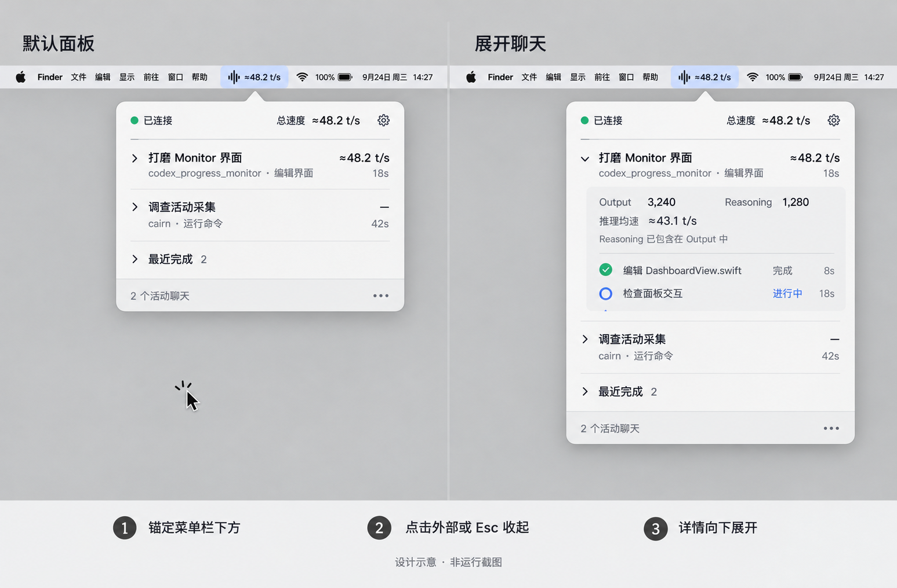
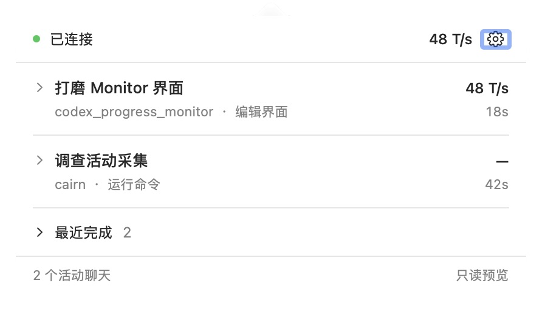
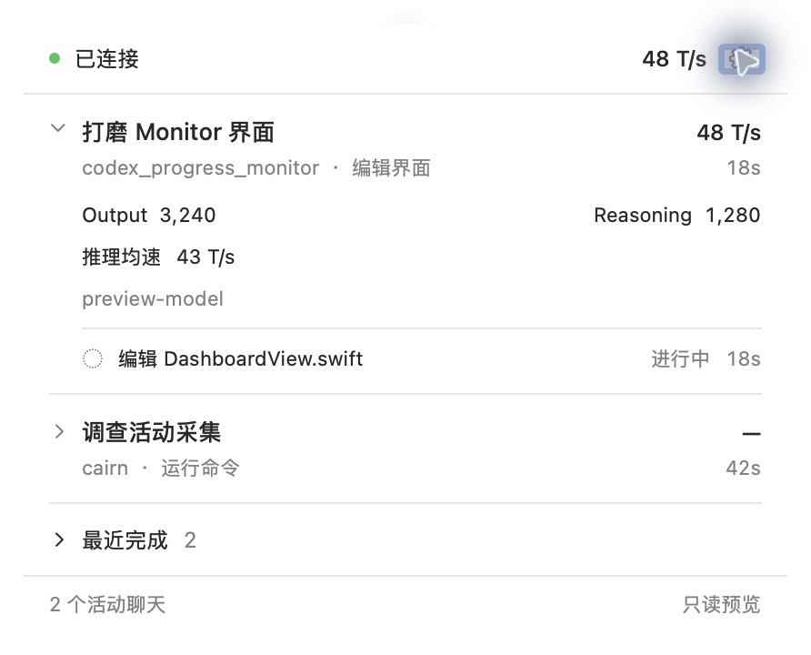

# GUI UI / UX 重设计

日期：2026-10-16。状态：已实现并更新本机 App。102 项 Python 针对性测试、23 项 Swift 测试通过；原生交互与剩余环境边界见[实施结果](implementation-results.md)。未提交或推送。

本轮把现有面板改为紧凑的菜单栏工具：生成时看速度，单会话思考 / 执行时看动态状态；打开后快速查看聊天与当前动作，再按需展开细节。修复面板覆盖菜单栏和点击外部不收起的问题。

## 阅读顺序

| 文档 / 材料 | 内容 |
| --- | --- |
| [产品需求](requirements.md) | 已确认范围、菜单栏状态表、会话计数、交互与验收要求 |
| [设计细节](design-spec.md) | 面板布局、信息层级、尺寸起点、动效与设计稿说明 |
| [实施计划](implementation-plan.md) | 当前代码缺口、最小数据契约、分步修改与针对性验证 |
| [实施结果](implementation-results.md) | 最终参数、源码指纹、U1–U10 验证层次及本机更新结果 |
| [合成原生面板](assets/native-panel-preview.jpg) / [展开详情](assets/native-panel-expanded-preview.jpg) | 当前原生实现截图，使用合成聊天；不含真实对话 |
| [可复用原生预览](../../experiments/gui-redesign/README.md) | 独立只读 App、固定快照、外观及动效检查方法 |
| [面板设计原稿](assets/panel-concept-v1.png) | 对话中选定的默认面板与聊天展开布局，保留原始图片 |
| [菜单栏动态预览](assets/status-motion.html) | 可在浏览器打开的完整 HTML，切换思考 / 执行 / 生成 / 多会话 |
| [动态预览可编辑源](assets/status-motion.fragment.html) | 动态预览的 HTML 片段，生成态已按最终决定改为纯数字 |

## 当前定稿

- 菜单栏默认容纳 `999 T/s`，更长数值按需扩宽，速度统一为整数 `T/s`，不显示 `≈`；生成态不加图标或打字光标。
- 单个活跃主会话：生成显示数值，思考显示三个位置固定的小点依次明暗变化，执行显示小锤子敲击。
- 多个活跃主会话：始终显示总生成速度；完整观测且没有生成时为 `0 T/s`，不可用时为 `—`。
- 面板 420 pt 宽，高度随内容变化；默认聊天采用两行，Token 用量、推理均速、工具和子代理按需展开。
- 面板在菜单栏下方展开；外部点击、再次点击入口、`Esc` 和切换到其他应用可收起。
- 设置集中管理配置、恢复、登录启动和退出；收起面板继续采集。

## 设计原稿与后续决定

这是 ImageGen 生成的设计示意，图中的聊天、指标与日期均为示例，不是运行截图。原稿确定布局方向，但早于后续菜单栏细节讨论，以下内容由最新需求替代：

| 原稿内容 | 最终要求 |
| --- | --- |
| `≈48.2 t/s` | `48 T/s`；所有 GUI 速度统一为整数、大写单位、无约等号 |
| 菜单栏波形图标 + 速度 | 生成态仅速度；单会话思考 / 执行时在同一固定区域显示动画 |
| 详情中常驻口径说明 | `Output` / `Reasoning` 的包含关系和速度估算口径移入悬停说明 |
| 顶部齿轮与底部省略号并存 | 保留一个顶部设置入口，不重复设置入口 |

HTML 动态预览保留初轮的原尺寸和 3× 放大视图，包括小点跳动与约 1.65 秒锤子节奏。当前原生版本为 47 pt 基准区域、约 1.35 秒固定位置三点明暗变化、约 3.3 秒锤子节奏；后续调整及证据见实施结果。HTML 自带预览外壳，可脱离聊天打开；图标及浮层库从版本固定的 CDN 加载，需要网络。它使用设计数据，不读取真实快照、不控制 Monitor。

## 当前原生实现

以上来自独立只读 Preview App，含“只读预览”标记。默认内容 420×229 pt，展开首条后为 420×334 pt；截图是系统高分辨率输出，图片像素不是布局 pt。正式 App 采用同一组件且不显示预览标记。

## 设计材料保存检查

- PNG 与本次对话中的原始生成文件逐字节一致，未修改图像。
- 本章及导航入口的本地链接检查通过；新增文本无行尾空白。
- 独立 HTML 已在浏览器打开，确认生成态为纯数字 `48 T/s`、没有附加图标；生成 / 执行切换保持 92 pt 区域，敲击动画运行且可暂停。
- 以上是首次保存设计材料时的检查；本轮产品测试及原生验证单独记录在实施结果中。

## 与既有文档的关系

[第 06 章](../06_gui_app_options_and_decisions/README.md)继续记录首版 GUI 的技术、接入、配置恢复、生命周期和既有验收。本章是其后续 UI / UX 变更；实现本轮界面时，以本章的布局、格式和状态展示要求为准。原指标定义、覆盖质量和管理事务继续沿用既有实现。

本轮已修改产品代码并替换日常 App，正常退出旧 GUI 后恢复采集；没有重启 Codex 或桥接，也没有执行正式恢复、清理、提交或推送。设计稿和 HTML 继续作为设计参考，原生验证与运行边界以实施结果为准。
