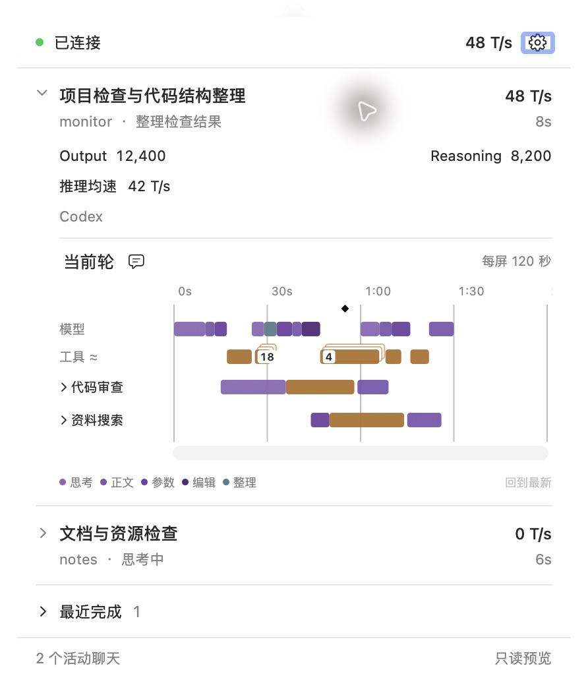
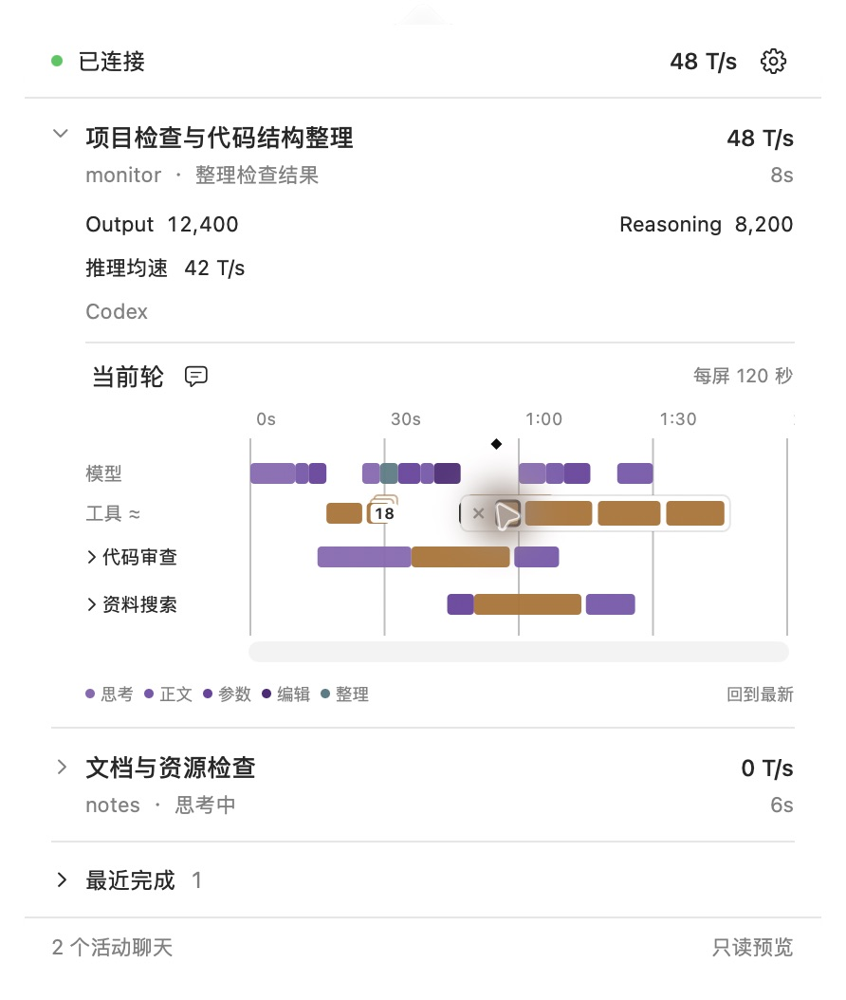
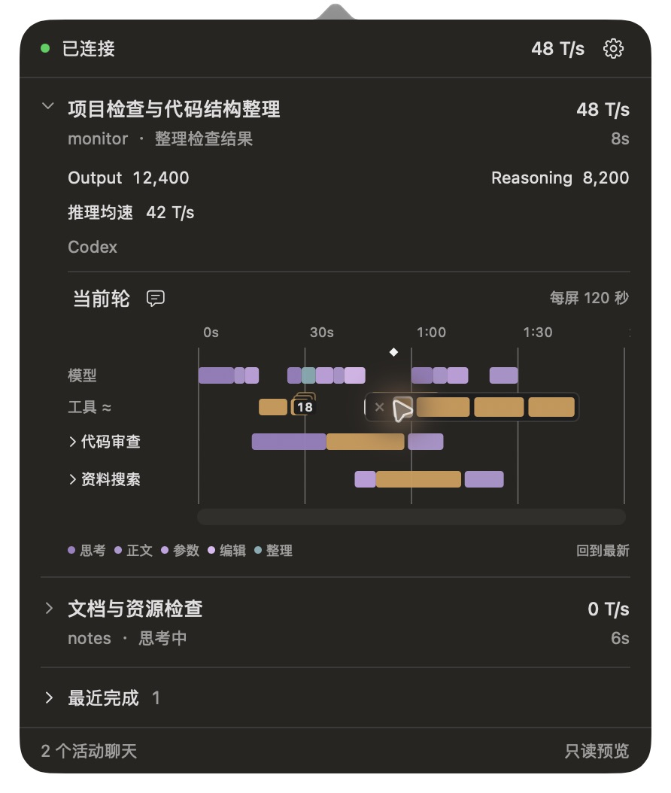

# 活动时间线：重叠展开与固定范围

2026-10-19 更新：工具 12 pt 最小宽度、层叠入口及横向覆盖展开已由[来源时间、短线与多工具详情](true-time-tools.md)替代；本文保留旧版证据范围。

日期：2026-10-17。状态：已实现、完成下述针对性检查和原生预览，日常 Monitor 已更新。本轮替代[上一轮调整](refinement-results.md)中的工具水平顺延和手动缩放；原始参数／结果、用户消息标记及上下文整理规则继续沿用。未提交、未推送。

本文件记录前一版的 60／120 秒方案及其验收；该比例策略已由[固定时间比例](fixed-scale.md)替代。工具重叠收起／覆盖展开继续沿用，模型阶段排除规则已在下文纠正；旧截图不代表新比例。

## 展示规则

展开菜单内容仍宽 420 pt，轨道绘制区域通常约 291 pt。取消菜单与查看器中的放大／缩小按钮，以被动文案显示“每屏 60 秒”或“每屏 120 秒”。

- 轮次来源跨度不超过 60 秒时，一屏 60 秒；超过后切到一屏 120 秒。
- 达到 120 秒后比例保持，横向滚动浏览后续；整轮内容不设时长截断，不持续缩小来塞下全部历史。
- 根据实际视口宽度计算比例，保留左右各 4 pt 余量；首次尚未完成布局时采用菜单宽度起点，实际布局／窗口大小变化后重新计算。
- 工具最小宽度仍为 12 pt。在约 291 pt 视口中，两档分别相当于约 2.54 秒和 5.09 秒；真实耗时不变。模型保留来源位置与原有短活动样式。

## 收起与展开

所有活动恢复来源时间对应的起点，取消让工具依次右移的排布。主工具轨、各子工具轨分别处理；子智能体汇总中的重叠也使用同一显示规则。

同一可视行内的工具矩形发生重叠时，默认合成有层叠边缘及数量的入口，覆盖该组的来源范围。最小显示宽度也可能使很短但顺序执行的工具产生视觉重叠，因此文案使用“重叠活动”，不能仅凭层叠认定全部工具同时执行或推断调用树。模型阶段不参与该分组，汇总行也只对工具分组。

点击层叠入口后，在该行向右平铺成员块。展开条拥有独立背景、关闭入口和最高绘制／命中顺序，覆盖后面的时间块；后续模型和工具的来源矩形均不变。点击具体块直接打开原始详情，间隙不穿透到底层活动。展开条过长时允许横向滚动，不挤动其他块。

点击展开条外部、点击关闭入口、按 Esc 或离开窗口时收起。菜单打开时，第一次 Esc 优先收起展开条；无展开条时沿用关闭菜单行为。切轮关闭展开状态；同轮刷新按稳定阶段身份保留成员，来源活动已移除时清理。鼠标、键盘和 AX 使用相同几何；键盘可展开并逐项访问。

模型点击区有多候选时，直接选择矩形中心最近的阶段，悬停使用相同规则；不会把模型变成展开条。键盘及 AX 可分别访问每个阶段。工具层叠只表示重叠；展开态只是选择界面，其成员横坐标不能读作新执行时间。

## 改动范围

- `Timeline.swift`：60／120 秒范围、来源位置布局、重叠分组及独立展开几何。
- `TimelineSurface.swift`：绘制、鼠标／键盘／AX、遮挡、关闭和实际视口变化。
- `TimelinePanelView.swift / TimelineStore.swift`：移除手动缩放，显示当前范围。
- `PopoverController.swift`：Esc 优先交给正在展开的时间线。
- 中文资源、Swift 定向测试与合成预览。

本轮不修改 Python 产品投影、历史读取、实时指标、管理或观察契约。不增加正文副本，不重新推断执行关系，不提交或推送工作区内容。

## 验收记录

| 检查 | 结果与证据边界 |
| --- | --- |
| 时间比例 | 60 秒边界、120 秒上限、超过一小时仍保留历史可滚动；按实际视口重算，未布局首帧不使用零宽度。Swift 测试及原生菜单／查看器验证。 |
| 来源位置 | 长并行工具、100 个密集短工具、父子工具轨和汇总轨不再顺延；展开不改变后续模型／工具矩形。Swift 几何测试。 |
| 收起／展开 | 层叠数量、横向覆盖、背景不穿透、点击间隙不触发底层；成员移除后清理。Swift 模型与 App 测试。 |
| 相接边界 | 浮点舍入不把首尾相接的模型阶段画成层叠组。新增回归和最终原生截图验证。 |
| 原生指针与键盘 | 实际鼠标点击层叠入口，直接展开；选成员打开原始详情；Right／Return 可访问组中第二个工具；Esc 优先收起并保持菜单，点击外部收起。 |
| 长展开条 | 18 个短工具的末端可通过水平滚动条到达；后续基础块不移动。未对所有鼠标／触控板滚动设备逐一验证。 |
| 浅／深色 | 独立只读 Preview 验证两种外观，未取得日常观察租约；结束后关闭所有本轮 Preview 和 fixture writer。 |
| 实际聊天 | 新日常菜单显示每屏 120 秒，无缩放按钮；真实聊天中的重叠组可展开／Esc 收起，无候选菜单。没有为验收另建真实并行调用、子智能体或压缩任务。 |

执行 `swift test --disable-sandbox --cache-path .local/swift-cache --package-path macos`：模型 30 项、App 实际执行 20 项通过，共 50 项；原有 WindowServer 窗口测试默认跳过。它的上一轮独立通过证据继续保留，本轮查看器通过原生操作检查。`bin/build-gui --preview`、`bin/build-gui`、中文资源 `plutil` 检查与差异空白检查通过。

Python 产品代码未修改，运行快照中的 Python 源码身份与重开前一致；原始内容、只读历史、存储和指标沿用上一轮定向检查，不重复完整矩阵。源文件与暂存区哈希基线、测试日志和运行元数据保存在本机忽略目录 `.local/overlap-ui/`，没有保存额外真实聊天截图或全文副本。

## 原生截图

以下聊天、输出、速度和 token 数均为手写合成数据。收起和展开两图使用相同来源记录；展开覆盖工具行右侧的独立工具，模型位置保持一致。







## 本机加载与限制

通过正常退出／重开日常 Monitor 载入新 GUI，没有重启 Codex。构建指纹与当前 Swift 源码及资源匹配：

```text
236bb2a8790546560a1675913c329092b6be8e1a4220fe49c5321590167ef57c
```

接入身份及原配置备份哈希保持不变；新观察 owner 正常运行。关闭菜单后 collector 仍在运行，检查时快照年龄约 0.28 秒。当前轮跨越重载，已有观测缺口和总速度 `—` 照实保留，不通过历史内容补造实时覆盖。

这次是本机定向检查及原生交互验收，未重跑安装／卸载、Remote、长期自然使用或发行矩阵。最小显示宽度仍会使很短的顺序工具形成视觉重叠；展开态的横向选择位置也不表达精确时刻，详情继续显示来源记录的耗时。
