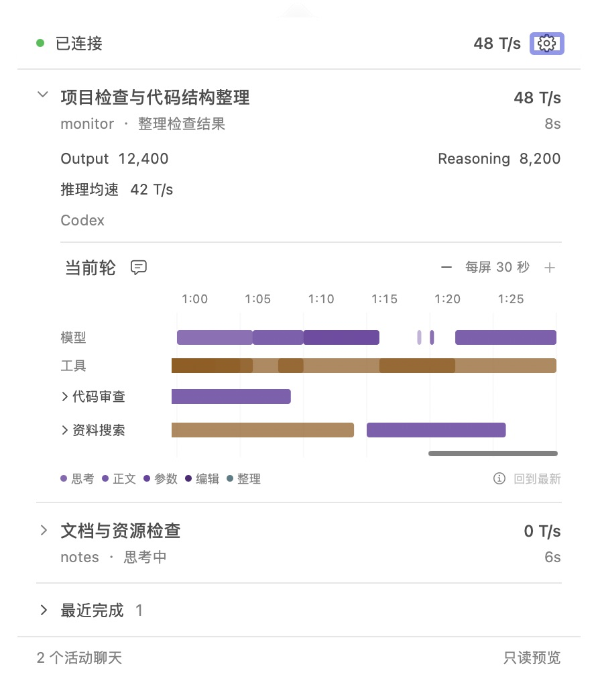
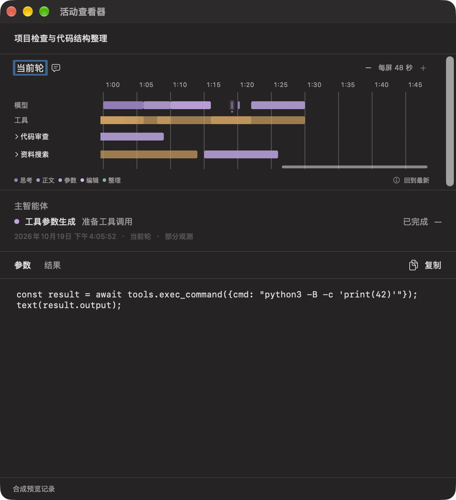

# 展开面板：第二轮 UI/UX 调整

后续更新：选中与结果状态以[选中与结果状态](selection-status.md)为准；本文保留滚动、缩放、默认定位及早期选中样式的原始证据。

日期：2026-10-19。已实现并完成本轮定向回归、浅／深色原生合成预览。本轮提交包含代码、测试与合成预览；未推送。

## 交互与视觉

1. **原生细滚动条。** 时间线继续使用 AppKit `NSScrollView`，改为 `.overlay` 和 `.small`。空闲自动隐藏，滚动时显示系统细条；不再为常驻滚动槽预留 13 pt。苹果 [Scroll views](https://developer.apple.com/design/human-interface-guidelines/scroll-views) 明确允许紧凑面板使用 small／mini 滚动条；[scrollerStyle](https://developer.apple.com/documentation/appkit/nsscrollview/scrollerstyle) 提供原生样式。浮层的自动隐藏由系统管理，`autohidesScrollers` 只影响 legacy 样式是否因溢出而占位，不能把它当作浮层的空闲隐藏开关。
2. **30／60 秒两档。** 默认参考绘图区 291 pt 对应 30 秒，减号切换到 60 秒，次序符合放大／缩小的含义；到达边界的按钮禁用。比例分别是 `(291−8)/30` 和 `(291−8)/60 pt/s`。菜单与详情共用同一聊天的档位；宽窗口显示实际可见秒数，不强制仍显示 30／60。窗口缩放、轮次增长仍不自动改变所选比例。跟随时切换保持最新；阅读时以可见的选中活动为锚，无选中活动时保留视口中心时刻。档位在当前 GUI 会话中按聊天保留，重新启动默认 30 秒。
3. **运行中默认最新。** 运行中的聊天重新展开、菜单重新打开时回到当前轮最新位置；新轮到来时清理旧轮选择并恢复跟随。在同一次展开内，向前滚动或选择活动暂停跟随，点击“回到最新”恢复。查看器不在每次刷新时强制跳转。已完成聊天保留阅读位置。
4. **短活动至少 3 pt。** 模型与工具统一使用 3 pt × 11 pt 的可见短线，点击区等于可见符号；相邻模型活动仍按最近中心选择，工具仍只选择点击位置命中的集合。原来的“三颗点”来自缺少开始时间或带质量标记的极窄矩形虚线边框，不是三个新事件。移除这层虚线，部分观测保留较淡填充、悬停／AX 提示、整体信息提示和详情说明。符号宽度不用于计算耗时，未知仍显示未知。
5. **选中保留原色。** 移除黑色描边，使用同色 16% 淡底衬和下方 1.5 pt 细线，短线与长块遵循同一规则。选择装饰不扩张命中区或修改来源时间；失败／中断继续用红色状态线。

## 验证记录

- 初轮 Swift 检查：模型 32 项、App 26 项通过，原有 WindowServer 独立窗口测试 1 项默认跳过。加入两档比例／中心与选择锚点、重新展开与新轮跟随、外部滚动暂停跟随的回归；调整短活动与默认比例的既有断言。
- 原生检查发现，限制为当前鼠标事件才暂停跟随会漏掉辅助滚动操作；已撤回此限制，继续用布局更新保护区区分自身移动和外部滚动。修正后重跑相关模型 16 项、App 13 项通过，原有窗口测试仍跳过；不重复未受影响的完整矩阵。
- 浅色原生菜单：默认“每屏 30 秒”，90 秒夹具位于右端；减号切到“每屏 60 秒”仍在右端，加减按钮边界禁用正确。浮层滚动条显示为细条、空闲隐藏。
- 深色原生验证窗口：外部 `Scroll Left` 后滚动条值由 1 变为约 0.9903，“回到最新”启用；收起／重新展开运行中聊天后回到 1，按钮禁用。
- 实际鼠标点击 46 毫秒模型短线，打开对应的思考摘要；缺少开始时间的参数短线打开自身详情，耗时为 `—` 并显示“部分观测”。长工具选中显示同色淡底和细下划线，没有黑框。
- Preview 与日常构建通过。日志、真实界面基线及运行元数据位于被忽略的 `.local/panel-ux-round2/`。公开截图只使用独立只读合成数据，不创建观察租约、不读取真实历史。

本轮不修改 Python 采集、历史、投影或用量口径；没有重跑发行、Remote、长期自然使用或完整 VoiceOver 矩阵。

## 本机加载

通过现有管理接口停止旧观察会话后重开日常 GUI，新进程取得观察租约，采集器快照继续更新、`timeline_available=true`；检查时心跳约 0.45 秒、快照约 0.21 秒。接入身份、原配置备份和运行目录保持一致。源码与日常构建指纹匹配：`1541f5a9012f599343611ac0e131cf639d3e96ba2d2bfcbc35157d2009081fc1`。

实际展开本对话的日常菜单，AX 确认“每屏 30 秒”、减号可用／加号禁用、滚动条位于 1、“回到最新”禁用；正在运行的活动可见。跨重载的 Output／Reasoning 继续显示 `—`。真实 AX 记录仅保存在本机忽略目录，没有进入文档图片。

只读 Preview 与合成数据写入进程已退出。跨重载实时覆盖仍按原契约显示未知，不用历史补造用量。
