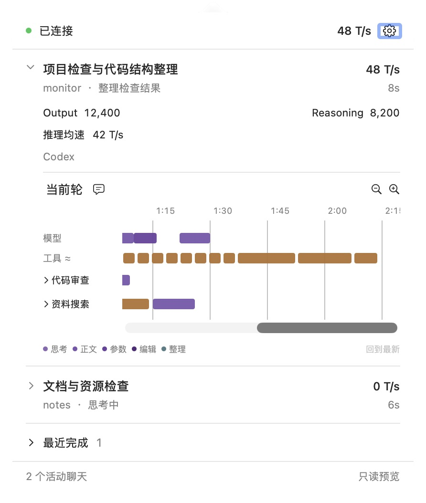
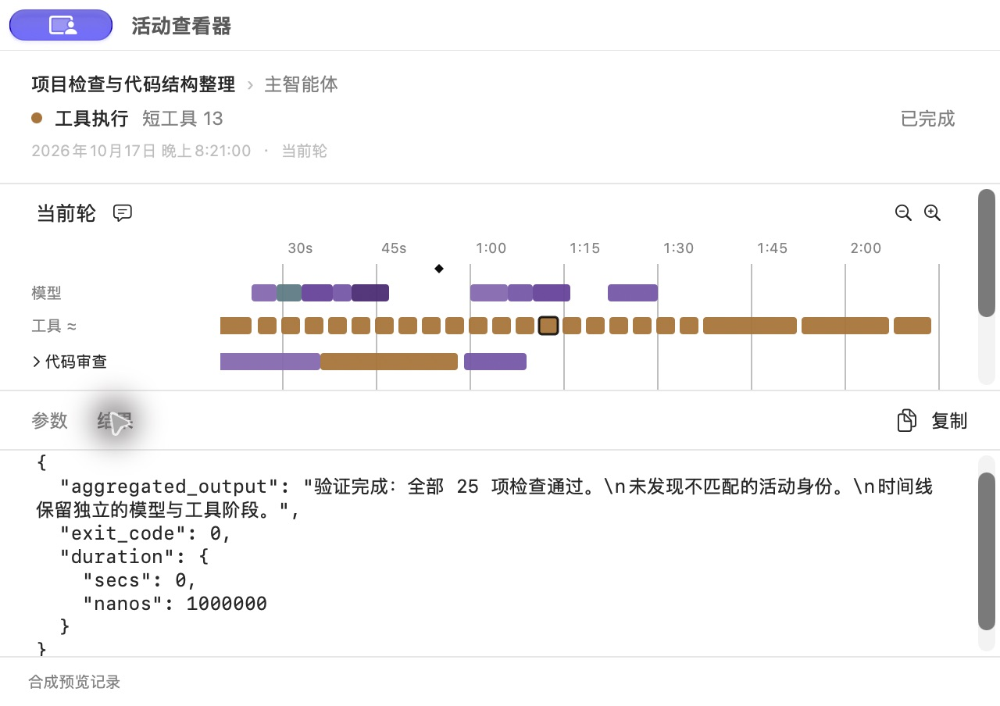
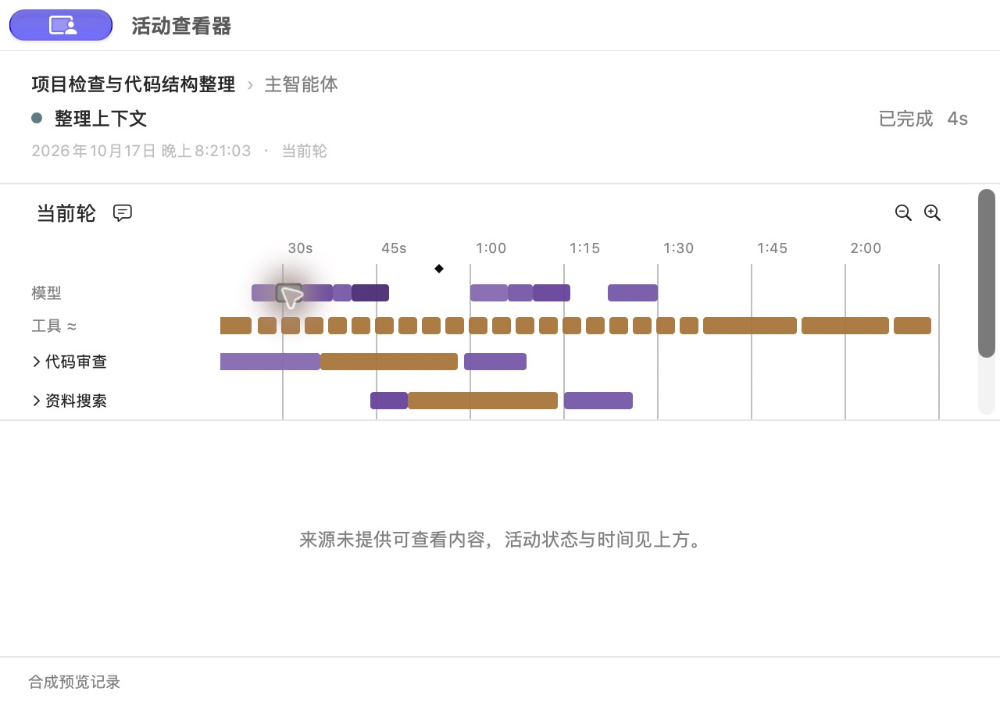

# 活动时间线：后续调整结果

日期：2026-10-17。对应[改动点](refinement-changes.md)与[实施计划](refinement-plan.md)。Q0–Q4 已实现并完成下述针对性检查和本机更新；未提交、未推送。首轮[实施结果](implementation-results.md)与[验收记录](validation-results.json)保留原有含义。

## 已交付行为

- 普通菱形只表示用户消息；首条从轮次标题访问。hook、buffering、审批、重试、连接与旧压缩完成通知不再成为可点击活动，也不进入键盘或可访问序列。观察缺口保留质量提示。
- 上下文整理是模型轨上的独立过程条，复用 canonical 阶段身份与可用起止时间。只有完成边界时耗时仍未知；来源没有正文时说明“来源未提供可查看内容”，不再误报历史被删除。
- 保留现有内部工具投影。工具采用最小显示宽度，按来源时间锚和稳定 ID 向右顺延；绘制、点击、悬停、选中、AX 和滚动定位共用矩形。普通工具直接打开详情，模型或汇总轨的真实重叠仍可消歧。
- 工具和参数生成活动统一“参数／结果”。原始字符串不重新解析，对象、数组及合法标量按 JSON 展示；文件修改直接显示 `changes/status` 等字段，不重建 diff。
- 字段缺失、空字符串、`null/false/0`、分页、来源截断、尚未落盘、无正文和来源不可用分别表达。只认已确认的结果截断格式，普通代码中的截断字样不触发提示。

| 最终参数 | 数值／规则 |
| --- | --- |
| 工具最小显示宽度 | 12 pt |
| 工具间距 | 3 pt |
| 默认时间比例 | 4 pt/s，保留原有缩放范围 |
| 同轨顺序 | 来源时间锚，再按稳定阶段 ID |
| 画布右端 | 同时覆盖来源范围和顺延后的全部活动，保留 24 pt 尾部空间 |
| 近似布局说明 | `工具 ≈`，附帮助与可访问名称 |
| 模型／上下文整理／输入 | 保留来源时间位置 |

顺延不写回来源时间、元数据或回合总耗时，也不能用来推断工具串行关系。读取旧位置时不恢复自动跟随；视口内选中活动在增长、缩放时优先维持位置。主工具轨、各子工具轨和子智能体汇总中的工具分别排布。

## 文件范围与来源契约

Python 变更集中在 `timeline.py` 的展示投影、`timeline_query.py` 的合流／可用性和 `history.py` 的原始内容读取。Swift 变更集中在布局、轨道说明、配色、查看器和中文资源；另补针对性测试与合成预览。

实施前记录了工作区文件哈希及暂存区差异哈希。本轮保留首轮暂存内容，不清理或重新暂存其他工作。相对该基线，bridge、Engine、事件过滤、collector、实时指标、用量、集成及 App 管理／观察会话代码均未修改；没有新增完整正文副本或问答恢复逻辑。

来源契约对照本机 Codex 源码版本 `806d9732c974bc8a51b8317c1bd8985544fe627c` 的 `protocol/src/items.rs` 与 `rollout/src/policy.rs`，并保留其文件哈希。本轮核对的 canonical 命令结果使用 `aggregated_output`、`exit_code`、`duration`；其中耗时值是包含 `secs/nanos` 的对象。展示保留这些实际字段，不统一伪造为 `output` 或 `duration_ms`。raw 调用仍分别读取 `arguments/input`，按明确 `call_id` 读取对应 `output`。

详情 DTO 只增加可选 `item_type/notice` 等兼容字段，查询版本继续为 1。新 GUI 对旧 marker 投影也做过滤；旧侧文件只在查询中转换，不回写或迁移源内容。

## 本轮检查

| 编号 | 实际检查与结果 | 证据层次／范围 |
| --- | --- | --- |
| F01 | 旧侧文件的状态 marker 隐藏，用户消息仍可访问，gap 质量保留；原生预览中的旧 hook 不出现 | Python 查询测试、Swift 兼容解码、合成原生 UI |
| F02 | 首条与同轮后续输入不另开 turn；重复 canonical 投递不增点，失败 steering 与 resolved 提问不造输入 | Python 输入／历史／查询夹具；未新增专门问答适配 |
| F03 | compaction 开始／完成只形成一个稳定 canonical 过程，旧完成通知不再画点；完成单边未知，旧侧文件和历史可用，无正文返回 `no_content` | Python 投影／历史／查询、Swift 兼容、4 秒合成原生过程；本轮未重新触发真实 compaction |
| F04 | 100 个零／毫秒级工具稳定顺延，长并行工具保留耗时宽度，父子工具轨独立；模型位置及源区间不变 | Swift 布局测试；18 个短工具合成预览 |
| F05 | 工具命中矩形不横向扩大；实际鼠标直接打开短工具，键盘打开活动，横向滚动可到最后一项；模型重叠原有消歧继续通过 | Swift 几何测试、原生鼠标／键盘／滚动；AX 复用同一矩形，未另跑屏幕阅读器 |
| F06 | 活跃增长和缩放保持选中工具阅读锚；切轮与迟到详情不覆盖当前选择；阅读旧位置可暂停跟随 | Swift 布局／Store 测试、合成长轮滚动；回合耗时不取显示宽度 |
| F07 | raw function／custom 和 canonical 命令、MCP、动态工具、文件修改按字段取值；按 call ID 配对，不拼装 diff | Python 原始内容夹具、来源字段核对；日常 App 实际命令参数／结果可读 |
| F08 | JSON 字符串原样、结构返回不展平；空字符串、null、false、0、空集合与缺字段可区分；文件修改参数区显示缺失说明 | Python 内容测试、Swift 详情解码、原生参数／结果切换；选择／复制沿用既有查看器 |
| F09 | 长结构化返回分块重组一致且仍为 available；明确来源截断与普通代码区分；已知源文件删除、内容暂缺、只读查询分别检查 | Python 历史／查询／存储测试，原生 compaction 无正文与文件缺参数状态；未逐一原生操作全部错误组合 |
| F10 | 查看器窗口回归通过；关闭日常查看器后采集继续，快照持续更新、原观察 owner 不变；只读历史不创建 lease 或事件 socket | Swift 窗口测试、Python 只读检查、本机运行；未改动的指标／管理语义复用首轮证据 |

实际命令与结果：

```sh
PYTHONPATH=src:tests .local/venv/bin/python -m unittest test_timeline test_history test_timeline_query test_timeline_storage
swift test --disable-sandbox --cache-path .local/swift-cache --package-path macos
MONITOR_WINDOW_TESTS=1 swift test --disable-sandbox --cache-path .local/swift-cache --package-path macos --filter viewerReusesWindowAndPreservesResizedFrameAcrossContentChanges
bin/build-gui --preview
bin/build-gui
```

- Python：48 项通过。
- Swift：模型 28 项通过；普通 App 测试实际执行 17 项通过，窗口项默认跳过；随后在图形会话中单独执行该窗口项并通过，共实际通过 46 项。
- Preview 与日常 GUI 均构建成功；中文资源 `plutil` 检查通过，合成截图只包含预览数据。
- 文档链接、差异空白及暂存区／边界哈希检查另记录在本机 `.local/refinement/`。该目录包含私有运行元数据及日志，不纳入 Git。

## 原生预览

独立只读 Preview 使用手写合成数据，不读取日常历史或取得管理／观察 lease。检查了浅色、深色、窄面板、子智能体汇总／展开、鼠标直接点击、键盘打开、横向末端及纵向滚动、原始结果与无正文状态；结束后关闭了 Preview 及 fixture writer。

截图中的聊天、代码、输出、速度、token 和“25 项检查”等均为合成内容，不代表实际测试结果；实际数量以上节为准。







## 本机加载状态

构建后通过正常退出／重开日常 Monitor 载入更新，没有重启 Codex。collector 快照中的 `timeline/history/timeline_query` 源码哈希与当前文件一致，查询 socket 和元数据文件可用，未出现时间线投影错误。GUI 构建指纹为：

```text
641a35af5eb06aa30414056a6845da0891c1d7ef67e7620af6c55899ddf7e568
```

该指纹与当前 Swift 源码及资源重新计算值一致。接入身份、原配置备份及原安装信息哈希保持不变；正常重开产生新的观察会话。日常界面已显示 `工具 ≈`，实际命令详情的参数区有 `command/cwd`，结果区有 `aggregated_output/exit_code`，没有误报源历史删除。关闭查看器后 collector 仍运行，快照检查时年龄约 0.14 秒，观察仍 active 且 owner 未变。

本轮任务跨越 collector 重载，当前轮的观测缺口照实保留，用量覆盖不足仍显示 `—`；不能把来源历史补齐当作实时指标覆盖已经恢复。

## 保留的限制

- 工具轨只表达大概耗时分布。很密集或很长的并行工具可以把画布明显推长；精确时间以来源详情为准，未知不补造。
- 只有来源实际保存的内容可以查看。部分持久化结果或此前的工具输出预算已经截掉的内容不能恢复；Monitor 分块只加载已有后续内容。
- 本轮 compaction、子智能体和长原始结果的新行为以源码、合成数据与原生预览为主，没有为验收新增真实压缩或真实子智能体调用，也未覆盖所有原生错误状态组合。
- 实际聊天检查只证明本机新构建和相关读取路径已经载入；不代表长期自然使用、Remote、发行签名、全新设备安装或其他 Codex 版本兼容。这些范围未在本轮重跑。
