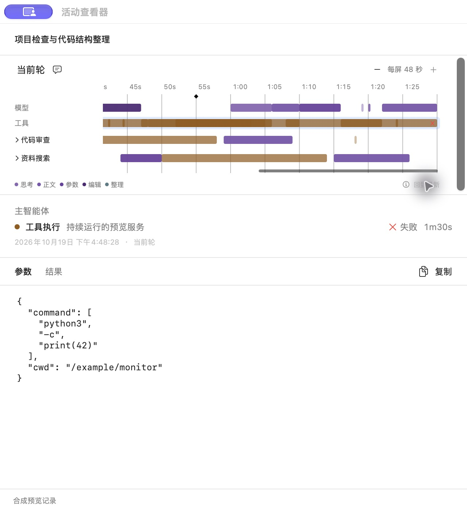
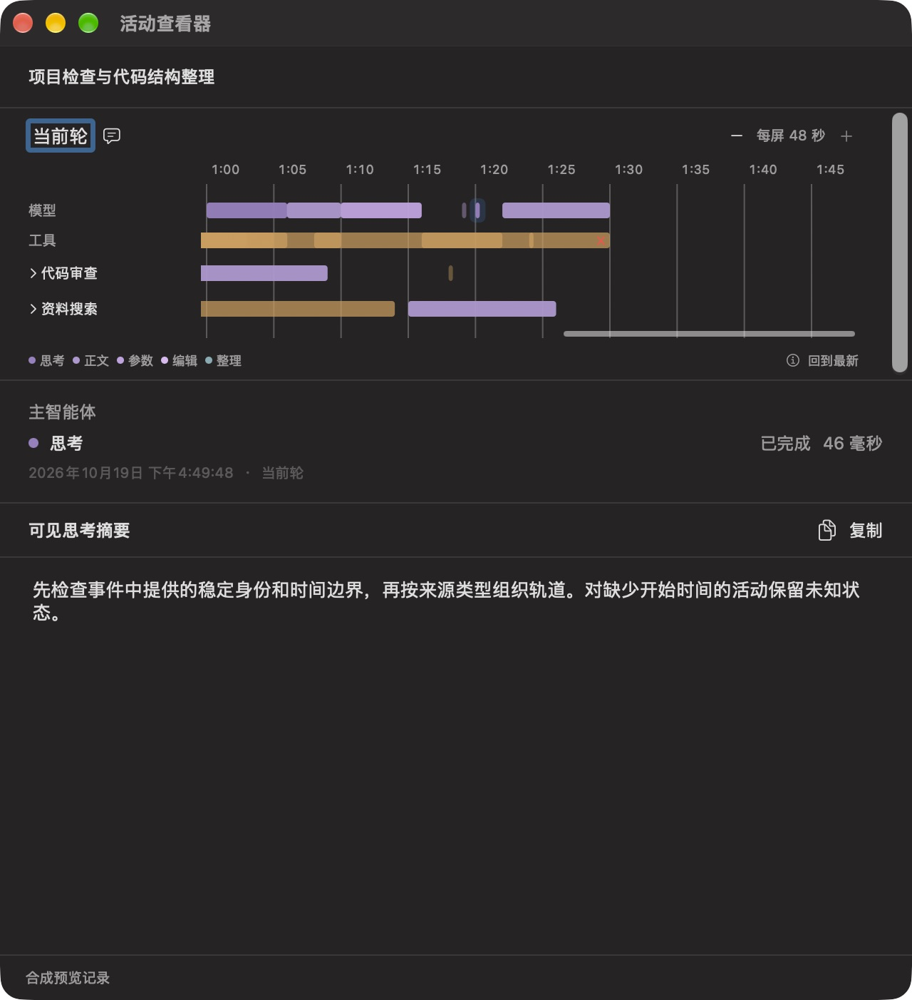
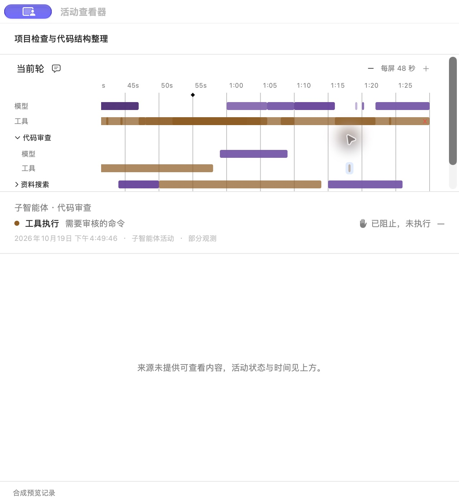

# 时间线：选中与结果状态

日期：2026-10-19。按本对话选定的“背景选区”方向实现。本文件替代[第二轮调整](panel-ux-round2.md)中的原色选中底衬、选中下划线及失败／中断长红线；30／60 秒缩放、最新位置、来源时间与工具命中集合继续沿用。本轮提交包含代码、测试与合成预览；未推送。

## 确认后的规则

- 选中仅使用系统蓝 16% 透明度的圆角背景，不再加描边或下划线。背景在活动上下各留 3 pt、左右各留 4 pt，短线背景至少 11 pt；源活动仍按原来的 3 pt 最小宽度绘制和命中。底衬没有额外点击区，不参与耗时、位置或重叠计算。多个选中背景一次合并填充，避免底衬交叠处再次加深。
- 来源状态为 `failed` 时使用小红叉 `xmark`，不根据退出码判断主动终止或重新分类。`declined` 使用中性灰 `hand.raised.fill`，文案为“已阻止，未执行”，不推断由用户还是自动审核阻止。完成、进行中、等待、未知及显式中断不增加这两类图标；不提供主动取消图标。
- 时间线内的结果图标为 8 pt，放在真实结束点内侧。仅在来源时间可靠、活动至少 12 pt 宽、真实结束点及整个图标均在可视区时显示；不把图标钉在视窗边缘，也不为容纳图标延长活动。窄块、缺少边界和结束点在屏外时，状态继续通过悬停、AX 和详情表达。未执行且没有开始时间的短记录通常属于这一情况。
- 单项与多项详情都使用相同的结果图标及文案。原始参数／结果中的 `status` 和退出码保持来源内容，缺少记录仍保留未知状态。
- 鼠标选中、方向键焦点和 AX 选择共享蓝色选区。方向键从当前选中活动继续移动；改用鼠标、AX 或切换轮次时清理旧键盘焦点，避免同时残留两处高亮。方向键聚焦后回车打开对应活动。

## 定向检查

首轮受影响 Swift 检查：模型 16 项、App 实际执行 17 项通过；原有 WindowServer 窗口生命周期检查 1 项默认跳过。小红叉最终改为不带底圆的系统 `xmark` 后，4 项装饰回归再次通过；最终 Preview 和日常构建通过。

新增回归覆盖来源状态映射、阻止文案／AX、缺少开始时间仍为未知、结束点在屏外与时间冲突时隐藏图标、最小底衬不扩大命中区，以及键盘／鼠标切换不残留旧高亮。相关既有缩放、阅读锚点、模型直接选择、重叠工具集合、轮次切换、迟到响应与详情分页检查继续通过。不重复 Python 采集、历史、Remote 或发行矩阵。

## 原生验收

使用独立只读 Preview 和手写合成记录；只刷新测试快照，不读取真实聊天或申请观察租约。夹具包含 90 秒失败工具、5 毫秒失败短工具、46 毫秒模型阶段，以及缺少开始时间的 `declined` 子智能体命令。此处状态均为合成数据，不能当作真实审核或执行证据。

- 深色下实际点击重叠位置，只选中长工具与该处的 5 毫秒失败工具；点击仅有长工具的位置恢复单项。底衬、源叠色和毫秒耗时分别保留。
- 将横向滚动值设为 0 后，90 秒长工具的结束点在可视区之外，时间线不显示红叉；详情标题继续显示失败红叉与 1m30s。没有把图标挪到视窗右侧。
- 方向键移动后，AX 仅标记当前键盘焦点为 selected；回车打开相应的思考记录。
- 极窄阻止记录沿用 3 pt 符号，详情显示灰色实心举手和“已阻止，未执行”，没有虚构执行时长或阻止者。

日志、真实运行元数据及额外合成截图位于本机忽略目录 `.local/timeline-selection-status/`。公开截图仅使用合成数据；本轮不重新验证完整 VoiceOver、长时间自然使用或发行兼容性。

## 本机加载

通过现有管理接口停止旧观察会话后重开日常 Monitor；新进程取得观察租约。检查时心跳约 0.98 秒、快照约 0.24 秒，`timeline_available=true`，原接入身份、配置备份和运行目录一致。日常构建与当前 Swift 源码／资源匹配：`6b87a8ae7f5743d392b74941c7da3ed7760dd729140a888732071ed19a9d6858`。

实际展开本对话的菜单，AX 确认“每屏 30 秒”、横向滚动值为 1、“回到最新”禁用，当前活动可见；跨重载用量继续显示 `—`。真实 AX 只留在本机忽略目录。Preview 和合成数据 writer 已全部退出，仅日常 Monitor 保持运行。

实现与验收阶段保持原暂存区逐字节不变；本次提交统一归档第二轮面板调整及最终选中与结果状态，未推送。
