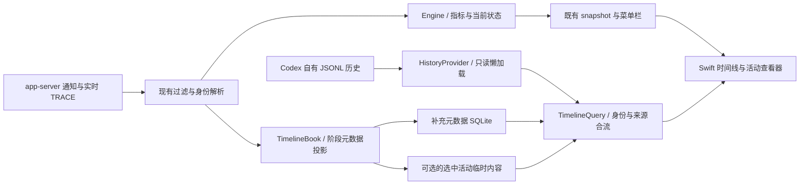

# 活动时间线：技术方案

日期：2026-10-17。状态：已实现；以下保留设计原理并回写实际契约，当前比例见[最新调整](fixed-scale.md)，叠放实现见[前次布局](overlap-layout.md)，内容等契约与首轮证据分别见[后续调整结果](refinement-results.md)和[实施结果](implementation-results.md)。

## 1. 总体结构

保留现有 bridge → collector／Engine → snapshot → SwiftUI 链路。新增独立时间线投影与只读历史提供器；不从当前动作文案或每秒快照反推过去发生了什么。

`TimelineBook` 复用已接受的身份、镜像与生命周期事实，按阶段保存稳定记录。接入点应在已完成过滤和身份判断之后、当前活动对象发生破坏性状态切换或被裁剪之前。它不复制 token 账本，不重新计算菜单栏优先级。

### 设计起点的代码缺口

下表记录实施前的问题；当前对应模块已补齐，`Engine` 仍不承担完整历史仓库。

| 位置 | 原有能力 | 设计时缺口 |
| --- | --- | --- |
| [events.py](../../src/codex_activity_monitor/events.py) | 通知白名单、双时钟、item／call 元数据、正文和参数增量 | `turn/steer` 请求与结果缺口；完整详情未通用保留；需核对时间字段实际序列化命名 |
| [engine.py](../../src/codex_activity_monitor/engine.py) | 活动、turn／item 身份、明确工具状态、镜像去重 | 参数结束会转 `tool_ready` 并重置起点；终态活动仅保留最近 20 条；不能直接充当完整时间线仓库 |
| [collector.py](../../src/codex_activity_monitor/collector.py) | 聚合、快照、观察会话和重启恢复 | 无分轮历史查询／侧存储；不能在事件循环同步扫描大历史 |
| [progress_state.py](../../src/codex_activity_monitor/progress_state.py) | 当前动作与优先级、防抖 | 适合当前状态，不用于重建历史阶段 |
| [tool_labels.py](../../src/codex_activity_monitor/tool_labels.py) | 工具身份、有界 patch／Code Mode 静态识别 | 复用分类依据，不通过中文标签反向解析 |
| [Snapshot.swift](../../macos/Sources/MonitorModel/Snapshot.swift) | 旧活动摘要、聊天树、菜单栏语义 | 缺少分轮、阶段、绝对边界、来源引用和时间线 DTO |
| [ChatRowView.swift](../../macos/Sources/MonitorApp/ChatRowView.swift) | 展开指标与纯文本活动列表 | 固定双轨、轮次选择、横向导航与活动选择 |
| [DashboardStore.swift](../../macos/Sources/MonitorApp/DashboardStore.swift) | 每秒读取快照、稳定聊天顺序和展开状态 | 时间线独立懒加载状态、选择与异步取消 |
| [Main.swift](../../macos/Sources/MonitorApp/Main.swift)／[PopoverController.swift](../../macos/Sources/MonitorApp/PopoverController.swift) | accessory App、popover、预览窗口 | 复用活动查看器及焦点、关闭、清理协调 |

## 2. 身份与数据模型

建议分为 `TimelineTurn`、`TimelinePhase`、`TimelineMarker`、`TimelineRelation` 和 `ContentRef`。保留原始来源字段，面向 GUI 增加少量稳定语义字段。

| 字段组 | 内容与约束 |
| --- | --- |
| 所有权 | `scope_id, thread_id, turn_id`；不把 child turn 改成父 turn |
| 来源身份 | `source_namespace, source_item_id, call_id?, response_id?, source_ref`；不同来源 ID 独立保存 |
| 阶段身份 | 稳定 `phase_id`，区分 model generation／tool execution 等；不能随标签或状态改变 |
| 分类 | `track=model/tool`、`kind=reasoning/text/tool_input/file_edit_input/contextCompaction/tool_execution`；普通 marker 只显示用户消息 |
| 时间 | 可空开始／结束、时间来源、观察实例／时钟信息、边界质量 |
| 状态 | 原始状态与规范展示状态；结束未知不是已完成 |
| 关系 | 明确 raw→canonical、调用→阶段、父 thread、派发→child turn、process 交互等，注明证据来源 |
| 内容 | 引用 Codex 源记录／item 的 `ContentRef`、内容可用性与截断状态；不嵌入完整正文 |
| 更新 | `revision`、schema version；幂等 upsert，终态不可被晚到 delta 重新打开 |

规范展示状态使用 `active / waiting / completed / failed / interrupted / declined / unknown`，但必须保留来源状态及质量。不把状态枚举收敛误当成新的事件推断。

稳定 phase ID 在首次生成后保持不变；后续建立 source alias 关联已有记录，不在补全 canonical ID 时替换 GUI 选择键。raw 与 canonical 的 alias 只能由明确关联产生。ID 缺失时保存局部来源身份和不完整标志，不跨聊天猜配。

可识别的文件编辑内容生成是 `tool_input` 的展示子类型；若在持续流中才识别到，更新同一阶段。跨来源的参数生成与实际 `fileChange` 则是独立阶段，不能互相覆盖时间。

## 3. 时间模型

### 3.1 保存三类时间的区别

| 时间 | 可用含义 | 用途 |
| --- | --- | --- |
| producer item `startedAtMs / completedAtMs` 或历史 `started_at_ms / completed_at_ms` | Codex 记录的该 item 生命周期边界 | 同一语义阶段存在有效字段时优先用于恢复 |
| Monitor monotonic 接收时间及对应 wall receipt | 该观察实例收到事件的时间 | 实时 generation 窗口、同实例耗时与缺口判断 |
| JSONL 外层 `timestamp` | recorder 写入该条记录的时间点 | 来源定位与降级时间点；不能等同该活动开始时间 |

分别保存开始／结束的 provenance 和缺失标志，不以一个“精确”布尔值掩盖来源差异。时间边界为 Codex 记录或本地接收观察值，均不宣称服务端纯推理耗时。

### 3.2 共同轴与异常处理

- GUI 坐标使用可比较的 epoch 毫秒时间；同一观察实例的纯接收区间耗时优先用 monotonic 差值。epoch 映射基于该实例的时钟锚，不把其他进程／重启前 monotonic 直接拼接。
- 对混合来源保留质量标记。producer 与 receipt 冲突、wall／monotonic 偏离超过 1 秒、结束早于开始等情况标记不可可靠计算；不能简单 `abs()` 或填零。无法可靠共同定位的轮次不绘制精确轴，仍可从活动菜单读取内容；下个明确新轮重新建立接收时钟锚。
- 有真实 turn 起点时作为原点；无起点时可暂用首个已知活动时间并标“部分观测”。补到更早原点时按阅读锚修正滚动。
- 模型生成 only-final 或工具 only-completed，且没有对应历史起点时，只画已知终点／未知起点样式；不借用相邻事件凑区间。
- collector 重启／观察中断时，原 active 阶段转为观测不确定并停止可信地增长。历史后续提供明确完成边界时再补全；恢复采集不重新启动旧流速度。
- turn completed 只关闭属于该生命周期且有适用结束依据的阶段；独立进程／child 不由父 turn 强行结束。沿用现有生命周期约束。

这些时间只服务时间线。`thread/tokenUsage/updated`、实时窗口和最近推理均速仍由原有模块决定。

### 3.3 近似工具绘制

`TimelineLayout` 按阶段 ID 预计算来源矩形，工具符号最小 3 pt，不顺延。工具命中区就是可见矩形，不构建间接重叠组。`TimelineSurface` 按独立矩形叠色，点击收集当前位置命中的工具集合；模型歧义点击仍选最近的独立阶段，键盘和 AX 可逐项访问。没有展开条、数量徽标或其 Esc 监控。

选择入口传递阶段数组。`ActivityViewerGroupStore` 固定点击选中的 ID 集合，管理每项独立的 `ActivityViewerStore`，复用已有身份检查、迟到响应防护和分页；切换选择时保留交集中的已加载内容。首次加载最多并发 3 项，已完成且内容可用的活动不重复轮询。没有来源协议或 Python 投影变更。

时间比例固定为 `(291−8)/60 pt/s`，窗口大小只更新画布和阅读锚点，向前阅读可保留右侧留白。完整规则见[来源时间方案](true-time-tools.md)和[固定时间比例](fixed-scale.md)。

## 4. 历史读取

### 4.1 提供器与默认路径

定义统一只读 `HistoryProvider`。首版以**本机 JSONL 读取适配器**为确定的落地基础，因为已经验证存在实际持久化内容，不依赖向当前 Desktop writer 注入请求。

同时在 P0 评估 app-server `thread/read`、`thread/turns/list`、`thread/items/list` 的隔离只读可达性。若证实可在当前接入拓扑下安全使用，可替换 canonical 分页读取适配器；raw 参数等仍可由 JSONL 补充。不得以新开 app-server、`resume` 或改写 Remote 路由作为默认读历史前提。两种方式对上层输出同一契约，首版不要求同时维护两套完整功能。

查找来源：优先明确 rollout 路径／已确认 thread 元数据；否则在对应 Codex home 下建立按需文件索引，并核验 `session_meta.id`。不能仅按文件名或当前全局 `~/.codex` 推断来源。`sessions` 是本机已验证来源；归档路径、临时聊天未落盘、分叉／回滚等按实际能力处理，不未经验证宣称完整支持。

### 4.2 JSONL 读取与缓存

1. 仅在展开／切轮／打开活动时定位对应 thread 历史。先取得目标轮次的元数据，再读取所需 item 的内容。
2. 大文件流式解析；保留可重建的 byte offset 索引与来源指纹，不一次加载整文件进内存。不要按行号当作永远稳定的记录 ID。
3. 活动文件只消费完整 JSONL 行，尾部半行留待下次；对增长增量处理。截短、原子替换、回滚或指纹变化时使索引失效，重新核验来源与内容。
4. 将 paginated canonical `event_msg.item_completed` 与 raw `response_item` 作为不同表示读取，不把两者都画成独立的同类执行。
5. legacy 缺少 canonical 区间时仍可以提供可读内容和点状记录，明确“耗时不可恢复”。缺少新字段不触发整聊天读取失败。
6. 内容只有在用户选中活动后才读取／格式化；分页／分块显示来源可保留的全文。超过单次响应限制时返回续读游标，不悄悄截成完整结果。

历史 API 或 JSONL 已有有效 item 时间时用其恢复；仅有 raw 函数调用的最终参数和外层 timestamp 时，无法重建参数生成开始，必须依赖实时侧元数据或显示未知。

### 4.3 内容与可用性

`ContentRef` 指向明确来源记录、item 或 raw call，不按代码／正文哈希猜配。详情响应保留已有状态，并区分 `no_content`（合法无正文过程）、`content_unavailable`（来源中暂缺活动内容）和 `history_unavailable`（找不到来源）。只有有依据的文件移除才使用相应缺失说明。

工具统一“参数／结果”，按原始字段筛选并保留字符串和结构值，不重建 diff 或把结构结果展平。区分 absent 与合法空值；区域可带可选 `notice`，不冒充来源正文。`notice` 为兼容新增字段，旧详情仍可解码。来源截断只在适用结果中识别已确认的截断格式，分块游标本身不触发截断状态。具体字段见[映射表](refinement-changes.md#41-原始字段映射)。

Codex 当前源码对部分 command／MCP 持久化结果存在约 64 KiB 上限；查看器只能展示来源留下的结果。对图片等附件，仅解析明确的资源引用，不盲目执行嵌入内容或下载任意远程 URL。

实时详情优先读取已经落盘的内容；若仍未完成，可复用现有可观察增量提供临时内容。临时内容仅供正在打开的活动查看会话，使用有界内存，不落盘另一份全文。订阅开始前的内容无法补齐时标注部分；最终从 Codex 历史切换到完整可用记录。模型内容复用现有可见流缓冲；选中工具输出保留有界临时尾部。steering 中断且源历史未保存的输入返回 `not_retained`，查看器已加载内容保留到关闭；不新增全量录制兜底。

## 5. Monitor 补充元数据

### 5.1 存什么

建议使用 Python 标准库 SQLite，单 writer 为 collector。数据库位于现有产品私有数据根中的 `timeline/metadata.sqlite3`，与 test profile／实际 Codex scope 隔离。私有目录和文件权限沿用既有约束；不放入仓库。

存储阶段 ID、来源 ID、起止观察时间及 provenance、turn／thread／process 关联、状态／缺口、source ref、schema version。可附不含正文的有限类型与工具名称。**不存完整用户输入、模型正文、参数／代码、补丁、命令正文和工具输出**；显示摘要尽量由来源即时生成。

为简化查询，允许保存可重建的轮次／item 索引及部分 canonical 时间元数据；这是索引和时间线侧信息，不是完整内容备份。数据库损坏时仍能从 Codex 历史读取基础内容，缺少的实时生成窗口显示未知。

### 5.2 写入和保留

- 在阶段开始、明确结束、关系改变与观察缺口时写元数据；每个 token delta 不写数据库。进行中活动以开始点＋当前查询时间显示右边界，无需逐帧持久化。
- 保留当前轮与最近 5 轮的补充元数据。跨轮仍活跃、查看器选中、被这些轮次明确引用的 child／process 记录及必要祖先关系暂时 pin，结束并解除引用后再清理。
- 与最近完成入口边界协调清理；不建设长期可检索副本。清理按轮次／引用执行，不因某轮超过 20 条事件就裁掉早期轨迹。
- 打开的查看器可以临时保留选中上下文，但不使已退出的观察会话重新采集。来源被删除后说明不可用，不为保留详情复制正文。
- schema 不兼容时保留侧文件并报告降级，供兼容版本继续读取；只有 SQLite 明确报告 `SQLITE_CORRUPT` 或 `SQLITE_NOTADB` 时才隔离并重建。忙／锁定、权限、只读和 I/O 错误均保留原文件并降级，不删除或修复 Codex 源历史。重建索引不能伪造已丢失的接收边界。
- 正式恢复／purge 时纳入现有产品数据清理；只读预览不得写入日常数据根。

SQLite 写入应批量、有界，并与 bridge 转发解耦；磁盘失败不能阻塞 Codex。详情大文件解析在工作线程／独立只读 helper 中执行，不能占用 collector 的事件接收循环。

## 6. 查询与 GUI 契约

现有 `schema_version=1` 与旧字段语义不变。可在快照增加可选、独立版本化的 `timeline_summary`（能力、当前 turn、revision），完整轮次／事件与正文通过单独的只读查询获取。

下表为设计的逻辑能力。实际传输收敛为 Python helper 的 `timeline-query <JSON>`：`action=timeline` 同时返回轮次与所选轮阶段，`action=detail` 返回详情，续读使用 `section_id / offset`；约 1 秒轮询实现更新。它们都是 Monitor 本地查询，不是 Codex app-server 方法。

| 查询 | 返回 | 触发 |
| --- | --- | --- |
| `timeline/turns` | 当前轮＋最近 5 轮的身份、状态与可用性 | 展开聊天／revision 变化 |
| `timeline/items` | 所选轮的阶段、标记、关系、范围、revision 与分页信息 | 切轮／展开相关智能体 |
| `activity/detail` | 明确 phase／source 的内容引用与分块内容 | 用户点击活动 |
| `activity/updates` | 选中活动的可用变化／临时增量 | 查看器打开且该活动仍在更新 |

优先复用 GUI 已有的 Python helper／结构化 JSON 调用方式。历史和已落盘元数据由只读查询 worker 读取；若需要 collector 内存中的选中活动增量，使用与 producer 流分离的本地只读查询通道，限制命令、响应大小、超时与背压，不向 Codex 协议转发查询。

完整快照不塞全文；可见视图约 1 秒查询一次，历史 offset 索引只解析新增完整行，文件无变化时不重新解析正文。收起聊天取消专用加载；选中查看器的内容请求独立于 popover 存活，关闭后取消。

Swift 新 DTO 对缺失能力、未知枚举和缺少字段保守解码。旧快照可以继续显示旧摘要／“时间线暂不可用”，而不是让整个面板失效。只读预览使用合成查询提供器，不能连接真实历史或管理命令。

## 7. 原生视图和窗口

- `TimelineLayout` 为纯布局模型：共同轴、视口裁剪、区间投影、固定轨道、局部命中集合与 hit test；用真实 ID 返回选择，不依赖绘制像素反推事件。
- 实际 `TimelineSurface` 以 SwiftUI 承载 AppKit document view／NSScrollView；只绘制当前视口。轨道标签不参与水平滚动；工具叠色、点击及可访问元素共用布局矩形。
- `TimelineStore` 按聊天／轮次保存锚点、跟随和选择状态；异步请求带 selection／revision token，丢弃晚到的旧轮响应。
- `ActivityViewerWindowController` 持有单一 `NSWindow + NSHostingController`。关闭 popover 与窗口前置有明确顺序，保持普通窗口层级，不改变菜单栏 accessory App 的既有管理语义。
- 窗口状态单独保存尺寸位置，重开时校正到可用屏幕；关闭只取消详情加载，不 stop collector。App 真正退出时统一取消任务和观察会话。

视图只消费布局与语义数据；菜单栏仍读既有 `menu_presentation` 与速度投影。一次 UI 点击不能触发 `configure / resume / restore` 等管理副作用。

## 8. 故障隔离与落地顺序

先验证来源和身份，再实现元数据投影及历史读路径，再接入布局、面板和查看器。若只读 API 不适合当前拓扑，使用 JSONL；若 raw→canonical 关联不足，保留未关联阶段；若历史无时间，提供内容与未知时间。以上降级不需要用户重新决定轨道模型。

侧存储失败、历史读取失败或未知格式只降低时间线能力，不清空已有菜单栏／速度状态，也不改变 Codex 工作。具体阶段退出条件见[实现计划](implementation-plan.md)。
