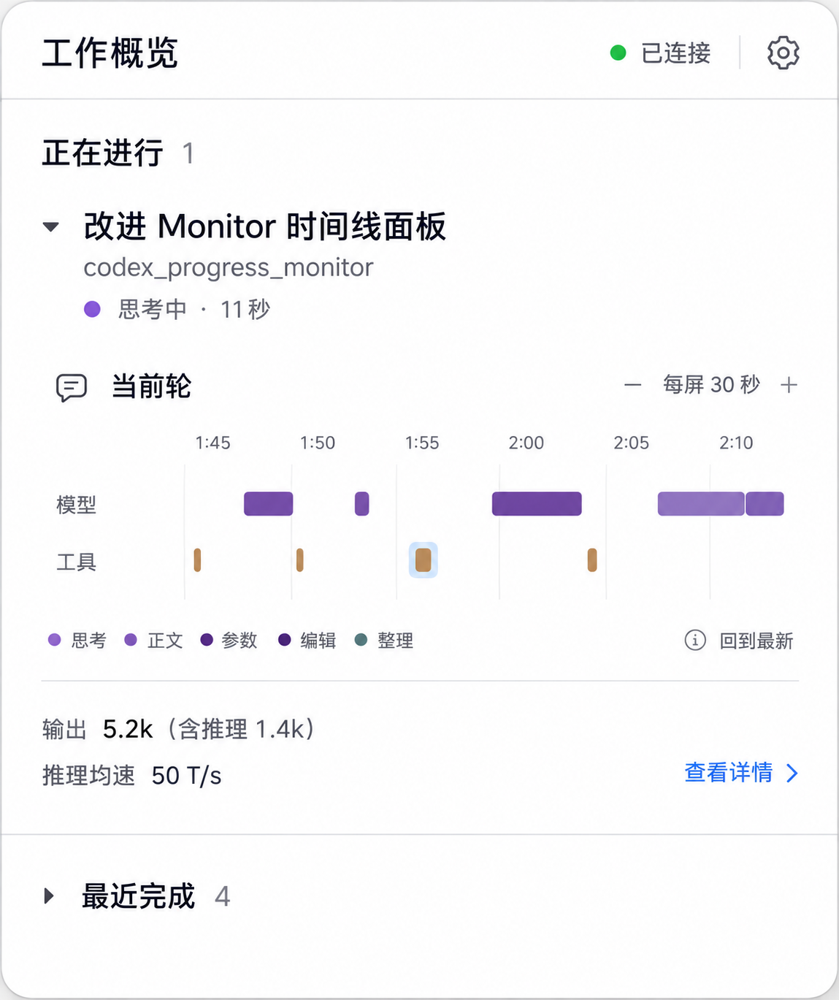

# 设计与改动说明

> 2026-10-22 更新：推理均速已[移除](../05_token_usage_and_reasoning_speed/removal.md)，统计区只保留官方输出和其中推理用量。下文及旧设计图保留当时的设计记录。

日期：2026-10-19。状态：设计已落地，实际尺寸和验证边界见[实施结果](implementation-results.md)。本轮仅修改图 1 对应的展开面板，不新增图 2 的单聊详情页，图 3 对应的独立窗口保持现状。已确认行为见[本章决定 D01–D11](README.md#本轮确认的决定)，工程步骤见[实施计划](implementation-plan.md)。

## 1. 当前问题与设计原则

现有界面把连接状态、当前聊天动作、当前轮统计、模型信息、轮次选择和时间线连续排在一起。完成聊天与运行聊天具有相近的视觉重量，展开后还要先读统计，才能看到工作轨迹；多个相同标题也缺少足够的辅助区分。

前一轮设计图主要移动了这些内容的位置，尚未充分区分对象归属。本轮先确定信息结构，再调整字号、间距和色彩。

| 信息层级 | 回答的问题 | 主要内容 |
| --- | --- | --- |
| 展开面板 | 哪些聊天正在工作？ | 工作分组、聊天摘要、整体可用状态 |
| 聊天 | 我在查看哪个工作对象？ | 标题、项目、当前状态 |
| 轮次 | 这一轮怎样推进？ | 轮次入口、时间线、属于这一轮的统计 |
| 活动 | 这一次具体做了什么？ | 类型、状态、耗时、原始参数与结果 |
| 补充说明 | 数值和记录有什么限制？ | 模型信息、统计口径、覆盖质量与来源说明 |

连接正常时属于辅助信息；断连、过期或部分覆盖会影响用户理解，应在当前视图明显可见，不能只藏在设置或悬停中。统计说明可以折叠，影响可用性的异常不能一同隐藏。

## 2. 概览与默认展开

概览保留“正在进行”和“最近完成”两个主要入口，运行中的工作占据主要位置。整体计数复用明确的主聊天与父子工作语义，不按时间块、工具数量或标题去重计算。

### 2.1 正在进行

- 正在运行的主聊天首次展示时默认展开；新出现的运行聊天同样默认展开。根聊天已结束但明确的子智能体仍工作时，沿用现有父子工作判断。
- 聊天标题是身份主信息，项目是辅助信息；当前动作与其持续时间一起呈现，例如“思考中 · 11 秒”。动作耗时不改称整轮耗时。
- 展开内容以“所选轮次”为一个明确分组：先时间线，再简要统计。允许多个运行聊天同时展开，空间不足时由面板主列表滚动。
- 实时生成速度有可靠值时作为次级信息展示；摘要行可省略未知速度字段。保留明确的零值含义，不能用零代替未知。
- 轮次切换、时间线、统计与模型／数据说明都在聊天展开区，不设置“查看详情”跳转。

### 2.2 最近完成

- 进入概览的初始状态只显示分组标题和数量，分组默认收起。
- 用户展开分组后先看到紧凑聊天列表，各聊天默认收起；手动展开时使用与运行聊天相同的轮次内容组件。
- 继续沿用既有最近记录的保留范围和稳定身份。空闲、断连、静默不能被重新解释为完成；失败或中断条目保留自己的状态文案。
- 只有有明确来源的结束时间时，才显示“2 分钟前完成”等相对时间。距最近进展的时间不是完成时间；缺少结束时间时使用状态文案。
- 相同标题通过项目和有来源的结束时间辅助区分，不能按名称合并聊天。

### 2.3 默认值与用户选择

“默认”是无手动选择时的初始值，不是每次刷新强制写入的值。

| 事件 | 行为 |
| --- | --- |
| 新开一次面板展示 | 进入概览；运行聊天默认展开，最近完成默认收起。 |
| 新运行聊天出现 | 按稳定顺序加入，默认展开；不改变其他聊天的手动选择。 |
| 用户展开／收起 | 保存本次面板展示内、按聊天身份区分的选择。 |
| 每秒刷新、速度变化 | 更新内容，不重置展开值、不按速度重排。 |
| 收起／展开及内容布局变化 | 保留聊天身份与阅读锚点；运行聊天主动重新展开时，最新定位继续遵守第 09 章规则。 |
| 聊天结束 | 更新真实状态并按既有规则分组；不清空其他聊天的选择，不关闭已打开的活动窗口。 |
| 关闭后重新打开面板 | 应用默认展开规则；时间线的缩放和定位按第 09 章原有规则处理。 |

实施时补充：新一次打开面板，主列表回到顶部；同一次展示内的普通刷新不重置列表位置。

最近完成分组被用户手动展开后，在同一次展示内同样保持。后台刷新不能因为它的默认值为收起而重新折叠。

## 3. 聊天展开区与轮次归属

每个聊天在原地展开，不切换面板页面。内部顺序为：

1. **聊天身份**：标题、项目；可靠的当前动作与状态明确标为当前状态。
2. **所选轮次分组**：轮次选择与本轮用户输入入口、时间线、该轮可用统计。
3. **补充说明**：模型与数据口径，默认收起。

查看历史轮时，聊天“现在正在做什么”和“所选历史轮的状态”必须分别标注。当前动作不能写成历史轮的动作。运行与最近完成聊天使用同一轮次内容组件，每个聊天保留自己的时间线状态；普通刷新或布局重建不清空缩放、历史轮次或活动选择。

层级主要通过标题、缩进、留白和细分隔线表达；必要时使用一层中性的原生分组背景。聊天和轮次不铺大面积蓝／紫底，运行状态用小图标与文字表达，悬停为短暂的中性反馈。时间线与统计处于同一轮次分组内，不再各自成为平级大卡片；只有时间线活动保留既有淡蓝选区。

苹果的 [Color 规范](https://developer.apple.com/design/human-interface-guidelines/color)要求颜色含义一致，[Boxes 规范](https://developer.apple.com/design/human-interface-guidelines/boxes)建议通过留白和对齐组织组内内容。实现可评估原生 `GroupBox`，但不为模拟卡片堆叠牺牲紧凑布局。420 pt 是现有面板宽度起点，高度按内容和所在屏幕可用空间限制；不能把生成图的像素尺寸直接当作布局尺寸。

### 3.1 统计与模型说明

统计区的位置在时间线之后、同一个轮次分组内；**排列以 [chat-detail-concept.png](assets/chat-detail-concept.png) 的“本轮统计”区域为准**，不采用最新概览图中输出和均速上下堆叠的形式：

| 部位 | 排列与视觉关系 |
| --- | --- |
| 左列 | 上方为较小的“输出”标签，下方突出输出数值 `5,214`；数值旁用较小的次级文字写“含推理 1,382”。 |
| 右列 | 上方为较小的“推理均速”标签，下方突出 `50 T/s`；与左列的主数值保持同一基线和相近字号、字重。 |
| 两列之间 | 左列可略宽，使用间距或一条中性细竖线分隔，不拆成两个独立卡片。 |

该局部排列迁移到图 1 的聊天展开区；不恢复图 2 的页面、导航、返回入口或大面积蓝底。原生字号与间距仍按 420 pt 面板校准，但保留标签、主数值、包含关系的三级文字层级。

- 输出采用“输出 5,214，含推理 1,382”这样的包含关系。可紧凑显示为 `5.2k`，精确数值保留在详情或悬停中。
- 推理均速是接收窗口估算，不能表示实时生成速度、模型服务端纯计算速度或任务进度。继续使用整数 `T/s` 和已有格式化规则。
- 每项统计必须能可靠绑定到所选聊天和轮次。历史轮缺少可用数据时显示 `—` 和简短原因，不复制当前轮统计。
- 最近有效的推理均速可按既有规则保留；放进“本轮统计”前需核对它的独立轮次身份。不能因为数值仍有效就让它成为另一轮的数据。
- 模型名与该统计或活动的来源相匹配。仅有当前聊天模型信息时，应明确为“当前模型”，不暗示历史轮使用相同模型。
- 输出、推理用量及推理均速不重新计算；原始来源数值、未知和部分覆盖继续保留。

## 4. 原生展开控件与操作入口

苹果的 [Disclosure controls](https://developer.apple.com/design/human-interface-guidelines/disclosure-controls) 将原地显隐的层级内容交给 disclosure triangle：控件在标题前方，收起时朝右、展开时朝下。SwiftUI 提供 [`DisclosureGroup`](https://developer.apple.com/documentation/swiftui/disclosuregroup)，AppKit 对应 [`NSButton.BezelStyle.disclosure`](https://developer.apple.com/documentation/appkit/nsbutton/bezelstyle-swift.enum/disclosure)。

| 目的 | 本轮方案 |
| --- | --- |
| 展开／收起聊天、最近完成、补充说明 | 标题左侧的小型原生展开控件，方向随展开状态变化。 |
| 查看具体活动 | 点击时间线活动，打开已有独立活动查看器。 |

优先使用原生自动样式，再按实际容器校准间距。系统原生控件的确切外观需要在目标 macOS 上检查，不以生成图中的手绘箭头为实现依据。

标题区域整体可展开／收起，细箭头不承担唯一点击目标。标题、图标、留白构成一致的命中区；轮次切换、缩放等内部控件独立响应，不让操作它们时顺带折叠聊天。悬停使用轻微反馈，展开采用短而平顺的系统风格过渡，遵守减少动态效果设置。

键盘可聚焦展开控件和内部操作，辅助功能名称包含聊天标题及展开状态。颜色、三角方向或悬停不能成为唯一的操作提示。

## 5. 独立窗口与时间线的边界

本轮不改独立活动窗口的布局、控件、时间线、上下文组织或生命周期，也不按图 3 重排其内容。点击时间线活动继续调用既有入口；单项／多项、原始参数／结果、复制、分页、失败隔离、迟到响应保护和窗口复用全部沿用。

面板改动只做必要的调用兼容回归：点单个活动打开正确记录，点工具重叠位置传入原有命中集合。概念图中的窗口变化不列入本轮实施或验收。

沿用[第 09 章选中与结果状态](../09_activity_timeline/selection-status.md)及[面板时间线交互](../09_activity_timeline/panel-ux-round2.md)：30／60 秒参考比例、运行中最新定位、手动阅读暂停跟随、3 pt 短线与可见命中区、局部叠色、工具命中集合、淡蓝选区、失败红叉、阻止举手及未知边界全部保持。

## 6. 概念图与最终文字的差异

最新中性概览图是本轮视觉参考，由 ImageGen 根据示例数据生成，不是原生产品截图。保存原始生成文件，不重绘图片。它仍早于最后的范围收敛，因此“查看详情”入口必须按文字决定移除。原始文件名、图片像素及 SHA-256 见[材料清单](assets/manifest.json)。

| 图中内容 | 实施时采用的最终规则 |
| --- | --- |
| 最新图 1 右下角的“查看详情” | 删除该入口；轮次与模型说明都留在聊天展开区。 |
| 最新图 1 中输出与推理均速上下排列 | 改用 `chat-detail-concept.png` 的统计区两列排列：左输出及含推理，右推理均速。 |
| 图 2 的独占单聊详情页 | 页面已取消，不新增路由、返回按钮或第二份时间线；仅保留其中统计区的局部排列作为参考。 |
| 图 3 的独立窗口重排 | 本轮不做；保持当前已实现的窗口。 |
| 早期概览的紫／蓝底、运行聊天收起、最近完成展开 | 已被中性分组、运行默认展开、最近完成默认收起替代。 |
| 模拟的历史轮统计、完成时间和模型信息 | 只有来源归属和时间可靠时显示；否则保留未知或明确“当前轮／当前模型”。 |
| 生成图中的大字号、大间距及控件形状 | 以紧凑原生组件校准，浅／深色、长标题和多聊天均需检查。 |

### 本轮面板参考

### 局部参考与归档材料

- [早期彩色概览](assets/overview-concept.png)：保留探索过程，不作为当前底色和默认状态依据。
- [chat-detail-concept.png](assets/chat-detail-concept.png)：本轮继续采用其中“本轮统计”的两列排列；该独占页面及蓝底不实施。
- [早期图 3 活动窗口](assets/activity-detail-concept.png)：独立窗口改造退出本轮范围，不实施。

字体和间距、系统展开控件、中性背景及长内容滚动的实际检查见[实施结果](implementation-results.md)。行为优先级为本章最新文字决定、原生验证后的尺寸记录、概念图。
