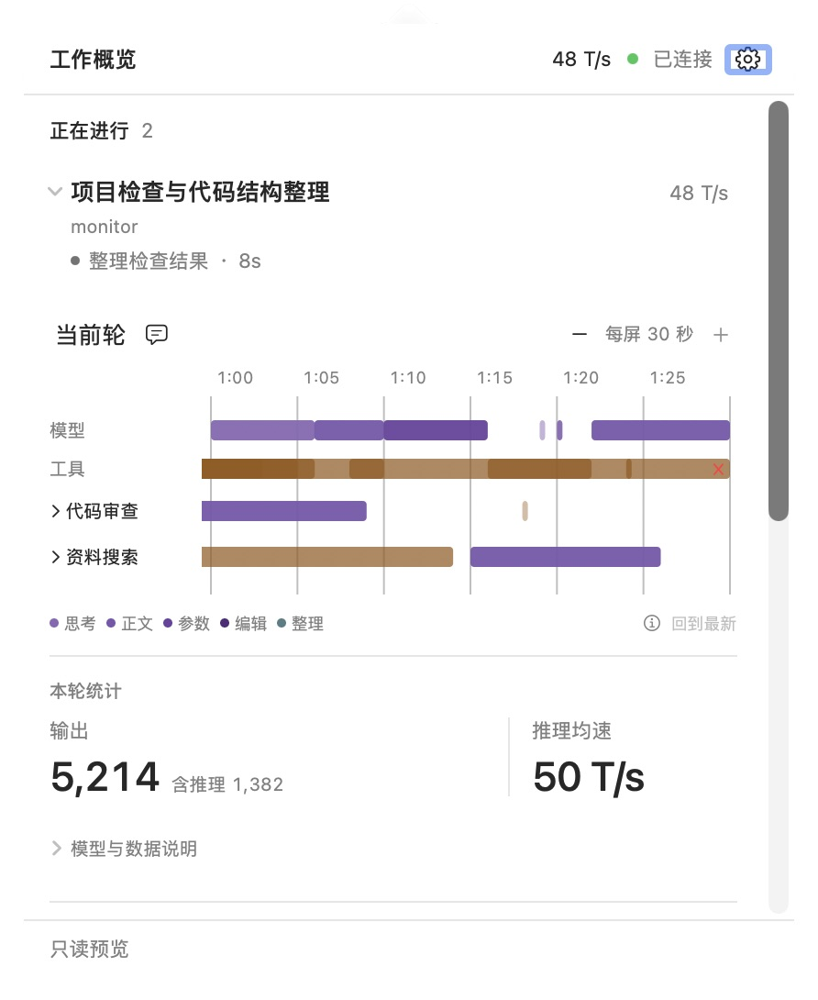
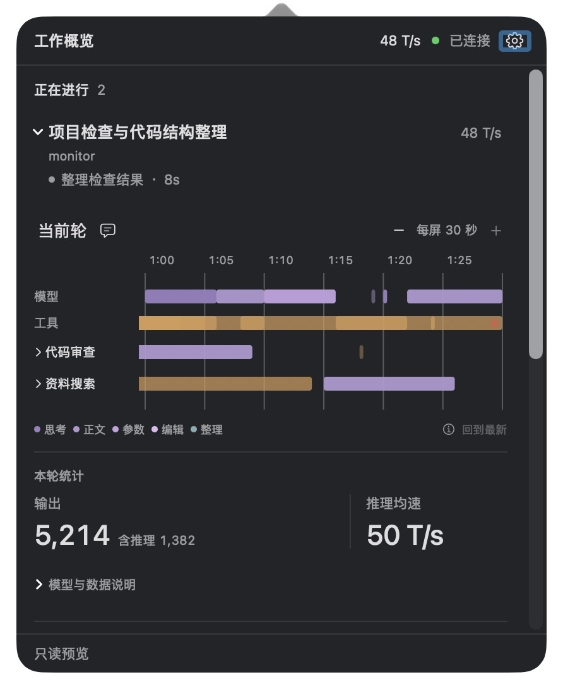
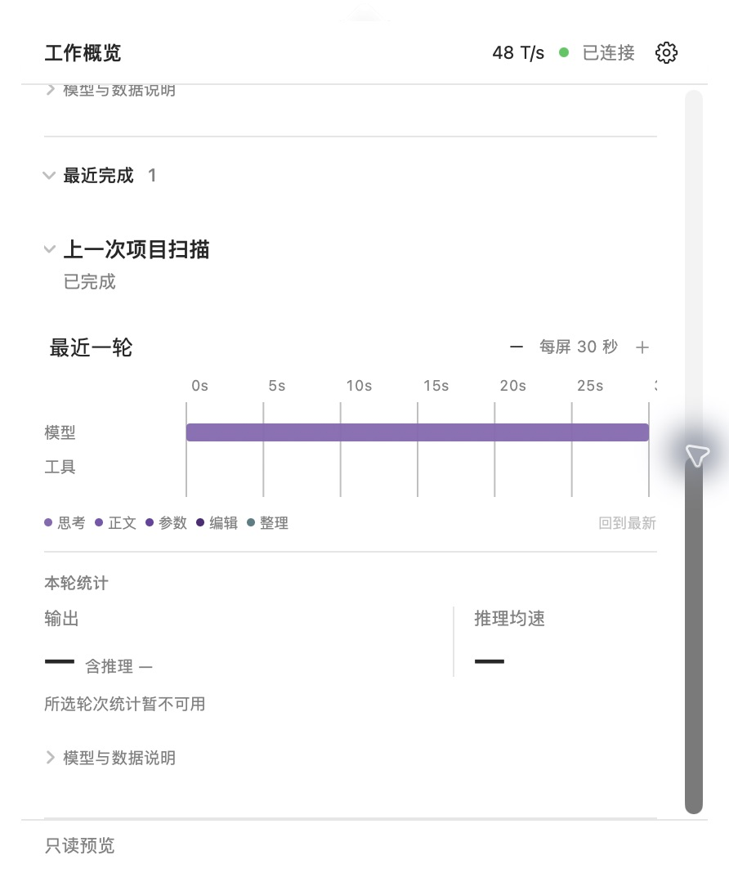

# 实施结果

日期：2026-10-19。基线：`36ff3bf`。本章面板已实现并加载到日常 Monitor。

## 1. 实际交付

- 概览分为“正在进行”和“最近完成”，连接与可靠的实时总速度降为辅助信息；移除底部重复聊天计数。异常覆盖说明继续直接可见。
- 所有运行中的主聊天默认展开；父聊天结束但子智能体仍工作时仍属于正在进行。最近完成分组默认收起，展开分组后聊天默认收起。
- 每次打开建立独立展示周期。手动展开／收起、最近完成开关及主列表阅读位置不被快照刷新重置；新运行聊天自动展开。关闭后重开恢复默认展开并回到主列表顶部。
- 使用自动样式的原生 `DisclosureGroup`，标题区域也能切换；内部轮次、缩放和说明控件独立响应。展开动画为 0.16 秒，并读取系统减少动态效果设置。
- 聊天内顺序固定为时间线、两列统计、默认折叠的模型与数据说明。没有单聊详情页面或“查看详情”跳转。
- 统计左列突出输出，旁列小字“含推理”；右列突出推理均速，主数值对齐。大数值紧凑显示，悬停保留精确值。聊天和轮次使用中性表面，时间线原有活动选区保留。

状态通过作用域与稳定聊天身份保存。每个聊天继续复用一份 `TimelineStore`，隐藏最近完成及收起内容不创建时间线轮询；普通快照更新不改变视图身份，只有新一次打开重建主列表的滚动状态。

## 2. 数据核实与降级

生产端 `UsageBook.view(thread_id, turn_id)` 已经输出 `usage.turn_id`，`engine.py` 也以当前明确轮次调用它。本轮只让 Swift 的 `Usage` 解码这个已有可选字段，没有修改 Python 采集、统计计算或 JSON 协议生产端。

新增 `PanelStatistics` 对每项统计分别校验：

| 数据 | 可进入所选轮次统计的条件 |
| --- | --- |
| Output、Reasoning | 所选轮次非空，且与 `usage.turn_id` 明确一致；数值有效。 |
| 推理均速 | 所选轮次与 `latest_reasoning.turn_id` 明确一致；数值有限且非负。它不必与当前用量属于同一轮。 |
| 切轮过渡中 | 全部暂时未知，避免旧值挂到新选项下。 |
| 旧快照、身份缺失或历史无用量 | 显示 `—`；全部缺失时补充“所选轮次统计暂不可用”。 |

真实零值仍是零。Output 已包含 Reasoning，不做加法。最近有效推理样本可以按原有规则保留；属于其他轮次时只放进说明，并标明未计入所选轮次。仅有当前模型时标为“当前模型”，不声称它是历史轮模型。

未新增历史统计账本。聊天 DTO 没有独立完成时间，因此不把 `last_progress_seconds` 写成“几分钟前完成”。完成、失败、中断及连接中断继续使用来源状态，各自保留文案。

## 3. 原生校准与截图

原生只读 Preview 使用手写合成快照和时间线，不包含真实聊天、命令或工具结果。实际面板内容宽 420 pt，本机预览实测高度 519 pt（含只读页脚），上限沿用 520 pt 与屏幕可用空间限制。标题 13 pt，状态与统计标签 11 pt，主统计数值 22 pt，补充说明 10 pt；两列间使用中性细分隔线。

聊天原生三角与标题首行对齐；标题最多两行，完整标题保留在悬停和 AX 名称中。原生 AX 提供展开开关状态；标识只放在标签上，避免向时间线和统计后代传播错误的“已展开”值。

### 浅色：运行聊天与两列统计



### 深色：同一信息结构



### 最近完成：按需展开，缺少统计时保持未知



图片指纹、尺寸及各自构建身份见 [native-evidence.json](assets/native-evidence.json)。浅色图摄于最终主列表重开定位修正之前，可见布局未变；深色图来自最终 GUI 构建。原始生成概念图仍独立记录在 [manifest.json](assets/manifest.json)，不能与这些原生截图混用。

## 4. 有限验收结果

| 编号 | 本轮结果与证据边界 |
| --- | --- |
| V01 | 状态测试覆盖多作用域、同名身份、父结束子仍工作；原生 Preview 两个运行聊天均默认展开，时间线先于统计。 |
| V02 | 原生分组初始关闭；展开后完成聊天仍关闭，再点击原地展开，显示其自己的轨迹。 |
| V03 | 状态测试覆盖手动覆盖、顺序变化、新聊天和移除；原生刷新后手动收起与最近完成开关保持。 |
| V04 | 原生切历史轮、返回最新、展开模型说明；点“验证改动”打开既有窗口中的对应工具记录。无新页面路由。 |
| V05 | 状态测试覆盖开始／完成时的显式选择；原生关闭重开后运行聊天恢复展开，最近完成恢复收起，主列表回到顶部。 |
| V06 | 原生显示 `5,214`、次级 `含推理 1,382` 与右列 `50 T/s`；按指定概念图的统计局部布局对齐。 |
| V07 | 测试覆盖当前用量与旧推理样本、独立旧样本、缺身份、切轮、零和负数；原生历史轮显示未知，回到最新恢复当前统计。 |
| V08 | 复用受影响的时间线测试，原生检查 30／60 缩放及回到最新；本轮未重复全部第 09 章验证。 |
| V09 | 完成聊天原生检查；零／未知由测试区分。状态文案映射与无来源完成时间降级经源码检查，未逐一自然运行所有结束状态。 |
| V10 | 原生三角、标题点击、键盘 Space 可切换；缩放、轮次、说明操作未使聊天折叠。 |
| V11 | 原生 Tab 聚焦聊天与轮次，Space 操作，AX 名称、实际数值和原生开关状态正确；刷新未改变所观察焦点。减少动态效果分支经源码检查，未切换系统偏好，也未执行完整 VoiceOver 验收。 |
| V12 | 原生单工具入口打开正确记录；重叠工具集合、模型独立选择、迟到响应和窗口数据隔离由既有定向测试覆盖。本轮未重新做原生重叠位置鼠标命中全矩阵。 |
| V13 | 原生检查两行长中文标题、相同标题但不同项目、多聊天滚动和 `12.3M / 含推理 8.8M`。缓存复用、任务可见性与取消路径经源码核对；没有记录完整请求计数或长期性能数据。 |
| V14 | 浅／深色、菜单栏下方锚定、原生滚动条、设置菜单与 Esc 检查通过。诊断记录关闭后监视器为 0、显示时为 2；外部点击路径未修改，本轮未另做全屏／多屏关闭矩阵。 |
| V15 | 日常 GUI 已更新；配置状态正常、观察租约有效、快照新鲜、时间线可用。偏好文件与更新前逐字节一致；接入回执由既有启动配置流程刷新，未保存足够旧内容做逐字段差异断言。恢复、登录启动和清理入口未改，未重做其完整生命周期操作。 |

新增 7 项定向测试并更新 1 项既有展示测试。最终筛选涉及两个测试目标：模型目标 16 项通过，App 目标 25 项通过、1 项跳过，合计 **41 项通过、1 项跳过**。覆盖展开默认值／手动覆盖／展示周期、统计归属、只读多聊天 fixture，以及已有时间线选择、重叠工具、选区、结果图标、定位、缩放和迟到响应保护。不是全仓库测试声明。

跳过项为 `viewerReusesWindowAndPreservesResizedFrameAcrossContentChanges`，由现有 `MONITOR_WINDOW_TESTS=1` 开关控制；本轮未启用它。窗口本身不改版，面板打开正确活动记录的路径已做有限原生检查，不能据此宣称该窗口测试已执行。

执行了受影响的 `swift test --disable-sandbox --cache-path .local/swift-cache --package-path macos --filter …`、`bin/build-gui` 与 `bin/build-gui --preview`。最终 GUI 源码构建指纹：

```text
59c10908dcc044f0504f2f367c08058af227fee05f0e7e63126e0b0096415c0f
```

独立窗口 `ActivityViewer.swift`、共享 `TimelinePanelView.swift`、`TimelineSurface.swift` 与基线文件哈希一致。面板专用布局放在 `ChatDetailsView`，没有通过共享样式连带修改窗口。只读 fixture 新增按聊天路由，兼容原有根 bundle，并为其他运行／完成聊天提供独立活动与详情。

## 5. 本机加载与边界

通过原设置菜单退出旧 Monitor，再启动新构建；没有重启 Codex。新 GUI 已获得有效观察租约，采集快照保持新鲜，真实运行聊天默认展开，覆盖不完整的统计继续显示未知和可见说明。GUI 退出／重开产生的观测间隙不作回填。

验证日志、原生 AX、运行元数据与长标题边界截图留在忽略的 `.local/panel-ux-10/`。合成数据刷新进程和 Preview 已退出；日常 Monitor 保持运行。没有将真实聊天、运行配置或原始载荷加入文档图片或 Git。

本轮不声称长期自然使用、完整辅助功能、Remote、安装卸载、签名公证或公开发行已通过；独立窗口自身的 UI/UX 没有进入本次改版。
