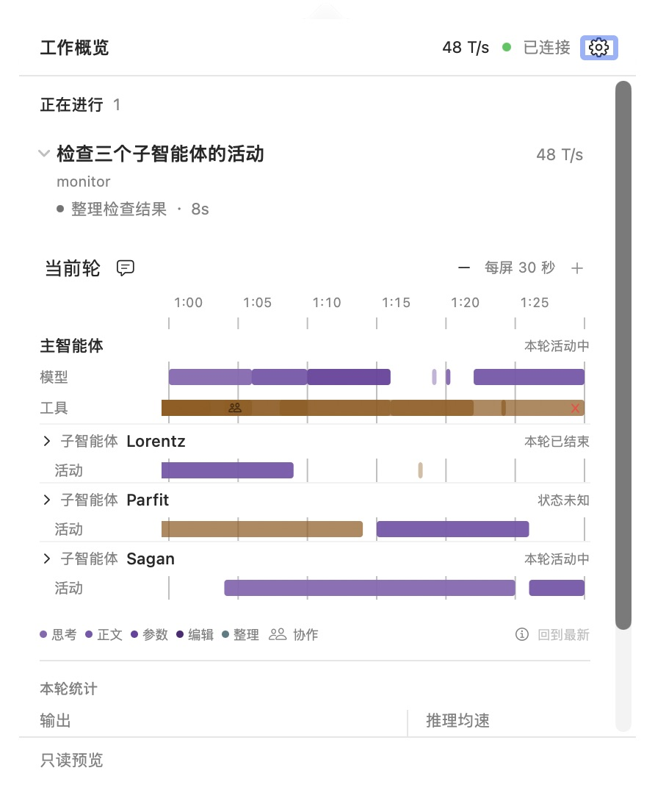
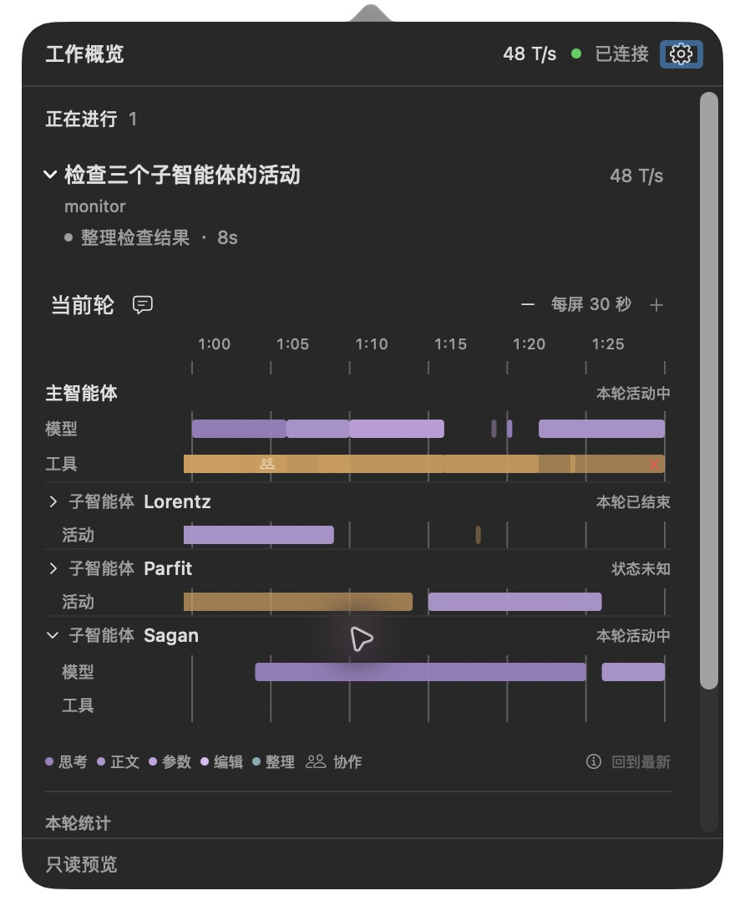
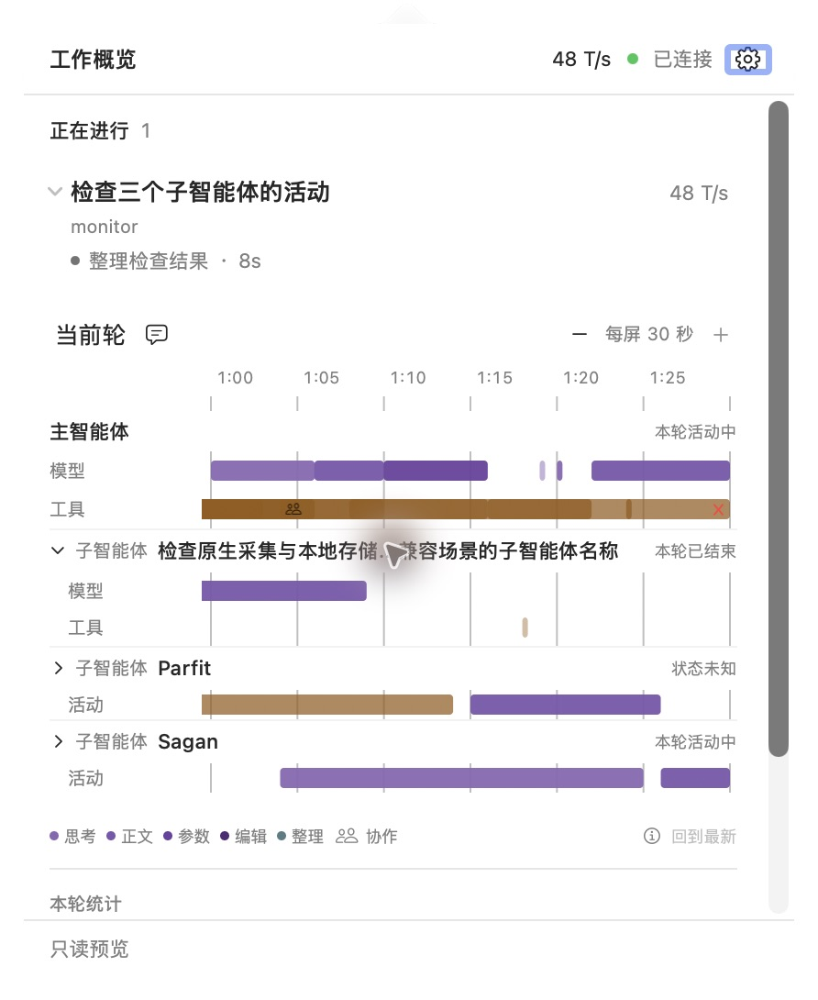
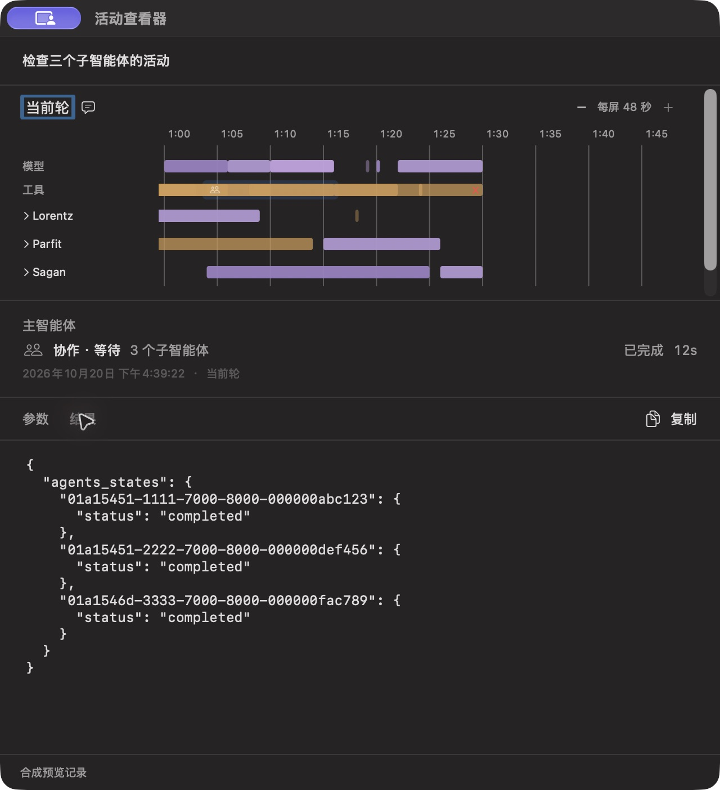

# 实施与验证记录

日期：2026-10-20。改动前基线：`d2b0986`。本轮已实现、验证并更新到日常 Monitor；实现、测试及本章证据一并作本地提交，不推送远端。

## 1. 交付行为

- 有子智能体时，主／子分别成组，组标题固定在垂直位置；每组内部才是模型／工具分类。无 child 时沿用紧凑双轨。
- 从已验证的 session header 读取昵称与路径，排除已知短 ID 回退名，处理字段冲突、同名和 ID 碰撞。名称更新不修改完整身份、展开集合或选中 ID。
- 显示“本轮活动中／本轮等待中／本轮已结束／未知”等限定所选父轮引用范围的状态；单个子轮完成不会被当作整个 agent 永久结束。
- 子智能体默认折叠为标题加汇总，展开为独立模型／工具轨；嵌套标题有限缩进，展开只控制该智能体的活动轨，不隐藏仍有独立身份的后代组。
- 明确的协作调用使用协作文字和系统符号，保留父级工具轨的原始阶段；对象只通过相同 scope／父 thread／父 turn 下的明确调用 ID 关联。
- `panelGrouped`／`activityViewer` 显式区分共享组件的布局。活动窗口沿用既有排布和参数／结果功能，现有标题与辅助描述复用准确身份与协作语义。

没有改动 phase 所有权、来源时间、普通活动 kind／track、SQLite schema 或用量计算。新增 helper 已登记到 collector 模块指纹。

## 2. 原生布局与过程中修正

面板实测内容宽 420 pt、高度上限样本为 519 pt。主标题 22 pt，子标题 24 pt，折叠汇总 16 pt，模型／工具行 20–21 pt。绘图保持约 291 pt 和原有 30／60 秒比例。

原生预览发现并修正了两处问题：网格线曾穿过全宽组标题，现在 header 行不绘制网格；长名称曾挤掉“子智能体”身份标签，现在身份和状态保留宽度，仅名称中间截断。完整名称仍由辅助功能及 help 提供。

以下均为真实原生 App 截图，数据是可复现的合成样例，不是生成概念图或自然使用证据：

| 浅色：三个独立组 | 深色：子智能体展开 |
| --- | --- |
|  |  |

| 长名称：身份与状态保持 | 协作详情：原始结果 |
| --- | --- |
|  |  |

通过鼠标标题展开、Tab 到达标题后空格切换、刷新后保持展开、昵称变化后保持同一完整 ID 的展开、嵌套组顺序、协作参数／结果页签切换及辅助功能归属检查。没有声称完成整个 VoiceOver 操作流程。

## 3. 测试与对应风险

| 检查 | 结果 | 覆盖 |
| --- | --- | --- |
| Python `test_timeline*.py` | 39 项通过 | 现有投影、sidecar、查询、重复关系、作用域／父轮归属、状态与协作投影 |
| Python `test_history.py` | 21 项通过 | 身份校验、有界值、冲突、历史替换／失效、原始内容兼容 |
| Swift 模型 | 34 项通过 | 新旧 DTO、组标题、无 child、嵌套、不同展示模式、相同 x／宽度及命中 |
| Swift App 常规运行 | 38 项实际通过 | 刷新／选择／展开、模式隔离和既有面板／生命周期回归 |
| 原生窗口用例 | 单独启用后 1 项通过 | 同一窗口复用、调整大小、内容切换、关闭重开及尺寸保留 |

Swift 普通日志摘要为 34＋39；其中一个窗口用例默认 skipped，随后设置 `MONITOR_WINDOW_TESTS=1` 单独执行通过。因此实际是 **73 项 Swift 通过，已包含该窗口用例**，不再额外重复计数。

V01–V04 由 Python／模型测试覆盖，V05–V08 由模型、查询、App 与原生样例覆盖，V09 由显式模式测试和单独窗口回归覆盖，V10–V11 由 420 pt 浅／深色及键盘／AX 定向检查覆盖，V12 由重复关系计数回归和真实查询覆盖。旧 collector 的兼容验证为 DTO／数据层检查，没有对每一个旧二进制版本逐一运行。

主要命令：

```sh
.local/venv/bin/python -m unittest discover -s tests -p 'test_timeline*.py'
.local/venv/bin/python -m unittest discover -s tests -p 'test_history.py'
swift test --disable-sandbox --cache-path .local/swift-cache --package-path macos
MONITOR_WINDOW_TESTS=1 swift test --disable-sandbox --cache-path .local/swift-cache --package-path macos --filter viewerReusesWindowAndPreservesResizedFrameAcrossContentChanges
bin/build-gui --preview
bin/build-gui
```

预览数据由 `experiments/timeline/agent_preview.py` 产生；支持默认、长名称、嵌套、旧字段和无 child 样例。原生实际检查采用默认、长名称和嵌套，旧字段／无 child 的兼容由自动测试覆盖。

## 4. 真实历史对照与性能

在固定历史索引、观察元数据与当前时间的条件下，对照基线查询与本轮查询：**2,092 个阶段的身份、来源时间、阶段数量、轮次、已有关系与 earlier-active 归属相同**。排除预期新增的展示字段、智能体名称／轮次状态和 revision 后，其余 bundle 字段一致。两项工具原始详情的 section 内容与 source state 也一致。

该样本首次索引约 2.599 秒，五次后续查询约 100、142、88、80、91 毫秒。主线程和三个 child 共四份历史，每份每次请求最多加载一次。与基线的逐字段对照用于验证语义；延迟数字是本机样本，不是所有数据规模的 SLA。

更新后真实 `tl.sock` 再查询该历史轮次，返回三个正确昵称及同样 2,092 个阶段，最终重载后的两次约 2.444 秒／88 毫秒，首次包含历史索引；不将两次都当作暖查询成绩。

还将该轮次的**身份和时间元数据**导出到本地只读预览，原生展开 Sagan，并横向定位到约 39 分钟区间，确认真实 Lorentz／Parfit／Sagan 的独立工作轨道和历史空档。容器刷新时间用于保持只读预览可操作；来源活动时间没有修改。这属于真实历史元数据重放，不是新版本自然创建／复用子智能体的端到端验证。其文件与截图留在 `.local/agent-timeline-ux/`，不纳入 Git。

## 5. 日常版本与本地证据

最终 GUI 源码／包指纹：`f5650d76d994ae2fef15483f1f5b4b3dea1857be89fd1f772b00b076ac20171b`。通过现有菜单正常退出旧 Monitor，再用 `bin/run-gui --show` 启动新版本，GUI／collector 均已重开，collector 所有登记模块与源码哈希一致，新增 helper 已载入。

截图与交互检查构建为 `62dea4b549c4fc80947ab3ec29b9e490151bf5181ed039f891756e45a6bff4c0`；随后仅删除了一个同值重复的本地化键，并重建、重载最终日常包。核对两包编译后的 133 个有效本地化键值完全一致，截图中的布局与文字没有因此变化。

核对时 snapshot 年龄约 0.217 秒，`timeline_summary.available=true`、summary quality 为空、投影错误为 0。接入标记和配置恢复备份哈希保持一致，原有三个 Codex bridge 进程继续运行。重载前已开始的活动和用量仍可能是部分观测，UI 继续显示未知或质量提示。

脱敏元数据与合成截图清单见 [native-evidence.json](assets/native-evidence.json)。完整本地日志、前后状态、历史对照、真实历史元数据及其原生截图保留在 `.local/agent-timeline-ux/`；Git 只收本章必要计数、哈希和合成截图。

## 6. 未验证边界

尚未完成新版本长时间自然运行、所有历史格式、全量 VoiceOver、多显示器系统级流程和发行验证。任意大历史的首次索引仍无严格时限；昵称缺失、身份冲突和关联不完整继续降级，不制造名称或补齐不可靠的轮次关系。
