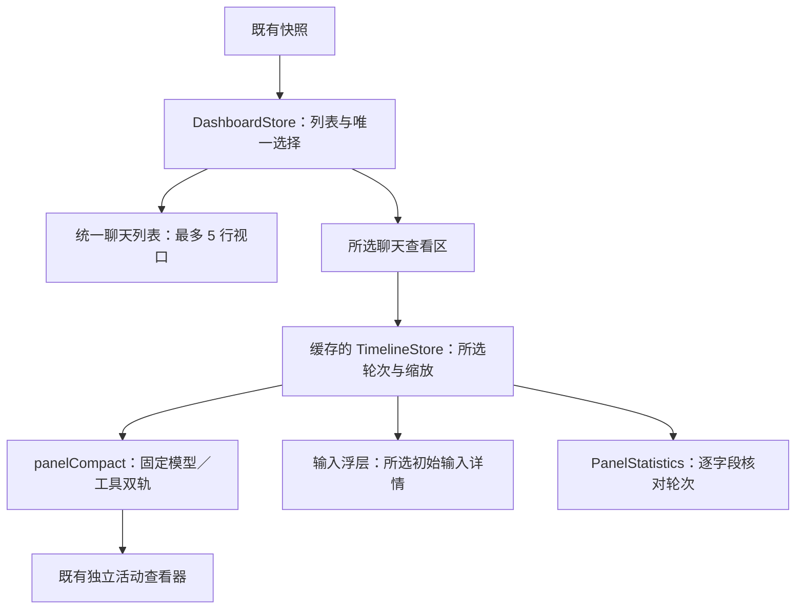

# 第三轮展开面板技术方案

日期：2026-10-20。状态：2026-10-21 已实施并完成定向验收。源码起始基线为 `768aa6e`；本文件描述技术边界，最终代码差异与证据见[实施结果](implementation-results.md)。交互基准见[设计说明](design-spec.md)。

## 1. 架构与修改范围

继续使用 SwiftUI 组织面板、AppKit 绘制与命中时间轴、现有本地客户端读取轨迹和详情。采集器、快照发布频率、历史投影、详情协议和统计口径均不需要为这轮布局改动。



主要代码落点：

| 文件 | 当前职责／问题 | 本轮调整 |
| --- | --- | --- |
| [DashboardStore.swift](../../macos/Sources/MonitorApp/DashboardStore.swift) | 多聊天展开集合、活跃／最近行、时间线缓存。 | 改为唯一选择、稳定列表、展示周期内保留的结束项；维持按完整聊天身份缓存。 |
| [DashboardView.swift](../../macos/Sources/MonitorApp/DashboardView.swift) | 一个大滚动区内放各聊天详情。 | 分离有高度预算的列表与下方唯一查看区，测量内容并反馈窗口大小。 |
| [ChatRowView.swift](../../macos/Sources/MonitorApp/ChatRowView.swift) | 聊天展开入口。 | 两行紧凑可选择行、原生选中反馈、完整辅助功能名称。 |
| [ChatDetailsView.swift](../../macos/Sources/MonitorApp/ChatDetailsView.swift) | 时间线、大号两列统计及说明。 | 紧凑活动头部、时间线、图例与一行统计；去掉统计展开。 |
| [TimelinePanelView.swift](../../macos/Sources/MonitorApp/TimelinePanelView.swift) | 轮次、缩放、分组轨道、图例和活动打开。 | 采用新面板表现；标题直接切轮，输入打开浮层，常驻原生缩放，删除轨迹选项与折叠操作。 |
| [Timeline.swift](../../macos/Sources/MonitorModel/Timeline.swift) | 来源阶段、轨道生成、布局与命中。 | 增加紧凑面板表现和成员几何元数据；既有查看器表现继续使用原规则。 |
| [TimelineSurface.swift](../../macos/Sources/MonitorApp/TimelineSurface.swift) | 原生横向滚动、绘制、命中、辅助功能。 | 接收紧凑几何，修正成员归属标签，明确横纵滚动目标。 |
| [TimelineStore.swift](../../macos/Sources/MonitorApp/TimelineStore.swift) | 轮次请求、序列防护、阅读位置及活动详情存储。 | 复用轮次状态与请求防护；为输入内容提供独立、完整身份的加载状态。 |
| [PopoverController.swift](../../macos/Sources/MonitorApp/PopoverController.swift) | 主面板锚定、大小、外部点击和 Esc。 | 改用屏幕高度预算；识别归属输入浮层的事件，先关闭子浮层。 |
| [PanelStatistics.swift](../../macos/Sources/MonitorApp/PanelStatistics.swift) | 输出／推理与均速的轮次归属。 | 优先原样复用；只改变排版，不合并来源或重算数值。 |
| [InputPopover.swift](../../macos/Sources/MonitorApp/InputPopover.swift) | 新增输入读取与展示。 | 独立身份、请求代次、原始分页、限高文本与来源状态。 |
| [PanelAuxiliary.swift](../../macos/Sources/MonitorApp/PanelAuxiliary.swift) | 新增归属浮层状态。 | 登记窗口、按身份清理、Esc 优先关闭，供输入和说明共同使用。 |
| [PanelLayoutBudget.swift](../../macos/Sources/MonitorApp/PanelLayoutBudget.swift) | 新增统一高度预算。 | 56 pt 行高、最多 5 行、详情保留空间与轨迹限高。 |

本轮涉及的中文、帮助和辅助功能文案走既有本地化方式，不把临时测试说明放进产品界面。

## 2. 选择状态与刷新

### 2.1 面板状态

`DashboardStore` 保存以下状态，替换面板用的 `expanded`／`expansionOverrides`，不删除独立查看器仍使用的智能体展开状态：

| 状态 | 用途 |
| --- | --- |
| `selectedChatKey` | 当前查看对象，采用现有完整 `Chat.id`，不以标题匹配。 |
| `lastActiveSelectionKey` | 同一 GUI 会话内重开时恢复仍活跃的选择，不落盘。 |
| `showRecent` | 本次打开是否追加最近候选，重开重置。 |
| `retainedSelection` | 选中对象结束或暂时失去来源时，保留本次阅读身份与最后确认的基本信息。 |
| `presentationID` | 区分面板展示周期，关闭或新周期使旧输入请求失效。 |
| `chatOrder` | 沿用稳定排名；普通快照与速度变化不重排。 |

列表由“活跃主聊天＋必要时保留的结束选中行＋已展开的最近候选”构成，按完整身份去重。保留行不计入活跃数。收起最近记录、主动切换和关闭时，按[选择规则](design-spec.md#22-选择刷新与完成)解除保留。来源消失不等于已完成；停止展示不可确认的旧实时状态。

归属待确认的已知子任务保留明确异常入口，可复用同一查看区；不推断父关系、不混入主聊天计数，也不展开一大片额外内容绕过窗口高度约束。

### 2.2 只挂载一个面板时间线

继续按聊天身份复用 `TimelineStore`，保留同聊天的缩放、横向阅读位置及选区。面板只为当前选中对象挂载刷新任务，任务身份包含展示周期与聊天身份；切换、关闭时取消旧任务，不为列表内所有聊天读取历史。

缓存清理要识别仍被选中或独立查看器持有的对象，不能在来源暂缺时立即删除其阅读身份。保留的是阅读上下文，不是永久冻结的实时数据；源不可用时显示相应质量／失败状态。

`TimelineStore` 已有序列号与聊天身份检查。切换轮次时旧 bundle 可以暂留供布局稳定，但在 `switchingTurn` 期间不能作为新轮次正文或统计显示；加载状态应明确。新响应通过所选身份和请求代次检查后再提交。

## 3. 紧凑轨道与命中

### 3.1 独立面板表现

`TimelinePresentation.panelCompact` 由新面板显式使用；`.activityViewer` 的默认布局不变，不将所有轨道统一改矮。

紧凑表现为每个成员固定生成模型、工具两条 lane。成员组从相邻两条 lane 派生，使用同一份所属线程、名称、来源状态、深度与几何，不另存可漂移的成员尺寸表。名称／状态位于左侧，覆盖这一对轨道；不插入全宽成员标题或折叠汇总。只有主成员时省去重复主标题。

递归关系只使用来源父子关系，沿用去重、循环保护和深度边界；缩进上限仅作用于名称。名称过长截断但保留完整辅助功能名称，不改变右侧绘图区原点。

### 3.2 几何约束

所有成员的活动横坐标继续由同一个来源时间原点及比例计算。紧凑只能改变纵向排布和留白，不改变来源起止、未知时间的降级方式或协作关系。

最终原生标定保留最短可见宽度 3 pt、活动高度 11 pt，每轨 18 pt、每成员 36 pt。绘制和命中使用这份紧凑几何，没有复制 HTML 的示意细条尺寸。

绘制、选区、命中及辅助功能共用同一份几何。保留来源时间与可见最小宽度的区别，不能因紧凑或短条而跨轨误选。失败／阻止符号、协作标识和重叠活动选择继续可辨。若确需缩小活动矩形，先更新明确的几何契约，再做短活动和跨轨定向验证。

当前 `TimelineDocumentView.activityLabel` 通过标题／汇总 lane 查找所属成员；删除这些 lane 后必须改为按显式成员身份查询，否则子智能体可能被误读为主智能体。这是本轮必须覆盖的辅助功能回归。

### 3.3 图例、跟随与滚动

图例只保留一份，沿用思考、正文、参数、编辑、整理及有来源协作类型的分类和颜色，见[设计说明](design-spec.md#7-图例与统计)。质量提示不得因删除轨迹选项而消失。

保留“回到最新”能力；脱离跟随时可在时间轴下方右侧显示小型动作，避免常驻一个不可用按钮。缩放、窗口尺寸变化和手动阅读继续使用既有锚点与最新跟随规则。

横向只有一个 `TimelineSurface`／`NSScrollView` 承载全部活动；名称区不随横向滚动。智能体过多时，名称与对应条带进入同一纵向容器，保持相同 y 偏移。现有 surface 会向祖先转发纵向滚轮，实现时须确保其目标是所选轨迹的纵向区域，不能意外滚动聊天列表。

## 4. 活动头部、缩放与输入

### 4.1 原生控件

轮次复用 `Picker(.menu)`，当前选项文字作为“本轮活动／最近一轮活动／历史轮次”的入口。菜单选项使用已有轮次身份，不把 steering 人为拆成新轮。右侧最终使用 `HStack` 组合原生减号／加号按钮与只读范围值；`ControlGroup` 的本机标定差异见实施结果。

原生 API 参考 Apple 的 [ControlGroup](https://developer.apple.com/documentation/swiftui/controlgroup) 与[按对象呈现 popover](https://developer.apple.com/documentation/swiftui/view/popover%28item%3Aattachmentanchor%3Aarrowedge%3Acontent%3A%29) 文档；具体目标系统的排列与关闭效果仍以原生观察为准。

继续使用 `TimelineZoom.detail`／概览档的既有比例，减号选更长范围，加号选更细范围。范围显示应根据实际绘图区宽度换算；只在参考视口下才恰好为 30／60 秒。现有参考宽度是 291 pt，不能让新名称区宽度变化导致文字与真实范围不符。

按钮边界、帮助和辅助功能名称统一验证。原生组样式、控件排列与不同内容长度是否适合 420 pt，由隔离预览标定，不在 HTML 阶段承诺像素效果。

### 4.2 输入加载器

初始输入从所选 bundle 的明确 `kind == input` 且 `is_initial == true` 记录取得，经既有 `TimelineReading.detail` 读取原始内容。不新增后端请求类型，不复用聊天标题替代正文。

输入加载状态绑定 `(scope_id, root_thread_id, turn_id, phase_id, presentationID)`；若阶段属于不同线程，详情请求仍使用阶段本身的完整身份。记录本次请求代次，关闭／切换取消任务；响应提交同时核对代次及返回身份，避免只看 `phase_id` 或显示上次正文。

可复用 `ActivityViewerStore` 的详情分页与完整身份检查，或提取其纯加载部分；不为读取输入创建独立活动窗口。不能无条件沿用“保留旧内容”的策略：只有身份一致时才能保留，来源状态仍须展示。

浮层至少覆盖加载、可读、缺失／未保留、截断／部分、失败可重试；长输入可滚动、选择复制，并按现有分页规则读取后续内容。呈现原始记录，不重新概括或加工。

### 4.3 子浮层归属

主面板是 `NSPopover`；现有外部点击监听会将不同 window 的事件视为外部。输入原生浮层可能拥有另一个 window，必须登记其归属或明确识别窗口层级，让浮层内点击、复制和滚动正常工作。

不要通过永久设置“modalShown”来跳过所有外部点击。应区分主面板、归属浮层和两者外部：Esc 先关子浮层，面板外部点击同时关闭两者，聊天／轮次切换与主面板关闭同步清理加载器及归属。原生轮次菜单继续尊重既有菜单跟踪逻辑。信息说明若使用可交互浮层，也使用相同归属规则。

## 5. 内容尺寸与窗口预算

保留 420 pt 宽度、菜单栏下方锚定和屏幕边距。现有 `min(520, visibleFrame.height × 0.6)` 不能直接作为第三轮布局上限；先按实际锚点、`visibleFrame` 与边距计算可用高度，再分配各区域。

```text
列表理想高度 = min(可见候选行数, 5) × 实测行高
内容理想高度 = 顶栏 + 列表理想高度 + 最近入口/必要提示
             + 活动头部 + 轨迹内容 + 图例统计 + 间距
窗口高度 = min(内容理想高度, 屏幕可用高度)
```

无选中对象时活动区不占空白。空间足够时，小于 5 行的列表完整显示，且不补齐空行；多成员先限制轨迹视口高度。小屏再允许列表早于 5 行滚动，头部操作、图例统计保持可达；极端可用高度下为所选详情设置有界纵向滚动，避免裁掉内容。所有区域预算应来自同一尺寸计算，避免互相测量导致无限重排。

聊天数、显示最近、成员数和屏幕改变时重新计算；输入浮层打开不参与主面板内容高度。跨显示器以当前锚点屏幕为准，不直接使用主屏尺寸。

只读预览额外支持 `--preview-max-height`，用于复查较小预算；日常模式忽略此参数。预算取预览限制与真实屏幕限制的较小者，不能借此突破屏幕边界。历史轮布局以实际 bundle 的轮次身份识别新视口，不提前使用尚未到达的请求轮次。

## 6. 保持不变的来源约束

- 聊天、轮次、成员、阶段各自保留完整身份；不按标签、文件名或相近时间补关系。
- `PanelStatistics` 继续逐字段核对所选轮次。来源缺失用 `—`，已知零值保留，根聊天用量不对子成员求和。
- 成员细粒度实时动作和持续时间仅在可靠归属时展示；否则使用 `roundStatusLabel` 的所选父轮状态或“状态未知”。
- 原始参数、结果、分页以及 `source_truncated`／`not_retained` 等状态继续传达；默认不增加 hook／内部标记。
- 不修改 collector、最新历史修复、菜单栏动画、独立查看器布局或日常接入。新增的实现与回归范围见[实施计划](implementation-plan.md)和[验收计划](validation-plan.md)。
