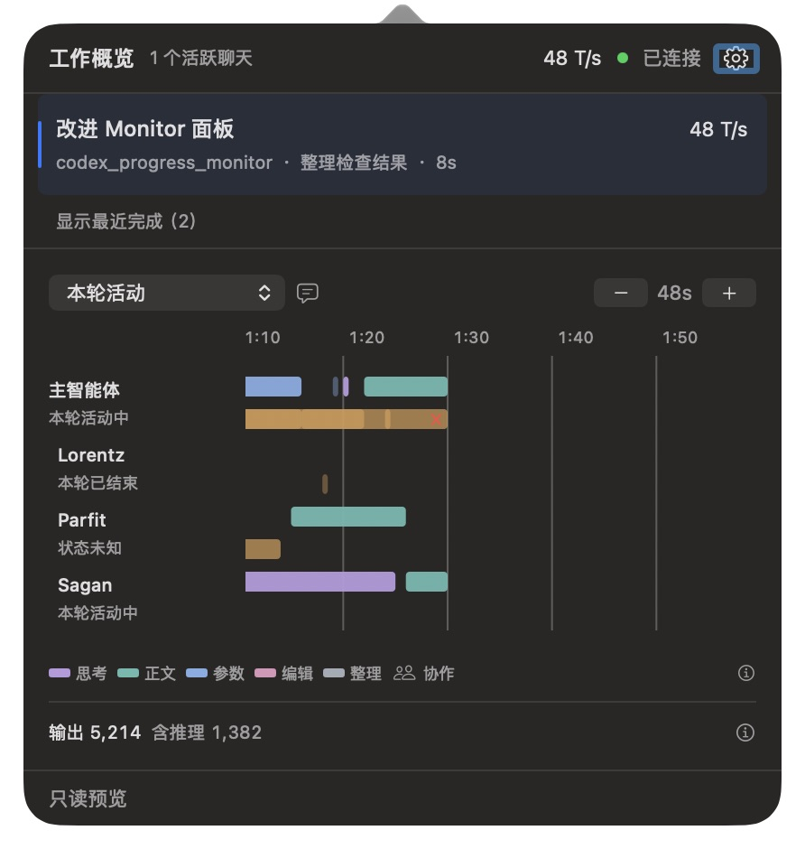

# 合成预览与证据边界

日期：2026-10-22。所有公开截图均来自手写合成 fixture，不包含真实聊天输入或工具结果。

| 文件 | 说明 |
| --- | --- |
| [paged-60-light.png](paged-60-light.png) | 60 秒参考档，运行到 90 秒仍显示 45～105 秒区间。 |
| [overview-120-light.png](overview-120-light.png) | 减号切到 120 秒参考档，减号在端点禁用。 |
| [detail-30-light.png](detail-30-light.png) | 加号切到 30 秒参考档，加号在端点禁用。 |
| [agents-light.png](agents-light.png) | 多成员浅色，名称区变宽后实际可见约 48 秒，比例保持。 |
| [agents-dark.png](agents-dark.png) | 最终构建的多成员深色预览。 |
| [validation.json](validation.json) | 标定、检查数量、构建身份、截图哈希和脱敏真实运行结论。 |

浅色资产构建身份：`5d1a3a491ccc80c289375bf1f8eca8b20c5b6d53f0545ef69c9c63708338d1f2`。最终深色、窗口验证和真实来源观察的构建身份：`4c336b878254e355dd8576dfe37e2509415b60742346b14948d113d707429f66`。两者比例和布局一致，最终产品补充了重复 bounds 通知过滤；截图不证明该状态逻辑或动画中断正确。

原生动画用例通过实际 clip-view 中间偏移和中断后的持续观察验证，不由静态图推定。真实来源数据与诊断只保存于忽略目录 `.local/timeline-paging-preview/`，本目录仅保留脱敏结论。

合成预览入口：

```sh
python3 experiments/timeline/viewport_paging_preview.py --output .local/timeline-paging-preview
```

通过该目录的 `control.json` 控制合成时间和单／多成员；例如 `{"seconds": 61, "case": "single"}`。Preview 使用现有 `--snapshot`、`--timeline-fixture` 和 `--ui-diagnostics` 参数。不得把此脚本的控制参数或合成活动当作实际运行证据。


