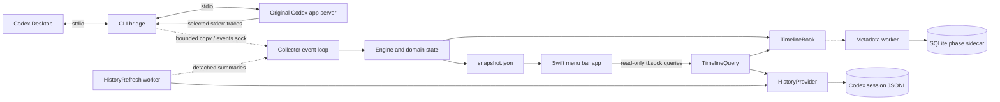

# Baseline architecture and reading guide

This describes the implemented product at baseline `c3996dc`, rather than the sequence of experiments that produced it. See [review.md](review.md) for findings and [validation.md](validation.md) for dated evidence and limits. The [chapter 18 design](../18_engineering_hardening/technical-design.md) describes planned changes; its IPC, paging and projection APIs are not implemented here. Product paths below are relative to the repository root.

## Runtime ownership

- The GUI's observation lease controls whether GUI-managed observation is enabled. Legacy terminal runtimes without that marker remain supported.
- The bridge owns the original backend child process and forwards transport, signals, EOF and exit status. Its observation worker is disposable; it does not own the Codex session.
- The collector owns the lifetime lock and live state. Snapshot freshness is a presentation-health signal; a held lifetime lock is separate evidence that another collector owns the runtime.
- The query server and history workers read existing state. They never resume, fork, steer or create a Codex writer.

## Modules and change boundaries

| Concern | Files | Responsibility |
| --- | --- | --- |
| Entry points | `cli.py`, `bin/codex-progress` | Parse commands; explicitly separate read-only queries, management, bridging and watching |
| Integration | `app_control.py`, `integration.py`, `app_session.py` | Backup/restore environment; serialize management; check process dependents and observation leases; retain legacy migration |
| Transport | `bridge.py`, `events.py` | Forward original bytes; bound observation memory; filter event payloads; preserve explicit source identity |
| State | `state.py`, `engine.py` | Mutable Activity/Thread domain objects; associate events; maintain activity and stream lifecycle |
| Reconciliation | `reconciliation.py` | Background JSONL scheduling and fact application on the collector's owning thread |
| Measurements | `metrics.py`, `usage.py` | Received-text counts/rates versus official usage; separate provenance, coverage and recovery rules |
| Presentation | `progress_state.py`, `overview.py`, `menu_presentation.py`, `display.py` | Project live state to localized descriptions, aggregate independent streams, and render terminal output |
| Agent identity | `agent_relations.py`, `agent_identity.py`, `agent_presentation.py` | Explicit structural relationships, bounded header reads, display names and selected-turn status |
| Timeline | `timeline.py`, `timeline_storage.py` | Phase projection, metadata persistence, pruning and selected live-content leases |
| History/query | `history.py`, `timeline_query.py` | Incremental JSONL indices; original content sections; bounded read API and offline fallback |
| Runtime files | `runtime.py` | Private paths, atomic JSON, read fallback, lifetime-lock probe and snapshot failure retry |
| Localization | `i18n.py`, `messages_*.py`, `bin/export-localizations` | Structured message descriptors, complete catalogs, generated Swift shared messages |
| Swift domain | `MonitorModel/Snapshot.swift`, `Timeline.swift`, `ActivityContent.swift`, `TimelineViewport.swift`, `Management.swift` | Decode wire data; enforce content identity/page rules; derive grouping and timeline geometry |
| Swift orchestration | `DashboardStore.swift`, `TimelineStore.swift`, `InputPopover.swift` | Management, selection, request generations, polling, retained reading state and content loading |
| Swift I/O | `BackendClient.swift`, `TimelineClient.swift` | Isolate subprocess operations from the main actor; provide injectable services for tests |
| Swift UI | `DashboardView.swift`, `ChatRowView.swift`, `ChatDetailsView.swift`, `TimelinePanelView.swift`, `TimelineSurface.swift`, `ActivityViewer.swift` | Current compact panel and independent viewer; AppKit scrolling/drawing/accessibility |
| Native lifecycle | `Main.swift`, `PopoverController.swift`, `PanelAuxiliary.swift`, `StatusContentView.swift` | App/menu-bar ownership, outside dismissal, child popovers and time-based animation |

`Engine.apply_history()` remains a small entry point for callers. The implementation lives with reconciliation, not among live protocol dispatch branches. `state.py` is a domain model, not a second wire schema.

## Identity and facts

| Object | Identity | Do not substitute |
| --- | --- | --- |
| Live thread | `(backend, thread_id)` | Chat title or cwd |
| Persistent thread | `(scope/home, thread_id)` | Backend PID or a display row |
| Turn | Scoped thread and `turn_id` | The latest activity arrival |
| Timeline phase | Scope, thread, turn, namespace, item ID | Similar text or neighboring timestamps |
| Generation / execution link | Explicit `call_id` | The same tool name |
| Parent / child | Verified child header or explicit spawn evidence; turn attribution is separate | Communication, agent nickname or path |
| Detail request | Scope, thread, turn and phase ID | A successful response without owning identity |

Model argument generation and canonical tool execution have separate timeline namespaces. An engine activity may reflect both lifecycle views of an explicitly linked operation; that does not collapse their timeline intervals.

JSONL supplies persisted facts for matching identities. Live observations provide pending activity, reception timing and text rate. Reading history never manufactures a missed live rate. Turn completion does not prove completion of a confirmed background process. Retiring unrecorded model supplements requires a reliably read, ended JSONL turn; it does not apply to tool execution.

Historical termination is an overlay on an independent `observation` basis, for phases and turns. A refreshed valid index can replace or remove that overlay; independently received completion survives. Old sidecars without a recoverable basis degrade to unknown when their historical source disappears. The internal basis is allowlisted in storage and omitted from visible phase payloads. The Engine also records an independently received turn outcome so a removed historical turn end cannot remain borrowed forever.

## Concurrency and failure rules

- Collector event processing, tick, reconciliation application and snapshot projection own the mutable Engine. They use `TimelineBook.lock` when sharing phase state with query threads.
- `HistoryRefresh` performs file I/O outside that live lock. Provider index updates use an `RLock`; detached views/summaries prevent readers from observing in-place refresh mutations.
- Query operations may hold the provider lock and briefly acquire the book lock. The collector must not acquire the provider lock while holding the book lock. Background scheduling/draining uses its own queue lock.
- The SQLite worker receives allowlisted deep copies. Raw conversation bodies are not sidecar fields. Disk errors degrade metadata availability rather than forwarding.
- Snapshot write errors are retried and counted. Snapshot serialization and blocking writes still occur on the event loop; a stuck disk remains a known latency risk.
- State changes publish on the approximately 250 ms tick; numeric-only updates remain approximately 1 Hz. The GUI watches the snapshot directory for atomic replacements and keeps a 1 Hz fallback for freshness/recovery. This is still file transport, not independent GUI IPC.
- Unmapped generation with an explicit item/response end can remain queued for identity recovery, but no longer blocks live-rate coverage. Pending response ends share the queue's backend/item identity and retention bound; late identity recovery reapplies termination before presentation.
- Swift stores and UI state are main-actor owned. A request generation invalidates both successful and failed late responses. Cancellation of a subprocess request is separate from rejecting a stale result.
- Input popovers and the activity viewer share `ActivityDetail.validated(for:)` and `appendingPage`. Python offsets count Unicode code points; Swift must not calculate them with `String.count`.

## Wire and privacy boundaries

Snapshot, timeline and detail responses currently use version 1. Official usage recovery has its own version 2 representation. These version numbers identify separate contracts. Fields remain optional where older snapshots can omit them; removing an internal Swift presentation case does not change the JSON contract.

`DisplayMessage` carries a localization key and parameters. Raw source text is never a translation key. `label`, paths, command previews and names are metadata but may still be private. Only a selected viewer retains a bounded live-output tail, and persisted command output may already be truncated by Codex.

## Reading paths

- New event type: `events.py` → `engine.py` / `progress_state.py` → `timeline.py`; decide identity, terminal behavior and privacy before display copy.
- Incorrect live speed: `metrics.py` → `overview.py`; keep `usage.py` out of received-rate calculations.
- Stale activity or mismatched history: `history.py` → `reconciliation.py` → `timeline.py` → `timeline_query.py`.
- Incorrect content/page/selection: `ActivityContent.swift` → `TimelineStore.swift` / `InputPopover.swift` → `TimelineClient.swift` → `timeline_query.py`.
- Installation or restoration: `app_control.py` → `app_session.py` → `cli.py`; use injected services or explicit disposable profiles in tests.

The remaining architectural work and its implementation state are maintained in [chapter 18](../18_engineering_hardening/README.md). This baseline still uses file transport and the existing detail contract. A generic event bus, plugin framework, global data store or new writer is not needed to make those changes.
