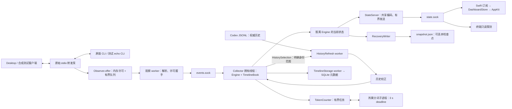

# 已实现架构与源码阅读路径

状态：本文件描述 P4 分页、P5 分段索引／校正队列／独立计数进程、P6 投影及 P7 边界的已实现架构；日常 GUI／collector／驻留 bridge 已统一更新并核对，新版自然验收仍待完成。后续阶段更新本文件，不覆盖[第 17 章基线架构](../17_review_and_refactor/architecture.md)。目标与实际结果分别见[技术设计](technical-design.md)和[实施记录](implementation-results.md)。

当前速度口径与展示见[固定一秒接收窗口](one-second-speed.md)。`RateReading` 统一数值／状态／原因；可选 `rate_status` 与 `generation_rate_status` 让 GUI 区分首次计数和异常不可用，数字覆盖仍独立保留。正常等待没有省略号，真实缺口不能显示为零。

## 一次活动如何到达界面

原始转发不等待观察事件的解析／发送。只有原后端启动之前有最多 150 ms 的首次许可机会；观察不可用时继续原传输。状态合并只替换尚未发送的界面版本，不替代 Engine 对输入事件的处理。

`snapshot.json` 不承担实时健康或逐秒通信。检查点启动时用于恢复有限上下文，终止历史仍由当前 JSONL 校验；不能恢复旧速度或复活已失效的权威历史结论。

## 拥有者和边界

| 边界 | 实现 | 所有权／失败行为 |
| --- | --- | --- |
| 原始 stdio | `bridge.py: forward` | 只管理自己启动的 CLI；字节、EOF、退出码和信号保持 |
| 原始数据副本 | `Observer.offer` 与 `observer_permit.py` | 转发线程只查内存并入队；worker 自己执行 socket I/O。跳过 chunk 使分帧代次失效 |
| 实时领域状态 | `collector.py`、`engine.py`、`state.py` | collector 拥有线程修改；活动与身份不由 GUI 重算 |
| 详情请求 | `query_request.py`、`TimelineClient.swift` | Python 冻结 DTO 与 Swift Encodable；身份／code point 游标在获取 source reader 锁之前校验 |
| 查询回复 | `query_response.py`、`json_encoding.py` | 一条完整 UTF-8 JSON 帧，含换行最多 8 MiB；超限／无效回复明确失败，已有服务失败不触发第二次离线解析 |
| 后台计数 | `metrics.py: CountWork`、`tokenizer_process.py` | 冻结请求摘要，弱引用所属流；准入有界，复用一个有 deadline 的所属子进程，失效模型结果不应用 |
| 元数据写入 | `timeline_storage.py: MetadataWrite` | allowlist 编码为不可变 payload；有界合并，超限失效派生缓存；worker 真正结束才释放生命周期拥有权 |
| 历史读取 | `history.py`、`history_index.py`、`history_read.py`、`history_content.py` | provider 拥有加锁缓存；源目录与所选 turn 可分别淘汰，内容引用经一致句柄校验 |
| 历史交接 | `history_refresh.py`、`reconciliation.py` | 冻结选择包含明确 item 范围，Facts 索引只投影所需元数据；编码结果有字节预算，范围外不作删除判定 |
| 跨线程投影 | `publication.py: DetachedSnapshot` | 拥有线程深复制；worker 只能编码或取得独立恢复副本，不持有 Engine 引用 |
| 状态订阅 | `state_transport.py`、`StateSubscription.swift` | 独立 socket owner；完整状态、实例／序号和 nonce 健康；慢端有界关闭 |
| 采集租约 | `observation_lease.py`、`app_session.py` | 文件只授权启动；连接内续期，reader 无管理权；过期／释放不依赖写盘 |
| 配置与失败恢复 | `app_control.py`、`BackendClient.swift` | 管理锁串行变更；确认丢失不等于回滚；真实状态查询不阻塞订阅 |
| 短命命令执行 | `ProcessExecutor.swift` | 两管道排空、输出预算、取消／deadline、所属进程组和有限 drain；不接管 Desktop 自有进程 |
| 展示与选择 | `DashboardStore.swift` | 接受最新代际状态；管理、订阅、健康时钟分开。聊天选择、独立查看器仍由 store 管理 |

上述源路径分别位于 `src/codex_progress_monitor/`、`macos/Sources/MonitorApp/` 与 `macos/Sources/MonitorModel/`。`SnapshotUpdates.swift` 仅用于显式只读文件路径。

## 三个 socket 的职责

- `events.sock`：桥接事件和有限观察许可；不负责 GUI 查询／租约。
- `state.sock`：完整状态、健康、拥有连接及有限 grant 安装／释放；不执行任意管理命令。
- `tl.sock`：只读时间线／活动详情。只有未连接且生命周期锁证明 collector 不在时，查询端才从权威历史与派生元数据离线读取；不启动 writer。

GUI 的管理命令通过统一子进程执行器调用 CLI，不能用管理命令是否完成推断实时连接健康。反过来，状态通道可用也不表示某次配置修改已经成功。

## 时间、版本和恢复

状态传输版本 1、Snapshot schema 1、启动 grant 版本 2 分开管理。实例随机标识 collector 生命周期；序号只在该实例内比较。墙钟用于来源／诊断，本地健康与截止使用单调时钟；新鲜度要求新 nonce 在期限内返回且 Engine tick 年龄合格。

GUI 断线后在已有 5 s 期限内用同一凭据重连，不延长断线本身的宽限。它不制造 source gap；只有 bridge 真正失去观察时才记录缺口。正常退出先显式释放，CLI 再停止所属 collector。检查点最后保存最多等 2 s；恢复／状态／元数据 worker 仍可写时不提前交出生命周期锁。

## 阅读、校正与展示缓存

详情使用 v2 section-prefix token；`content_version.py` 统一摘要和切页，`history_read.py` 在一个文件句柄上校验 session、记录摘要、显式 turn／context 与读取前后来源。Swift 的 `ActivityPageCursor` 和 `ActivityDetail` 统一两个入口的游标、版本变化及保留阅读状态；v1 只读第一页。查询过大、失败或来源变化都保留已加载内容。

`HistoryProvider.detail_view` 按目标 phase 与明确 call 依赖缓存 `HistoryDetails`，只读取所需正文引用；`timeline_view` 用 `HistoryMetadata` 保留全体展示元数据，丢弃不使用的正文引用；后台校正用 `HistoryFacts` 缓存明确 item 范围。目录被淘汰后，经文件身份校验仍可读取缓存选择。这些索引共用 64 MiB 权重／1,024 份选择预算，正文不在索引常驻。完整时间线的构造仍与 phase 数量成正比，回复字节上限不等于 RSS 上限。

`HistoryCoverage` 在 Engine 和 TimelineBook 复用 item 范围，防止窄结果引起范围外删除。`HistoryRefresh` 的请求和编码结果分别有字节上限，单个 tick 只取有限批次；`TokenCounter` 计量全部未完成工作，包括模型变化后失效的 Future，并用一个独立子进程中断 native 超时／崩溃。`IdentityBudget` 的压缩证据只管准入，不作为历史完成结论。后端终止保护只采用明确停止证据，长断线仍允许重新建立观测基线。

`SnapshotProjection` 在解码 worker 中随一张状态构造，getter／行复用同一图；store 只按最近列表到期刷新选择。实际预算与未完成压力档位见 [资源预算](resource-budgets.md)。CPU／GIL 竞争、原始 JSONL 读取及首次启动的文件系统操作不因增加 worker 而自动消失。

## 边界核对与保留入口

- **身份与单位**：`Event` 明确 backend 与方向；持久选择采用冻结 `HistorySelection`／`HistoryCacheKey`，分页 token 绑定 scope/thread/turn/phase/section，状态实例与序号独立。已有领域表仍用显式 tuple key，不再包一层同义对象。`state.py` 说明运行时单调秒与来源墙钟毫秒，分页偏移为 code point，工作／队列容量为 UTF-8 字节。
- **拥有者与值**：`Activity`／`Thread` 只有 collector 拥有线程修改；`reconciliation.py` 只应用 JSONL 事实。后台交接是冻结选择、不可变编码包和脱离副本；计数／存储／缓存诊断是冻结摘要。wire 字典和有界派生投影仍保留在其适配层，没有再建并列领域历史。
- **失败与兼容**：进程失败由 `ProcessExecutionError` 区分；查询有三种结构化传输失败，分页有来源变化／不可用状态，Swift 在两个阅读入口保留原文和滚动。旧 snapshot／detail v1、旧租约拒绝收敛在读取／协商边界。
- **保留入口**：文件 Snapshot reader 只供显式只读／fixture；provider 的完整 `view`／`selected_view` 和 `items=None` 供诊断／行为对照，生产详情、时间线和校正分别使用窄投影。CLI 离线入口须确认没有 collector 拥有者。旧 `QueryProcess` 和生产目录通知已被替代；P0 的影子完成 basis 已删除。

[49 个 Python 模块的相对导入核对](evidence/p7-boundary-audit.json)未发现 eager 导入环。函数内的已有管理命令调用和计数 child→`count_text` 延迟导入保留，其用途在附件说明；AST 检查不证明任意动态导入或第三方库没有环。Engine 继续拥有相互依赖的协议生命周期、归属及 tick；独立规则已分别进入状态、历史扫描／读取、事实应用、后台交接、计数和存储模块。没有额外搬移状态机来追求文件行数。

## 剩余运行验收

日常 GUI／collector 的实际构建、源码、状态实例与拥有连接已核对，见[切换证据](evidence/p3-daily-cutover.json)。维护者完整重开 Desktop 后，旧 bridge 已退出，新 bridge 的进程身份、启动源码与许可已核对，见[重开记录](evidence/p3-desktop-restart.json)。新版自然完整回合及长期记录继续验收，不能由这里的调用图或 Preview 测试替代。
