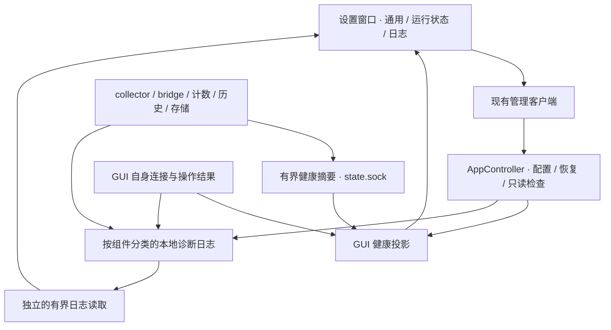

# 技术方案

日期：2026-10-28。基线：`6c39325`。状态：已实施。第 1 节保留实施前的能力盘点，其余描述技术契约；实际组织、取舍及验证边界见[实现结果](implementation-results.md)。产品行为见[需求](requirements.md)。

## 1. 基线能力与缺口

| 入口 | 已有能力 | 本轮补充 |
| --- | --- | --- |
| 原 `DashboardSettingsMenu.swift`（本轮删除）；[DashboardView.swift](../../macos/Sources/MonitorApp/DashboardView.swift) | 语言、配置、恢复、登录启动和退出菜单 | 齿轮改为窗口入口，操作移入对应页面。 |
| [DashboardStore.swift](../../macos/Sources/MonitorApp/DashboardStore.swift)、[BackendClient.swift](../../macos/Sources/MonitorApp/BackendClient.swift) | 首次自动配置、重开时恢复／重应用、串行管理、失败后查询、实时订阅 | 保留生命周期；补结构化错误留痕、接入投影和独立诊断 store。 |
| [app_control.py](../../src/codex_activity_monitor/app_control.py) | 配置事务、备份、回读、恢复、依赖退出与清理状态 | 将配置检查、运行证据和错误信息分别输出；增加有界只读检查。 |
| [StateSubscription.swift](../../macos/Sources/MonitorApp/StateSubscription.swift)、[state_transport.py](../../src/codex_activity_monitor/state_transport.py) | 1 s 心跳、2 s nonce 截止及 tick 年龄检查、实例身份、存档诊断 | 保留健康协议，接入 UI 诊断并补充必要的可选摘要字段。 |
| [bridge.py](../../src/codex_activity_monitor/bridge.py)、[engine.py](../../src/codex_activity_monitor/engine.py) | bridge 心跳、部分解析失败／丢弃计数、原因、近期缺口 | 补统一状态事件和启动配置证据；不改变原始字节转发。 |
| [collector.py](../../src/codex_activity_monitor/collector.py) | `resource_diagnostics`、`counters`、`timeline_summary.quality` | 产出有当前状态、作用域和恢复证据的健康摘要。 |
| [publication.py](../../src/codex_activity_monitor/publication.py)、[timeline_storage.py](../../src/codex_activity_monitor/timeline_storage.py)、计数及历史模块 | 部分失败计数、最后错误、预算和积压状态 | 补必要的最后成功／失败及恢复信息，不能从累计值推断当前故障。 |
| [Snapshot.swift](../../macos/Sources/MonitorModel/Snapshot.swift) | 解码活动与部分质量状态 | 尚未解码通用诊断计数；增加按需的强类型摘要。 |
| [cli.py](../../src/codex_activity_monitor/cli.py) | collector 输出写入 `collector.log`，启动时达到阈值才轮转 | 增加独立、有界、覆盖 GUI 与后台的结构化日志。 |

现有 `readManagement()` 使用 `try?`，失败时保留旧值；状态订阅的 `catch` 重连时未保存具体原因。它们保护了运行，但不足以回答故障原因。已有 `bridge_restart_required` 主要识别旧观测协议，不是所有配置变更的重启证明。

## 2. 职责与数据流



- `DashboardStore` 继续拥有观察生命周期、管理操作与已有活动状态；设置窗口共享它，不重新 bootstrap、不取得另一份租约。
- 页面选择由保留的 `SettingsView` 局部状态持有；`DiagnosticsStore` 管日志筛选、选择及读取代次，健康投影放在 `DashboardStore` 的独立扩展中。日志读取、搜索和磁盘维护均不在主 actor 执行。
- 后台模块报告自身操作事实；collector 汇总其组件健康；GUI 独立判断通信是否新鲜及管理操作是否失败。
- 日志可由各进程直接落盘，读取不经 `state.sock` 或 collector。collector 不可用时，GUI 的诊断及日志页仍能工作。
- Agent 仅作为显式来源字段和接入区域扩展点。本轮保留具体 Codex 实现，不建设通用插件框架。

## 3. 原生窗口与主面板

### 3.1 窗口所有权

沿用当前 AppKit 应用入口。由 `AppDelegate` 强持有一个 `SettingsWindowController`，使用标准 `NSWindow` 与 `NSHostingController`。根视图使用 `NavigationSplitView`、侧边栏 `List(selection:)`、通用页的分组 `Form`／`Section`，日志使用 `Table` 和系统搜索／筛选控件。按后续反馈，通过 `.toolbar(removing: .sidebarToggle)` 移除顶栏的自动折叠按钮；用户确认保留原生拖动隐藏，不强制锁定侧栏。

齿轮成为普通按钮：关闭主弹出面板、打开或聚焦设置窗口。设置窗口独立于 `PanelAuxiliaryState`；关闭主面板、切换聊天或点击其他应用不应顺带销毁设置窗口。窗口关闭只释放页面观察和读取任务，既有观察租约继续由应用管理。

窗口初始尺寸采用约 `760 × 560 pt`、侧栏约 `170 pt`，作为布局起点；最小尺寸以英文长文案、表单和日志可操作为准。页面不写死与系统控件竞争的高度。首次显示通用，进程内保留选择，恢复窗口几何位置。退出入口调用应用现有终止流程，卸载确认移到设置窗口承载。

### 3.2 系统外观

设置窗口采用默认导航、表单、按钮和内容背景。主弹出面板先只删除 `DashboardView` 的 `.background(.regularMaterial)`，保留现有 `NSPopover`、大小、定位、外部点击和 Escape 行为。

以新 SDK 构建，让系统按运行版本提供效果；不新增 `glassEffect()`／`.glass` 样式或材质版本判断。当前 Package 和构建 plist 的最低系统版本都是 14.0，本轮保持。原生容器自动适配不代表自定义时间线或列表选中背景也变成系统控件。

若预览显示 hosting 视图仍覆盖 popover 背景，先定位覆盖来源，再作最小修正；不直接另铺一层玻璃。依据是 Apple 的[采用指南](https://developer.apple.com/documentation/technologyoverviews/adopting-liquid-glass)对标准组件、SDK 和移除自定义 popover 背景的说明。内容层的可读性遵循[材质指南](https://developer.apple.com/design/human-interface-guidelines/materials)。

## 4. 接入状态与生效证据

### 4.1 分开的事实

增加可选、带独立版本的 `integration_status` 摘要，字段名可在编码时调整，但必须保留下列语义：

| 维度 | 值与含义 |
| --- | --- |
| `configuration` | `enabled / disabled / partial / unknown`，来自记录与实际受管配置的比较，不是仅比较 receipt 的 `state`。 |
| `operation` | `idle / configuring / restoring / failed`，包含操作身份和最后结果；失败不覆盖已确认的配置事实。 |
| `runtime` | `active / partial / waiting_for_codex / reconnecting / unavailable / unknown`，区分接入和运行故障。 |
| `restart` | `not_required / required / unknown`，附原因和关联进程证据；安全清理的等待原因另列。 |
| 证据 | 目标配置代次、匹配／旧／未知 bridge 数、检查结果的新鲜度及错误码。不能包含 secret 和环境原值。 |

开关绑定最后确认的配置启用结果，操作进度单独呈现。`partial / unknown` 时保留上次确认状态的说明，禁用普通切换并提供受控恢复／重试；不能把 `state != configured` 简化成“已经关闭”。

复用 `BackendClient` 的失败后查询。管理命令超时或取消不意味着回滚，只有查询或后续恢复确认的事实才能更新状态；陈旧结果按操作代次丢弃。登录启动注册失败单独报告，不撤销已完成的 Codex 接入。

### 4.2 配置代次与 bridge 证据

1. 为实际有变化的接入配置分配 `configuration_revision`，包含 launcher／实际 CLI 路径、受管值、观测能力及相关实现版本的规范化身份。同一配置重新应用保持代次，不能每次打开 Monitor 都导致待重启。
2. launcher 传递其启动代次；bridge 在启动时固定该值，并核对启动上下文中的相关有效配置，只报告匹配结论或允许的指纹，不上报环境原值。
3. 将启动证据写入 bridge 注册信息，并在 `bridge/started` 与健康摘要中提供；校验 PID 对应的进程身份、runtime 和实时握手。旧 bridge 没有字段时保持未知／兼容状态，不伪造匹配。
4. 正在运行的 bridge 不能在读取最新 receipt 后把自己的启动代次改成最新版；launcher 文件被更新也不能单独证明旧 Desktop 已继承新环境。
5. 代次定义不能依赖包含自身代次的 launcher 文件全文哈希，避免循环；实现时固定规范化输入并用变更／无变更案例验证。

读配置和进程检查放在新的小型 `integration_status.py` 或同等独立模块；管理层每次操作后检查，平时沿用约 5 s 的低频刷新，全部设置截止时间。只读检查不复用会删除失效注册文件的清理路径，不扫描进程的完整环境或命令行。

### 4.3 判定规则

- 已写入配置、Codex 未运行：显示等待下次启动。
- 在配置变更时确认相关进程仍持有旧上下文，或发现旧代次／不兼容 bridge：提示完全退出并重开 Codex。
- 当前有效配置匹配，且对应 bridge 身份、能力和实时握手正常：确认该接入已生效；不推导全部聊天覆盖。
- 新旧 bridge 并存：保留已接入事实，同时提示旧连接需重启，不用一个绿色状态掩盖旧连接。
- 无 bridge、无聊天或短期无事件：不能单独判为失败或必须重启。可显示等待连接；检查失败则未知。
- 关闭时，停止观察与恢复配置先执行；旧进程可能继续原任务。用相关进程身份判断剩余依赖，提示重开后使用原配置，不能强杀。
- `pending_cleanup`、无法观察进程和卸载等待分别显示。保留原有备份／安全清理约束，恢复完成前阻止新的配置操作。

后续 Agent 可复用相同展示维度，具体生效证据仍由各适配器定义，不能把 Codex 的进程和环境规则推广为通用事实。

## 5. 健康状态模型

### 5.1 事实来源

每个组件提供有界的 `ComponentHealth`，至少包含 `component`、可选 `agent`、`instance_id`、作用域、当前状态、稳定原因码，以及最近成功／失败证据和累计计数。`healthy / degraded / unavailable / unknown / disabled` 与操作进行中、等待启动／重启等预期状态分开。

collector 的 snapshot 增加可选、版本为 1 的 `diagnostics` 摘要；复用现有资源计数和 `timeline_summary`，只增加缺少的当前状态／恢复依据。心跳中的 `persistence` 继续用于独立存档诊断。Swift 按需解码这些字段，不把原始字典全部铺到页面。

| 组件 | 判断依据 | 恢复依据 |
| --- | --- | --- |
| GUI → collector | 现有 nonce、实例及 tick 年龄；区分连接／协议／租约错误 | 新鲜、匹配的握手与响应。 |
| bridge → collector | 连接、心跳、丢弃增量、解析失败和缺口原因 | 新的有效连接及连续观测证据；历史活动缺口保留原语义。 |
| tokenizer | 已有失败／超时、预算状态及当前任务情况 | 新的有效计数；没有待处理任务不因缺少新结果而报错。 |
| 历史读取／查询 | 已有异常、结果质量及查询服务可用性 | 同范围的新成功结果；源不存在、源不完整和实际 I/O 错误分别处理。 |
| 元数据／检查点存储 | 当前写入结果、队列丢弃和已排队任务 | 后续成功写入；无新写入时显示尚未验证恢复。 |
| 配置与诊断检查 | 当前操作及只读检查结果 | 后续回读或检查成功，局部失败分别解除。 |

首版历史、元数据和检查点 worker 的未完成工作截止为 5 s，空闲不计时；解析及丢弃增量采用 5 s 近期窗，累计值保留。

超时需要明确业务期限。首版复用已有 IPC 和 tokenizer 截止；只有确有未完成请求的其他任务才增加 deadline／进展检查，不以空闲期间没有工作完成作为卡死证据。

### 5.2 新鲜度与异常生命周期

当前健康基于本地单调时钟和明确的消息／实例身份。墙钟仅用于日志与来源显示。collector 摘要仅在对应实时通道新鲜时可作为当前状态；存档、日志文件时间和 PID 存活不能续期健康。

以 `(agent, component, scope, code, instance)` 标识问题，维护首次出现、最近出现、次数、当前影响和处理建议。状态改变产生 `started / updated / recovered` 事件；相同问题合并，实例改变不把旧实例记录当成当前故障，也不冒充已经验证旧故障恢复。

累计计数只描述历史或新增事件。告警依据新失败、未解决影响和恢复证据；例如历史 `snapshot_write_failures > 0` 不足以证明当前仍不可写。计数归零／回退按实例切换处理，不能制造负增量。

通信中断立即使实时指标按原有规则不可用；可操作的持续告警经过短暂重连宽限，避免把单次切换渲染为长期故障。预期停止、管理操作和睡眠恢复应显式传入投影。前台整体状态区分局部降级、关键路径不可用和证据不足，不让正常项覆盖未知或受影响项。

现有 `DashboardStore` 中吞掉具体原因的路径改为保留类型／错误码与允许的上下文，并继续原有退避。Python 命令／collector 的顶层和后台线程异常边界补充尽力记录的 `unexpected_exception`，保留异常类型和允许的定位信息，不原样输出可能带正文的异常对象。Swift 在可恢复的调用边界记录错误；fatal error 不伪装成可以捕获并继续运行。日志不作为健康状态的权威输入，删除日志不能清除告警。

### 5.3 自诊断边界

GUI 可判断后台失联，后台模块可报告内部操作错误；不能承诺检测所有死锁、崩溃原因或逻辑错误。GUI 无法在自身停止执行后实时显示告警。

GUI 启动时以实例标记记录“运行中”，正常退出时记录结束。下次先核对记录对应的进程身份，再判断是否未正常结束，避免把仍运行的另一实例当成崩溃。发现未正常结束只提示事实及可用日志，不断言崩溃；强制退出、断电或标记写入失败均可能导致该结果。系统崩溃报告可由用户另行查看，首版不扫描或自动收集系统报告。

## 6. 结构化日志

### 6.1 事件契约

采用 UTF-8 JSON Lines；版本与活动 snapshot 协议独立。示例仅含虚构标识：

```json
{"version":1,"event_id":"example-7","sequence":7,"at":"2026-10-28T08:00:00Z","level":"warning","component":"metadata","agent":"codex","instance_id":"collector-example","operation_id":"example-op","code":"metadata_write_failed","transition":"started","message_key":"diagnostics.metadata_write_failed","params":{"errno":13},"count":1}
```

时间用于显示，同一进程内顺序用实例及事件序号保证，不仅按墙钟排序。`operation_id` 关联 GUI 管理请求与后端操作，不借 PID、路径或文本相似度关联；它不携带认证能力。

级别为 `info / warning / error`。默认记生命周期、配置、故障、重试摘要和恢复，不记逐 token、逐心跳或逐次成功轮询。重复事件按短时间窗合并，保留起止时间、次数和截断标记；首次立即入队，窗口结束补其余次数及首末时间。队列满时丢弃新记录并计数，首版不承诺严重度优先或日志无丢失。

面向用户的摘要使用稳定消息 key 及允许参数，支持中英文。跨版本未知 key 显示稳定错误码及安全详情。底层详情采用类型、errno、退出码等允许字段；禁止原样序列化任意异常对象、stderr、receipt、请求或环境字典。

### 6.2 文件与并发

新日志根目录为 `data_root/diagnostics/`，独立于可能被恢复流程清理的 runtime。四类日志流为 `gui / management / collector / bridge`，角色由程序固定，不由事件字符串构造路径；记录中再区分具体组件和 Agent。

同类多进程共享日志流时，由各进程的后台 writer 以非阻塞文件锁协调追加和轮转。持锁后重新打开当前文件，避免跨进程轮转后继续写旧描述符；一条完整 JSON 行在锁内写入，解码端允许最后一行不完整。锁竞争由后台 worker 退避，队列满时丢弃并计数，不让调用方等待；退出有独立截止时间。

应用、管理命令和 collector 从已解析的数据根目录取得日志位置；bridge 经受管启动上下文或 worker 读取的管理标记获得位置，热路径不查文件。终端的非 GUI-managed runtime 默认只写其显式 runtime 范围内的诊断，不写入另一份 GUI 数据目录。只读 Preview 使用合成诊断 fixture，不向日常目录写日志或结束标记；一次性 profile 的所有诊断读写和清理均限制在 profile 内。

现有 `collector.log` 暂作原始进程输出的兼容入口，单独标明格式；新增结构化事件逐步覆盖已知错误。它也必须纳入有界轮转预算，不能只靠下次启动时检查大小。UI 不默认导入未经清理的原始输出，打开目录时可查看实际保留文件。

### 6.3 初始资源预算

以下为可调的工程起点，实施时以边界注入复核：

| 资源 | 起点 |
| --- | --- |
| 每进程写入队列 | 最多 256 项且 256 KiB；记录编码后单条最多 8 KiB，超限安全截断。 |
| 每类 JSONL | 当前文件 2 MiB，加至多 3 个轮转文件；四类约 32 MiB。 |
| 原始 collector 输出 | 当前与一个轮转文件，各最多 2 MiB；捕获与轮转不得阻塞采集主循环。 |
| 日志保留 | 最多 7 天；总预算 64 MiB 含原始日志、轮转和元数据。维护过程也有锁与扫描上限，不依赖 collector 存活。 |
| GUI 内存列表 | 最多 1000 条或 2 MiB；初始加载最近 200 条，按需读取更早记录。 |
| 日志读取与刷新 | 后台有界窗口读取，文件身份／大小／修改时间未变则使用缓存；最多约 1 Hz。搜索最多扫描 64 MiB／1 s，可取消，显示受限范围。 |
| 重复合并 | 5 s 汇总窗；首次错误和恢复优先，窗口结束时补次数。 |

日志磁盘阻塞只允许影响独立 writer；不能在 GUI 主 actor、collector 事件循环或 stdio 转发泵上同步格式化大对象、等锁、写文件或无限 flush。退出只作有界的尽力写入；突然终止可能丢失末尾日志，不把日志当配置事务凭据。

写盘／轮转失败在内存中记录 `logging_unavailable`、原因与丢弃数，由 GUI 可见渠道报告，不递归写同一失败。磁盘故障时无法保证记录持久化，不能宣称日志永不丢失。

### 6.4 读取、恢复与清理

日志读取通过独立 `DiagnosticLogClient`，后台处理有界尾部窗口、文件身份缓存、轮转、替换、UTF-8 分帧、损坏行及截断。首版不维护复杂的跨轮转持续游标；文件变化时重读预算内窗口。过滤和搜索不向 UI 一次加载全部文件；损坏记录显示读取受限说明，不阻止其他记录展示。

后台每分钟维护固定归属文件，按文件出生时间淘汰，reader 再按记录时间排除超过七天的记录；同一过期文件中的较新事件可能提前淘汰。

普通恢复保留 `diagnostics/`；现有 runtime 中的 `collector.log` 可能随恢复清理，重要的已知诊断在独立流中保存。完整卸载将新增目录和归属文件纳入明确 allowlist，结束／限制相关写入后清理，未知文件继续阻止扩大删除。仅打开日志页不启动 collector、不延长租约、不改变接入配置。

## 7. 模块与协议改动建议

| 范围 | 改动建议 |
| --- | --- |
| Python 管理 | `integration_status.py` 负责只读生效检查，`app_control.py` 负责事务和附加结果；扩展 `app status`，不让状态检查配置系统。 |
| Python 诊断 | 小型健康类型／投影与有界日志 writer 分开；模块在明确错误边界上报，不把 logger 放进 Engine 业务判断。 |
| bridge | 增加固定启动证据和 worker 日志；原始转发行为、观察预算及许可热路径保持。 |
| collector 相关模块 | 复用计数，补当前错误、最后成功及恢复信号；健康摘要有界，避免每次刷新重复扫描历史。 |
| Swift 模型 | 增加 `IntegrationStatus`、`ComponentHealth`、`DiagnosticEvent`；保留可选字段和未知枚举回退。 |
| Swift 应用 | 增加设置窗口、页面和诊断 store／client；复用现有管理客户端、订阅和共享语言状态。 |
| 资源与清理 | 更新中英文资源、日志归属和卸载 allowlist；保留原有备份与用户后改值的恢复行为。 |

扩展使用可选、带版本的对象，旧接入缺少字段时降级为未知并按证据提示更新。不能因为缺少诊断字段拒绝现有活动数据；也不能复用 `state_protocol=1` 就假定具备配置代次能力。实现前以新旧组合 fixture 固定具体兼容契约。
