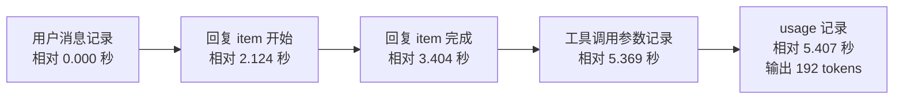
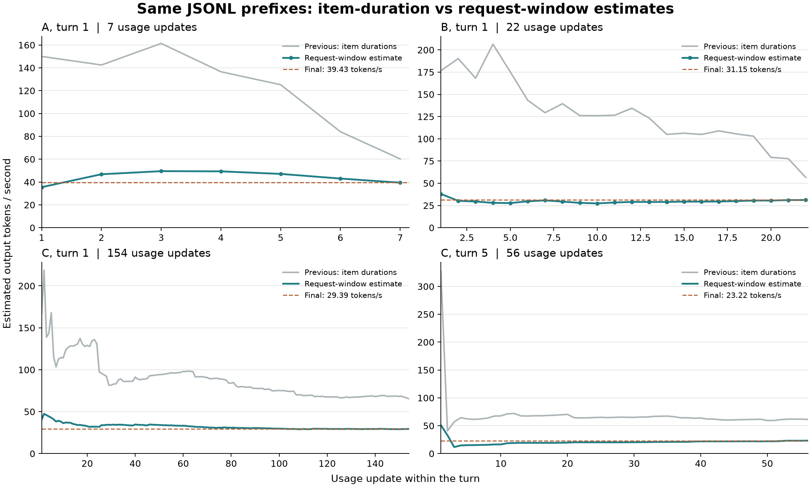
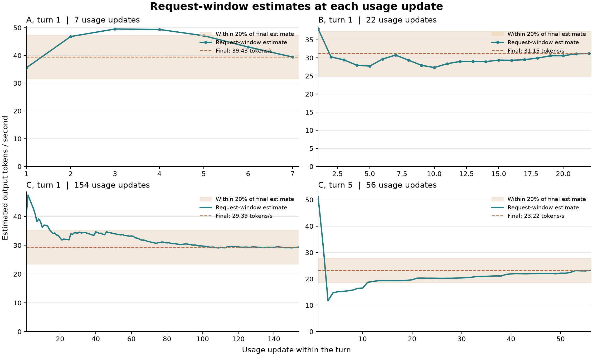

# 两种计时方法对比与实验结果

日期：2026-10-28，Asia/Shanghai。实验代码基线与状态见[本章入口](README.md)。全部脱敏数值见[逐条结果](evidence/updates.csv)和[轮次汇总](evidence/turns.csv)。

## 两种方法改变的是分母

两个实验都在每个轮次内重新累计，每读到一条新 usage 就计算一次，分子采用去重后的 `usage.output_tokens`，已经包含推理 tokens。

| 项目 | 方法一 模型事件耗时求和 | 方法二 请求时间窗 |
| --- | --- | --- |
| 每次更新 | 新 usage 到来时 | 新 usage 到来时 |
| 耗时来源 | 同轮、此前已完成的 Reasoning、AgentMessage、Plan 的 `completed_at_ms - started_at_ms` | 推导的请求开始边界到对应 usage 的外层 `timestamp` |
| 累计方式 | 输出 tokens 总和 ÷ item 时长总和 | 有效计时请求的输出 tokens 总和 ÷ 这些请求的耗时总和 |
| 工具参数生成 | 原始调用记录常没有独立起止字段，容易漏入分母之外 | 通过请求窗口覆盖，不依赖参数 item 的独立持续时间 |
| 工具执行 | 不直接累加工具事件 | 依请求边界分隔；不把工具持续时间求和后机械相减 |
| 未知时间 | 实验保留可读取的模型事件时长 | 无有效窗口时，token 与耗时均不进入速度样本 |
| 计量含义 | item 生命周期上的输出速率估算 | 客户端日志推导的请求级输出速率估算 |

方法二的开始边界不是服务端直接报告的推理开始时间。详见[Token Monitor 计时状态机](token-monitor-reference.md)。

## 一条 usage 的字段与时间线

以下是说明用合成 JSONL：沿用真实样本首条请求的相对间隔和 token 数，将原始日期换成固定日期，并省略身份、正文和其余 usage 字段。它展示字段结构，不是原始聊天日志副本。

```jsonl
{"timestamp":"2000-01-01T00:00:00.000Z","type":"response_item","payload":{"type":"message","role":"user"}}
{"timestamp":"2000-01-01T00:00:03.404Z","type":"event_msg","payload":{"type":"item_completed","item":{"type":"AgentMessage"},"started_at_ms":946684802124,"completed_at_ms":946684803404}}
{"timestamp":"2000-01-01T00:00:05.369Z","type":"response_item","payload":{"type":"custom_tool_call"}}
{"timestamp":"2000-01-01T00:00:05.407Z","type":"token_usage_record","payload":{"usage":{"output_tokens":192}}}
```



图按事件顺序排列，节点与连线的几何宽度不表示持续时间。回复开始时刻由 `started_at_ms` 还原，不代表文件中另有一行同时间的记录。

方法一只计入回复 item：

```text
192 ÷ (3.404 − 2.124) = 192 ÷ 1.280 = 150.00 token/s
```

方法二使用用户消息记录到 usage 的推导窗口：

```text
192 ÷ (5.407 − 0.000) = 192 ÷ 5.407 ≈ 35.51 token/s
```

其余 4.127 秒没有被方法一计入，但不能因此认定那段时间没有模型输出。它可能包含参数生成，也可能包含首 token 等待等时间，现有记录不能可靠拆分各自占比。

同轮第二条 usage 新增 508 tokens。此时方法一累计耗时为 `1.280 + 3.632 = 4.912` 秒，得到 `700 / 4.912 ≈ 142.51 token/s`；方法二累计窗口为 `5.407 + 9.549 = 14.956` 秒，得到 `700 / 14.956 ≈ 46.80 token/s`。两个请求窗口之间另有 0.379 秒间隔，没有直接加入方法二分母。累计速度始终是累计 token 与累计耗时之比。

## 样本和重放方法

实验使用本机 3 份实际 JSONL 的固定字节前缀，模型均为 `gpt-6.1-sol`，记录中的 CLI 版本均为 `0.164.0-alpha.11.1`。样本选择覆盖短轮次、22 次响应的轮次，以及含 154 和 56 次响应的较长轮次，不按速度结果筛选记录。

| 匿名样本 | 固定前缀字节数 | 有 usage 的轮次 | usage 数 |
| --- | ---: | ---: | ---: |
| A | 2,025,182 | 8 | 31 |
| B | 1,384,454 | 1 | 22 |
| C | 6,177,240 | 10 | 232 |
| 合计 | 9,586,876 | 19 | 285 |

文件前缀及其哈希在两轮实验间保持一致，避免追加记录改变对比集合。16 轮有至少两条 usage；另外 3 轮只有一条，不能用来评价轮内更新的稳定性。

方法一按源文件顺序读取，在每条 usage 处只使用此前的去重模型 item；285 个累计输出值均与 JSONL 的轮次累计值一致，19 轮最终模型时长均与现有历史解析器一致。没有通过补零、限速或删除极端速度调整结果。

方法二是固定版本 Tokscale `CodexRequestTiming` 的 Python 复现。每条 usage 到来时，在脱离主状态的副本上预览请求窗口；原计时状态仍在后续接受的 token_count 处推进。预览只使用当时可见的文件前缀，不提前读取之后的 token_count。

后续 token_count 再验证计数和边界：285 条 usage 全部有计数一致的对应记录，285 次预览耗时与后续确认全部一致；另有 2 条重复 token_count 被跳过。全部 285 条有有效时间窗且覆盖全部输出 tokens，没有通过剔除未计时响应换取本次改善。复现还核对了所参照源码中 11 个工具延迟、并行结果及错误时间顺序的回归期望；这不是运行原生 Tokscale 或 Token Monitor App 的验证。

## 稳定性结果

用该轮最终值的 ±20% 作为事后比较的参考范围。最终值只用于评价，不参与之前每条 usage 的速度计算。后半段定义为序号从 `floor(n / 2) + 1` 开始的更新，包含最终更新。

| 样本范围与判定 | 方法一 | 方法二 |
| --- | ---: | ---: |
| 至少 2 条 usage 的 16 轮，全程都在范围内 | 1/16 | 7/16 |
| 同上，后半段全部在范围内 | 8/16 | 14/16 |
| 至少 3 条 usage 的 12 轮，全程在范围内 | 0/12 | 4/12 |
| 同上，后半段全部在范围内 | 4/12 | 10/12 |
| 至少 5 条 usage 的 7 轮，全程在范围内 | 0/7 | 2/7 |
| 同上，后半段全部在范围内 | 2/7 | 6/7 |
| 至少 10 条 usage 的 3 轮，后半段全部在范围内 | 1/3 | 3/3 |

16 个多 usage 轮次的轮内累计速度变异系数中位数，从 67.47% 降至 8.88%。变异系数按该轮所有累计读数的总体标准差除以均值计算，不是单次请求速度的变异系数。两条 usage 的轮次，其后半段只剩最后一条，因此另列至少 3、5、10 条的分组，避免过度解释后半段指标。



以下图只展示方法二，浅色带是各轮最终值的 ±20%。四个面板与方法一报告保持相同样本选择。



## 逐条示例和反例

样本 A 第 1 轮的全部 7 次更新，单位为 token/s：

| usage 序号 | 方法一 | 方法二 |
| --- | ---: | ---: |
| 1 | 150.00 | 35.51 |
| 2 | 142.51 | 46.80 |
| 3 | 161.38 | 49.52 |
| 4 | 136.60 | 49.35 |
| 5 | 125.23 | 47.10 |
| 6 | 84.06 | 43.04 |
| 7 | 60.25 | 39.43 |

方法二明显缩小了这一轮的波动，但第 3、4 次仍超过最终值的 +20%，没有达到全程稳定的参考标准。

样本 B 第 1 轮共有 22 次 usage，抽取以下更新点：

| usage 序号 | 方法一 | 方法二 |
| --- | ---: | ---: |
| 1 | 176.61 | 37.99 |
| 2 | 190.21 | 30.24 |
| 5 | 175.14 | 27.72 |
| 10 | 126.01 | 27.31 |
| 15 | 106.33 | 29.36 |
| 20 | 79.17 | 30.57 |
| 22 | 56.58 | 31.15 |

这一轮方法二从第二条起处于约 27–31 token/s。所有未抽取的更新仍保留在逐条证据中。

方法一还有 44 条 usage 新增了共 3,241 个输出 tokens，但没有新增可计时的上述模型 item。相应区间有工具调用参数记录；公式会在分母不增加时增加分子。这是可观测的计时覆盖缺口，不等于已经解释了全部波动原因。

方法二也保留长窗口反例。样本 C 第 5 轮第 3 次请求窗口长达 352.203 秒，累计均速从 32.84 降至 11.70，最后逐渐回到 23.22 token/s。窗口内有一段长时间没有新模型事件的间隔，并有重复 token_count；重复计数没有推进计时边界。记录不足以将空隙归因为纯生成、网络或其他等待，不能按某个原因自动扣除。

## usage 的到达间隔

统计量来自同轮相邻 `token_usage_record` 外层时间戳的差，得到 266 个间隔，即 `285 − 19`。它不包含每轮第一条 usage 前的等待，也排除了轮次之间等待用户输入的时间；仍包含同轮中的工具流程和等待。

| 统计量 | 秒 |
| --- | ---: |
| 平均 | 18.298 |
| 中位数 | 10.676 |
| 第 25 百分位 | 7.252 |
| 第 75 百分位 | 18.308 |
| 第 90 百分位 | 30.829 |
| 第 95 百分位 | 42.080 |
| 最短 | 3.284 |
| 最长 | 434.161 |

百分位使用排序后 `(n − 1) × p` 处的线性插值。239/266 个间隔不超过 30 秒，258/266 不超过 60 秒；有 2 个超过 120 秒的间隔，全部保留。

| 匿名样本 | 间隔数 | 平均秒数 | 中位秒数 |
| --- | ---: | ---: | ---: |
| A | 23 | 42.961 | 21.816 |
| B | 21 | 19.714 | 13.917 |
| C | 222 | 15.609 | 9.376 |

总体均值按全部 266 个间隔计算，不是三个样本均值的算术平均。样本 C 贡献了 222 个间隔，不能将总体值视为所有聊天的固定频率。

usage 的相邻间隔、推导的单次请求耗时、界面轮询周期是三个不同量。界面只能在记录落盘并被读取后更新；不能把 18.298 秒当作固定请求时长或固定刷新周期。文件时间戳也不是桥接器收包时钟、GUI 显示时钟或服务端生成时钟。

## 可支持的结论

请求时间窗方法在本批数据上显著改善了同轮累计读数的稳定性，支持继续实施 usage 驱动的平均请求速度估算。改善不是“每轮从第一条起恒定”，也没有独立验证真实服务端生成速度。

本次覆盖一个模型、一组 CLI 版本和 3 份本机日志。旧 JSONL、usage 与 token_count 缺失或冲突、文件改写、重启恢复和 GUI 实际刷新，还需要按[实施计划](implementation-plan.md)验证。实验结果、产品实现、原生验收和发行准备分别记录。
