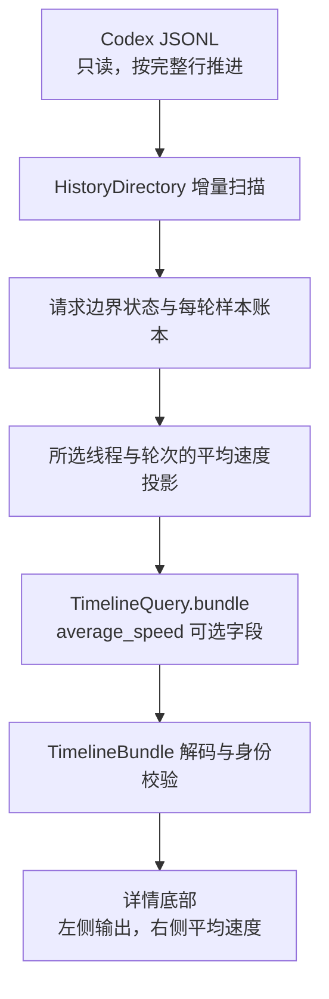
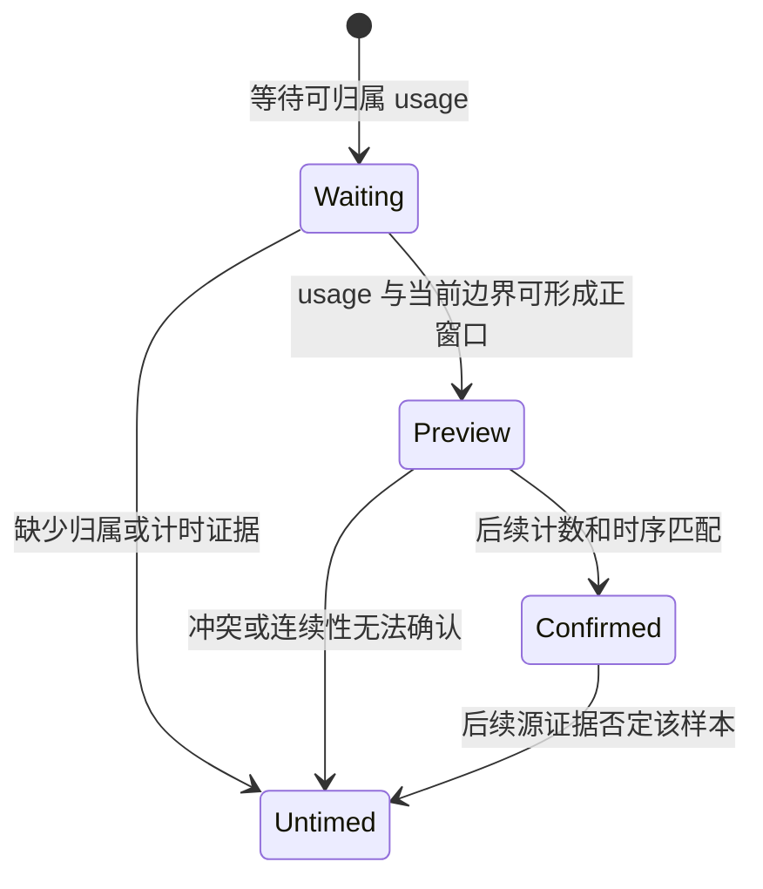

# 平均速度技术方案

日期：2026-10-28。本文保留实现前设计快照；功能已实施，最终细化与验证见[实施结果](implementation.md)。产品范围以[需求与决策](requirements.md)为准，实验依据见[实验记录](experiments.md)。

## 设计目标

在现有 JSONL 增量扫描中推导请求计时，为每个线程、每个轮次维护独立的成对样本账本。新 usage 到来时即可提供平均值，后续记录可以核对或撤销该笔样本。详情查询提供所选轮次的结果，Swift 只负责身份校验和展示。

```text
平均速度 = Σ 有效样本的官方 output_tokens × 1000
         / Σ 同一批样本的请求 duration_ms
```

“有效”要求归属明确、输出计数合法、起止时间已知且时长为正。正常的零输出响应可贡献正耗时和零输出，不能把已知零当未知。没有有效分母时速度为 null。

## 数据链路与所有者



现有入口与拟议修改如下。它们是未来改动面，不代表当前已经提供平均速度。

| 所有者 | 现有位置 | 拟议职责 |
| --- | --- | --- |
| 历史目录与源文件版本 | [history_index.py](../../src/codex_activity_monitor/history_index.py) 的 HistoryDirectory | 在原扫描循环调用请求计时器；文件替换、截断、重写时一起重建 |
| 请求计时与每轮账本 | 拟新增 `src/codex_activity_monitor/request_rate.py` | 数值与身份字段、边界状态、去重、预览、确认、覆盖和累计值 |
| 历史缓存预算 | [history.py](../../src/codex_activity_monitor/history.py) | 将新增账本、响应身份和计时状态纳入 retained_bytes 预算 |
| 详情查询 | [timeline_query.py](../../src/codex_activity_monitor/timeline_query.py) | 仅从根线程目录读取 selected turn 的平均速度，不聚合子智能体 |
| Swift 解码 | [Timeline.swift](../../macos/Sources/MonitorModel/Timeline.swift) | 新增可选平均速度 DTO，与旧响应兼容 |
| 展示与轮次匹配 | [PanelStatistics.swift](../../macos/Sources/MonitorApp/PanelStatistics.swift)、[ChatDetailsView.swift](../../macos/Sources/MonitorApp/ChatDetailsView.swift) | 详情统计行右侧速度、未知值、说明和本地化 |

优先通过已有详情查询链路提供结果，不为了这一项详情指标扩充 collector 高频状态发布。当前 TimelinePanelView 在启用轮询时约每秒查询一次；实际更新还受 usage 落盘和查询完成影响。隐藏详情时沿用原轮询生命周期。

平均速度使用 JSONL 证据，不能仅因为实时 bridge 有 observation_gap 就清空可读取的历史均值。反过来，历史可读也不能证明实时流健康。左侧现有官方用量来源和保守归属规则继续独立处理，不顺带扩大历史输出统计功能。

## 身份和源文件范围

每条样本归属键至少包含 `(scope, thread_id, turn_id, response_id)`。scope、线程身份先由已验证的 session header 和查询上下文确定；usage 的显式线程、轮次、响应身份必须相容。

- 响应去重在正确的线程和轮次内进行，不将不同聊天中相同形式的 ID 混用。
- 父子智能体保持自己的账本，不按时间重叠或同一目录合并。
- 轮次之间重置活动请求起点，保留各轮已结算结果。
- fork 重放、compaction、revert 或归属冲突不能靠显示名称、文件名 UUID 位置或临近时间填补身份。无法证明可配对时保留用量证据，降低速度覆盖。

时钟使用 JSONL 的源时间，不使用查询时的当前时刻或接收窗口时间。所有参与运算的数字先校验类型、有限性、非负 token 和有效时序；布尔值不能被当成整数计数。非法或倒退的时钟不产生速度样本。

## 请求时间窗状态

活动计时状态只需要边界、固定起点、最后模型记录时刻、工具结果时刻、最近接受的 token_count 和待配对 usage 的数值信息，不需要聊天正文。

### 建立开始边界

沿用[源码参照](token-monitor-reference.md)中已验证的请求级规则：轮次或上下文开始、真实用户记录、工具结果及上一笔已接受的结算可提供边界。首次观察到本次模型输出后固定起点，之后异步工具结果不能移动这一已固定起点。

用户输入与系统注入内容需要按明确字段和已有协议规则区分；不能只用字符串以 `<` 开头就判定为系统内容。单纯的模型 item 存续开始时间不自动替代请求起点。

### 新 usage 的即时预览

读到完整 `token_usage_record` 行后，检查归属和 `response_id`，从当前计时状态生成脱离主状态的窗口预览，终点使用该 usage 的外层 timestamp。合法时将这条响应的 token 与耗时作为一笔样本发布。

这一步不能等待整轮结束，也不能为了显示新值提前读取后续 token_count。新的 usage 还没落盘时，不按当前墙钟延长分母。

预览不会直接调用原状态机的有副作用 finish 并提前推进所有边界。实验已经采用副本预览；产品需要把其生命周期明确收敛到下面的账本，而不是将实验对象直接挂到长期运行服务。

### 后续确认与撤销

后续接受的 token_count 用相应 `last_token_usage` 各桶和时间顺序核对待配对样本。核对一致时确认该笔，累计值保持不变；不一致时原子撤销或替换该样本的 token 与耗时，再生成均值。

重复且不推进用量的 token_count 不建立新的速度样本，也不单独推进请求起点。`total_token_usage` 可能因上下文变化而改写，不能把所有累计差都当作新响应输出。

若新 usage、轮次边界或文件结束使配对顺序不再符合已验证路径，需要断开未知请求连续性，不能把上一笔起点借给下一笔。待确认样本的撤销和新明确边界的恢复应有定向用例；无法证明窗口的样本转为 untimed，其他有效样本保留。

## 账本和累计投影

每条响应保留输出、起止或时长、确认状态和必要诊断。重复的相同响应不重复计数；相同身份带来不同数值时，不能把第二份当成新输出相加。



投影始终从同一个有效集合计算 token 和耗时。不能用“全部输出 / 部分请求时长”，也不能将总 token coverage 比例乘回全部输出来伪造配对分子。

只有数值为零但分母有效时显示 0；一个有效样本都没有时显示 `—`。部分样本 untimed 时，可展示有效子集的估算，并在说明里标识部分覆盖。`complete` 若用于接口，只表示当前可读 JSONL 前缀内没有发现遗漏的速度样本，不代表整轮已结束、服务端时间完整或推理耗时准确。

新增状态必须参与现有历史缓存预算。响应身份和逐轮账本需要明确上限；达到限制后标记预算降级，不静默丢掉旧响应继续宣称全量统计。源文件重建、缓存淘汰和重新打开轮次都要得到相同的、来源明确的结果。

## 拟议接口

通过 TimelineQuery 的所选轮次 bundle 增加可选 `average_speed`。以下是字段形状示例，字段名在实施中保持前后端同步；数值取自首条样本。

```json
{
  "average_speed": {
    "version": 1,
    "thread_id": "selected-thread",
    "turn_id": "selected-turn",
    "tokens_per_second": 35.50952469021639,
    "timed_output_tokens": 192,
    "timed_duration_ms": 5407,
    "sample_count": 1,
    "untimed_response_count": 0,
    "pending_response_count": 1,
    "coverage": "complete",
    "estimated": true,
    "quality": []
  }
}
```

版本、线程、轮次与 selected turn 必须相容。Swift 解码使用可选字段，使旧 collector 或 fixture 仍可读取；没有新字段时显示未知。Swift 不重新累计 token 或时间，只检查值是否合法、属于哪一轮。

历史文件不可用、查询失败和轮次切换不能复用其他轮次的均值。保留旧查询结果时必须保留其来源和已有错误提示，不将旧值当成新收到的 usage，也不在离线状态继续推进计时。

## 界面和文案

详情底部继续使用一行左右布局：左侧现有输出及推理数，Spacer 后显示平均速度，最右侧保留统计说明入口。速度使用等宽数字；窄窗口和英文文案下确保两端都可读。

常态文案建议为 `平均速度 39.4 token/s`，未知为 `平均速度 —`。说明中解释“按所选轮次中有有效计时的响应累计，输出包含推理，时间为 JSONL 推导的请求窗口，可能包含首 token 等待等时间”。部分覆盖或数据不可读时补充必要的可读提示。

中英文资源均需完整。使用现有本地化流程，不将原始聊天内容翻译，也不把 response_id、边界字段和账本状态塞入正常产品流程。

## 已知计量边界

长窗口不是自动无效样本。没有事件不等于模型没有工作，也不证明是在等待。样本 C 的 352.203 秒窗口保留作边界用例；当前方案不会仅因为结果偏低就裁掉这段时间。

初版优先实现有明确 usage record 的已验证路径。没有足够字段的旧 JSONL 返回未知或部分覆盖；Token Monitor 的旧格式 100 毫秒回退另做兼容决策和测试，不作为首版准确性的前提。

不引入服务端请求、不要求启动新模型回合，也不改变现有一秒实时速度。原始 JSONL 继续由 Codex 所有，Monitor 只读；来源重建不能写回原文件。
