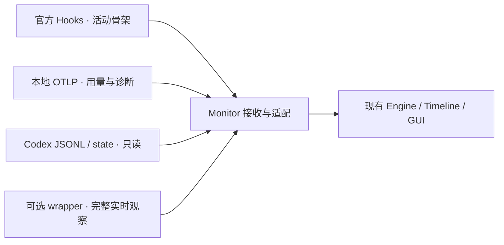

# Hooks + OTel：调研与实验记录

日期：2026-10-30。状态：调研和隔离实验完成；没有切换日常 Monitor 的采集架构。

简要对照见[相对现有采集方案的功能缺口](capability-gaps.md)。

**结论：可以降低接入侵入性，并把日常 Monitor 升级与 Codex 重启解耦；目前不能同时做到零配置、首次接入无需加载配置，以及完整保留现有实时功能。** Hooks 适合提供活动骨架，OTel 适合用量与性能遥测，JSONL 适合内容与历史校正。当前默认 WebSocket 路径的逐聊天流式测速仍有实质缺口。

## 实验范围与证据

- Monitor 基线：`f1be3adb108f10cc3fe224346beefa0a77347479`，实验前 `main` 工作区干净。
- 实际运行：Desktop 安装包内 `codex-cli 0.166.0-alpha.5.1` 的原版 `app-server`，不是 PATH 中的 `0.163.0` CLI。
- 辅助源码：本机 Codex checkout `970111f6cb62cc02fe36a82ea7d71b37a2889c97`。没有验证它就是该安装包的构建提交；行为结论以二进制实测为准。
- 真实请求：`gpt-6.1-sol`、low effort，共 8 个回合、10 次有输出响应，另有 3 次零输出预热。包括英文、中文、工具调用、WebSocket、SSE，以及 traces/metrics。
- 受控实验：本地模拟 Responses SSE 服务，检查回调、配置加载、接收器重启、HTTP 503 和中断。模拟服务的 usage 是固定夹具，不作为真实模型 token 证据。
- 每组创建独立 `CODEX_HOME`、SQLite 和日志目录；真实请求复制现有登录到私有临时目录，用完删除副本。原配置前后 SHA-256 一致，没有更改日常 hooks、重启 Desktop 或替换当前 bridge。
- 真实工具成功实验在允许正常嵌套沙箱的执行环境运行，固定命令仅输出 `HOOK_OTEL_PROBE`。普通受限环境下的早期样本遇到 `sandbox_apply: Operation not permitted`，不把那些样本计为工具成功验收。

[脱敏结果](evidence/results.json)保留计数、字段名和状态，不含聊天 ID、正文、账号、参数、结果或凭据。[复现实验](../../experiments/hooks-otel/README.md)及脚本已保存。原始数据保留在本机私有临时目录，路径不进入公共附件。

## 逐项能力判断

| 当前需求 | Hooks | OTel | 判断 |
| --- | --- | --- | --- |
| 会话、回合启动与正常结束 | SessionStart / UserPromptSubmit / Stop 已触发 | 有启动、prompt、完成用量等；并非等价的全套回合状态 | Hooks 更适合做骨架，仍需处理异常与丢失 |
| 工具前后、输入与结果 | PreToolUse / PostToolUse 已收到 ID、参数、响应 | 有 tool_decision、tool_result、call_id、耗时、参数和结果预览 | 可以替代相当一部分工具观测 |
| 用户中断 | Interrupt 已触发；中断回合没有 Stop | 有部分关联遥测，不能视为必有完整终止通知 | 必须单独处理 Interrupt |
| 全局近实时估算速度 | 没有流式计数 | WS metrics 周期导出 delta 计数及窗口时间 | 可以计算总 delta/s，作为 token/s 的估算 |
| 正文逐 delta | 没有此回调 | SSE logs 有；当前 WebSocket logs 没有；WS metrics 有窗口计数 | 无法保持逐段正文分词的测速口径 |
| 工具参数逐 delta | PreToolUse 时已是完整输入 | 模拟 SSE 的 function_call_arguments.delta 有；真实 WS custom_tool_call_input.delta 不进入 logs | 不能保持现有流式工具输入观测 |
| 多聊天分别测速 | 有 session_id / turn_id，但没有流式计数 | logs 有 conversation.id；WS metrics 无聊天维度 | metrics 不能拆分同模型的并发聊天 |
| 官方输入、输出、缓存、推理 token 用量 | 没有直接的 usage 回调 | 完成日志包含对应字段 | 适合用量；本次真实样本 reasoning=0，未重新覆盖非零推理样本 |
| reasoning item 的精确开始/结束 | 没有逐 reasoning item 回调 | 本次导出不能视为等价 item 生命周期接口 | 继续依赖 JSONL 或现有协议；不能宣称全覆盖 |
| 详情正文、文件变更、历史与分叉 | 最终消息、工具输入输出、transcript_path 只能覆盖一部分 | delta 日志没有正文；工具结果可截断 | 保留已有 JSONL/state 只读路径 |
| 子代理关联与所有工具路径 | 文档有 SubagentStart / Stop，但本次未运行子代理 | 未作多代理、所有工具路径的实测 | 待验收，不能由普通 shell 样本外推 |

上述 Hooks 的事件集合、输入字段及工具覆盖边界来自[官方 Hooks 文档](https://learn.chatgpt.com/docs/hooks)。文档明确提醒：部分专用工具可绕过通用工具 hook 路径，transcript 格式也不是稳定接口。

## 关键实测

### 1. WebSocket 与 SSE 的 OTel logs 覆盖不同

默认真实 WebSocket 组：英文 248 个正文 delta，中文 223 个，工具参数 18 个；OTLP logs 中相应逐 delta 记录均为 **0**。导出的 `codex.sse_event` 是 `response.completed` 用量事件，不能因为名字包含 sse 就推断实际使用了 SSE。

同版本换用隔离的自定义 OpenAI provider、关闭该 provider 的 WebSocket 支持后，真实 SSE 请求产生的 **248 个正文 delta 全部进入了 OTLP logs**。模拟 SSE 的 2 个工具参数 delta 也全部导出。

SSE delta 日志含 `conversation.id`、`event.kind`、`event.timestamp` 和 `duration_ms`，但没有正文、item_id、sequence_number、逐块 token 数或 turn_id。它支持聊天级事件密度估算，不能直接替代目前接收文本后进行的累计前缀分词。

同一次 SSE 响应会有两个 `event.kind=response.completed` 日志：一个通用流事件，一个含 usage 的完成事件。适配器必须按 usage 字段识别，不能直接数 completed 日志来统计请求或累加用量。

`log_user_prompt=false` 也不意味着全部日志都没有内容：本次 tool_result 仍含工具参数、结果预览，其他日志包含账号元数据。若采用 OTel，需要像当前过滤器一样只保留所需字段，并维持本地接收和处理的产品语义。

源码辅助定位：`codex-rs/otel/src/events/session_telemetry.rs` 的 `sse_event` 写日志和 metrics，`record_websocket_event` 写 metrics。实际结果支持这个区别。[官方可观测性说明](https://learn.chatgpt.com/docs/config-file/config-advanced#observability-and-telemetry)是代表性事件列表，不能替代对实际传输路径的验证。

**此前把“OTel 有逐 delta”推广到默认 WebSocket，是过宽的结论。** 本次没有运行旧版本二进制作对照，不能将差异直接认定为上游版本回归。

### 2. WebSocket metrics 可算总速度，但不能按聊天拆分

真实 WS traces/metrics 组有 247 个正文 delta：

- `codex.websocket.event` metrics 的对应增量合计也是 **247**，证明事件没有在模型接收层消失。
- 指标在生成过程中分成 **74 批**到达，首批比回合结束早 **14.395 秒**。`asInt` 是窗口内事件数，`startTimeUnixNano` 和 `timeUnixNano` 给出统计窗口。它可以计算近实时总 delta/s，并据此估算 token/s；不需要等待流结束。不能把回合结束时的官方 token 用量误当成每批的真实 token 数。
- 对应指标只有 `app.version`、`auth_mode`、`kind`、`model`、`originator`、`session_source`、`success` 标签；**没有 conversation.id / turn_id**。同一个 app-server 内，同模型的并发聊天会合并。
- traces 导出 **2,330 个 span**，其中 **254 个 handle_responses span** 代表接收循环，包含 delta 以外的事件。本次实际导出的这些 span 名称均为 handle_responses，缺少可区分 text_delta / tool_input_delta 的类型字段，也不直接携带聊天或回合 ID。父级及其他 span 有部分身份信息，尚未证明可以在并发、重试和父 span 未结束时可靠地实时归属全部循环。
- 该组 traces 的 OTLP JSON 请求体共约 **5.58 MB**，logs 约 **74 KB**，metrics 约 **1.52 MB**；这是启用 100 ms 导出间隔、包含启动及关闭的短样本，不能外推为长期资源预算。

因此，全局近实时估算速度可行；同标签的并发聊天无法用该指标分别测速。不能把全部 receiving/handle_responses span 直接当正文 token。Traces 仍有诊断和离线阶段分析价值。

### 3. delta 数不等于官方输出 token 数

| 真实样本 | 正文 delta 数 | 官方非推理输出 token |
| --- | ---: | ---: |
| WS 默认批处理，英文 | 248 | 252 |
| WS 默认批处理，中文 | 223 | 229 |
| WS 100 ms，英文 | 234 | 238 |
| WS 100 ms，中文 | 228 | 232 |
| WS traces/metrics，英文 | 247 | 251 |
| SSE 100 ms，英文 | 248 | 252 |
| 两组 WS 工具后的 `done` 回复，各一条 | 1 | 5 |

这些数证明不能用 delta_count 直接替代官方 output_tokens；差异可能包含消息封装等非正文 token，**不能仅凭差值推断每个 delta 内有几个文本 token**。[API schema](https://developers.openai.com/api/reference/resources/responses/streaming-events#response.output_text.delta)将 delta 定义为文本增量字符串，没有“一事件对应一个 token ID”的保证。

原有[工具参数实验](../18_engineering_hardening/chunk-interval-distribution.md#每个-delta批次的-token-数)已明确：921 个 delta 恰好各增加 1 个本地 token，是该样本的离线重建结果。它不是跨语言、跨输出类型的协议承诺。如果产品选择事件数近似，应把它标为估算，并与现有“本地累计前缀分词后的接收速率”区分。

### 4. 批量导出延迟可以降低，但并不消失

以 `event.timestamp` 到本机 OTLP HTTP 接收时刻的差计算，全部日志的 nearest-rank 分位数如下：

| 真实组 | 日志条数 | P50 | P95 | 最大值 |
| --- | ---: | ---: | ---: | ---: |
| WS，未设置批处理间隔环境变量 | 32 | 551 ms | 941 ms | 985 ms |
| WS，100 ms 间隔 | 31 | 44 ms | 98 ms | 104 ms |
| SSE，100 ms 间隔 | 266 | 54 ms | 101 ms | 105 ms |

100 ms 通过实验子进程的 `OTEL_BLRP_SCHEDULE_DELAY=100` 设置；traces 和 metrics 另用对应 SDK 环境变量。这个环境设置仍需由 Codex 进程启动时读取，不能把它描述为安装 Monitor 后自动生效的运行时开关。

本次 logs 的 OTLP `timeUnixNano` 全部为 `0`，有效源时间在属性 `event.timestamp` 中。接收器应验证并使用该时间，不应把批次接收时间当逐 delta 源时间。这些差值不含遥测事件生成前的排队或网络等待，也不证明服务端解码速度。[官方文档](https://learn.chatgpt.com/docs/config-file/config-advanced#observability-and-telemetry)同样说明导出是异步批处理。

### 5. 安装、更新和配置加载是三个问题

| 操作 | 实验结果 | 对产品的意义 |
| --- | --- | --- |
| 将 OTel 从 none 改为本地 endpoint，并调用 config/batchWrite + reloadUserConfig | API 返回 ok；既有线程和同进程新线程均未开始导出 | 普通配置刷新没有重建进程级 exporter |
| 随后只重启隔离 app-server | 立即正常导出 | 首次启用 / 修改 exporter 仍应按需重启后端设计 |
| 同端口停止并重新启动 OTLP 接收器 | 原 app-server PID 不变，后续导出恢复 | 接收器和 Monitor 的升级可与 Codex 生命周期解耦 |
| Hooks v1 改为 v2，并显式刷新已加载线程配置 | 同一线程下一轮触发 v2 | Hooks 可以热刷新，但需要实际刷新触发点 |
| Hooks v2 改为 v3，只改文件 | 旧线程继续触发 v2；同进程新线程触发 v3 | 不能承诺仅写文件就让所有现有聊天立即加载 |
| 未信任的 hooks | 配置被发现，回调为 0 | 安装和更新要尊重 hook 定义的信任审查 |

源码 `app-server/src/otel_reloader.rs` 的 exporter 重载由 auth change 驱动。本次没有通过登录登出触发重载；不把账号操作当成安装方案。Hooks 刷新另见 `core/src/session/config_refresh.rs`、`app-server/src/request_processors/config_processor.rs` 与 `effective_plugin_change.rs`。

[官方 Hooks 文档](https://learn.chatgpt.com/docs/hooks#plugin-bundled-hooks)允许 plugin 携带 hooks，因此用户可通过插件安装与信任完成接入，不一定需要 Monitor 直接编辑 config.toml。不过，插件启用仍是 Codex 配置变化；现有聊天刷新以及 Desktop 界面中的实际安装体验，本次只查了源码，未做 UI 验收。实验对自有临时 hook 使用会话级 trust bypass，不是建议生产产品绕过审查。

### 6. 接收端故障不阻塞任务，但存在丢失

模拟模型正常工具回合期间，OTLP 接收器持续返回 HTTP 503，共收到 15 次失败投递。该回合仍 completed，后端持续存活，之后接收器恢复和同端口重启均能收到新事件。故障回合的工具遥测在实验结束时没有补回，不能假设无限重试或自动历史重放。

Interrupt 实验中，UserPromptSubmit 触发，回合完成状态为 interrupted，Interrupt 触发一次，Stop 没有为该回合触发。只订阅 Stop 的状态机会遗留“运行中”。

Hooks 默认同步等待，生产监控回调应短小、有超时、只发送观测记录；不返回模型上下文、审批、阻断或继续运行指令。可以评估 async command hook，但它有并发上限、乱序和会话结束取消的边界，且 SessionEnd 始终同步。本次未量化 async 性能或长期故障行为。[官方执行规则](https://learn.chatgpt.com/docs/hooks#run-hooks-in-the-background)应作为实现约束。

## 建议的架构方向

建议拆开“获取活动数据”和“控制 Codex 的后端启动方式”：

1. **先提供无需 wrapper 的模式。** JSONL/state 用于历史和内容；用户安装并信任的 Hooks 补充活动骨架；OTel metrics 提供近实时总速度估算，logs 补充用量和诊断。没有某数据源时明确显示缺口，不能补造实时状态。
2. **把稳定接收地址和小型 hook 发送器与 GUI/collector 更新解耦。** 常规更新只替换 Monitor 自身；同端口恢复后新事件继续送达，缺口靠历史校正。不要在每次升级中改 exporter 地址或 hook 定义。
3. **完整实时能力仍保留可选 bridge。** 在上游默认 WS logs 增加逐聊天、逐 item 的流事件，或提供正式只读订阅接口之前，不承诺无 wrapper 模式与现版功能完全一致。
4. **不建议为监控强制用户改为 SSE。** 它能获得日志事件，但改变了 Codex 的传输选择，又引入配置和兼容责任，与本次降低侵入性的目标不一致。

这是一条“较低侵入、升级通常无需重启”的可行路线，不是“完全零配置”的方案。若要求零写入 Codex 配置，当前可提供的基础方案只能是只读历史观察，实时能力需要明确降级。

尚未验证：真实 Desktop 插件安装/信任/现有聊天刷新、外部只读观察能否获得所需刷新权限、所有工具/审批/子代理/错误路径、非零推理阶段、并发聊天归属、长时间性能、接收器长时间离线恢复、macOS 14 运行行为。未修改产品采集代码，未部署或提交。

交付检查：探针 Python 语法检查、diff 空白检查、最终单回合模拟 SSE + Hooks + logs/traces/metrics 冒烟实验通过。仅增加实验和开发记录，没有运行与本次无关的产品全量回归。
