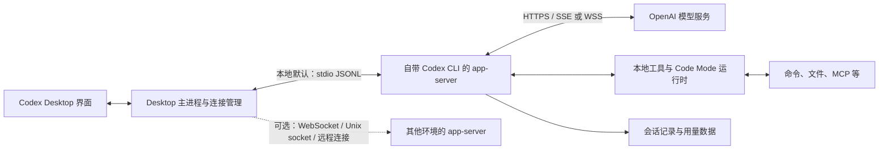

# 架构与通信原理

整理日期：2026-10-10。版本与证据分级见 [阅读索引](/Users/bytedance/personal/codex_progress_monitor/docs/01_initial_experiment/README.md)。

## 1. 整体结构

Desktop 负责界面、聊天管理和连接管理；本地 agent 执行由它使用的 app-server 及相关运行时承担。后端再连接 OpenAI 的模型服务，并在本地或远端执行工具。



图中的两条通信链路需要分别看待：

| 链路 | 主要用途 | 能观察到的内容 |
| --- | --- | --- |
| Desktop ↔ app-server | 驱动聊天、工具、审批和界面状态 | turn / item 生命周期、正文增量、命令输出等 |
| app-server ↔ 模型服务 | 发起模型请求、接收模型输出 | 正文、工具输入、reasoning 摘要等上游事件 |

第一条链路的 WebSocket 与第二条链路的 WebSocket 是两个独立连接。观察到本地 WebSocket，不代表模型请求也走同一个连接。

## 2. “后端就是 Codex CLI 吗？”

对这里验证的本地路径，可以说：**Desktop 使用自带 Codex 可执行文件的 `app-server` 模式作为 agent 后端。**

同一个 Codex 可执行文件可以提供终端交互、`codex exec`、`codex app-server` 等入口。Desktop 使用 app-server，不是在后台模拟用户操作终端界面。

app-server 接收请求、管理 thread / turn、连接模型服务、调度工具、处理审批，并把结果与状态通知给客户端。它还有 Code Mode host、工具执行进程、MCP server 等配套组件，所以“后端”不一定只有一个进程。

当前安装包的本地路径是：

- App：`/Applications/ChatGPT.app`，其 bundle identifier 为 `com.openai.codex`。
- CLI：`/Applications/ChatGPT.app/Contents/Resources/codex-cli/CodexCLI.app/Contents/MacOS/codex`。

以上是本机安装布局，不应作为跨版本、跨平台的固定路径。

## 3. Desktop 为什么会连接多个后端？

连接通常按运行环境、主机和生命周期划分，例如本机、SSH 远端、WSL 或显式指定的 app-server。不同环境有不同文件系统、工具运行位置和会话加载状态。

一个 app-server 可以管理多个 thread；一个 Desktop 也可以管理多个后端连接。不能简单理解为“每条聊天必有一个 CLI”，也不能假设本机所有 app-server 都拥有同一份内存状态。

### 本地默认 stdio

**安装包源码核查**：默认分支创建 CLI 子进程，使用 `stdin / stdout / stderr` 三条管道：

- stdin：Desktop 发往后端的请求。
- stdout：后端发往 Desktop 的 JSONL 协议消息。
- stderr：诊断日志。

stdout 上的一条 JSONL 消息本身可以是增量事件，但普通管道不会自动提供第二个订阅客户端。一个外部监控程序无法仅凭 CLI 的 PID 就订阅这条流。

源码入口：[子进程与管道创建](/Users/bytedance/personal/codex_progress_monitor/analysis/upstream-stream/desktop-source/application-network-startup.pretty.js:13739)。

### 显式 WebSocket / socket

app-server 也可以暴露监听地址，让客户端连接。隔离实验使用 localhost WebSocket，并验证两个观察客户端能收到对应聊天的事件。

这证明实验实例能够支持多客户端观察；它不证明默认 stdio 实例也有可用的第二个接入地址。新的观察连接通常还需要初始化并加载 / 恢复目标 thread，不能只连接 socket 就假设订阅了所有聊天。

协议与传输说明见 [官方 app-server 文档](https://learn.chatgpt.com/docs/app-server)。WebSocket 相关支持与稳定性应按安装版本的官方说明评估。

### `notLoaded` 的含义

某实例能查询历史但返回 thread `notLoaded`，表示该实例当前没有加载该 thread 的运行状态。可能是连接了不同实例，也可能是当前实例只看到磁盘历史、尚未加载它。

共享 `CODEX_HOME` 能共享部分持久化数据，不能自动共享活跃 turn、工具进程或事件订阅。

## 4. daemon 与 Desktop 的关系

daemon 是常驻的 app-server 服务形态，区别在于启动和生命周期管理。它不是另一种模型，也不是必须额外存在的“第二层 AI 后端”。

**安装包源码核查**：存在连接本地常驻服务的可选分支；它受 `CODEX_APP_SERVER_USE_LOCAL_DAEMON=1` 等条件控制，并使用本地控制 socket。默认 stdio 分支则由 Desktop 创建 CLI 子进程。

因此：

- stdio 子进程通常与创建它的 Desktop 连接生命周期相联系；源码的关闭逻辑会终止该子进程。
- daemon 的生命周期可以独立于某一个 Desktop 窗口或客户端，供之后的客户端复用。
- 进程在 Desktop 退出后仍驻留，不代表它一定在生成 token 或执行任务。
- 退出 Desktop 后某个活跃 turn 是否继续，要看实际断连策略与运行状态；本项目尚未完成该场景的验证。

源码入口：[daemon 分支选择](/Users/bytedance/personal/codex_progress_monitor/analysis/upstream-stream/desktop-source/application-network-startup.pretty.js:13927)。不能将“支持 daemon”写成“当前 Desktop 必定使用 daemon”。

## 5. 后端与 OpenAI 服务如何通信？

### Responses 与 SSE / WebSocket

Responses API 的 HTTP 流式响应通常采用 SSE；它也有 WebSocket 模式，可以在持续连接上接收响应事件。事件语义与传输编码需要分开理解：SSE 文本帧和 WebSocket 消息不是同一种封装。

**实测**：本次隔离后端与模型服务之间使用 Responses WebSocket。接收层日志包含解析后的 `response.*` JSON 事件。SSE 接收日志入口在公开源码中存在，但本次没有实测 SSE。

参考：[官方流式响应说明](https://developers.openai.com/api/docs/guides/streaming-responses)、[官方 WebSocket 模式](https://developers.openai.com/api/docs/guides/websocket-mode)、[本地实验记录](/Users/bytedance/personal/codex_progress_monitor/analysis/upstream-stream/FINDINGS.txt)。

### ChatGPT 登录与 API key

API key 方式通常向 OpenAI API 端点发送 `Authorization: Bearer <API_KEY>`。

ChatGPT 登录会通过 OAuth 登录流程取得访问令牌和刷新令牌。请求也可以使用 Bearer 认证，但这里的 Bearer 是登录取得的 access token，不是用户创建的 API key；过期令牌由认证组件刷新。登录详情可以缓存于 `auth.json` 或系统凭据存储。

**公开源码核查**：ChatGPT 认证路径的默认 base URL 包括 `https://chatgpt.com/backend-api/codex`，API key 路径默认使用 `https://api.openai.com/v1`，配置可以覆盖端点。ChatGPT 后端路径不能当作公开 API key 接口的同义替代。

参考：[官方登录缓存说明](https://learn.chatgpt.com/docs/auth#login-caching)、[当前本地 provider 选择实现](/Users/bytedance/playground/codex/codex-rs/model-provider-info/src/lib.rs:428)。

普通网络抓包看到的是 TLS 加密流量。我们已经验证的方式是在 CLI 接收层读取解码后的事件日志，不需要从抓包内容解密模型输出。

## 6. Code Mode 为什么影响可观测性？

在本次默认模式实验中，模型调用的外层工具名是 `exec`。它接收 JavaScript，执行后再通过 `tools.*` 调用命令、文件操作或 MCP 工具。例如：

```javascript
const result = await tools.exec_command({cmd: "python3 example.py"});
text(result.output);
```

这分为两个阶段：

1. 模型逐步生成整个 JavaScript 工具输入。
2. 输入被接受后，Code Mode 执行代码并调用内部工具。

上游 `response.custom_tool_call_input.delta` 能显示阶段 1；内部工具生命周期更适合从 app-server 或 hooks 获取。把两者混为一谈，会误显示为“Python 正在执行”，而实际上模型还在生成参数。

`code_mode_only` 是模型工具模式元数据的一种值，相关 feature 配置和模型目录也会影响最终选择。它不是一个可普遍理解为“设置同名环境变量即可生效”的开关。在该模式下，多数可嵌套工具通过 `exec` 暴露；特殊工具入口仍可能例外。

直接调用 `apply_patch` 时，专用补丁流消费者有机会产生预览事件；当补丁嵌在外层 `exec` 的 JavaScript 字符串中时，同一个消费者不能直接消费这段外层输入。

**实测**：更改隔离模型工具模式并直接调用 `apply_patch` 后曾收到 14 次补丁预览；随后已恢复原有模式。监控方案不依赖改变工具模式或开启实验补丁开关。

证据：[文件编辑流式实验](/Users/bytedance/personal/codex_progress_monitor/analysis/file-edit-progress/FINDINGS.txt)。

## 7. 接入配置的稳定性

| 配置 / 入口 | 当前认识 | 设计上的处理 |
| --- | --- | --- |
| `RUST_LOG` | 官方公开的 Rust 日志过滤配置 | 可以使用；具体日志内容仍需版本适配 |
| `CODEX_HOME` | Codex 数据与配置位置 | 识别实际环境；不要假设总是 `~/.codex` |
| `CODEX_CLI_PATH` | 当前 Desktop 源码支持选择 CLI 启动入口 | 本项目尚未建立跨版本稳定性保证 |
| `CODEX_APP_SERVER_WS_URL` | 当前源码支持指定连接地址 | 隔离实验入口；不视为长期公共契约 |
| `CODEX_APP_SERVER_FORCE_CLI` | 当前源码可绕过部分 socket / daemon 路径 | 用于诊断分支，需按版本核对 |
| `CODEX_APP_SERVER_USE_LOCAL_DAEMON` | 当前源码中的 daemon 分支条件 | 不是所有版本默认启用 |
| `CODEX_MAX_LOG_LEVEL` | 当前 Desktop 源码的自身日志级别覆盖 | 需验证日志落盘与容量，不视为稳定采集 API |

`RUST_LOG` 会传给 Desktop 创建的 CLI；Desktop 默认值为 `warn`。CLI stderr 会被 Desktop 以 debug 级别记录，正式版默认日志级别为 info，因此仅启用 CLI trace 还不等于完整日志已落盘。

更关键的是，普通 app-server 事件 trace 可以只记录 `item/started` 等方法名，而不含事件参数。因此“开启详细日志”与“得到完整工具事件”不能画等号。

参考：[官方诊断配置](https://learn.chatgpt.com/docs/config-file/environment-variables#diagnostics)、[Desktop 环境传递](/Users/bytedance/personal/codex_progress_monitor/analysis/upstream-stream/desktop-source/application-network-startup.pretty.js:14004)、[Desktop 日志实现提取文件](/Users/bytedance/personal/codex_progress_monitor/analysis/upstream-stream/desktop-source/bootstrap-Du6FqCuH.js)、[app-server 事件 trace](/Users/bytedance/playground/codex/codex-rs/app-server/src/outgoing_message.rs:767)。
