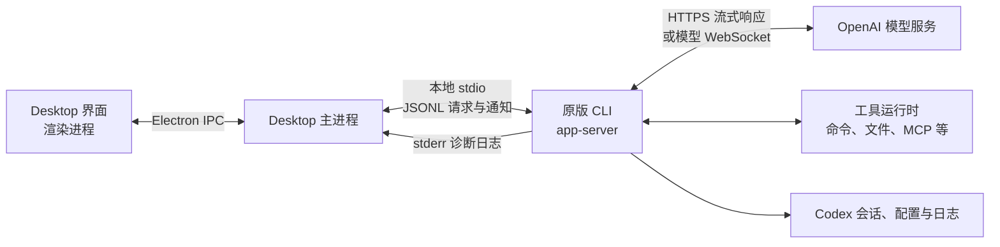
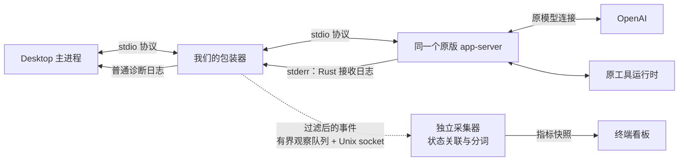

# Codex Desktop 架构与 Monitor 接入方案

更新日期：2026-10-12。本文说明本项目核查和验证过的本机架构、可用配置，以及 Monitor 的方案选择。依据是项目保留的安装包源码快照、隔离实验和当前 Monitor 代码；不同版本、远程主机的行为可能不同。

**当前方案：在 Desktop 与原版后端之间加入 stdio 包装器，复制运行事件，读取 Rust 日志中的流式增量。** 它满足首版的本机实时监控需求；选择依据是数据覆盖、日常接入方式和已有验证，不是已经证明它在所有场景下优于 WebSocket。

主 App / 隔离 App 的逐步启动、环境变量保存位置，以及包装器、采集器、看板的启动和停止关系，见 [启动步骤与进程管理](/Users/bytedance/personal/codex_progress_monitor/docs/02_product_mvp/startup-and-processes.md)。

## 1. Codex Desktop 本来怎样工作

Codex Desktop 有三个主要部分：

| 部分 | 负责什么 |
| --- | --- |
| Desktop 界面与主进程 | 显示聊天、接收用户操作、管理后端连接 |
| 本地后端 `app-server` | 管理聊天和任务、请求模型、执行工具、处理审批 |
| OpenAI 模型服务 | 生成正文、推理摘要和工具调用参数 |

Desktop 使用 Electron：界面运行在渲染进程中，通过 IPC（应用内部的进程间消息）与主进程通信；主进程负责连接后端。Monitor 接入的是主进程与后端之间的链路。

本地后端来自 App 自带的 Codex CLI。同一个可执行文件既能用于命令行，也能以 `app-server` 模式为 Desktop 提供服务；Desktop 通过它运行任务。

本项目验证的原生本机 stdio 路径如下：



**图中有两条独立通信链路：** Desktop ↔ 本地后端用于任务管理；本地后端 ↔ OpenAI 用于模型请求。前一条使用 stdio 时，后一条仍可以使用 WebSocket。

### stdio、WebSocket 和日志分别是什么

stdio 是进程的标准输入输出。在这条本地路径中，Desktop 启动后端子进程，并连接三个管道：

| 通道 | 内容 |
| --- | --- |
| stdin：Desktop → 后端 | 启动任务、恢复聊天、取消任务、审批响应等请求 |
| stdout：后端 → Desktop | JSONL 协议，即每行一个 JSON 消息；包括聊天、工具、正文等事件 |
| stderr：后端 → Desktop | Rust 后端的诊断日志 |

stderr 的历史名称是“标准错误输出”，但正常的 INFO、DEBUG、TRACE 日志也可以写到这里。是否为错误由日志级别决定。日志使用独立通道，避免混入 stdout 的业务协议。

管道与文件不是互斥选项：启动程序可以把 stderr 接到文件，也可以接到另一个进程读取。初始实验把它重定向到 `.log` 文件；当前产品直接读取 stderr 管道。

Desktop 还支持连接已有 WebSocket 后端，以及有条件地连接本地常驻服务（daemon）；远程主机也有自己的后端连接。初始实验采用的正是“我们先启动 WebSocket 后端，Desktop 再连接它”。一个后端可以管理多条聊天，一个 Desktop 也可以连接多个后端。共享数据目录不代表共享正在执行的任务。

源码依据：[Desktop 的 IPC 接收](/Users/bytedance/personal/codex_progress_monitor/analysis/upstream-stream/desktop-source/main.pretty.js:160126)、[Desktop 创建三条管道](/Users/bytedance/personal/codex_progress_monitor/analysis/upstream-stream/desktop-source/application-network-startup.pretty.js:13739)、[Rust 日志写入 stderr](/Users/bytedance/playground/codex/codex-rs/app-server/src/lib.rs:715)。原生架构的详细研究见 [初始架构文档](/Users/bytedance/personal/codex_progress_monitor/docs/01_initial_experiment/architecture.md)。

## 2. 可以配置哪些部分，怎样配置

下面列出与接入、日志和隔离有关的配置。部分 Desktop 环境变量来自安装包源码，不应视为有长期兼容保证的公共接口。

| 配置入口 | 作用对象 | 可以改变什么 |
| --- | --- | --- |
| `CODEX_CLI_PATH` | Desktop | 指定启动哪个 CLI 可执行文件；可以指向我们的包装器 |
| `CODEX_APP_SERVER_WS_URL` | Desktop | 指定要连接的后端 WebSocket 地址 |
| `CODEX_APP_SERVER_FORCE_CLI=1` | Desktop | 绕过显式 WebSocket 和 daemon 分支，采用 CLI 子进程路线 |
| `CODEX_APP_SERVER_USE_LOCAL_DAEMON=1` | Desktop | 允许尝试连接本地常驻服务；仍受版本和其他条件限制 |
| `RUST_LOG`、`LOG_FORMAT` | Rust 后端 | 设置日志模块/级别，以及是否使用 JSON 格式 |
| `CODEX_MAX_LOG_LEVEL` | Desktop | 调整 Desktop 自身的日志级别；与 Rust 后端日志是两层配置 |
| `CODEX_HOME`、`CODEX_SQLITE_HOME` | Codex 数据环境 | 指定 Codex 数据/配置根目录与 SQLite 目录，用于隔离测试环境 |
| `CODEX_ELECTRON_USER_DATA_PATH`、`--user-data-dir` | Desktop 界面 | 指定独立界面数据目录；用于启动隔离实例 |
| CLI 的 `app-server --listen …` 参数 | 后端启动 | 让后端采用 stdio，或监听指定的 WebSocket 地址 |

模型、权限和工具等配置由 Codex 自己的配置文件（如 `CODEX_HOME/config.toml`）及 CLI 配置覆盖管理。上表中的 Desktop 启动环境变量不能直接当作同名 `config.toml` 设置。

### 本项目怎样应用配置

| 方式 | 应用范围 | 项目中的用法 |
| --- | --- | --- |
| 启动时传入环境变量 | 本次新启动的 App | `codex-progress desktop` 通过 macOS `open --env` 传入接入变量；`--home / --profile` 可指定隔离目录 |
| 登录启动脚本设置 GUI 会话环境 | 之后启动的 App | `setup --launch-agent` 注册 LaunchAgent，运行 `launchctl setenv`；适合配置一次后从平常入口使用 |
| 直接传 CLI 启动参数 | 本次后端进程 | 初始实验先运行 `app-server --listen ws://127.0.0.1:端口`，再让 Desktop 连接 |

这些配置作用于新进程。已经运行的 App / 后端不会因环境变量改变而自动切换；通常需要等任务结束后正常退出并重新打开。在终端中设置变量，也不能直接假设从 Dock 启动的 App 会继承它。

主 App 和隔离 App 使用的是同一个应用程序，区别主要在 home / profile 和启动参数。只要两者都经包装器接入同一个采集器，Monitor 就能同时收集它们；当前没有“只监听主 App”的开关。

依据：[WebSocket 与强制 CLI 的选择](/Users/bytedance/personal/codex_progress_monitor/analysis/upstream-stream/desktop-source/application-network-startup.pretty.js:11873)、[daemon 的选择条件](/Users/bytedance/personal/codex_progress_monitor/analysis/upstream-stream/desktop-source/application-network-startup.pretty.js:13944)、[项目安装与启动配置](/Users/bytedance/personal/codex_progress_monitor/src/codex_progress_monitor/integration.py:21)。

## 3. 要知道进度，需要监听哪里

我们的目标是显示阶段、持续时间、正文/参数的接收 token/s，以及 reasoning summary 的增长。需要结合两类信息：

| 信息 | 合适的观察位置 | 为什么需要它 |
| --- | --- | --- |
| 聊天和回合开始/结束、工具活动、审批状态 | Desktop ↔ app-server 的完整协议 | 知道“哪个聊天在做什么”，区分参数生成与工具执行 |
| 正文和工具参数的流式 delta | Rust 后端接收模型响应时的 TRACE 日志；正文也有协议增量 | 在内容尚未生成完时计算累计量和速度 |
| Reasoning 开始/结束、可见摘要 | 对应的协议和上游事件 | 显示经过时间与摘要增长；没有连续隐藏 reasoning token 计数 |

这里的“回合”是用户提交一次任务后的执行过程，其中可能发生多次模型请求和工具调用。delta 是一小段新增文本，不等于一个 token。Monitor 累计同一内容流的文本，用 tiktoken 重新分词，再计算约 2 秒窗口内的计数变化。编码未知时显示 `≈`。这是**收到文本的本地 token/s**，不是服务器内部算力速度或最终总用量。

Rust 日志中的关键增量包括 `response.output_text.delta`、`response.custom_tool_call_input.delta`、`response.function_call_arguments.delta` 和 `response.reasoning_summary_text.delta`。它们通过 item / turn / thread 身份字段与协议事件关联，不能按最近活跃的聊天猜归属。

特别是 Code Mode：模型先生成外层 `exec` 的 JavaScript 参数，随后才执行内部命令。初始 WebSocket 观察客户端能看到命令等事件，却没有收到这段长工具参数的 delta；Rust 接收日志提供了这部分增量。因此，**把本地连接改成 WebSocket，也不能省去 Rust 日志这个数据来源。**

### 可选采集方案

| 方案 | 怎样取得数据 | 主要优点 | 主要限制 / 代价 |
| --- | --- | --- | --- |
| 读取原生日志，结合 hooks（工具回调）/ 会话文件 | 开日志、尾读文件；用工具回调和会话记录补充状态 | 可保留原连接路径，减少传输链路改动 | 现有日志不一定包含完整事件载荷；hooks 和会话记录不能覆盖全部实时增量。完整覆盖尚未验证 |
| 自管 WebSocket 后端 + 观察客户端 + Rust 日志 | 预启动监听服务，让 Desktop 和观察客户端连接同一后端 | 协议可从额外客户端取得，观察客户端不在 Desktop 的传输链路中 | 需要管理服务启动/退出、地址及观察客户端初始化和目标聊天加载；参数速度仍依赖日志。初始实验已验证可行 |
| **stdio 包装器 + Rust 日志** | 复制 Desktop 的请求/通知，直接读取后端 stderr | 同时取得协议和增量；随 Desktop 启动接入，无需额外协议观察客户端 | 包装器进入关键传输链路，必须处理转发、信号和退出。当前 MVP 已实现并通过有限验证 |
| 上游网络代理 + 其他状态来源 | 代理模型服务连接，解析响应 | 可在网络层观察上游增量 | 需处理 TLS、认证及 SSE / WebSocket，还需另取工具状态；当前未实现 |
| 修改并维护后端实现 | 在 CLI 内增加专门的进度事件出口 | 有机会提供更直接的结构化观测 | 需要维护自定义 CLI 并跟进升级；当前未采用 |

只看 Desktop 界面受其渲染和折叠行为限制；会话文件保存的是完整内容和部分事件，未保存逐段正文/参数增量，无法满足长参数生成期间的实时反馈。不同方案是否可行，应以实际事件覆盖为准，不能只看“有没有连接上”。

证据：[初始协议与上游日志对照](/Users/bytedance/personal/codex_progress_monitor/docs/01_initial_experiment/data-sources.md:44)、[初始 WebSocket 实验方案](/Users/bytedance/personal/codex_progress_monitor/docs/01_initial_experiment/requirements-and-plan.md:101)。

## 4. 为什么选择当前方案，具体改了什么

### 4.1 当前方案怎样工作



启动链是 `Desktop → 包装器 → 原版 app-server`。**Desktop 直接管理包装器，包装器管理真实后端**，并负责传递协议关闭、信号和退出码。它确实增加了一个组件，不能说后端仍由 Desktop 直接管理。

正常生命周期已经实现，具体行为如下：

| 事件 | 包装器怎样处理 |
| --- | --- |
| Desktop 正常关闭后端连接 | Desktop 向包装器发送终止信号；包装器将 `SIGTERM`、`SIGINT`、`SIGHUP` 转给后端进程组 |
| Desktop 的输入管道结束（EOF） | 关闭 app-server 的 stdin，让后端处理连接结束 |
| 向 Desktop 写 stdout 失败 | 向后端进程组发送 `SIGTERM`，避免协议消费端消失后继续运行 |
| app-server 退出 | 等待并回收子进程，有限等待输出排空；向 Desktop 返回原退出码，或以相同信号退出 |

已有测试覆盖 EOF、退出码和 `SIGTERM` 传递，真实隔离后端也验证过正常结束。**这不等于异常清理已经完整：** 当前没有后端拒绝退出时的超时强杀；包装器被 `SIGKILL` 强杀时无法执行清理；Desktop 崩溃及自行脱离该进程组的工具也没有完整验收。相关实现与测试见 [包装器进程管理](/Users/bytedance/personal/codex_progress_monitor/src/codex_progress_monitor/bridge.py:246) 和 [运行测试](/Users/bytedance/personal/codex_progress_monitor/tests/test_runtime.py:35)。

这里由 Desktop 管理的是承载通信的包装器。独立采集器由 Monitor 命令或 LaunchAgent 启动，终端看板由用户启动，它们不属于 Desktop 的子进程管理链。

Rust 后端接收并解码模型事件，写出 stderr 日志；包装器解析其中的 delta。stdout 主要提供完整生命周期，正文/摘要增量也可作为替代来源；同一内容流只选择一个来源计数，避免重复。

采集器按后端 ID 和 thread / turn / item ID 关联数据，记录实际 `CODEX_HOME`。看板读取约每 250 ms 更新的指标快照；关闭看板不会停止采集。主 App 与隔离实例的事件可共用一个采集器。

### 4.2 为什么它适合当前 MVP

本轮的约束是：覆盖本机聊天、首次配置后正常使用、取得完整运行状态与长参数增量、保留原版后端，并尽快验证真实反馈。当前方案在这些条件下具备三个具体依据：

1. **数据覆盖已经验证。** 同一包装器能取得协议生命周期和 Rust 上游增量，并实时关联并行聊天，不依赖完成文件补齐实时信息。
2. **接入绑定 Desktop 的后端启动。** 安装后新后端自动进入包装器，不必先准备独立监听服务，也不必另建协议观察客户端来加载聊天。
3. **产品路径已有实测。** 已验证隔离 Desktop 的真实界面任务、完整流计数、取消/退出、观察端拥堵与采集器恢复，现阶段可以继续日常试用。

这是“当前适合推进首版”的判断。WebSocket 实验没有失败；它把更多责任放在独立服务与观察连接上，stdio 则把责任放在转发和子进程管理上。没有对照实验证明 stdio 的总复杂度更低、性能更好或稳定性更高。

选择记录见 [实现前验证结论](/Users/bytedance/personal/codex_progress_monitor/analysis/product-preflight/README.md:5)。

### 4.3 实际修改的配置和架构

Monitor 的改动是**启动配置、日志配置，以及新增的进程和通信路径**。没有修改 App 安装包、自带 CLI 二进制或 Desktop 界面代码。

“之前”列以**未自定义配置的原生本机 stdio 路径**为基准。未设置环境变量，不代表子进程中没有值：Desktop 会主动填入部分默认值。本机安装前的备份中，四个 Desktop 接入变量均记录为空；备份不能区分“未设置”和“设置为空”。如果用户已有自定义配置，应以其安装备份为准。

| 改动位置 / 配置 | 之前的值或行为 | 接入后的值或行为 | 是否改变、实际影响 |
| --- | --- | --- | --- |
| Desktop：`CODEX_CLI_PATH` | 没有有效覆盖值，Desktop 选择自带 CLI | `…/.local/runtime/codex-observed` | **值和启动链均改变。** 从直接启动原 CLI，变为先启动包装器；最终使用的 CLI 二进制不变 |
| Desktop：`CODEX_APP_SERVER_FORCE_CLI` | 未设为 `1`，按正常条件选择连接方式 | `1` | **值改变，基准传输方式不变。** 本机仍用 stdio，但现在强制选择该路线，绕过 WebSocket / daemon |
| Desktop：`CODEX_APP_SERVER_USE_LOCAL_DAEMON` | 未设为 `1`，不主动启用 daemon | `0` | **显式设置值，基准行为不变。** 之前和之后都不启用 daemon；`FORCE_CLI=1` 也会绕过它 |
| Desktop：`CODEX_APP_SERVER_WS_URL` | 未指定环境覆盖时，可读取主机配置的 `websocket_url`；普通本机无该地址 | 空字符串 | **显式设空，基准连接方式不变。** 普通本机原本就不连 WebSocket；设空还阻断主机地址回退，`FORCE_CLI=1` 也会绕过该分支 |
| CLI 子进程：`LOG_FORMAT` | Desktop 已设为 `json` | `json` | **值和格式均不变。** 包装器再次写入相同值 |
| CLI 子进程：`RUST_LOG` | Desktop 未继承自定义值时设为 `warn`，输出 WARN / ERROR | `warn,codex_api::sse=trace,tungstenite::protocol=trace,tungstenite::protocol::frame=off` | **值和日志行为均改变。** 开启指定模块的详细日志，关闭 frame 模块所有级别日志；增加生成和解析成本 |
| CLI 子进程：`CODEX_CLI_PATH` | Desktop 填入原 CLI 路径 | 包装器将其从包装器路径改回原 CLI 路径 | **后端收到的最终值不变。** 新链路中先被设为包装器路径，再恢复原 CLI 路径，防止递归进入包装器 |
| stdin / stdout 路径 | Desktop 直接连接 app-server | 增加包装器转发并复制到观察队列 | **通信路径改变，协议内容不改写。** 增加调度、复制成本和包装器故障点 |
| stderr 路径 | 后端诊断直接交给 Desktop | 指定模块 DEBUG / TRACE 在包装器内消费，其他诊断转交；超长行受限 | **路径和日志内容均改变。** 不保证与原默认日志一致，详见下文 |
| 本机运行环境 | 没有 Monitor 的进程和文件 | 增加 runtime、Unix socket、指标快照及登录启动 LaunchAgent | **新增进程和文件。** 增加 CPU、内存和磁盘写入；不新增网络代理 |

表中的“基准行为不变”仅指上述原生本机 stdio 场景。如果原先配置了 WebSocket 或启用了 daemon，接入会改为 CLI / stdio。显式设置这些变量是为了固定接入路线，不能把每一次写入配置都理解为行为变化。

Desktop 的原默认值见 [子进程环境构造](/Users/bytedance/personal/codex_progress_monitor/analysis/upstream-stream/desktop-source/application-network-startup.pretty.js:14004)。原本已经走 stdio 的本机实例，接入后仍走 stdio，但中间增加了包装器。

登录启动配置作用于当前用户的 GUI 会话，可能同时影响以后启动的主 App 和隔离实例；它不是只针对某个窗口的开关。隔离启动额外指定独立 home / profile。主 App 接入不写它的 `config.toml`，不替换模型、工具模式、沙箱和审批配置；请求参数原样交给原 CLI，认证和模型连接仍由原 CLI 处理。

**stdio 协议按字节转发，stderr 日志经过筛选；送给 Desktop 的日志不保证与接入前完全一致。** 当前策略是消费指定模块的 DEBUG / TRACE，继续转交其他诊断。它没有按原 `RUST_LOG` 重新筛选，具体差异有：

- 指定模块因 TRACE 开关额外产生的 INFO 日志仍可能转交 Desktop；原默认 `warn` 下不会输出这些 INFO。
- `tungstenite::protocol::frame=off` 会关闭该模块所有级别日志，包括原本可能输出的 WARN / ERROR。
- 超过 10 MiB 的未结束诊断行会整行丢弃并记录缺口；用户原有的自定义 `RUST_LOG` 也会被包装器覆盖。

因此，当前实现可以减少新增高频日志进入 Desktop，却不能称为“完全恢复默认日志”。若要保留接入前的诊断筛选语义，需要保存并复用原日志策略；当前尚未实现。

代码依据：[安装配置与恢复记录](/Users/bytedance/personal/codex_progress_monitor/src/codex_progress_monitor/integration.py:25)、[原 CLI 启动与转发](/Users/bytedance/personal/codex_progress_monitor/src/codex_progress_monitor/bridge.py:246)、[日志筛选](/Users/bytedance/personal/codex_progress_monitor/src/codex_progress_monitor/bridge.py:282)。

### 4.4 对效果、性能和稳定性有何影响

模型请求和工具执行继续使用原版后端。Monitor 读取并统计事件，不改写提示词、生成内容或审批决定；它影响的是本地启动、传输与观测路径。

观察队列、解析、socket 发送和分词与原协议转发分开。采集器关闭或观察队列满时，Codex 可以继续通信，但指标会出现缺口；包装器本身故障可能影响任务，这是当前方案明确存在的稳定性代价。连接断开或数据不完整时，看板显示未知/观测缺口，不继续展示旧速度。

性能方面，Rust TRACE 的生成、管道复制、日志解析、分词和快照写入都有成本。默认不额外保存完整 trace；正文和完整参数在内存中计数，完成后释放。快照保存指标与必要元数据，包含聊天名、目录和命令首行最多 160 字；原版 Codex 自己的会话和日志存储仍按原实现工作。

| 已有证据 | 能支持的结论 | 验证边界 |
| --- | --- | --- |
| 39 项测试，以及 EOF、退出码、信号、观察端拥堵/恢复等检查 | 已覆盖这些具体场景，观察端故障可以有限降级 | 更多异常和工具类型仍待自然使用验证 |
| 12 个真实流重放，最新隔离 UI 的长正文与约 20 秒命令检查通过 | 已取得完成前反馈，有限样本的最终计数和归属正确 | 不代表所有主机/模型；短参数可能在速度刷新前结束 |
| 有限本地传输、分词与资源测试 | 已排查部分开销和容量问题 | 存在开销；真实模型任务整体额外延迟及长期并行负载尚待量化 |

主 App 默认启动的完整验收与长期自然使用，在现有验收记录中仍是后续确认项。架构说明不能代替这些实测。详细数字与边界见 [产品验证报告](/Users/bytedance/personal/codex_progress_monitor/analysis/product-mvp/README.md) 和 [完成核对](/Users/bytedance/personal/codex_progress_monitor/analysis/product-mvp/completion-audit.md)。

### 4.5 怎样恢复

安装时保存原启动变量。运行下面的命令会卸载 Monitor 的登录启动、恢复仍由它管理的启动变量，并停止采集器；已有任务结束后正常重开 Codex，恢复原入口。

```sh
/Users/bytedance/personal/codex_progress_monitor/bin/codex-progress uninstall
```

已有任务使用的包装器和依赖应保留到任务结束。完整安装、试用和恢复步骤见 [使用说明](/Users/bytedance/personal/codex_progress_monitor/docs/02_product_mvp/usage.md)。
