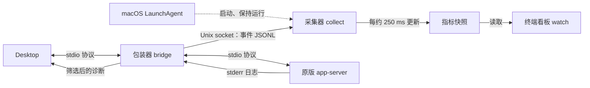

# 启动步骤与进程管理

更新日期：2026-10-12。本文按当前 macOS 实现说明如何启动主 Codex App、隔离测试 App 和 Monitor，以及各进程和配置的关系。命令中的绝对路径使用本机现有安装；其他机器需替换路径。

方案选择与配置前后对比见 [架构文档](/Users/bytedance/personal/codex_progress_monitor/docs/02_product_mvp/architecture.md)，看板操作与指标含义见 [使用说明](/Users/bytedance/personal/codex_progress_monitor/docs/02_product_mvp/usage.md)。

## 1. 哪些进程在运行

Monitor 的包装器、采集器、看板是独立的 Python 进程，共用同一份源码和 Python 环境，无需编译成独立二进制。

| 进程 | 谁启动、管理它 | 职责与源码 |
| --- | --- | --- |
| Desktop 主进程 | 用户打开 App | 管理界面与后端连接 |
| 包装器：`bridge` | Desktop | 启动原版后端、转发协议、读取日志、发送观察事件；[bridge.py](/Users/bytedance/personal/codex_progress_monitor/src/codex_progress_monitor/bridge.py:246) |
| 原版 `app-server` | 包装器 | 管理任务、请求模型、运行工具；包装器负责其启动、信号传递和回收 |
| 采集器：`collect` | 登录启动模式下由 macOS LaunchAgent 管理；手动模式下由 Monitor 命令启动 | 接收事件、聚合状态、计算 token/s、写快照；[collector.py](/Users/bytedance/personal/codex_progress_monitor/src/codex_progress_monitor/collector.py:17) |
| 看板：`watch` | 用户在终端启动 | 读取快照并刷新显示；[display.py](/Users/bytedance/personal/codex_progress_monitor/src/codex_progress_monitor/display.py:109) |



包装器先转发协议字节，再复制观察数据到有界队列。它的观察线程解析、过滤事件，通过本机 [events.sock](/Users/bytedance/personal/codex_progress_monitor/.local/runtime/events.sock) 发送逐行 JSON，包含后端身份、接收时间和事件内容。采集器按 backend / thread / turn / item 关联事件，调用 [engine.py](/Users/bytedance/personal/codex_progress_monitor/src/codex_progress_monitor/engine.py:56) 和 [metrics.py](/Users/bytedance/personal/codex_progress_monitor/src/codex_progress_monitor/metrics.py:117)，写入 [snapshot.json](/Users/bytedance/personal/codex_progress_monitor/.local/runtime/snapshot.json)。看板只读取快照。

每个被接入的后端都有自己的包装器。同一个 runtime 使用一个采集器，可同时接收主 App 和隔离实例的数据；它们的后端和聊天仍各自独立。采集器不负责启动或关闭 app-server。

两个可执行入口也都是 Shell 脚本：

| 入口 | 用途 |
| --- | --- |
| [bin/codex-progress](/Users/bytedance/personal/codex_progress_monitor/bin/codex-progress) | 随项目提交的命令入口，调用 Python CLI，支持 `setup`、`desktop`、`watch` 等子命令 |
| [.local/runtime/codex-observed](/Users/bytedance/personal/codex_progress_monitor/.local/runtime/codex-observed) | 安装时生成的 Desktop 包装器入口，写入本机 Python、原 CLI、runtime 的绝对路径，固定调用 `bridge` |

后一个文件是本机安装配置的一部分，虽然放在 runtime 中，也需要保留到承载中的任务结束。

## 2. Desktop 的启动变量保存在哪里

环境变量是进程启动时取得的配置副本。Desktop 读取自己的副本选择后端入口；改变外部变量不会自动更新已经运行的 Desktop。

本项目的登录启动模式使用以下文件：

| 位置 | 保存什么、由谁读取 |
| --- | --- |
| [LaunchAgent plist](/Users/bytedance/Library/LaunchAgents/com.local.codex-progress-monitor.plist) | 保存启动脚本路径、`RunAtLoad=true`、`KeepAlive=true`；由 macOS 读取 |
| [login-start](/Users/bytedance/personal/codex_progress_monitor/.local/runtime/login-start) | 保存四个接入变量；运行 `launchctl setenv`，最后执行 `collect` |
| [desktop-environment.json](/Users/bytedance/personal/codex_progress_monitor/.local/runtime/desktop-environment.json) | 保存安装前的变量和安装值，供卸载恢复；Desktop 不读取它 |

启动脚本设置 `CODEX_CLI_PATH`、`CODEX_APP_SERVER_FORCE_CLI`、`CODEX_APP_SERVER_USE_LOCAL_DAEMON` 和 `CODEX_APP_SERVER_WS_URL`。值和具体影响见 [架构文档的配置表](/Users/bytedance/personal/codex_progress_monitor/docs/02_product_mvp/architecture.md#43-实际修改的配置和架构)。

`launchctl setenv` 把变量设置到当前用户的 GUI 登录会话中。之后从正常入口启动的 Desktop 会获得这些变量。下次登录时，macOS 再运行脚本，重新设置变量并启动采集器。持久保存的是我们的安装文件，Desktop 没有把这组配置写入自己的设置文件。

显式执行 `codex-progress desktop` 时，命令通过 `open --env` 给那次新启动的 App 传入变量。它使用同一包装器，不依赖提前设置 GUI 会话变量，也不会改变已有实例的环境。实现见 [integration.py](/Users/bytedance/personal/codex_progress_monitor/src/codex_progress_monitor/integration.py:25)。

## 3. 启动步骤，每步做什么

### 3.1 首次安装，只需一次

需要 Python 3.11+ 和已登录的原版 Codex Desktop。本机已完成安装，日常无需重复下面的命令。

```sh
python3 -m venv /Users/bytedance/personal/codex_progress_monitor/.local/venv
/Users/bytedance/personal/codex_progress_monitor/.local/venv/bin/python -m pip install -e /Users/bytedance/personal/codex_progress_monitor
/Users/bytedance/personal/codex_progress_monitor/bin/codex-progress setup --launch-agent
```

| 步骤 | 做了什么 |
| --- | --- |
| 创建 venv | 建立产品与实验共用的 Python 环境 |
| `pip install -e` | 安装依赖，以可编辑方式使用仓库源码 |
| `setup --launch-agent` | 生成包装器入口、记录原 CLI 与 Python 路径、备份原启动变量，注册并立即加载登录启动项 |
| macOS 运行 `login-start` | 设置 GUI 会话变量，启动并保持采集器运行 |
| 正常重开 Codex | 新 Desktop / 后端采用包装器入口；已有实例不会自动切换 |

重新执行 `setup --launch-agent` 会重新注册启动项并重启采集器，可能产生短暂观测缺口；它不是日常打开看板的步骤。

### 3.2 日常启动主 App

1. **照常从 Dock 或应用程序目录打开 Codex。** Desktop 取得 GUI 会话变量，启动包装器；包装器启动原版 app-server 并连接采集器。主 App 使用原来的登录与聊天数据。已接入的 App 可以继续使用，无需重复重启。
2. **在终端打开看板：**

   ```sh
   /Users/bytedance/personal/codex_progress_monitor/bin/codex-progress watch
   ```

   `watch` 读取快照，不启动 Desktop、后端或采集器。登录启动模式下，采集器通常已经运行。
3. **正常提交任务。** 包装器复制事件，采集器计算指标，看板持续显示进展。

也可以通过下面的命令显式传入接入变量并请求打开主 App。它会准备包装器、确认采集器运行，但仍不能让已经运行的旧实例切换入口：

```sh
/Users/bytedance/personal/codex_progress_monitor/bin/codex-progress desktop
```

### 3.3 启动隔离测试 App

```sh
/Users/bytedance/personal/codex_progress_monitor/bin/codex-progress desktop \
  --home /Users/bytedance/personal/codex_progress_monitor/experiments/desktop-isolation/runs/20261010-150337-2b232b/codex-home \
  --profile /Users/bytedance/personal/codex_progress_monitor/.local/product-implementation/desktop-1/profile
```

这条命令按顺序执行：

1. 生成包装器入口，确认采集器运行；已有采集器会复用。
2. 通过 `open --env` 给新实例传入接入变量。`--home` 设置独立 `CODEX_HOME` 和 SQLite 目录，`--profile` 设置独立界面数据目录。
3. 使用 `open -n -g` 启动额外的 App 实例，由它启动自己的包装器和后端；主 App 可继续运行。
4. 新包装器连接同一个采集器，事件携带独立后端身份和实际 home。

命令使用已有登录的测试 home，不复制主 App 凭据。隔离实例已经打开时无需重复执行；`-n` 会创建额外实例。随后在隔离窗口提交任务，打开或继续使用前述同一个看板即可。

Monitor 没有主 App / 隔离 App 监听模式开关。两个实例都接入时，活动聊天一起显示；可从 `status` 的后端 `home` 区分它们。

### 3.4 检查是否接入

```sh
/Users/bytedance/personal/codex_progress_monitor/bin/codex-progress status
```

`running` 表示采集器快照是否新鲜且 socket 存在；后端的 `connected` 和 `home` 表示哪些环境已连接。采集器正常运行不代表某个 App 已接入，打开看板也不会主动接入一个旧后端。

2026-10-12 的本机会话只读检查确认：GUI 接入变量已设置、LaunchAgent 正在运行，采集器已连接主 home 的后端。这是当前连接状态的观察；从日常入口重新启动的独立验收和长期使用边界仍按 [验证报告](/Users/bytedance/personal/codex_progress_monitor/analysis/product-mvp/README.md) 记录。

## 4. 停止、恢复与卸载

### 4.1 关闭看板或 Codex

看板按 `q`，只关闭显示。正常退出某个 Codex 实例，会关闭它对应的包装器和后端；采集器继续运行。包装器负责 EOF、信号和退出状态传递，已有验证及异常清理边界见 [架构文档](/Users/bytedance/personal/codex_progress_monitor/docs/02_product_mvp/architecture.md#41-当前方案怎样工作)。

### 4.2 登录启动模式：暂停采集、再恢复

当前安装设置了 `KeepAlive=true`。单独运行 `codex-progress stop` 会请求采集器退出，但 macOS 会重新启动它。要在本次登录会话中卸载启动项并停止其管理的采集器：

```sh
launchctl bootout "gui/$(id -u)/com.local.codex-progress-monitor"
```

这一步保留 plist 文件和 GUI 接入变量，已有包装器继续转发 Codex 通信，但停止采集期间的增量会漏收。它只关闭该启动项管理的进程；另外手动启动的采集器需要用 `stop` 关闭。

在上述暂停之后，恢复登录启动项：

```sh
launchctl bootstrap "gui/$(id -u)" \
  /Users/bytedance/Library/LaunchAgents/com.local.codex-progress-monitor.plist
```

macOS 再运行 `login-start`，重新设置变量并启动采集器。未删除 plist 时，下次登录也会再次启动；显式运行 `desktop` 或 `start` 同样可能启动采集器。

### 4.3 手动模式：启动与停止采集器

没有安装登录启动项时，使用：

```sh
/Users/bytedance/personal/codex_progress_monitor/bin/codex-progress start
/Users/bytedance/personal/codex_progress_monitor/bin/codex-progress stop
```

`start` 检查采集器是否已运行，必要时创建后台 `collect` 进程。`stop` 通过同一 Unix socket 发送带本机控制 token 的停止请求，让采集器清理并退出，不终止包装器或后端。实现见 [cli.py](/Users/bytedance/personal/codex_progress_monitor/src/codex_progress_monitor/cli.py:19)。

### 4.4 完全卸载接入配置

```sh
/Users/bytedance/personal/codex_progress_monitor/bin/codex-progress uninstall
```

卸载会移除登录启动项、恢复仍由 Monitor 管理的启动变量，并停止采集器。已有 Desktop / 后端持有原环境副本，承载中的任务结束后正常重开 Codex，才会使用恢复后的入口。包装器和 Python 环境需保留到已有任务结束。

采集器恢复后，包装器会重连并提供有限生命周期元数据；漏收期间的实时速度不能补回。看板会标出观测缺口，不继续展示旧速度。
