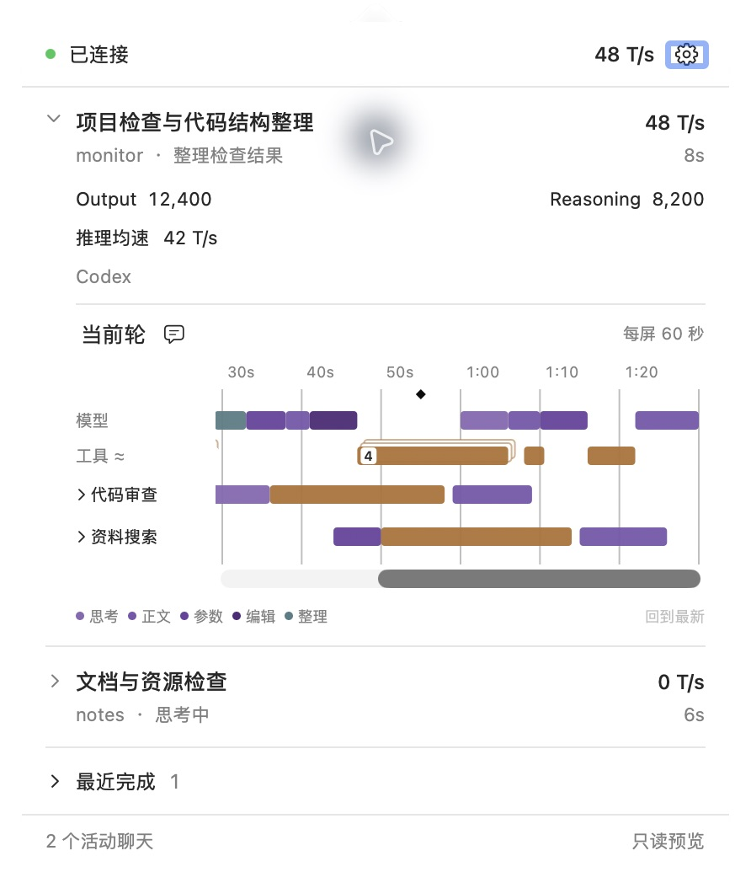
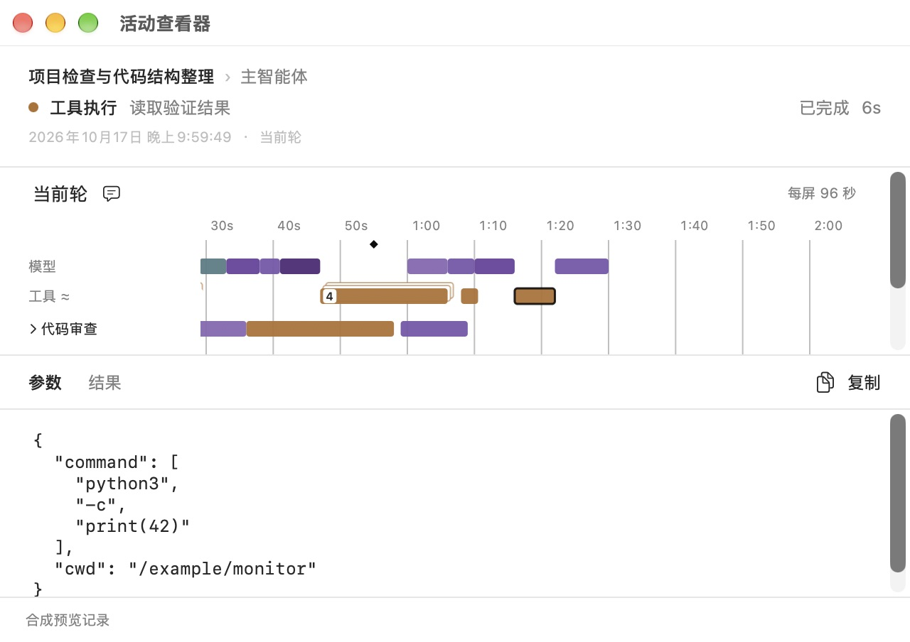
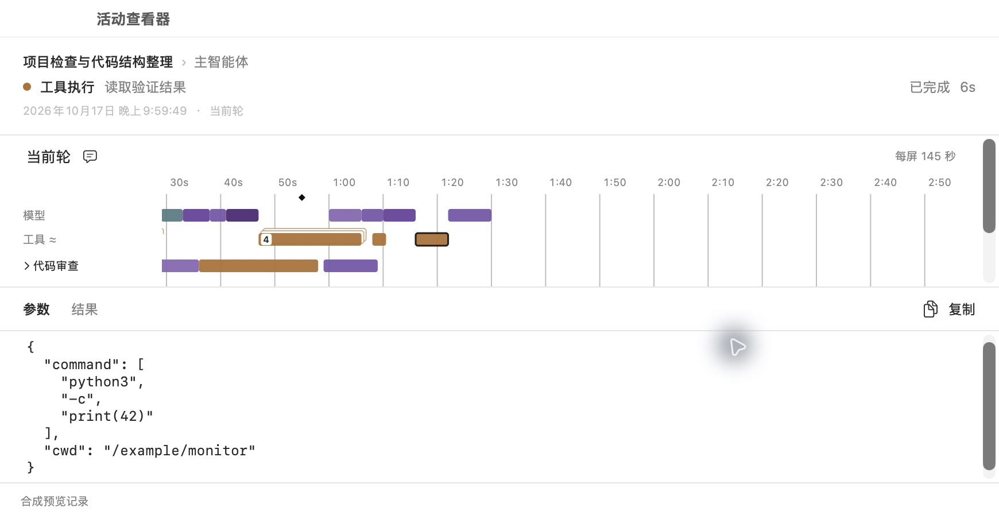
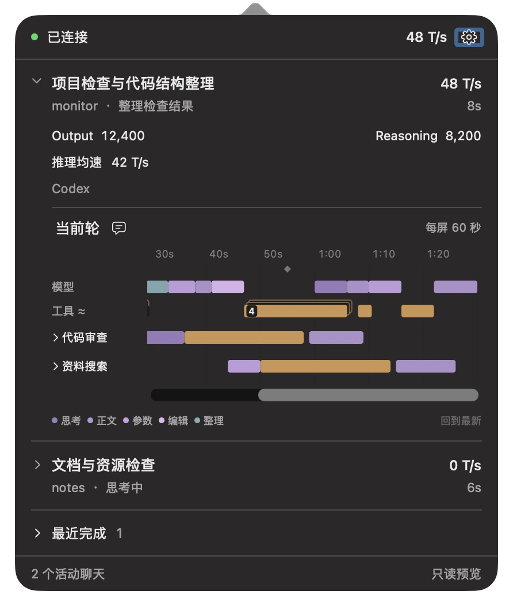

# 活动时间线：固定时间比例

2026-10-19 更新：工具 12 pt 最小宽度、层叠入口及横向覆盖展开已由[来源时间、短线与多工具详情](true-time-tools.md)替代；本文保留旧版证据范围。

日期：2026-10-17。状态：已实现、完成本轮定向检查与原生预览，日常 Monitor 已更新。未提交、未推送。本轮替代[上一版](overlap-layout.md)按轮次跨度和窗口宽度重算比例的行为；叠放／覆盖展开、原始详情及输入标记规则保持。

## 确认后的规则

菜单绘图区参考宽度为 291 pt，扣除左右共 8 pt 余量后对应 60 秒：

```text
固定比例 = (291 − 8) / 60 = 4.716666… pt/s
```

菜单、详情窗口、主／子智能体共用该比例，布局入口不再接受可变比例。轮次从不足一分钟增长到数分钟，或详情窗口变宽／变窄，活动的来源矩形和时间刻度间距均保持不变。

- 菜单一屏最多约 60 秒；不足一分钟留空，不拉伸，超过一分钟横向滚动。
- 详情窗口只增加可见范围。例如可用绘图区为 566 pt 时对应 120 秒；整轮历史和详情可见范围不设一分钟上限。
- 工具最小宽度仍为 12 pt，在所有窗口中均相当于约 2.54 秒。真实耗时仍取来源记录。
- 自动层叠仅适用于工具。思考、正文、参数／编辑生成及上下文整理各自显示，不因最小像素宽或来源时钟边界交叠而收成一组。
- “每屏 N 秒”按实际视口宽度计算，只是可见范围文案，不参与比例或活动几何计算。
- 向前阅读时，调整窗口大小保留左侧时刻；必要时在右侧留白，避免系统为装下全部历史而把视口推回起点。跟随最新时保持右端，不新增自动缩小。

## 改动范围

`TimelineLayout` 集中固定比例；`TimelineStore` 与 `TimelineSurface` 不再从轮次跨度或视口宽度重算比例。窗口大小变化只更新画布容量和滚动位置。视口调整期间不把 AppKit 自动约束产生的偏移误当作用户滚动；用户选择活动时记录当前阅读偏移，详情初次打开沿用该位置。

`TimelinePanelView` 根据实际绘图区宽度更新每屏秒数。查询、事件投影、历史、实时指标和观察管理代码均不在本轮范围；没有新增正文持久化。

## 本轮验证

| 检查 | 结果 |
| --- | --- |
| 固定比例 | 轮次超过一分钟、增长至一小时均不改变比例；同一模型／工具矩形不因历史长度或视口变化而变化。 |
| 菜单容量 | 291 pt 视口对应 60 秒；不足一分钟不拉伸，超过后可滚动。原生 90 秒夹具仍显示“每屏 60 秒”。 |
| 详情容量 | 详情初次打开约每屏 96 秒；实际拖宽至约 145 秒，再缩回 96 秒，同一 6 秒工具和刻度间距不变。 |
| 阅读锚点 | Swift 回归覆盖窗口变宽后全部历史可见时仍保留左侧时刻、展开／收起不抹去该留白，以及跟随模式保持右端；原生拖动对照中左侧始终在约 30 秒处。 |
| 内容与重叠 | 原始命令参数仍可读，叠放入口／选择身份继续保留；叠放、遮挡、缺边界、迟到响应等受影响的既有 Swift 检查通过。 |
| 本机加载 | 正常重开日常 Monitor 后，实际聊天菜单显示“每屏 60 秒”，无自动 120 秒文案和缩放按钮；关闭菜单后采集仍运行。 |

执行 `swift test --disable-sandbox --cache-path .local/swift-cache --package-path macos`，模型 30 项、App 实际执行 22 项通过，共 52 项；原有 WindowServer 独立窗口测试默认跳过，沿用前次窗口生命周期证据。`bin/build-gui --preview`、`bin/build-gui` 构建通过。本轮未修改 Python 产品及测试，不重复其已有效的指标、历史和管理矩阵。

基线、日志和运行元数据在本机忽略目录 `.local/fixed-scale/`。原暂存区保持不变；新增源改动只涉及本轮 GUI／模型布局、对应测试和文档。

## 原生对照

以下均为独立只读 Preview 的手写合成数据，不读取日常历史，不取得观察租约；结束后 Preview 与 fixture writer 均已关闭。截图中的聊天、速度、用量和输出不是实际运行统计。旧截图保留各自所属版本的含义。







## 本机与证据边界

通过正常退出／重开 Monitor 载入新 GUI，没有重启 Codex。构建指纹与当前 Swift 源码及资源匹配：

```text
8c10c67f8cdcd809f3cd8e21adf4f6db4d5bde3be07d045a11e35ff336504028
```

接入身份、配置备份和 Python 源码身份均与重开前一致。关闭菜单后观察仍 active，快照持续更新。当前轮跨越重载，实际聊天的官方用量仍显示 `—`，没有用历史内容补造实时覆盖。

本轮验证限于固定比例及相关布局／阅读状态、本机原生操作与加载；未重跑发行、安装／卸载、Remote 或长期自然使用矩阵，也未为此新开真实并行或压缩任务。

## 后续修正：模型阶段独立展示

此前布局错误地把每一可视行的重叠矩形都收成组。只读检查上一轮记录发现，一段思考持续 46 毫秒，结束 3 毫秒后才开始 992 毫秒的正文输出；两者本来串行，但思考的最小 1 pt 视觉宽度约对应 212 毫秒，因此在像素上重叠。实时来源还可能出现 producer／receipt 边界相差约 22 毫秒的交叠。这些都不能作为模型并行的依据。

修正后，只有工具参与自动层叠；主模型轨、子模型轨及子智能体汇总中的模型阶段均保留独立身份。模糊点击选择矩形中心最近的阶段，直接打开详情，悬停采用相同规则。来源时间和耗时不重写，固定比例、工具最小宽度、展开覆盖和阅读锚点规则保持。

Swift 检查通过：模型 31 项（其中新回归覆盖模型轨与汇总轨两个参数场景），App 实际执行 23 项，共 54 项；原有独立 WindowServer 窗口测试默认跳过。新增覆盖实际遇到的 46 毫秒阶段／3 毫秒间隔、22 毫秒时钟边界交叠、模型直接点击及汇总行只收工具。工具层叠和固定比例既有检查继续通过。

原生只读 Preview 使用合成的 22 毫秒交叠边界，确认模型仍是独立入口，思考／正文分别直接打开对应详情，工具仍向右覆盖展开。以下截图仅含合成内容，不是真实聊天。日志与基线位于本机忽略目录 `.local/model-separation/`。



本机 Monitor 已载入修复构建 `1e01c9adbdcfdd5988978a2bd5b4a82df3340540cbeac45e9c98111856fc774a`，与当前源码指纹一致。通过现有管理接口停止旧观察租约后重开 GUI，没有重启 Codex；最终以不带诊断日志的正常参数运行。采集器和观察租约 active，快照检查时约 0.08 秒。接入身份及原配置备份与前次已验证基线一致；启动按现有逻辑刷新管理记录时间，未要求管理记录字节完全不变。Python 产品源码和原暂存区保持。

本轮原生交互证据来自独立 Preview；日常 App 重载后的验证限于构建身份、进程、观察租约及快照状态，未取得日常菜单的新 AX 验收。既有观测缺口继续按原契约处理，不补造跨重载实时指标。
