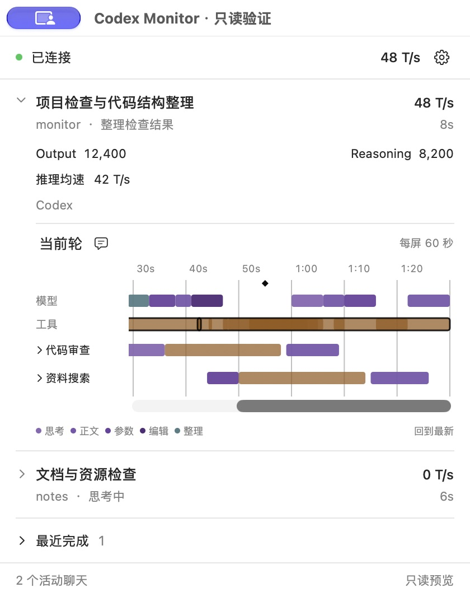
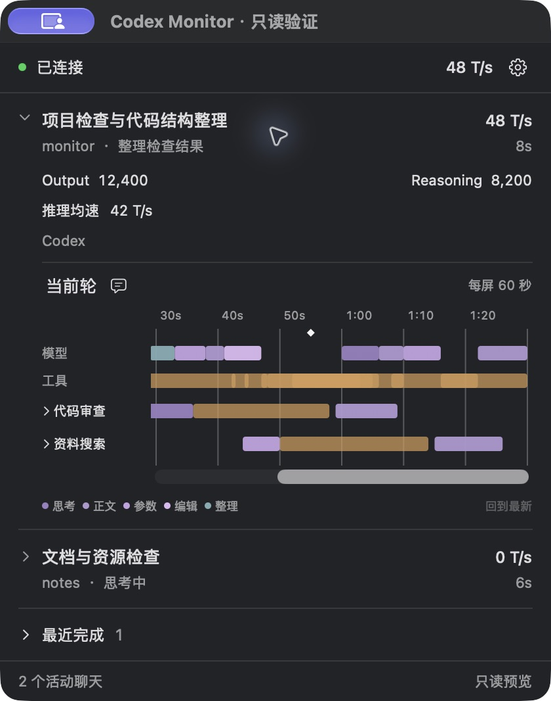
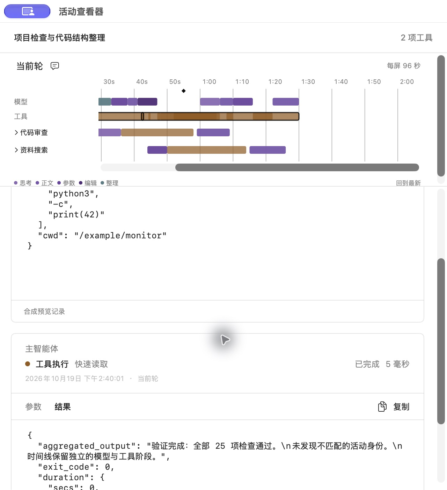
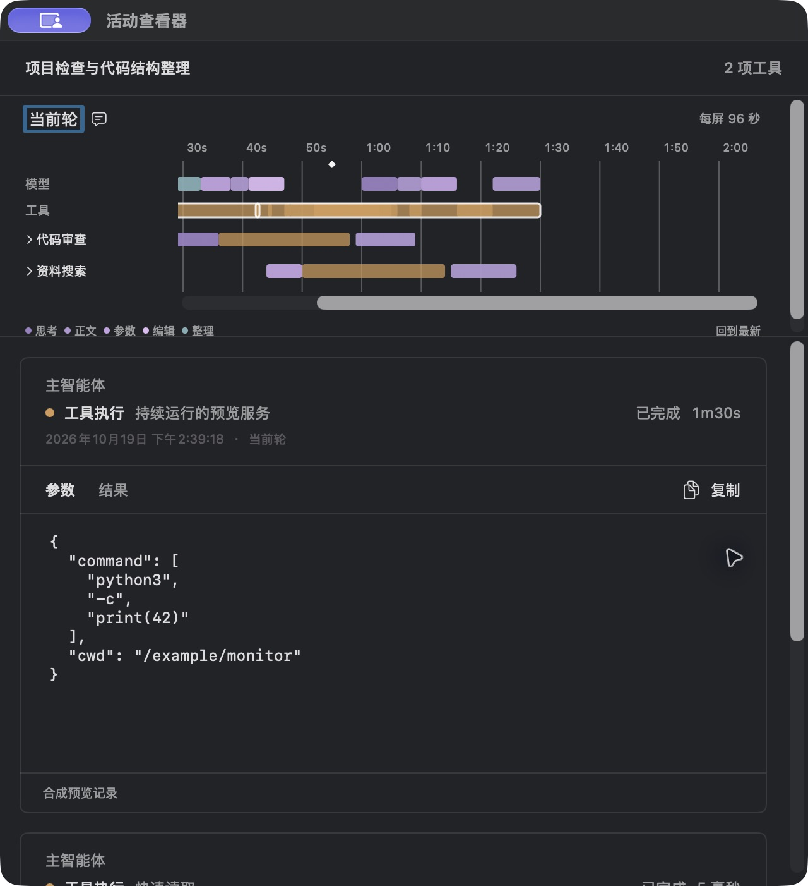

# 工具时间线：来源时间、短线与多工具详情

日期：2026-10-19。状态：已实现，完成定向检查与原生合成预览，日常 Monitor 已更新。提交范围及后续复核见[提交整理](commit-review.md)。本文件替代此前工具 12 pt 最小宽度、间接重叠分组及横向覆盖展开；固定时间比例与来源内容规则继续沿用。

## 最终规则

- 菜单及详情保持 `(291−8)/60 pt/s`，窗口大小只改变可见范围。各工具起点和时长来自来源记录，不水平顺延。
- 极短或缺少时长的工具使用 3 pt 宽、11 pt 高的竖线符号；宽度是可见标记，不折算成持续时间。点击区就是可见符号，不额外增加透明范围。未知耗时仍为未知。
- 长工具按来源区间绘制。重叠处增强同色强度并设上限；不画数量徽标、阴影或整组边框，不按间接交叠形成组。
- 点击实际图形，直接打开详情。工具重叠时，只选择该位置命中的工具，按开始时间排列；一次点击后的成员固定，刷新只更新这些工具的状态和内容。模型阶段保持独立。
- 详情逐项展示工具名称、状态、耗时及各自的原始“参数／结果”，保留分页、空值、来源截断、未落盘和读取失败状态。没有时间线内的展开步骤。
- 不推断并行批次，不加入 100ms、模型输出边界或 Code Mode 父子树等规则。保留来源身份，不改变 Python 投影、历史、采集和用量口径。

## 实施顺序

1. 修改纯布局：3 pt 短线、工具命中等于绘制矩形，删除重叠组和展开几何。
2. 修改原生绘制及鼠标／键盘／AX：局部叠色、直接选择命中集合，删除展开状态和相关 Esc 处理。
3. 选择入口传递阶段数组；详情容器管理独立的每工具状态，复用单工具读取、分页、身份核对和迟到响应防护，复用既有窗口。
4. 增加定向回归，更新合成预览，检查浅／深色、短线点击和多工具详情；构建后载入日常 Monitor，保留接入配置和观察缺口。

## 验收重点

- 长工具横跨多个相互串行短工具：点击一个短工具只选中该短工具及当前位置覆盖的长工具，不返回其他时刻的工具。
- 短线可见且点击命中不超出可见几何；相邻活动不移动，耗时不因符号变宽而变化。
- 重叠颜色只出现在实际图形覆盖的位置，极密区饱和但不扩张时间范围；模型不会重新合组。
- 多工具详情各自加载、失败、分页和刷新，不串台、不丢已加载内容、不因新工具出现改变成员。
- 固定比例、阅读锚点、切轮、窗口复用以及原始内容和指标边界继续有效。

本轮日志和源码／暂存区基线位于本机忽略目录 `.local/true-time/`；仅合成截图可进入文档。以下记录实际结果和未验证范围。

## 实际验证与截图

- Swift 模型 31 项、App 实际执行 24 项通过；独立启用 WindowServer 后，窗口复用与尺寸保持回归 1 项通过，共实际执行并通过 56 项。新增／调整覆盖 40 个串行短工具横跨同一长工具、3 pt 精确命中、模型独立选择、多工具失败隔离／分页保留／迟到响应，以及固定比例和阅读锚点。
- 单层工具采用透明度 0.72，并在浅色使用更深的橙色基色；颜色合成只发生在实际可见矩形交叠处，强度自然饱和。浅／深色合成对比度检查均通过，原生截图验证局部颜色变化。
- 实际鼠标点击 5 毫秒短线，直接打开长工具与该短工具的两项详情；旁边的 10 毫秒工具没有进入选择。第二项可独立切换参数／结果并显示毫秒耗时。再点另一根短线，成员变成“长工具＋另一短工具”，详情滚动回顶部；点只有长工具覆盖的位置恢复单项。没有时间线内展开或候选菜单。
- 多工具详情各卡片拥有独立参数／结果标签、内容滚动、分页和状态，外层可纵向滚动。选择固定后不因新工具出现自动增加成员；已完成且内容可用的工具不重复轮询。
- 本轮没有修改 Python 产品投影、历史读取或指标代码。原暂存区保持不变，源码及私有基线记录位于 `.local/true-time/`。

以下为独立只读 Preview 的手写合成数据，不读取真实聊天、不取得观察租约。旧截图保留所属版本的证据范围。

GUI 构建指纹：`e10bfc5813055b2b20606ba24b8cc61b0e521719020727e24aa5e7f22574b3aa`。浅色交互完成后仅补充了 AX 分区与切换选择时的滚动复位；最终构建在深色预览重验选择切换，核心绘制及浅色配色未改变。

本机通过现有管理接口停止旧观察租约后重开 GUI，没有重启 Codex。最终检查确认采集器及观察租约有效，快照距检查约 0.28 秒，接入身份保持一致，GUI 与源码匹配；日常菜单保持每屏 60 秒，缺少覆盖的用量仍显示未知，所有临时预览及合成数据写入进程已退出。记录见本机 `.local/true-time/runtime-after.json`。跨重载的观测缺口按原契约保留，不借历史回填实时指标。

本轮验证限于所列布局、选择、内容及本机原生行为；没有重跑发行、Remote、安装／卸载或长期自然使用矩阵。颜色强度仅表示可见图形重叠，不是可精读的并发数量；短线是符号，其 3 pt 笔画宽不代表增加耗时。
