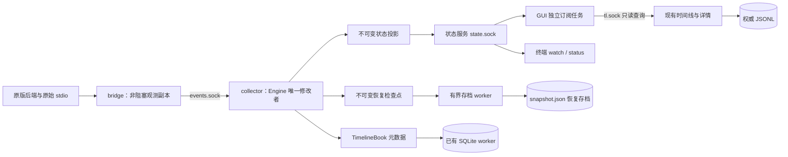

# 六项工程改进的技术设计

状态：目标设计，分阶段实施中。基线 `c3996dc`；产品约束见[范围与决策](requirements-and-decisions.md)，实际实现与验证见[实施记录](implementation-results.md)。尚未验收的协议和组件继续视为目标，不因出现在本文中而成为已有 API。

基线问题描述保留 `c3996dc` 的时间边界；当前代码路径见[已实现架构](implemented-architecture.md)，不能将下文的基线问题理解为尚未修改的现状。

## EH01：实时状态、健康与恢复存档分离

### 基线路径与修改范围

基线 `collector.py` 在事件循环中生成快照并调用 `SnapshotPublisher.publish()`；`DashboardStore` 监听原子文件替换并定时读取。GUI 的 `BackendClient.heartbeat()` 写 observation 文件，collector 的 `observing()` 读取该文件；`bridge.Observer.offer()` 也可能触发文件检查。

因此范围包括 `collector.py`、`runtime.py`、`app_session.py`、`app_control.py`、`bridge.py`、`cli.py`、`display.py`，以及 Swift 的 `DashboardStore`、`BackendClient`、`SnapshotUpdates` 和相关模型。仅增加状态 socket，仍不足以消除这些路径中的磁盘耦合。

### 目标职责与所有权



- Engine、活动生命周期、历史校正仍由 collector 的拥有线程修改。订阅线程、存档线程不得读取可变 Engine 对象。
- 在拥有线程上建立脱离可变对象的状态投影，然后交给发送／序列化 worker。仅复制需要的当前状态，避免为发送复制整个历史索引。
- 实时 DTO 保留现有快照的显示字段和隐私边界；恢复 DTO 另含必要 usage recovery 等恢复字段。完整正文继续从 JSONL／有界 live detail 读取。
- 对外状态、恢复文件、时间线元数据各有版本与职责；恢复存档不是第二份权威聊天历史。
- 保留现有锁序：collector 不在持有 `TimelineBook.lock` 时读历史或等待 provider、socket、磁盘。worker 的 I/O 不持有领域状态锁。

### 状态协议

使用独立 Unix stream socket `state.sock`，首版采用 UTF-8 JSON Lines。有界缓冲按字节分帧，完整一行后才解码 UTF-8；不能把一次 `recv` 当作一条消息。

协议包含 `subscribe`、`hello`、`state`、`heartbeat`、`release`、`error`。订阅分为拥有观察租约的 GUI 与只读订阅者；终端查询和预览不得取得 GUI 的管理权限。订阅和周期心跳携带客户端新 nonce，响应回显；健康续期只接受在本地截止时间内返回的对应响应，不能把积压的旧心跳当成刚产生的健康证据。

一条状态消息的结构示例：

```json
{
  "protocol_version": 1,
  "kind": "state",
  "instance_id": "collector-example",
  "sequence": 42,
  "payload": {
    "schema_version": 1,
    "threads": []
  }
}
```

示例只说明封装，不是完整运行 fixture。

| 字段／规则 | 含义 |
| --- | --- |
| `protocol_version` | 状态传输协议版本；与 Snapshot、detail、usage recovery 版本分开 |
| `instance_id` | 每次 collector 启动的新实例身份，不使用可复用 PID 代替 |
| `sequence` | 同一实例内状态严格递增；客户端拒绝旧状态，重连允许中间序号跳过 |
| 完整 `state` | 接入后首先发送完整状态；后续也发送完整状态，不维护客户端增量补丁账本 |
| `heartbeat` | 响应包含客户端 nonce、实例、最新状态序号、发送前核对的 tick 距今时长及独立存档诊断；不伪造新状态 |
| 时间 | 本地收到消息及超时使用接收方单调时钟；服务端报告相对 tick 年龄，墙钟仅用于来源显示／诊断 |
| 权限 | runtime 目录及 socket 保持私有权限；管理消息核对 observation session 凭据和连接归属，不靠 PID 单独授权 |

服务端只处理本协议定义的状态与租约命令，不提供执行 shell、修改 Codex 对话或转发任意管理命令的接口。控制响应与状态发送共享连接时只能在帧边界调度；超期关闭慢连接，不能通过交错帧来抢发心跳。

### 节流、背压与退出

1. 保留约 250 ms 的内存采样；生命周期／覆盖／菜单模式变化优先发出，纯数值约 1 Hz。
2. 每个读端只有一份正在发送的完整帧和一份可替换的最新待发状态。不能在已发出一半的 JSON 帧中间插入另一帧。
3. 较新状态替换尚未开始发送的旧状态。真实事件仍先由 Engine 处理；合并的是界面刷新，不是输入事件。
4. 慢读端达到写入截止时间或帧上限时关闭该连接；重新连接重新取完整状态。连接数、帧大小和排队字节均有上限。
5. 心跳反映事件循环进展。独立发送 worker 还活着、但 Engine 已停滞时，GUI 仍判定数据不新鲜。
6. GUI 的订阅／心跳任务与 management 查询分开；管理命令变慢不会阻塞实时消息应用。Swift 主 actor 只接收已解码的不可变值，晚到读取继续做实例和代际检查。

起始参数用于原型和故障注入，尚非性能实测结论：

| 参数 | 起始值 | 调整依据 |
| --- | --- | --- |
| 状态采样／数值更新 | 250 ms／1 s | 沿用现有语义，测量投影与 GUI 成本 |
| 心跳／实时陈旧阈值 | 1 s／2 s | P2 实现采用 2 s nonce 截止及 tick 年龄上限；单调时钟验证，包括事件循环停滞 |
| GUI 拥有租约过期 | 5 s | 延续关闭／崩溃后停止 GUI 管理观察的方向 |
| 重连退避 | 100 ms 至 2 s，有界抖动 | 无忙轮询，恢复后立即接收完整状态 |
| 状态连接／单帧上限 | 4 个／8 MiB | 按真实工作集复核；超限明确降级而非静默丢活动 |
| 待发状态 | 每连接 1 份，另有至多 1 个发送中帧 | 同时记录字节峰值；不能只检查队列长度 |
| 恢复存档 | 常规约 10 s；关键终止优先调度；退出最多等 2 s | 测量写盘次数、恢复缺口和退出耗时 |

### 恢复存档

存档 worker 串行处理“一份写入中、一份最新待写”的检查点，承担序列化和原子替换。写入故障累计诊断并有界退避重试；不能把错误重试放回事件循环，也不能无限创建写任务。

检查点记录实例、关联状态序号和保存时钟；旧检查点不覆盖已完成的新检查点。启动时保留现有身份／用量恢复边界，活动连续性和实时速度仍按未知处理。

关闭时停止接收新检查点，给最终保存有界等待；等待结束后进程可退出。生命周期锁保持到进程退出，防止旧 writer 与新 collector 并存。需验证解释器／线程池退出没有隐式无限 join，不能只给 `join()` 加超时就宣称关闭有界。

### 租约与桥接观测热路径

GUI 的已连接租约通过内存消息续期；管理文件保留启用配置和恢复身份，不再承担逐秒实时心跳。GUI 正常退出显式释放所属租约，崩溃由过期处理；旁观订阅者不能延长观察生命周期。

P3 的凭据契约采用版本 2 session grant：随机 `id`、`secret`、已验证的 `owner_pid` 和启用标记。管理操作安装 grant，GUI 在 `subscribe(role=owner)` 提供 `session_id`／`session_secret`，只有所属连接的 heartbeat 能续期；普通 reader 不提供也不能取得该能力。初始连接与断线重连共用 5 s 的有限期限，断线本身不延长期限。正常 `release` 立即撤销，已被替换的连接不能续期或释放新的连接。

当管理操作需要为已运行 collector 安装新 grant 时，使用仅限该职责的 `authorize` 请求，带私有 collector control token、nonce 和 session record；它没有执行其他管理命令的能力。服务端在内存中拒绝不同 GUI 替换仍有效的租约，返回 `authorized` 或结构化失败。session secret 不出现在只读健康／状态中，PID 单独不能授权。凭据文件与内存授权的安装／失败恢复在接入管理流程时一起验收，隔离模型通过不能代替这项集成。

没有 `app-managed` 标记的显式终端 runtime 延续原有用户启动／停止语义；GUI 租约只约束 GUI 管理的观察。只读订阅本身不隐式启用观察或创建 Codex writer。

`events.sock` 的桥接握手需声明观测协议能力。支持新协议的 observer worker 接收 collector 的有期限观察许可，在内存里缓存。握手连接由 worker 主动建立，不依赖先入队一个被许可的事件，避免“没有许可就无法发送握手”的互等。`Observer.offer()` 只检查内存许可／期限并尝试有界入队，不能打开文件、建立连接或等待 socket。许可续期、发现启用配置和重连均在观测 worker 中处理；观察服务断开只影响副本，原始转发继续。

P3 的实际参数是 500 ms 续期、750 ms 请求截止、最多 1500 ms 许可。初次握手在启动原版 child 之前有至多 150 ms 的机会；立即连接失败则提前继续，已有转发泵不等待观察服务。丢失许可期间跳过的 chunk 会使分帧代次前进，即使新许可很快到来，也不能拼接旧半帧。

GUI 连接恢复与 source bridge 恢复分开处理：前者取最新完整状态；后者只有实际丢失源观察时标记 gap。collector 实例改变也不代表能够补回丢失的 token 接收历史。

旧 bridge 代码驻留在 Codex 进程内。新增握手与热路径优化生效，需要在切换阶段完整退出并重开 Codex Desktop；仅重启 collector 不够。迁移期明确识别旧能力并提示应用更新，完整解耦验收使用新版两端；兼容路径的文件依赖不能算入已通过的新链路保证。

### 所有实时读端与兼容

- GUI、终端 `watch`、`watch --once` 和 `status` 都改用状态通道读取实时状态／健康。`collector_alive` 的生命周期锁继续负责拒绝重复启动。
- `Snapshot.isFresh()`／终端 `snapshot_fresh()` 不再被生产 IPC 读端用于推断连接健康；文件预览和离线诊断继续按文件时钟判定。不能简单把旧 `updated_at` 改成当前时间来假造新数据。
- `app_session` 的磁盘读取离开已连接的 collector 热循环。管理状态查询保留在独立、有截止时间的任务中。
- P3 管理状态以 5 s 周期、5 s 截止读取，核实旧驻留 bridge 的登记身份和能力；它既不续期采集，也不承担实时健康。旧 GUI 的 configure／resume 在修改前要求声明状态协议能力。安装 grant 后确认丢失时保留同一凭据重试，不能盲目恢复旧文件；只有确定拒绝才能回退管理记录。
- 新通道完成验收后移除生产 GUI 的 `SnapshotUpdates` 和常规快照轮询。显式 `--snapshot`、只读 fixture、恢复和离线诊断保留。
- `tl.sock` 继续用于只读历史／详情；本项不把所有接口重写成一个通用 RPC 框架。
- 保证范围是已启动连接后的存档阻塞／失败与慢消费者隔离。应用首次启动、socket 创建、读取配置、原始 JSONL 查询仍可能需要文件系统，不承诺整个文件系统失去响应时所有功能可用。

## EH02：统一可取消的子进程执行器

### 接口与所有权

建议新增 Swift `ProcessExecutor` 和可注入的 `ProcessExecuting` 协议，由 `BackendClient` 与 `SystemTimelineClient` 共同使用。调用方提交明确的可执行文件、参数数组、环境、工作目录、deadline、输出预算和取消信号；不经 shell 拼接命令。

返回结构化的退出码、stdout、有限 stderr 尾部和截断标记。错误区分启动失败、超时、主动取消、stdout 超限、非零退出和响应解码失败；展示层使用中英文字段／消息，不依赖 stderr 文案猜测业务状态。

每次调用只有一个生命周期协调者，拥有本次创建的进程及其管道。取消、deadline、正常退出竞争时只能完成一次；结束后撤销 timer、关闭 FD 和释放引用。不能让旧 deadline 再取消下一次调用，也不能让 Task 取消只取消等待者而把真实进程留在后台。

### 执行与终止

1. 启动后并发持续排空 stdout 和 stderr，不能按顺序 `readToEnd()`。
2. stdout 超预算时以 `output_limit` 失败并终止所属任务，不能将半段 JSON 当作有效响应。stderr 使用有界尾部，超限仍继续排空并记录截断。
3. 取消或 deadline 到达时对所属进程发 SIGTERM，宽限期后仍未退出再发 SIGKILL；读端 drain 也有结束期限，后代继承 pipe FD 不能使调用无限等 EOF。
4. 启动适配器验证能否建立本次操作拥有的进程组；需要时采用小范围 POSIX 启动适配，不以进程名称或临时父子快照杀一整棵树。
5. 进程组终止仅作用于可证明由本次执行器创建的组；显式脱离组的后代不在组终止保证内，单独记录与处理。Codex Desktop／其原版后端不属于这些短命 CLI 调用的所有权范围。
6. 调用方仍做选择代际、内容身份和实例检查；真实进程取消不能替代防止旧结果覆盖新选择。

起始操作策略：查询沿用 12 s 截止时间，管理命令先取 30 s；终止宽限和 pipe drain 各 500 ms。stdout 查询 8 MiB、管理响应 1 MiB，stderr 尾部 256 KiB。以上值在 P1 用实际响应大小复核；等待用户／依赖退出的管理流程应返回结构化 waiting 状态，不把无限等待藏在子进程中。

管理命令可能已经改变配置或创建 collector，取消等待不等于撤销这些副作用。调用方对取消／超时后的管理状态重新查询并走既有恢复流程，再允许依赖它的新操作；不自动回滚用户之后的配置。AppController 按管理协议创建的独立 collector 有自己的生命周期和锁，不因执行器清理短命 CLI 就被当作泄漏后代误杀。相关状态收敛纳入 P1，而不只测试只读查询。

## EH03：跨进程稳定的分页内容版本

### 版本对象

基线 `ActivityDetail` 已检查完整身份，`appendingPage()` 已检查 section 和 offset；新增的是同一次阅读的内容版本，而不是替换这些检查。

采用每个 section 一个阅读快照 token，包含 token 版本、完整活动／section 身份、来源类别、`snapshot_chars` 和内容摘要。摘要采用 SHA-256：身份、来源、section format、完整性／截断语义和长度组成确定排序的 UTF-8 JSON 元数据，随后加分隔字节及原始文本前缀的 UTF-8 字节。保留源换行和 Unicode，不做 NFC／换行归一化；不包括本地化标题、provider UUID 或整个 JSONL 的 mtime。token 是有界、不可信输入，不能提供任意文件路径或绕过请求身份校验。

第一页在同一份已渲染、不可变内容上计算摘要和切页。后续请求重新验证源身份、渲染该 section，核对截至 `snapshot_chars` 的内容摘要，然后只在该阅读快照的范围内返回页。

| 来源变化 | token 行为 |
| --- | --- |
| 新 provider／新的 CLI 进程 | 内容相同则继续有效 |
| 无关活动追加到 JSONL | 当前 section 不变则继续有效 |
| 当前 section 只在尾部追加 | 前缀及来源／格式／完整性语义不变时可读完固定旧长度的快照；刷新后再取得新内容 |
| 已读或尚未读范围内的内容被改写／截短 | `content_changed`，不拼接旧页 |
| live 补充交接为 JSONL | 来源类别变更，要求重新加载，即使文本前缀相同也不静默混合来源 |
| 文件暂时不可读／内容未保留 | 明确 unavailable／not_retained，保留已读内容；不声称版本仍有效 |

相同身份、相同来源类别且内容完全相同的文件替换可接受；inode 只用于读取安全检查，不独自定义内容版本。读取引用时使用同一文件句柄验证记录身份及读取前后来源状态，变化时有界重试或返回来源变化；摘要和页文本不能来自两次不一致的读取。

### 协议与客户端

详情协议升级为 `version=2`，section 包含版本化 `page_token`、`offset`、`total_chars`、`next_offset`。后续页请求必须带原 token 和服务器返回的 offset；`total_chars` 在一次阅读快照内固定。token 与请求 section 不匹配、长度越界或 digest 无效时拒绝，不能退回无版本拼接。

新 GUI 可展示 v1 的第一页用于旧 fixture／明确兼容，但安全的“加载更多”要求 v2；旧 GUI 遇到 v2 按已有版本检查拒绝。发布时 GUI 和 collector 一起更新，并验证旧端组合的明确降级。Snapshot／timeline 协议不因详情升级而一同改号。

两个查看入口继续共用 `ActivityContent.swift` 的校验／拼接规则。版本变化时保留已读文本与滚动位置，标明内容已变化并提供重新加载；新请求代际使旧分页成功、失败和 defer 都无法污染新阅读状态。

哈希以所选 section／引用记录为边界，不扫描整个聊天；大内容摘要计算与缓存按 EH04 测量。每次只保留有界的所选内容，校验 token 的长度上限，避免恶意长度制造无限读取。Python code point 偏移继续由服务器提供，Swift 不从字符数推算游标。

建议落点：`history.py` 的引用读取和 section 投影、`timeline_query.py` 的请求／响应契约、Swift `TimelineReading`、`ActivityContent` 及两个加载入口。新增类型随 EH05 进入边界。

## EH04：长期规模、身份回收与资源预算

### 先量清楚的成本

现有桥接队列、未关联队列、缺失缓存和 provider 数量已有部分上限；它们不能约束一个巨大 rollout 内的全部索引，也不能直接代表所有计数 Future 持有的文本字节。测量按组件拆开：

| 组件 | 测量项 | 优先改进方向 |
| --- | --- | --- |
| `RolloutIndex`／`HistoryProvider` | 单个索引的 refs/phases/turns/outputs 条目、估算字节、源扫描量、冷／热查询峰值 | 所选 turn 的脱离视图、按需内容、按权重淘汰、必要时分段 offset 索引 |
| Engine 身份与活动 | active、terminal、pending、冲突身份及关联账本的数量与保留时长 | 活跃工作保护、终止身份压缩、有证据的回收和有界准入 |
| `TokenCounter` | 工作中／排队任务数、文本字节、过时 revision、排队时长、计数耗时 | 全局任务／字节预算，每流合并最新 revision，结束流优先完成和释放 |
| 状态投影与发送 | 投影／深复制／序列化时间，payload 大小，连接待发字节 | 有界不可变投影，共享编码结果，慢消费者断开 |
| Swift 模型与 GUI | 解码峰值、分组次数／耗时、主 actor 占用、重绘延迟 | EH06 的单快照投影和按代际应用 |
| 存储／查询 | 元数据增长、恢复写盘次数、查询排队、分页摘要成本 | 后台批次、复用可靠索引、查询／token 预算 |

线程中的 JSON 序列化、深复制和分词仍可能争用 CPU／GIL。把 I/O 移到线程不代表这些 CPU 成本已经隔离；测量超预算时先约束投影和复制，再评估小范围独立 worker，记录实测取舍。

### 测量工作集与预算产物

使用可复现的合成 JSONL／事件生成器，参数包含聊天数、每个 rollout 的行数／字节、同时活动流数、事件速率、输出长度、重连和迟到比例。保留随机种子和生成配置，不提交真实会话正文。

起始测量档位：单聊天约 1 万行；10 个聊天、每个约 10 万行；50 个聊天、其中一个约 100 万行。事件速率分 10／100／1000 条每秒，按 1／10／50 个并行流测试。这些是压力档位，不是当前产品支持承诺；生成器同时记录真实字节，不能把行数当作唯一规模指标。

结果形成 `resource-budgets.md`：逐项给出硬上限、软目标、计量单位、当前占用、淘汰规则、降级状态、验证场景和选值依据。该文件在 P5 有测量后创建；本设计不预填“已经满足”的内存数字。

### P5 测量后的索引粒度修订

首轮测量发现完整索引超过 64 MiB 后会反复重建；后续 50 个源轮转访问又暴露源目录挤出所选 turn 的问题。当前实现按以下职责收敛，测量见[资源预算](resource-budgets.md#较大索引与缓存边界新增证据)：

- `history_index.py` 的共享扫描器只处理来源校验、增量读取和行语义。`HistoryDirectory` 保存 turn 范围、关系、活跃项和紧凑 phase ID／标志目录；`RolloutIndex` 保存阅读选择的 phase／内容引用，`HistoryFacts` 只保留校正请求的 phase 元数据。完成项正文始终留在 JSONL。
- 每个范围保存固定大小的行摘要链和显式归属 context；读取所选 turn 时验证范围、session header、文件身份与前后 stamp。追加后即使旧范围被同长度改写，也不能沿用旧完成事实。
- `HistoryProvider` 统一拥有 64 MiB 权重预算；源目录可先淘汰，turn／窄事实／单项详情／时间线选择合计最多 1,024 份。目录被淘汰后，只要选择的文件 stamp／generation 相同并通过一次源句柄校验，就可独立复用。新内容和源变化仍走重新校验。
- 详情、完整时间线及历史校正使用同一 provider。完整索引入口保留作诊断／语义对照，生产查询不再通过它间接重建全部 phase。
- `history_content.py` 只渲染源内容，`history_read.py` 负责一致引用读取；两者均不引用 Engine。

### 单项详情的读取方案（已实现）

完整阅读 turn 视图与单项详情分别缓存。单项详情仅保留目标 phase、明确 `call_id` 关联的 canonical／raw 元数据和输出引用，避免点击一项活动就构造整个巨大 turn。索引中的内容引用继续由 `HistoryRead` 验证，body／分页版本契约不变。

第一遍验证该 turn 的来源范围并投影目标。若它依赖 raw 调用输出或协作调用证据，再按已确定的显式 ID 做一遍有界元数据投影，使位于目标之前的输出和原始调用也能找到；不按记录邻近或名称猜关联。相关关系从同一个已验证目录按 turn／call 过滤。缺少来源记录时，只用当前 observed phase 的显式字段确定读取范围，不把它当作历史内容。

缓存键包含 scope/thread/turn/phase，live hint 仅在关联身份字段改变时失效；源 stamp／generation 改变仍重新验证。普通正文项只需一遍，热分页继续仅验证源句柄并读取目标引用。完整时间线全量选择的峰值不由这项优化自动消除，另行验收。

### 查询响应预算与离线边界（已实现）

沿用现有 GUI 查询 stdout 的 8 MiB 上限，将 `tl.sock`、CLI 和 Swift 的响应预算统一。编码器先在有限缓冲中完成一条 UTF-8 JSON Line；超限返回明确 `query_too_large`，不向客户端写半段 JSON。CLI 使用同一紧凑编码，避免 framing 额外空格把合法 socket 结果再次推过 stdout 上限。

已连接服务的超大、截短或无效响应都明确失败，不再因此启动第二次全量离线读取。只有连接未建立且生命周期锁证明没有 collector 拥有者时才走离线入口；连接失败但拥有者仍在时显示不可用。Swift 解析结构化查询错误，保留既有阅读状态。

完整时间线使用 `HistoryMetadata`，扫描同样的已验证 turn 范围，只构造展示元数据，不缓存正文／输出引用；关系仍来自同一目录的明确协议边。所有 phase 都继续参与原有成员、排序与展示规则。完整选择依然是线性成本，8 MiB 只限制响应缓冲，不是临时对象或 RSS 上限。48,000 phase 的旧响应本就超出 GUI 上限，当前明确拒绝该帧；若以后扩展这种整帧的阅读能力，应另行设计时间线分页，不能靠增大管道预算掩盖成本。单项详情的读取与此分开。

这收紧的是资源和错误边界，不静默截断活动，不扩大或缩短现有单次读取支持范围。超出原 8 MiB 整段传输能力的完整时间线明确报错，单项详情按上述独立路径读取；若未来需要扩大这种整段浏览能力，应单独设计分页协议，不通过放大缓冲规避。

### 后台校正和分词边界

`HistoryRefresh` 已移到 `history_refresh.py`。不可变 `HistorySelection` 携带 scope/thread/turn、紧急程度及明确的 `(turn_id, item_id)` 集合；`HistoryPacket` 在 worker 内编码为不可变字节，事件循环只解码本次预算允许的批次。请求全局 1 MiB、单个 64 KiB，结果全局 32 MiB、单个及每次 drain 8 MiB，另有 128 条上限。过载轮转重试，单项过大产生 `history_unavailable/history_budget`，不携带 revision 或完整成员声明，不能据此撤销已读取的历史。`reconciliation.py` 只在拥有线程上应用事实。

校正不再构造整个 turn 的展示索引。Engine 收集自身活动与保留的 TimelineBook item，worker 使用 `HistoryFacts` 只投影这些 item 的实际 namespace，以及按原插入顺序选出的最近 20 个终止活动。目录以 16 字节 phase ID 和具名标志保留这项选择所需的最小元数据；晚到／重复记录的 terminal 和 item type 规则与完整解析器逐项比较。

摘要的 `phase_selection` 明确列出允许进行缺失判定的 item；`requested_turns` 仍表示完整 turn 元数据范围。Engine 和 TimelineBook 的历史撤销、模型补充退役都使用该范围，未请求项不作为删除。来源范围摘要和前后文件身份仍完整验证，选中的事实仍合并其在当前 JSONL 中的全部记录。不同窄结果依次到达时，每项直接采用当前源投影，不能因为其他项先更新了全局 generation 就借回旧源起止时间。`items=None` 的完整元数据入口保留作诊断／对照，生产校正始终提供明确 item 集合。

实测 1 MiB 连续空格会触发 PyO3 `PanicException`，8 MiB 重复 ASCII 的分词子进程高水位约 537 MB。当前分词准入因此收紧到单次 1 MiB、全局两个任务／2 MiB 输入；更长前缀的接收速度未知，官方 usage 和 JSONL 阅读范围不变。

生产 `TokenCounter` 复用一个 `spawn` 子进程，只有正文和 encoding 进入该进程。请求管道、分词及响应接收受 3 s deadline 控制，超时只终止所属子进程；关闭时取消排队工作并中断正在计算的 worker。原生 panic／崩溃是计数失败，清理失效缓冲并保持未知；后续其他流可重建 worker。有限退出不再依赖 Python 线程等待一个无法中断的 native BPE。队列等待与单次执行期限分别记录，3 s 不是速度显示延迟承诺，也不是全部 RSS 的硬上限。

### 身份不能按普通缓存处理

已完成身份既用于去重，也用于阻止晚到事件重新打开活动。先回收正文、显示派生值及可从 JSONL 重建的索引，终止证据与活动状态分开管理。

终止身份回收前，必须明确可验证的后续处理：失效 backend 实例拒绝旧实例事件；缺少当前轮次归属的孤立 delta／completion 保持未关联或未知，不直接建立活跃工作；必要的终止证据可按元数据索引查询，不能通过保存正文解决。

如果无法在预算内安全回收，进入明确的准入降级并保持未知，等待可验证的新基线或历史校正。不能仅凭 TTL、UUID 大小或时间邻近推断工作是新的。压缩 tombstone／后端边界的具体实现，要先通过“超预算回收后再次收到旧 item”反例，再接入。

### 分词与索引的准入

- 全局计数任务上限与其持有文本的字节预算同时检查；一个 stream 最多保留一个运行任务和一个可合并的最新待算版本，过时结果仍做 revision 校验。
- 计算排队过久或文本因预算未保留时明确显示计数状态／未知速度，不能把旧计数当作新一轮接收速度；官方 usage 不受这项近似策略替代。
- 优先只复制请求 turn／section 所需索引记录，避免每次详情查询 deep-copy 全 rollout；缓存淘汰后按需从权威 JSONL 重建。
- 若测量要求落盘 offset／终止索引，它仍是可失效的派生元数据；校验 scope/thread/源身份，源变化即失效，不变成第二份聊天历史。
- 性能优化默认维持可查看历史范围。若必须改变范围或交互，按决策文档提交有数据支持的选项。

## EH05：边界类型与领域职责

### 类型布局

| 边界 | 建议类型与职责 | 所有者 |
| --- | --- | --- |
| 协议入口 | 已验证的请求／事件 DTO；字段、枚举和单位在解析处收敛 | Python intake／query／IPC adapter |
| 作用域身份 | 不可变 `ThreadKey`、`TurnKey`、`PhaseKey`、`StreamKey` 等小值对象，区分 backend 与 persistent scope | 领域与读接口共享含义 |
| 领域状态 | 现有 Activity／Thread 保持状态所有权；终止、未知、历史来源有明确字段 | Engine 拥有线程 |
| 跨线程工作 | 不可变状态、恢复检查点、历史摘要、计数请求／结果 | 发送方创建，接收方只读 |
| 持久化 | 明确版本与 allowlist 的元数据 DTO，拒绝新增正文穿透 | storage adapter |
| Swift I/O | Codable 请求／响应与 `ProcessExecuting`、`StateSubscribing`、`TimelineReading` | I/O 实现，注入测试替身 |
| Swift 展示 | `SnapshotProjection`、连接健康和阅读状态 | store／model；UI 不解析原始协议 |

Python 优先使用 `TypedDict` 描述 wire 形状、解析函数做运行时校验、不可变 dataclass 表示内部值；不是把一个 `dict` 换成另一个没有边界校验的类型注解。Swift 用已有 Codable／Sendable 风格。两个语言通过共享合成契约样本验证字段、单位、缺失值和错误，不引入全仓代码生成框架。

### 逐步收敛

EH01 的状态／租约类型与 EH03 的分页类型随各自功能一起落地。P7 再梳理剩余查询、存储和 Engine 协作，只有存在独立规则、清晰输入输出且可验证时才拆模块。

保留已经完成的 `state.py`／`reconciliation.py` 边界；P0 先按 JSONL 权威规则收敛历史与实时交接，再决定删除哪些 basis、fallback 和重复状态。不能同时大规模重写状态机与搬文件，使真实行为变化难以审查。

每种时间明确标注 source wall ms、观察单调时钟或相对 duration；offset 明确 code point，容量明确字节。未知、空文本、零用量和来源未保留分别建模。兼容旧 sidecar／旧快照只在解码适配层处理，内部业务不反复猜旧字段。

完成以贡献者能追踪“输入 → 所有者 → 终止／失效 → 展示”为准，结合行为回归和导入依赖检查；不以拆出多少文件或减少多少行数为准。

## EH06：每个状态版本共享 GUI 投影

### 当前成本与目标

`MonitorModel/Snapshot.swift` 的 `grouped`、`parentMap` 和 `belongs` 会由多个 getter／视图重复调用。先在 P5 记录实际调用次数、祖先遍历和主 actor 时间，再决定 P6 需要的缓存层级。

建议在接受一张不可变 Snapshot 后构造 `SnapshotProjection`，一次建立：

- 按 `Chat.id` 的 scoped identity 索引；不能用裸 thread ID 跨 home 合并。
- 显式且验证过的 parent/children 邻接关系，统一隔离冲突、跨 scope 和循环。
- members、roots、unassigned、可见祖先上下文，以及每个 root 的活跃状态和最近进展。
- 供多处视图复用的 active/recent 行序；选中聊天和展开／阅读状态继续由 store 管理。

按一张图完成的遍历求祖先归属与汇总，目标结构成本接近 `O(V+E)`，排序另计；不能通过缓存所有两两祖先组合引入新的平方级内存。

### 缓存失效与异步应用

缓存按 collector 实例和已接受状态序号绑定。文件 fixture 使用本地读取代次；heartbeat 只更新健康时不重复构造层级。若投影放到主 actor 外，结果应用前再次核对代际，旧任务不得覆盖新状态。

结构性分组与语言／年龄展示分开。语言切换重算显示文本而不改变身份；最近列表到期、freshness 和年龄边界由明确时钟更新处理，不能因为没有新状态让旧行永久留在 recent 中。

保留 `ephemeral=true` 排除、真实子智能体归属、未知父身份、隐藏祖先上下文和现有优先排序。输入 schema、图错误与缺失值保持保守显示，不用“看起来像子智能体”的名称补边。

`DashboardStore` 与各行共享同一投影。模型层不持有 NSView、窗口或 store 的可变引用；独立 Activity Viewer 的选择和内容加载继续遵守原契约。

P6 验收同时比较分组行为与计算成本。若实测成本很低，可只消除已经重复的共同计算；额外缓存、后台任务和框架必须有对应测量收益。
