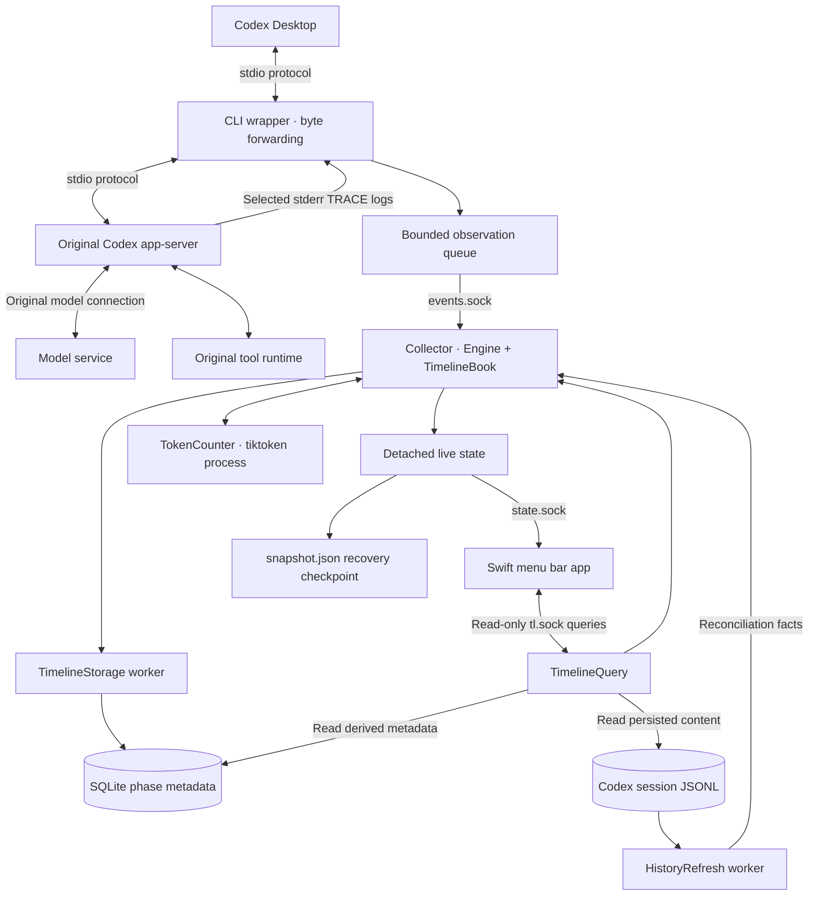
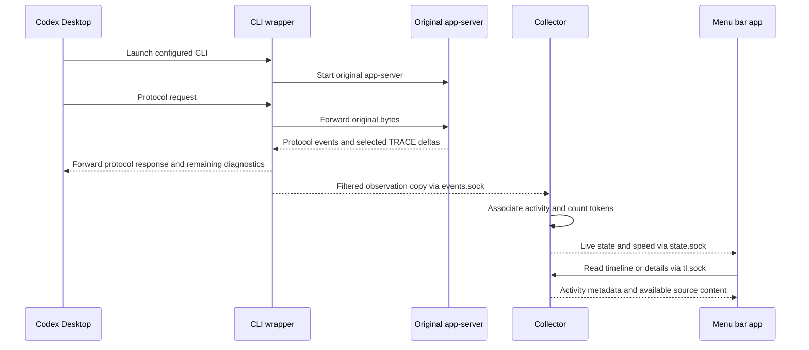

# Architecture and configuration boundaries

[README](../README.md) · [User guide](user-guide.md) · [Engineering record](../dev-history/18_engineering_hardening/implemented-architecture.md)

Codex Activity Monitor has three main components: a CLI wrapper, a Python collector, and a native Swift menu bar app.

## Local observation

The wrapper starts the original backend, forwards its standard input and output, and enables selected backend TRACE logs for streaming text and tool-input deltas. Protocol lifecycle events identify chats, turns, and activities. An independent, bounded observation path copies both sources to the collector. It is designed to avoid making normal byte forwarding wait for observation parsing or socket delivery; incomplete observation is represented as a gap.

The Python collector owns activity identity, lifecycle, local tokenization, and state aggregation. The GUI subscribes to full state and health through a local Unix socket. Its management commands run separately from the state subscription. Timeline and detail queries use a separate read-only endpoint; they do not start a second session-history writer.

## Data and measurement

| Source | Purpose | Boundary |
| --- | --- | --- |
| Live protocol and selected stderr TRACE events | Current activity, tool lifecycle, token generation speed | Version-dependent; not a public Codex compatibility contract |
| Codex session JSONL | Persisted content and historical reconciliation | Read only; remains owned by Codex |
| Monitor SQLite sidecar | Derived phase metadata and timeline recovery | Disposable derived data; not a second full transcript |
| Monitor checkpoint | Recover limited state after restart | Not a live health signal or proof that old activity is still running |
| Local tokenizer | Count received text and tool input in a fixed one-second window | Does not include hidden reasoning |

The interface preserves unknown values and known zeros separately. Timeline placement follows source timing where available, with uncertainty retained. A displayed reasoning duration describes an observed activity lifecycle; it does not establish how long a server spent computing.

The app can read selected content from Codex history and use transient text for live details and tokenization. Derived state can include chat titles, paths, command previews, and metrics. These files can contain private information.

## Integration changes

Configuration saves the previous macOS GUI-session environment and installs a launcher under the app's data directory. The current integration sets these variables:

| Variable | Configured value | Purpose |
| --- | --- | --- |
| `CODEX_CLI_PATH` | Monitor-owned `codex-observed` launcher | Select the wrapper for local CLI launches |
| `CODEX_APP_SERVER_FORCE_CLI` | `0` | Avoid forcing an additional local backend for other hosts |
| `CODEX_APP_SERVER_USE_LOCAL_DAEMON` | `0` | Select the local CLI route used by this integration |
| `CODEX_APP_SERVER_WS_URL` | Empty string | Clear an alternate WebSocket route for this integration |

These controls describe the currently implemented integration, not stable upstream APIs. Already running processes retain their inherited values; a full Desktop restart is needed after changes. The app also manages its collector and a macOS login item. It does not rewrite the original Codex executable.

Restoration compares current values with the values installed by the monitor. Values still owned by the integration are restored to their saved originals, including the distinction between unset and empty; later user changes are kept. Repeated configuration retains the outstanding original backup for values still owned by Monitor. If the user explicitly reapplies integration after an external change, that later value becomes the restoration target for the changed key.

Quitting the monitor stops GUI-managed observation but leaves configuration enabled. Restoring disables integration and remains disabled across subsequent monitor launches. Uninstall adds owned-data cleanup and login-item removal; the user deletes the app bundle after cleanup finishes.

## Settings and diagnostics

The menu bar overview and the independent AppKit Settings window share one `DashboardStore`, management client, and observation session. Opening or closing Settings does not configure integration or acquire another lease. The native SwiftUI sidebar contains General, Runtime Status, and Logs. The existing `NSPopover` supplies the overview background without an explicit material override; the deployment target remains macOS 14.

Integration status separates configuration, operation, runtime evidence, and restart requirements. A deterministic configuration revision identifies managed values, executable locations, and relevant implementation identity. The launcher fixes that revision and an expected environment fingerprint at launch. A bridge reports its inherited configuration evidence; it does not adopt a newer receipt while running. The UI claims activation only with fresh matching live bridge evidence. Unknown or older evidence remains explicit, including mixed active and restart-required connections.

The collector publishes an optional versioned health summary from component facts. Current errors, pending-work deadlines, and recovery evidence are separate from historical counters. The GUI independently evaluates connection freshness, management failures, its own log writer, and the previous end marker. These checks describe observed failures and unknowns; they cannot detect every logic error or diagnose a stopped GUI from within that process.

Structured diagnostic JSONL has independent `gui`, `management`, `collector`, and `bridge` streams under `data_root/diagnostics/`. Writers use bounded queues, background filesystem work, nonblocking role locks, rotation, and retention. A separate Swift actor reads bounded log windows directly from disk, so viewing logs does not require a working collector. Raw collector output is captured through an independently drained nonblocking pipe and has its own bounded compatibility files. Ordinary restoration keeps structured logs; purge removes only explicitly owned files. See the [implementation and validation record](../dev-history/23_settings_and_diagnostics/implementation-results.md) for limits and test scope.

## Source map

- `src/codex_activity_monitor/`: wrapper, collector, management, history queries, tokenization, and terminal UI.
- `macos/Sources/MonitorApp/`: native menu bar, overview, activity viewer, and backend clients.
- `macos/Sources/MonitorModel/`: decoded models, timeline layout, metrics, and localized presentation.
- `bin/` and `packaging/`: source and standalone build entry points.

See [CONTRIBUTING.md](../CONTRIBUTING.md) to build, test, and contribute changes. Detailed component ownership is documented in the [engineering architecture](../dev-history/18_engineering_hardening/implemented-architecture.md).
